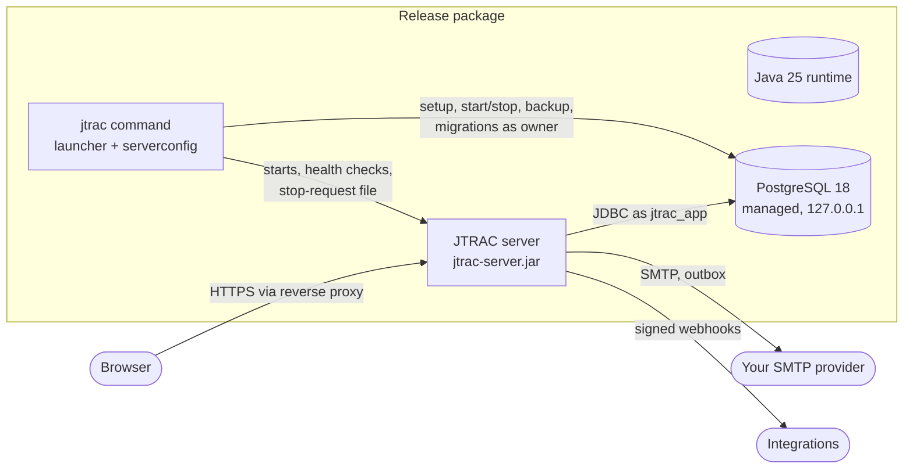
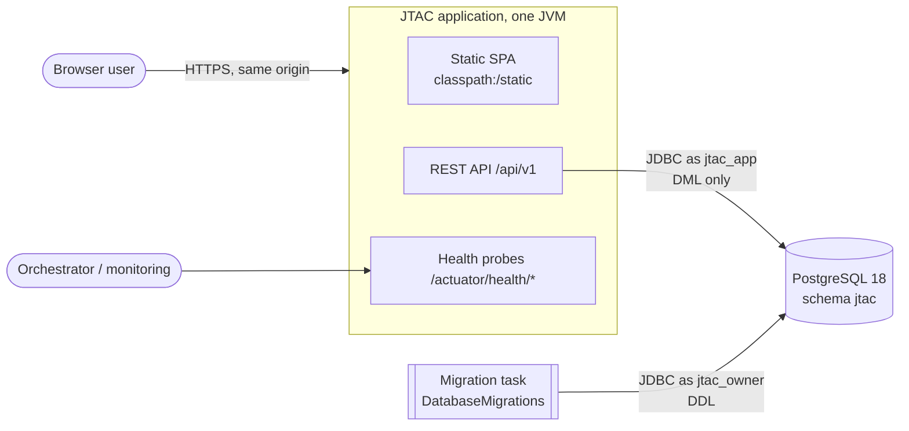

<div align="center">

<picture>
  <source media="(prefers-color-scheme: dark)" srcset="docs/assets/jtrac-logo-dark.svg">
  <source media="(prefers-color-scheme: light)" srcset="docs/assets/jtrac-logo-light.svg">
  
</picture>

# JTrac

### What if JTrac had been born today?

**An unofficial, imagined reboot of the classic JTrac issue tracker: what it could look like in the modern era.**

This project imagines how JTrac might look and work if it were designed today. The last public JTrac
binary (2.3.3) was studied with the **REA MCP** reverse-engineering server, and the idea was rebuilt from
scratch on **Java 25, Spring Boot 4, React 19 and PostgreSQL 18**, shipped as a self-contained server
package with a guided setup wizard.

[](https://github.com/Jerophin123/JTrac/actions/workflows/ci.yml)
[](LICENSE)


[Quick start](#quick-start) · [Features](#features) · [Install](#installation) · [API reference](#api-reference) ·
[Security](#security) · [Terms & Conditions](#terms-and-conditions) · [License](#license)

</div>

> [!IMPORTANT]
> **This is not an official JTrac release.** It is an independent, unofficial reimagining: a "what if"
> of how JTrac could look in the modern era. It is not affiliated with, endorsed by or maintained by the
> original JTrac project or its authors, and it contains none of the original's source code, database
> schema or templates. The JTrac name is used only to credit the tracker that inspired it. Looking for
> the original? See the [JTrac project on SourceForge](https://sourceforge.net/projects/j-trac/).

---

> **Imagine the tracker you loved in 2008, reborn for 2026.**
> Same soul: workflows, custom fields and `KEY-42` issues. New everything else: a fast React UI,
> one-command installs, a real REST API and security you can explain to an auditor.

**Why people stop scrolling here:**

- **Five minutes, zero dependencies.** One download and one `setup` command. Java and PostgreSQL are
  already inside: no JDK, no Node.js, no DBA.
- **Your data never leaves your server.** No telemetry, no trackers, no per-seat SaaS bill.
- **Workflow power without the bloat.** A visual workflow editor, role-based transitions and per-status
  field rules, all enforced on the server.
- **Built for people who integrate.** 140 REST operations, an OpenAPI 3 contract, API tokens and
  HMAC-signed webhooks.
- **Tested where you run it.** Every 3.0.0 package passed 36 installer checks natively on Windows,
  Linux (x64 and ARM64) and macOS (Intel and Apple Silicon).
- **Secure by default.** Argon2id passwords, CSRF protection, a strict CSP, least-privilege database
  roles and owner-only secret files.
- **Privacy built in.** Terms, Privacy and Grievance pages aligned with India's DPDP Act, with recorded
  consent and a personal data download.
- **Free, open and yours.** Apache License 2.0, standard PostgreSQL and a documented schema: no lock-in.

> **Your team's work deserves better than a spreadsheet, and better than renting it back from a SaaS vendor.**
> This reimagined JTrac gives you boards, workflows, custom fields, dashboards and a real REST API on your
> own server, installed with one command. It takes about five minutes.
> Curious how a classic would feel if it were built today? Keep reading: the first issue is closer than you think.

## Contents

- [Why JTrac](#why-jtrac)
- [Reverse-engineered with REA MCP, rebuilt to be modern](#reverse-engineered-with-rea-mcp-rebuilt-to-be-modern)
- [Features](#features)
- [Quick start](#quick-start)
- [Platform support](#platform-support)
- [Installation](#installation)
- [Setup wizard](#setup-wizard)
- [Outgoing email (SMTP)](#outgoing-email-smtp)
- [Configuration reference](#configuration-reference)
- [Web UI tour](#web-ui-tour)
- [Command-line reference](#command-line-reference)
- [Architecture](#architecture)
- [Security](#security)
- [Privacy and DPDP compliance](#privacy-and-dpdp-compliance)
- [API reference](#api-reference)
- [Database and migrations](#database-and-migrations)
- [Backup and restore](#backup-and-restore)
- [Upgrades](#upgrades)
- [Troubleshooting](#troubleshooting)
- [Development](#development)
- [Testing and quality](#testing-and-quality)
- [Build and release](#build-and-release)
- [Architecture decision records](#architecture-decision-records)
- [Dependencies](#dependencies)
- [Third-party licenses](#third-party-licenses)
- [Roadmap and known limitations](#roadmap-and-known-limitations)
- [FAQ](#faq)
- [Glossary](#glossary)
- [Contributing and community](#contributing-and-community)
- [Terms and Conditions](#terms-and-conditions)
- [Acknowledgements](#acknowledgements)
- [License](#license)

> ➜ *Start with [Why JTrac](#why-jtrac) if you're evaluating, or jump to [Quick start](#quick-start) if you're installing.*

## Why JTrac

> **Every team tracks work. Most of them pay for it twice: once in money, and again in lost control over their own data.**

JTrac exists for teams that want a capable tracker **without** handing their roadmap, their customers'
names and their incident history to someone else's cloud.

| You want | JTrac gives you |
|---|---|
| Your data on your hardware | A self-hosted server; nothing ever "phones home" (no telemetry, no trackers) |
| Setup in minutes, not days | One package per OS with Java and PostgreSQL bundled, and a 13-step setup wizard |
| A tracker that fits *your* process | Configurable workflows, role-based transitions, per-status field rules, custom fields |
| Modern, fast, accessible UI | React 19 single-page app, keyboard-first, light/dark/system themes, WCAG 2.1 AA |
| Something you can integrate | A versioned REST API (140 operations), API tokens, signed webhooks, CSV import/export |
| Security you can explain to an auditor | Server-side authorization everywhere, Argon2id, CSRF, strict CSP, least-privilege DB roles |
| Compliance help | Terms, Privacy Notice and Grievance pages aligned with India's DPDP Act, recorded consent |
| No lock-in | Apache License 2.0, standard PostgreSQL, documented schema and migrations |

**The value in one sentence:** JTrac turns a single download into a production-grade, private issue
tracker with the workflow power of the big names and the operational simplicity of a desktop app.

> ➜ *So where did JTrac come from, and why does that matter? It started with a 15-year-old WAR file and a reverse-engineering MCP server.*

## Reverse-engineered with REA MCP, rebuilt to be modern

> **What do you do when a beloved tool is stuck in 2008, and all you have is its compiled binary?**

The original **JTrac** was a much-loved open-source issue tracker: simple, workflow-driven and easy to
self-host. Its last distribution (2.3.3) is a **binary-only** Java web application: a WAR file of Java 8
bytecode built on Wicket 1.3, Spring 2.5, Acegi Security 1.0, Hibernate 3.2, Lucene 2 and HSQLDB, with no
buildable source in the distribution.

This unofficial reimagining was created by **studying that binary with the REA MCP server**, a
reverse-engineering toolkit exposed through the Model Context Protocol, and then **re-implementing the
domain from scratch** on a modern stack.

**How the reverse engineering worked**

1. **Inventory**: the WAR was unpacked and catalogued (Wicket templates, Spring XML, the Hibernate
   mapping, message bundles, JSPs, scripts and compiled classes).
2. **Behaviour analysis**: Java classes were inspected at the bytecode level to recover how screens map to
   handlers, services, DAO calls and authorization checks.
3. **Traceability**: the findings were written down as a verified feature catalogue (features F1-F29 with
   a UI → handler → service → DAO → authorization matrix), the persistence model (spaces, items, custom
   field columns, metadata XML, history) and a list of security and compatibility risks (R1-R12).
4. **Re-design**: the domain concepts (per-space custom fields, role-specific state transitions,
   per-state-and-role field masks, append-only history, `PREFIX-N` issue keys, optimistic locking, issue
   links, saved searches, attachments, notifications) were carried over as **requirements**, while the
   legacy risks (for example admin pages protected only by hidden links) became **design constraints**
   that the new architecture rules out by construction.

**What was *not* reused:** no legacy source, schema, templates or UI. JTrac shares ideas with its ancestor,
not code. The result is an independent, Apache-licensed code base.

| | JTrac 2.3.3 (legacy) | JTrac {VERSION} (this project) |
|---|---|---|
| Runtime | Java 8 bytecode, Jetty 9.4 | Java 25, embedded Tomcat via Spring Boot 4.1 |
| Web layer | Wicket 1.3.7 server-side pages | React 19 + TypeScript SPA, REST `/api/v1` with OpenAPI 3 |
| Framework | Spring 2.5.6, Acegi 1.0.7 | Spring Framework 7, Spring Security 7, Spring Modulith 2.1 |
| Persistence | Hibernate 3.2 XML mappings, HSQLDB by default | Hibernate 7 + JdbcClient, PostgreSQL 18 only, Flyway migrations |
| Search | Lucene 2.0 index files | PostgreSQL queries with permission filtering |
| Passwords | legacy hashing | Argon2id (bcrypt upgraded on sign-in) |
| Authorization | some admin pages guarded by hidden links | every permission enforced server-side in services |
| Packaging | WAR + Jetty | self-contained packages per OS with Java and PostgreSQL bundled |
| Setup | manual config files | interactive or unattended 13-stage setup wizard |
| Email | basic SMTP | runtime-configurable SMTP with step-by-step test diagnostics, queued delivery |

> ➜ *Enough history. Here's everything this reimagined JTrac can do for your team today.*

## Features

> **A tracker is only as good as the work it lets you skip. Here's what JTrac takes off your plate.**

### Plan and track work

- **Organizations** (tenants) with owners, admins, members and guests; teams; invitations by email.
- **Projects** from templates (Kanban, Structured) with keys like `WEB`, issue types, labels and milestones.
- **Issues** with human-readable keys (`WEB-42`), rich Markdown descriptions, assignees, reporters,
  priorities, due dates, estimates, labels, sub-tasks, links (relates, duplicates, blocks) and watchers.
- **Custom fields** per project (text, number, date, select, multi-select, user and more) with validation.
- **Optimistic locking** everywhere: two people editing the same issue never silently overwrite each other.
- **Attributed, append-only history** of every change.

### Make the process yours

- **Configurable workflows** with a visual editor: statuses, categories, transitions and the roles allowed
  to use each transition.
- **Field rules per status and role**: hidden, read-only, optional or required, **enforced on the server**
  on every read and write (hidden fields disappear from responses, search, sorting, aggregates and history).
- **Workflow versioning**: publishing a new version safely maps existing issues from removed statuses.
- **Project roles and permission sets**, organization default roles, and team-based access.

### See everything

- **Boards** with drag-and-drop (and keyboard alternatives), **lists/tables** with filters and sorting,
  and **timelines** with milestones and `blocks` dependencies.
- **Saved views** (personal or shared) and **global search** across issues, projects and people.
- **Dashboards** with widgets: breakdowns, counts, created-vs-resolved trends, milestone progress, lists.
  Widget data is always computed *for the viewer*, so a shared dashboard never leaks what they can't see.
- **My Work** home page and an **inbox** of notifications with real-time updates (Server-Sent Events).

### Collaborate

- **Comments** with `@mentions` (only people who can see the issue can be mentioned).
- **Attachments** streamed to disk with SHA-256, served only after an authorization check, sandboxed.
- **Notifications** in-app and by email, re-checked per recipient for permissions and field visibility.

### Integrate

- **REST API** under `/api/v1` described by an **OpenAPI 3** contract ([full reference below](#api-reference)).
- **Personal API tokens** with scopes, optional organization restriction and expiry; stored hashed.
- **Webhooks** signed with HMAC-SHA256 and timestamps, retried with backoff, with delivery logs; secrets
  encrypted at rest; private networks blocked in production.
- **CSV import and export** of issues.

### Operate with confidence

- **Self-contained server packages** for Windows, Linux and macOS (x64 and ARM64) with Java 25 and
  PostgreSQL 18.6 bundled ([platform status](#platform-support)).
- **Setup wizard** (interactive or unattended): database, first administrator, port and address, SMTP with a
  real test email, security, storage, then start and health check.
- **Lifecycle commands**: `start`, `stop` (graceful on every OS), `restart`, `status`, `logs`, `configure`,
  `test-email`, `backup`, `restore`, `update`, `service install`, `uninstall`.
- **Verified backups** with SHA-256 manifests; restores that keep your previous data aside.
- **Server settings** page for administrators: change and test SMTP without a restart; queue health.
- **Health and metrics** endpoints (`/actuator/health/*`, Prometheus).

### Respect people

- **Terms of Service, Privacy Notice and Grievance Redressal** pages (templates aligned with India's DPDP Act, 2023).
- **Recorded, versioned consent** with re-consent on change, **withdrawal** and **erasure requests**,
  and a per-user **data download**.
- **Accessible UI**: WCAG 2.1 AA contrast in light and dark themes, keyboard navigation, screen-reader
  labels, reduced-motion support, right-to-left ready (logical CSS properties).
- **No telemetry. Ever.**

> ➜ *Convinced? Let's get a server running. It's genuinely quick.*

## Quick start

> **Five minutes from download to your first issue. No JDK, no Node.js, no database server to install.**

**1. Download** the package for your platform from the
[Releases page](https://github.com/Jerophin123/JTrac/releases) and verify its checksum (the `.sha256` file next to it).

**2. Unpack and run setup**

```powershell
# Windows (PowerShell)
Expand-Archive .\jtrac-3.0.0-windows-x64.zip -DestinationPath C:\JTRAC
C:\JTRAC\jtrac-3.0.0-windows-x64\setup.bat
```

```bash
# Linux
tar -xzf jtrac-3.0.0-linux-x64.tar.gz && cd jtrac-3.0.0-linux-x64 && ./setup.sh
```

```bash
# macOS (the package is not notarized: clear the quarantine flag once)
tar -xzf jtrac-3.0.0-macos-arm64.tar.gz
xattr -dr com.apple.quarantine jtrac-3.0.0-macos-arm64
cd jtrac-3.0.0-macos-arm64 && ./setup.sh
```

**3. Answer the wizard**: choose the managed database, create the first administrator, pick a port,
optionally set up email (it sends a real test message), and let it start JTrac.

**4. Open the address it prints**, sign in, accept the terms, create your organization and first project.

```text
  [ ok ] JTRAC is running and healthy at http://localhost:8080
  [ ok ] JTRAC is set up. Open http://localhost:8080 and sign in as you@example.com.
```

**Unattended install** (CI, configuration management):

```bash
export JTRAC_ADMIN_PASSWORD='choose-a-long-passphrase'
./bin/jtrac setup --answers my-answers.properties
```

Start from `config-templates/answers.example.properties` in the package. Details in
[the setup wizard section](#setup-wizard).

> ➜ *Running locally is one thing. Which platforms are actually verified for production? Here's the honest matrix.*

<a id="platform-support"></a>

## Platform support

> **"Works on my machine" is not a support policy. JTrac publishes exactly what was tested, where.**

JTRAC is released as one self-contained package per operating system and CPU architecture.
Every package contains the JTRAC server, the `jtrac` command, a Java 25 runtime linked with
`jlink` (no JDK, `JAVA_HOME`, Gradle or Node.js needed on the server) and, where available,
PostgreSQL 18.6 binaries for the **managed database** mode.

#### Status of each target

Status words mean exactly this:

- **Smoke-tested**: the final archive was unpacked and `tools/installer-smoke.py` passed on
  that platform (setup, SMTP test, API, lifecycle, backup/restore, update, uninstall).
- **Cross-built, statically verified**: the package was built by the release pipeline on
  another OS and inspected without running it (`checkUnixArchive` in the build and the
  independent `tools/inspect-unix-package.py`): CPU architecture of every Java and PostgreSQL
  binary from its ELF/Mach-O header; Java native binaries byte-identical to Temurin's;
  macOS code signatures present; executable bits; symlinks resolving inside the archive;
  shell scripts with shebang, LF endings and a passing `sh -n`; runtime modules identical to
  the smoke-tested Windows package; release scans. **Nothing in it has been executed on the
  target OS.**
- **Not packaged**: no archive is published for the target.

The 3.0.0 archives published on GitHub are the ones the
[release workflow](https://github.com/Jerophin123/JTrac/actions/runs/40331273688) built natively on each platform; each one passed
`tools/installer-smoke.py` on that same runner before it was uploaded, and its report is
published next to it (`*.installer-smoke.md`).

| Target | Package | Database strategy | Status (JTRAC 3.0.0) |
|---|---|---|---|
| Windows x64 | `jtrac-<v>-windows-x64.zip` | Managed (bundled PostgreSQL 18.6) or external | **Smoke-tested** (36/36 checks) on Windows Server 2025 (GitHub runner) and on Windows 11 build 26300 |
| Windows ARM64 | none | **External PostgreSQL 18 only** (no redistributable Windows ARM64 binaries were found) | **Not packaged**: the CI job was removed because no Temurin 25 build for Windows ARM64 was available to `actions/setup-java`; build from source |
| Linux x64 | `jtrac-<v>-linux-x64.tar.gz` | Managed or external | **Smoke-tested** (36/36 checks) on Ubuntu 24.04 x86_64, glibc 2.39 (GitHub runner) and on Arch Linux, glibc 2.44; systemd user service verified on Arch |
| Linux ARM64 (AArch64) | `jtrac-<v>-linux-arm64.tar.gz` | Managed or external | **Smoke-tested** (36/36 checks) on Ubuntu 24.04 AArch64, glibc 2.39 (GitHub runner) |
| macOS x64 (Intel) | `jtrac-<v>-macos-x64.tar.gz` | Managed or external | **Smoke-tested** (36/36 checks) on macOS 15.7.9 x86_64 (GitHub runner) |
| macOS ARM64 (Apple Silicon) | `jtrac-<v>-macos-arm64.tar.gz` | Managed or external | **Smoke-tested** (36/36 checks) on macOS 15.7.9 arm64 (GitHub runner) |

Do not treat a target as supported for production until its status says smoke-tested.

#### Requirements and limitations per platform

| | Windows | Linux | macOS |
|---|---|---|---|
| Minimum OS | Tested: Windows 11 (x64). Windows 10 and Windows Server are expected to work but are untested. | **glibc 2.27 or later** (e.g. Ubuntu 18.04+, Debian 10+, RHEL/Rocky/Alma 8+, SLES 15+), read from the highest GLIBC symbol version the bundled PostgreSQL needs; musl (Alpine) is not supported. | **macOS 13 Ventura or later**, read from the Mach-O minimum-version commands (PostgreSQL needs 13.0; the Java runtime 11.0-12.0). |
| Packaging | ZIP; run `setup.bat` | tar.gz; run `./setup.sh` | tar.gz; run `./setup.sh` |
| Automatic start | `jtrac service install` adds a script to your Startup folder (starts at sign-in, no admin rights). Running as a Windows service before sign-in needs an administrator: see *Windows service* in `installation.md`. | systemd **user** unit (`systemctl --user`); start at boot needs `loginctl enable-linger` | launchd agent in `~/Library/LaunchAgents` (starts at login) |
| Code signing | Not signed: SmartScreen may warn when the ZIP was downloaded from the internet. | n/a | The Java and PostgreSQL binaries carry their publishers' code signatures (verified present; Java binaries byte-identical to Temurin's), but the **package is not notarized**: Gatekeeper blocks files from a browser download. Remove the quarantine flag after unpacking: `xattr -dr com.apple.quarantine jtrac-<v>-macos-*` |
| Offline install | Yes (everything is in the package) | Yes | Yes |

#### Database strategies

1. **Managed (default where bundled)**: setup creates a new PostgreSQL 18.6 cluster in the
   data directory, listening on `127.0.0.1` only, with password (SCRAM-SHA-256) authentication
   for every role, and starts/stops it with JTRAC. Binaries: `io.zonky.test.postgres:
   embedded-postgres-binaries` 18.6.0 from Maven Central, checksums pinned in
   `distribution/postgres-binaries.properties`.
   The macOS binaries are universal (x86_64 + arm64), which is why macOS packages are larger
   (about 224 MiB versus 131-133 MiB for Linux).
2. **External**: any PostgreSQL 18 server. Setup can create the roles, database and schema
   with an administrator account you enter once (not stored), or print the SQL for your DBA.
   Requires network access to that server, and `pg_dump`/`pg_restore` 18 on the PATH for
   `jtrac backup`/`restore`.

JTRAC never substitutes another database.

#### What was verified for Linux and macOS (static inspection)

| Package | Size | Binary architecture (Java, JVM, PostgreSQL) | Other checks |
|---|---|---|---|
| linux-x64 | ~133 MiB | ELF 64-bit x86-64 | 14 symlinks resolve; executables 0755; `sh -n` passes for 13 scripts |
| linux-arm64 | ~131 MiB | ELF 64-bit AArch64 | same |
| macos-x64 | ~225 MiB | Mach-O x86_64 (PostgreSQL universal x86_64+arm64), all slices signed | same (no symlinks) |
| macos-arm64 | ~224 MiB | Mach-O arm64 (PostgreSQL universal), all slices signed | same |

Every package has since been run for real: the installer smoke test (setup, managed
PostgreSQL, background start, SMTP test, lifecycle, graceful stop, backup/restore, update,
uninstall) passed on its own OS in the release workflow. Not yet exercised: the launchd agent
on macOS and the systemd service on ARM64 (the systemd unit was verified on Linux x64 only).

#### What was verified on Linux x64 (Arch Linux VM)

`tools/installer-smoke.py` on the final archive: all 36 checks, the same as on Windows, with
the managed PostgreSQL 18.6, `nohup` background start, owner-only secrets (mode 600), the
STARTTLS test email, graceful stop, backup/restore, update and uninstall. Separately, the
systemd user service: `jtrac service install`, `systemctl --user start jtrac` (healthy,
database started), `systemctl --user stop jtrac` (graceful shutdown logged, database stopped,
unit `inactive`), `jtrac service remove`.

Running on Linux found two bugs that no Windows test could, both fixed before the final
build: the port check refused a port whose old connections were still in `TIME_WAIT` after a
stop (so `start` right after `stop` failed), and a `systemctl stop` marked the unit `failed`
because the JVM exits with 143 after a SIGTERM shutdown (`SuccessExitStatus=143`).

#### What was verified on Windows x64

`tools/installer-smoke.py` on the final archive (see `testing.md`): unpack; setup with `PATH`
stripped and no `JAVA_HOME`; new empty managed database; first administrator; configured HTTP
port; owner-only secret files; SMTP STARTTLS + authentication + test email against a
controlled server; web UI served; sign-in, terms acceptance, organization, project, issue,
comment; test email from Server settings; password never returned or logged; `status`,
`stop`, `start`, `restart`, `logs`, `test-email`; graceful stop; verified backup, restore
(data written after the backup disappears); update from a second copy keeping settings,
secrets and data; uninstall keeping data; `--delete-data` only with typed confirmation.
The automatic start was verified separately (`service install`, running the Startup script,
`service remove`).

> ➜ *Picked your platform? The full installation guide covers checksums, service mode and reverse proxies.*

## Installation

> **A production install is more than unzip-and-run. Here's how to do it right the first time.**

This covers installing a JTRAC server from a release package. To build packages yourself,
see `build-and-release.md`.

#### 1. Choose the package

Download the archive for your platform and its `.sha256` file (see `platform-support.md`),
then check the archive:

```powershell
# Windows (PowerShell)
(Get-FileHash .\jtrac-3.0.0-windows-x64.zip -Algorithm SHA256).Hash   # compare with the .sha256 file
```
```sh
# Linux / macOS
sha256sum -c jtrac-3.0.0-linux-x64.tar.gz.sha256        # macOS: shasum -a 256 -c ...
```

#### 2. Unpack

Unpack into a folder you keep, owned by the account that will run JTRAC (not root /
Administrator):

- Windows: e.g. `C:\JTRAC\jtrac-3.0.0-windows-x64` (right-click > Extract All, or
  `Expand-Archive`). Avoid `C:\Program Files` (needs admin rights to write logs there).
- Linux: e.g. `~/jtrac` or `/opt/jtrac` (owned by a dedicated `jtrac` user):
  `tar -xzf jtrac-3.0.0-linux-x64.tar.gz`
- macOS: `tar -xzf jtrac-3.0.0-macos-arm64.tar.gz`, then
  `xattr -dr com.apple.quarantine jtrac-3.0.0-macos-arm64` (the package is not notarized).

Nothing else needs to be installed: the package contains its Java runtime and, on most
targets, PostgreSQL.

#### 3. Run setup

| Windows | Linux / macOS |
|---|---|
| double-click `setup.bat`, or `setup.bat` in a terminal | `./setup.sh` |

The wizard (see `setup-wizard.md`) asks for:

1. the database mode (managed is recommended),
2. the data directory (configuration, database, attachments, backups, logs),
3. the first administrator (name, email, password),
4. the bind address, HTTP port and public address,
5. outgoing email (SMTP) and sends a test email,
6. who can create accounts and how long sessions last,
7. storage directories and, optionally, operator details for the legal pages.

It then provisions a **new, empty** database, applies migrations, creates the administrator,
starts JTRAC, checks its health and prints the address to open.

Unattended installs: `setup --answers answers.properties` with secrets in environment
variables; template in `config-templates/answers.example.properties`.

#### 4. Daily operation

`bin/jtrac` (Linux/macOS) or `bin\jtrac.cmd` (Windows), or the matching `*.sh` / `*.bat`
shortcut in the package folder:

| Command | What it does |
|---|---|
| `status` | version, address, database and server state, health (exit 0 healthy, 3 otherwise) |
| `start` / `stop` / `restart` | starts the managed database and JTRAC; stops gracefully |
| `logs [--lines N] [--follow]` | shows `logs/jtrac.log` |
| `configure [http\|smtp\|security\|storage\|legal]` | changes settings with the wizard's questions and checks |
| `test-email [--to ADDRESS]` | sends a test email with the saved settings |
| `backup`, `verify-backup FILE`, `restore FILE` | see `backup-restore.md` |
| `update --from OLD_FOLDER` | see `upgrades.md` |
| `service install\|remove\|status` | start automatically (below) |
| `uninstall [--delete-data]` | stops and unregisters; keeps data unless deletion is confirmed |

`jtrac` never stops other programs: if the configured port is taken, `start` explains and
exits.

#### 5. Start automatically

```
jtrac service install
```

- **Linux**: writes a systemd user unit (`~/.config/systemd/user/jtrac.service`) running
  `jtrac run`. Enable with `systemctl --user enable --now jtrac` (stop a `jtrac start`ed
  instance first). Start at boot without logging in: `sudo loginctl enable-linger <user>`.
  For a system-wide service, copy the unit to `/etc/systemd/system/`, add `User=jtrac`, and
  use `systemctl enable --now jtrac`.
- **macOS**: writes `~/Library/LaunchAgents/com.jtrac.server.plist` (starts at login).
- **Windows**: adds `JTRAC Server.cmd` to your Startup folder (starts JTRAC minimized when
  you sign in). No administrator rights are needed.

##### Windows service (start before anyone signs in)

This needs an administrator. Create a dedicated local account (e.g. `jtrac`), give it the
package and data folders, and in Task Scheduler create a task that runs
`"<package>\bin\jtrac.cmd" run --data-dir "<data folder>"` **at system startup**, as that
account, "whether user is logged on or not". Run setup as that account first (secret files
are readable only by their owner).

#### 6. Expose it to users

Keep JTRAC bound to `127.0.0.1` and put a reverse proxy with HTTPS in front of it (IIS, nginx,
Caddy, Apache). Then run `jtrac configure http`: set the public address to the `https://`
URL and answer *yes* to "behind a reverse proxy". With an `https://` address, session cookies
are marked Secure. Example nginx location:

```nginx
location / {
    proxy_pass http://127.0.0.1:8080;
    proxy_set_header Host $host;
    proxy_set_header X-Forwarded-Proto $scheme;
    proxy_set_header X-Forwarded-For $proxy_add_x_forwarded_for;
    client_max_body_size 30m;
}
```

#### Where things are

| | Default |
|---|---|
| Package (replaced on update) | where you unpacked it |
| Data directory | Windows `%LOCALAPPDATA%\JTRAC`, Linux `~/.local/share/jtrac`, macOS `~/Library/Application Support/JTRAC` (chosen during setup) |
| Settings | `<data>/config/jtrac.properties` |
| Secrets (owner-only) | `<data>/config/secrets.properties`, `<data>/config/admin-secrets.properties` |
| Managed database | `<data>/pgsql/data` (127.0.0.1, port chosen in setup, default 54329) |
| Logs | `<data>/logs/jtrac.log`, `jtrac-console.log`, `postgresql.log` |
| Backups | `<data>/backups` |

> ➜ *The wizard did most of that for you. Want to know exactly what it asks, and how to automate it?*

<a id="setup-wizard"></a>

## Setup wizard

> **The fastest way to a correct configuration is a tool that refuses to accept a wrong one.**

`setup.bat` / `./setup.sh` (or `jtrac setup`) turns an unpacked package into a running JTRAC
server. It is implemented in `launcher/src/main/java/com/jtrac/launcher/SetupWizard.java`; the
questions for each settings group live in `Sections.java` and are shared with
`jtrac configure`. All answers are checked with the shared rules in
`serverconfig/.../ConfigValidator.java`, the same rules the Server settings page uses.

#### Stages

| # | Stage | What happens |
|---|---|---|
| 1 | Welcome and mode | Checks OS/architecture; managed (bundled PostgreSQL) or external database. If JTRAC is already set up, it stops here and changes nothing. |
| 2 | Directories and runtime | Data directory (must be absolute and writable); shows the bundled Java runtime; checks the server jar is present. |
| 3 | Database | Managed: picks a free loopback port (default 54329) and generates random passwords for `jtrac_owner` (migrations) and `jtrac_app` (application) and the cluster superuser. External: host, port, database, roles, `sslmode`, passwords; optionally provisions with an administrator account used once and never stored, or prints the SQL for a DBA. |
| 4 | First administrator | Name, email, password (12-128 characters, entered twice). This account is the server administrator. |
| 5 | Address and port | Bind address (default `127.0.0.1`) and HTTP port; the port is checked by binding it, and a free one is suggested if taken. |
| 6 | Public address and proxy | The URL people open (used in email links); whether a reverse proxy sets `X-Forwarded-*`. `https://` turns on Secure cookies. |
| 7 | Outgoing email | SMTP host, TLS mode, port, sign-in, user, password, sender, reply-to, timeout, optional private CA file; sends a **real test email** and shows every step. On failure: change settings, save anyway, or continue in email-pending mode. See `smtp-configuration.md`. |
| 8 | Accounts and sessions | Invite-only (default) or open self-registration; session length (default 8 h). |
| 9 | Storage | Attachments, backups and logs directories (default under the data directory); optional legal operator details. |
| 10 | Review | Shows the settings (secrets never shown) and validates everything; errors stop here with nothing applied. |
| 11 | Bootstrap | Saves settings and secrets (owner-only files), initializes and starts the managed cluster, provisions roles/database/schema, verifies that the application role can't change the schema, applies migrations as the owner in a separate process, refuses to continue if the database already has accounts, creates the administrator. |
| 12 | Start | Starts JTRAC and waits for `/actuator/health/readiness` to report UP. |
| 13 | Done | Prints the address and the next commands. |

#### Running it again

Setup is idempotent:

- An installation that finished setup is never changed by `setup`: use `jtrac configure`.
- If setup stopped half-way, running it again resumes with the saved settings. Completed steps
  (`database`, `migrations`, `administrator`) are recorded in `config/setup-state.properties`
  and skipped; generated secrets are never rotated.
- Setup never imports or overwrites data: it stops if the target database already contains
  JTRAC accounts.

#### Unattended setup

```
jtrac setup --answers my-answers.properties [--no-start]
```

Start from `config-templates/answers.example.properties`. Values are read literally, so
Windows paths like `C:\JTRAC\data` work as written. Secrets come from environment variables:

| Variable | Needed for |
|---|---|
| `JTRAC_ADMIN_PASSWORD` | first administrator (always) |
| `JTRAC_SMTP_PASSWORD` | SMTP with sign-in |
| `JTRAC_DB_OWNER_PASSWORD`, `JTRAC_DB_APP_PASSWORD` | external database |
| `JTRAC_DB_ADMIN_PASSWORD` | external database with `database.provision=y` |

An invalid answer stops setup with the reason; unknown keys are listed at the end. Answer keys:
`database.mode`, `database.port`, `database.host`, `database.name`, `database.owner-user`,
`database.app-user`, `database.ssl-mode`, `database.provision`, `database.admin-user`,
`data.dir`, `admin.name`, `admin.email`, `http.bind`, `http.port`, `http.public-url`,
`http.behind-proxy`, `smtp.enabled`, `smtp.host`, `smtp.tls`, `smtp.port`, `smtp.auth`,
`smtp.username`, `smtp.from`, `smtp.from-name`, `smtp.reply-to`, `smtp.timeout`,
`smtp.private-ca`, `smtp.trusted-certificates`, `smtp.test`, `smtp.test.recipient`,
`security.registration`, `security.session-hours`, `storage.attachments`,
`storage.backups`, `storage.logs`, `legal.configure`, `legal.*`, `confirm`, `start`.

#### Changing settings later

```
jtrac configure            # choose a group
jtrac configure smtp       # or name it: http, smtp, security, storage, legal
```

The same questions and checks as setup; values are saved and, if JTRAC is running, you're
offered a restart. Email can also be changed without a restart in **Server settings** (user
menu, server administrators only).

> ➜ *One stage deserves its own chapter, because nothing breaks a tracker faster than email that silently doesn't send.*

## Outgoing email (SMTP)

> **Invitations, password resets and notifications are only as reliable as your mail setup. JTrac makes it testable.**

JTRAC sends invitations, password-reset links, email confirmations, notifications and
erasure-request acknowledgements through an SMTP server you choose. Any standards-compliant
provider works: Zoho Mail, Microsoft 365, Google Workspace, Amazon SES, your organization's
relay, and so on. JTRAC assumes no provider: enter the host, port and credentials **your**
provider documents for your account and region.

#### Where to configure it

| When | How |
|---|---|
| During installation | setup stage 7 |
| Later, on the server | `jtrac configure smtp`, then `jtrac test-email --to you@example.com` |
| Later, in the browser | **Server settings > Outgoing email** (server administrators only); applied without a restart |

All three use the same validation (`ConfigValidator.validateSmtp`) and the same SMTP client
setup (`SmtpSessions`), and write the same files.

#### Settings

| Setting | Notes |
|---|---|
| Send email | Off = **email pending**: messages are queued, not sent, and delivered once email is turned on. |
| SMTP server | Host name from your provider (e.g. the SMTP host shown in your mail admin console). Zoho, for example, uses different hosts per data centre: use the one for your account. |
| Encryption | **STARTTLS** (usually port 587, recommended), **Implicit TLS** (usually 465), or **None** (only for a trusted relay on a private network). STARTTLS is *required* when chosen: if the server doesn't offer it, sending fails instead of continuing unencrypted. |
| Port | 587 / 465 / 25. Port 25 is for relays and is often blocked by ISPs and cloud providers. |
| Sign in | On for providers. Off only for a relay that accepts mail from this server's address (a warning is shown). Signing in over an unencrypted connection is refused. |
| User name / password | Many providers require an **app-specific password** when multi-factor authentication is on, or SMTP access to be enabled for the mailbox. The password is stored in the owner-only `secrets.properties` and never returned by the API or logged. |
| From address | Providers usually only accept the signed-in mailbox or a verified alias. |
| From name, reply-to | Optional. |
| Timeout | Connect/read/write timeout (default 15 s). |
| Delivery attempts | Failed sends are retried with exponential backoff (1, 2, 4 ... minutes, capped at 6 h) up to this many attempts (default 8), then marked failed. |
| Extra trusted CA certificates | Optional PEM file for a relay whose certificate comes from a private CA. Certificates are **always** verified and the host name must match; verification is never switched off. |

#### The test email

The test (setup, `jtrac test-email`, or **Send test email** in Server settings) reports each step:

1. **Check settings**: the validation rules above.
2. **Resolve host**: DNS lookup ("not found" = spelling, or no DNS access from the server).
3. **Connect**: TCP connection ("refused" = wrong port or firewall; "no answer" = filtered port).
   A connection alone is never reported as success.
4. **SMTP greeting**, **Start TLS** / **TLS**: TLS negotiation and certificate validation
   (untrusted certificate, wrong host name, server without STARTTLS, implicit TLS against a
   STARTTLS port).
5. **Sign in**: rejected credentials (often: app password needed, SMTP access disabled).
6. **Send test message**: the server accepted the message for delivery, or rejected the sender
   or recipient (relay denied, sender not owned by the mailbox, sending limits).

"Accepted" means the SMTP server took the message; check the recipient's inbox (and spam
folder) to confirm delivery. Diagnostics never include the password. Test emails are limited
to 10 per hour per administrator.

#### Storage, precedence and environment variables

Settings live in `<data>/config/jtrac.properties` (keys below) and the password in
`<data>/config/secrets.properties`. Spring Boot environment variables override the files:

| Key | Environment variable that overrides it |
|---|---|
| `jtac.mail.transport` (`smtp` / `disabled`) | `JTAC_MAIL_TRANSPORT` |
| `jtac.mail.smtp.host`, `.port`, `.auth`, `.username`, `.tls`, `.timeout-seconds`, `.trusted-certificates` | `JTAC_MAIL_SMTP_HOST`, `JTAC_MAIL_SMTP_PORT`, ... |
| `jtac.mail.smtp.password` (secrets file) | `JTAC_MAIL_SMTP_PASSWORD` |
| `jtac.mail.from`, `jtac.mail.from-name`, `jtac.mail.reply-to`, `jtac.mail.max-attempts` | `JTAC_MAIL_FROM`, ... |

If any of these variables is set, Server settings lists it as "fixed by the server
environment" and saved changes won't take effect until it's removed. The short
`JTRAC_SMTP_*` variables from development (`JTRAC_SMTP_HOST`, `JTRAC_SMTP_PORT`,
`JTRAC_SMTP_USER`, `JTRAC_SMTP_PASSWORD`, `JTRAC_SMTP_AUTH`, `JTRAC_SMTP_TLS`,
`JTRAC_MAIL_FROM`) only provide defaults when the configuration files don't set the key.

#### Queue

Email is written to an outbox in the same transaction as the action that caused it and
delivered in the background, so an SMTP outage never loses mail or blocks users. Server
settings shows waiting, sent (24 h) and failed counts and the last delivery error (secrets
removed).

> ➜ *Email done. Here is every other knob, file and environment variable JTrac understands.*

## Configuration reference

> **Configuration you can't see is configuration you can't trust. Every setting, in one place.**

#### Files

An installation keeps its configuration in `<data>/config/`:

| File | Read by | Contents | Permissions |
|---|---|---|---|
| `jtrac.properties` | server and `jtrac` | ordinary settings (below) | normal |
| `secrets.properties` | server and `jtrac` | application database password, SMTP password, webhook-secret encryption key | owner only (mode 600 / owner-only ACL) |
| `admin-secrets.properties` | `jtrac` only | schema owner and managed-superuser passwords (migrations, provisioning, backups) | owner only |
| `setup-state.properties` | `jtrac` | setup steps already completed | normal |

The server imports the first two files at startup (`spring.config.import` with
`jtrac.config-dir`, set by `jtrac`). They're written by setup, `jtrac configure` and the
Server settings page, atomically and with escaping; edit them by hand only with JTRAC
stopped, then restart.

#### Precedence (highest first)

1. Command-line arguments and Java system properties (`jtrac` sets only `jtrac.config-dir`,
   `jtrac.stop-file` and `jtac.setup.code-file`).
2. Spring Boot environment variables, e.g. `SERVER_PORT`, `JTAC_MAIL_SMTP_HOST`,
   `SPRING_DATASOURCE_PASSWORD`.
3. `secrets.properties`, then `jtrac.properties`.
4. Built-in defaults (`application.yaml`), including the short `JTRAC_*` development
   variables listed at the end.

#### Settings (`jtrac.properties`)

| Key | Default | Meaning |
|---|---|---|
| `server.address` | `127.0.0.1` | bind address; `0.0.0.0` accepts network connections |
| `server.port` | `8080` | HTTP port |
| `jtac.public-url` | (set by setup) | address users open; used in email links |
| `server.forward-headers-strategy` | `none` | `native` behind a trusted reverse proxy |
| `server.servlet.session.cookie.secure` | derived | `true` when the public URL is `https://` |
| `server.servlet.session.timeout` | `8h` | session length |
| `jtrac.database.mode` | `MANAGED` | `MANAGED` or `EXTERNAL` |
| `jtrac.database.host` / `port` / `name` | `127.0.0.1` / `54329` / `jtrac` | database location |
| `jtrac.database.owner-user` | `jtrac_owner` | schema owner (runs migrations) |
| `jtrac.database.ssl-mode` | `disable` (managed) | PostgreSQL `sslmode` |
| `spring.datasource.url` | derived | JDBC URL used by the server |
| `spring.datasource.username`, `jtac.database.app-role` | `jtrac_app` | application role (data access only) |
| `jtac.mail.*` | | see `smtp-configuration.md` |
| `jtac.registration.mode` | `INVITE_ONLY` | or `OPEN` (self sign-up with email confirmation) |
| `jtac.attachments.directory` | `<data>/attachments` | attachment storage |
| `jtrac.storage.backup-dir` | `<data>/backups` | default backup location |
| `jtrac.storage.log-dir`, `logging.file.name` | `<data>/logs`, `<data>/logs/jtrac.log` | logs (rotated by size) |
| `jtac.legal.operator-name`, `operator-address`, `contact-email`, `grievance-officer-name`, `grievance-officer-email`, `jurisdiction` | empty | shown in the legal pages; erasure requests go to the grievance officer |
| `jtac.integrations.require-secret-key`, `allow-private-networks`, `allow-http` | `true`, `false`, `false` | webhook hardening, always written by setup |

#### Secrets (`secrets.properties`)

| Key | Meaning |
|---|---|
| `spring.datasource.password` | application role password |
| `jtac.mail.smtp.password` | SMTP password / app password |
| `jtac.integrations.secret-key` | base64 AES-256 key that encrypts webhook secrets at rest (generated by setup) |

#### Launcher options and variables

| Option / variable | Meaning |
|---|---|
| `--data-dir DIR`, `JTRAC_DATA_DIR` | data directory (otherwise from `jtrac-home.properties` in the package folder, written by setup, or the OS default) |
| `-Djtrac.server.max-heap=2g` (in `JAVA_TOOL_OPTIONS` for `jtrac`) | server heap (default `1g`) |
| `JTRAC_ADMIN_PASSWORD`, `JTRAC_SMTP_PASSWORD`, `JTRAC_DB_OWNER_PASSWORD`, `JTRAC_DB_APP_PASSWORD`, `JTRAC_DB_ADMIN_PASSWORD` | secrets for unattended setup (`setup-wizard.md`) |

#### Development variables

Used by `application.yaml` defaults when no configuration file sets the key (development and
container deployments without a data directory): `JTRAC_DB_URL`, `JTRAC_DB_USER`,
`JTRAC_PORT`, `JTRAC_PUBLIC_URL`, `JTRAC_FORWARD_HEADERS`, `JTRAC_SECURE_COOKIES`,
`JTRAC_SESSION_COOKIE_NAME`, `JTRAC_LOG_FORMAT`, `JTRAC_REGISTRATION_MODE`,
`JTRAC_SETUP_CODE_FILE`, `JTRAC_JOBS_ENABLED`, `JTRAC_MAIL_TRANSPORT`, `JTRAC_MAIL_FROM`,
`JTRAC_MAIL_FROM_NAME`, `JTRAC_MAIL_REPLY_TO`, `JTRAC_SMTP_HOST`, `JTRAC_SMTP_PORT`,
`JTRAC_SMTP_USER`, `JTRAC_SMTP_PASSWORD`, `JTRAC_SMTP_AUTH`, `JTRAC_SMTP_TLS`,
`JTRAC_SMTP_TIMEOUT`, `JTRAC_ATTACHMENTS_DIR`, `JTRAC_SECRET_KEY`, `JTRAC_LEGAL_*`
(each also accepted with the historical `JTAC_` prefix).

#### Ports

| Port | Default | Bound to |
|---|---|---|
| HTTP | 8080 | `server.address` (default 127.0.0.1) |
| Managed PostgreSQL | 54329 (first free from there) | 127.0.0.1 only, never configurable to other interfaces |
| Health / metrics | same as HTTP: `/actuator/health/liveness`, `/actuator/health/readiness`, `/actuator/prometheus` | as HTTP |

> ➜ *Settings tell JTrac what to do. The command line is how you tell it when.*

## Web UI tour

> **A tracker people actually open every day has to be fast to navigate. Every screen, one table.**

Every screen of the web UI, from `frontend/src/app/router.tsx`. Routes under the signed-in shell require a session; the
server still authorizes every request they make.

| Route | Screen | What it is for |
|---|---|---|
| `/setup` | `SetupPage` | First-run setup in the browser (setup code, administrator, first organization) |
| `/welcome` | `(redirect)` | Old setup address: redirects to /setup |
| `/login` | `LoginPage` | Sign in |
| `/legal/terms` | `TermsPage` | Terms of Service (public) |
| `/legal/privacy` | `PrivacyPage` | Privacy Notice (public) |
| `/legal/grievance` | `GrievancePage` | Grievance Redressal (public) |
| `/register` | `RegisterPage` | Self-registration (when open) |
| `/forgot-password` | `ForgotPasswordPage` | Request a password reset link |
| `/reset-password` | `ResetPasswordPage` | Choose a new password from an emailed link |
| `/verify-email` | `VerifyEmailPage` | Confirm an email address |
| `/invite` | `AcceptInvitePage` | Accept an organization invitation (sign up or sign in) |
| `/` | `OrgIndexPage` | Continue in the last organization, choose one, or join by invitation |
| `/new` | `CreateOrgPage` | Create an organization (server administrators) |
| `/account` | `ProfilePage` | Account profile, organizations and password |
| `/account/tokens` | `TokensPage` | Personal API tokens |
| `/account/appearance` | `AppearancePage` | Light / dark / system theme |
| `/server/settings` | `ServerSettingsPage` | Server settings: outgoing email and server info |
| `/account/privacy` | `AccountPrivacyPage` | Consent history, data download, withdraw consent |
| `/:org` | `Outlet` | Organization frame: resolves the organization and checks membership for everything below |
| `/:org` | `MyWorkPage` | My Work: issues assigned to you and recent activity |
| `/:org/projects` | `ProjectsPage` | Projects in the organization |
| `/:org/inbox` | `InboxPage` | Notifications inbox |
| `/:org/dashboards` | `DashboardsPage` | Dashboards |
| `/:org/dashboards/:id` | `DashboardPage` | One dashboard with widgets |
| `/:org/issue/:issueKey` | `IssuePage` | Issue detail: fields, comments, attachments, links, history |
| `/:org/search` | `SearchPage` | Global search and saved views |
| `/:org/settings` | `OrgSettingsLayout` | Organization settings frame (administrators) |
| `/:org/settings` | `OrgGeneralSettings` | Organization name, URL, brand color and logo |
| `/:org/settings/members` | `MembersSettings` | Members and roles |
| `/:org/settings/teams` | `TeamsSettings` | Teams |
| `/:org/settings/notifications` | `NotificationSettings` | Notification preferences |
| `/:org/settings/webhooks` | `WebhookSettings` | Webhooks and delivery logs |
| `/:org/settings/audit` | `AuditSettings` | Audit log |
| `/:org/p/:key` | `ProjectLayout` | Project frame: header, view switcher (board, list, timeline) and project access |
| `/:org/p/:key` | `BoardView` | Kanban board |
| `/:org/p/:key/list` | `IssueListView` | List / table view with filters, sorting and bulk actions |
| `/:org/p/:key/timeline` | `TimelineView` | Timeline with milestones and dependencies |
| `/:org/p/:key/settings` | `ProjectSettingsLayout` | Project settings frame (project administrators) |
| `/:org/p/:key/settings` | `ProjectGeneralSettings` | Project name, key and visibility |
| `/:org/p/:key/settings/access` | `ProjectAccessSettings` | Project roles and members |
| `/:org/p/:key/settings/workflow` | `WorkflowSettings` | Workflow editor |
| `/:org/p/:key/settings/fields` | `FieldsSettings` | Custom fields and field rules |
| `/:org/p/:key/settings/catalog` | `CatalogSettings` | Issue types, labels and milestones |
| `/:org/p/:key/settings/import` | `ImportSettings` | CSV import |

> ➜ *The browser is for your team. For operators, there's one command that does everything.*

## Command-line reference

> **One command to install, run, back up, upgrade and remove JTrac, and none of them will surprise you.**

Every operation on an installed server goes through one command: `bin/jtrac` (Linux, macOS) or
`bin\jtrac.cmd` (Windows). Each command also has a shortcut script in the package root
(`start.sh` / `start.bat`, and so on).

| Command | What it does | Exit codes |
|---|---|---|
| `jtrac setup [--answers FILE] [--no-start]` | First-run wizard; resumes an unfinished setup; never touches a finished one | 0 ok, 1 failed |
| `jtrac start [--timeout SECONDS]` | Starts the managed database and the server in the background, waits for readiness | 0 healthy, 1 not healthy, 2 port in use |
| `jtrac stop` | Graceful stop via a stop-request file, then stops the managed database | 0 |
| `jtrac restart` | `stop` then `start` | as `start` |
| `jtrac status` | Version, address, database and server state, health | 0 healthy, 3 stopped or unhealthy |
| `jtrac run` | Foreground mode for systemd, launchd and containers | server's exit code |
| `jtrac logs [--lines N] [--follow]` | Shows `logs/jtrac.log` | 0 |
| `jtrac configure [http\|smtp\|security\|storage\|legal]` | Same questions and validation as setup; offers a restart | 0 / 1 |
| `jtrac test-email [--to ADDRESS]` | Sends a test email with the saved settings and explains each step | 0 accepted, 1 not sent |
| `jtrac backup [--output DIR]` | Verified backup of database, attachments and configuration | 0 / 1 |
| `jtrac verify-backup FILE` | Re-checks every file of a backup against its SHA-256 manifest | 0 / 1 |
| `jtrac restore FILE [--with-config] [--yes]` | Restores a verified backup; current data is moved aside, never deleted | 0 / 1 |
| `jtrac migrate` | Applies this release's database migrations as the schema owner | 0 / 1 |
| `jtrac update [--from OLD_FOLDER]` | Moves an installation to this release with a verified backup first | as `start` |
| `jtrac service install\|remove\|status` | Automatic start: systemd user unit, launchd agent, or Windows Startup folder | 0 / 1 |
| `jtrac uninstall [--delete-data]` | Unregisters and stops; keeps data unless you type the data directory to confirm | 0 / 1 |
| `jtrac version` | Prints version, platform and Java runtime | 0 |

Global option: `--data-dir DIR` (or the `JTRAC_DATA_DIR` environment variable) selects the data directory.

**Safety properties you can rely on**

- `jtrac` never kills a process just because it uses "your" port; it identifies its own server by PID
  file *and* command line.
- `stop` is graceful on Windows too (a watched stop-request file, not a hard kill).
- `restore`, `update` and `uninstall` never delete data without an explicit, typed confirmation;
  previous data is moved aside.
- Secrets are passed to helper processes through the environment, never as command-line arguments.

> ➜ *Now let's open the hood. How is JTrac built, and why is it built that way?*

## Architecture

> **Good architecture is the reason a security fix takes an hour instead of a quarter.**

JTRAC is a self-hosted project and issue tracker: a **modular monolith** (Spring Boot 4.1 on
Java 25) serving a **React/TypeScript** single-page application from the same origin, backed
by **PostgreSQL 18**. Detailed module design: `architecture/overview.md`; decisions: `adr/`.

#### Building blocks



| Gradle project | Role |
|---|---|
| `backend` | the server: REST API `/api/v1`, static SPA, health probes; modules `identity`, `organization`, `project`, `field`, `workflow`, `issue`, `collaboration`, `attachment`, `notification`, `search`, `reporting`, `planning`, `integration`, `realtime`, `audit`, `mail`, `system`, `shared` (boundaries verified by Spring Modulith) |
| `frontend` (pnpm) | the web UI, built into the server jar (`-PwithFrontend`) |
| `serverconfig` | shared configuration model, validation, secure config files, port checks, SMTP sessions and test email; used by the launcher and the server |
| `launcher` | the `jtrac` command: setup wizard, lifecycle, configure, test-email, backup/restore, update, service integration, uninstall |
| `distribution` | release packages per OS/architecture with allowlisted contents and release scans |

#### Runtime configuration

The launcher passes `-Djtrac.config-dir=<data>/config`; the server imports
`jtrac.properties` and `secrets.properties` from there (`configuration-reference.md`).
Outgoing-email settings are also held in memory by the `mail` module and can be replaced at
runtime by server administrators (`system` module), written back to the same files.

#### Data flow for email

Business actions write messages to the `email_outbox` table in their own transaction; a
scheduled dispatcher delivers them with retries using the shared SMTP session factory. In
email-pending mode the dispatcher sends nothing and messages wait.

#### Process model

`jtrac start` starts the managed PostgreSQL (`pg_ctl`) and the server as a detached process
(`javaw` on Windows, `nohup` elsewhere), records its PID, and waits for
`/actuator/health/readiness`. `jtrac stop` writes a stop-request file that the server watches
(graceful shutdown on every OS), then stops PostgreSQL. `jtrac run` keeps both in the
foreground for service managers.

> ➜ *The server is a modular monolith. Here is what each module owns, straight from the code.*

### Modules

Each module is a Java package under `com.jtac`; only its base package is public, everything under
`internal` is private, and Spring Modulith verifies the boundaries in `ModularityTests`.

| Module | Name | Responsibility |
|---|---|---|
| `attachment` | Attachments | Issue attachments on local (or mounted) storage. Uploads are streamed to disk while a SHA-256 is computed; files are served only after an authorization check, as downloads (images whose magic bytes match an allow-listed type may be shown inline), with `nosniff` and a sandboxing CSP. Orphaned files are swept periodically. |
| `audit` | Audit | Audit trail of security-relevant actions (sign-in, membership and role changes, permission and workflow changes, token and webhook management, settings). Public API: `com.jtac.audit.AuditLog`, `com.jtac.audit.AuditEntry`, `com.jtac.audit.AuditRecord`. Records are append-only for the application role. |
| `collaboration` | Collaboration | Comments on issues with @mentions (Markdown text; rendered safely by clients without raw HTML). Mentions only resolve to people who can browse the issue; mentioned people start watching it. Comment events feed notifications, webhooks and real-time updates. |
| `field` | Custom fields | Custom fields: per-project field definitions (type, options) and value validation. Values are stored in the issue's `custom_values` JSONB keyed by field key. Visibility/editability per status and role is a workflow concern (field rules). Public API: `com.jtac.field.FieldCatalog`, `com.jtac.field.FieldDefinition`, `com.jtac.field.FieldType`. |
| `identity` | Identity | Identity: user accounts, credentials, authentication, sessions and the HTTP security configuration. Organizations, memberships and authorization policies are separate modules (introduced in later milestones) that depend on this one, never the reverse. Public API: `com.jtac.identity.CurrentUser`. Everything under `internal` is private to this module. |
| `integration` | Integrations | Integrations: outgoing webhooks (HMAC-signed, retried with backoff, with delivery logs) and CSV import/export of issues. Webhook payloads are minimal and permission-filtered: an event is delivered only if the webhook's creator can still browse the issue, and changed-field names are limited to fields visible to the creator. Webhook secrets are encrypted at rest (AES-GCM). |
| `issue` | Issues | Issues: creation, editing, assignment, workflow transitions, sub-tasks, links, labels, watchers, custom values, ranking (board order), bulk operations, the attributed activity history, and issue search (lists, boards, aggregates). Field rules of the published workflow are enforced here on every read and write: hidden fields are removed from responses, search filters, sorting, aggregates and activity; read-only fields cannot be changed; required fields must be filled. Public API: `com.jtac.issue.IssueAccess`, `com.jtac.issue.IssueSearch`, `com.jtac.issue.IssueChanged` (domain event), and their value types. |
| `mail` | Mail | Transactional email. `com.jtac.mail.Mailer#send` writes to the outbox inside the caller's transaction; a background dispatcher delivers with retries and exponential backoff. Transports: `smtp` (production) and `file` (development: writes `.eml` files to a local directory). |
| `notification` | Notifications | Notifications: in-app inbox, email and real-time badge updates, driven by issue events (assignment, mentions, comments, status changes, updates on watched issues). Every notification is re-checked per recipient: people who cannot browse the issue get nothing, and field changes are only mentioned if the field is visible to the recipient. Delivery runs after commit via the event publication registry (retried after crashes). |
| `organization` | Organizations | Organizations (tenants), memberships and organization roles, invitations, teams, organization settings and the audit-log viewer. Public API: `com.jtac.organization.OrganizationAccess` (tenant resolution and membership checks used by every tenant-scoped module), `com.jtac.organization.OrgContext`, `com.jtac.organization.OrgRole`, `com.jtac.organization.OrganizationSettings`. |
| `planning` | Planning | Planning: the project timeline (scheduled issues, "blocks" dependencies, milestones) and milestone progress. Progress counts done issues against all issues except canceled ones, using the caller's own search permissions. |
| `project` | Projects | Projects: lifecycle (create, edit, archive, delete), project roles with permission sets, project membership (users and teams), issue types, labels and milestones. Public API: `com.jtac.project.ProjectAccess` resolves what the current user may do in a project (direct role, team roles, the organization default role for organization-visible projects, and implicit administration for organization admins); `com.jtac.project.ProjectContext`, `com.jtac.project.ProjectPermission`, `com.jtac.project.ProjectCatalog`. |
| `realtime` | Real-time | Real-time updates over Server-Sent Events. Messages are small pings (what changed, not the data): clients refetch through the normal, permission-checked API. Limitation: connections are tracked per instance. Running several instances needs a fan-out channel (e.g. PostgreSQL LISTEN/NOTIFY): see docs/operations.md. |
| `reporting` | Reporting | Dashboards and their widgets (breakdowns, counts, created-vs-resolved trends, milestone progress, issue lists). Widget data is always computed for the viewer through `com.jtac.issue.IssueSearch`, so a shared dashboard never shows a viewer issues or field values they could not see themselves. |
| `search` | Search | Saved views (personal or shared list/board/timeline configurations) and global search across issues, projects and people. Every result is filtered by the caller's access: issues through `com.jtac.issue.IssueSearch`, projects through project permissions, people through organization membership. |
| `shared` | Shared infrastructure | Shared kernel and cross-cutting infrastructure: identifiers, API problem responses, request correlation, database migration settings and static SPA delivery. This module is `OPEN`: every other module may use its types. It must never depend on a business module, and it must not accumulate business logic. |
| `system` | System administration | Server administration: settings that apply to the whole installation (outgoing email, server information). Only server administrators may use it; checks are made in the service layer, never only in the UI. |
| `workflow` | Workflow | Configurable workflows: statuses (with categories), versioned workflow definitions (draft → published), role-restricted transitions and field rules (hidden, read-only, optional, required) per status and role. Publishing a version that removes statuses requires an explicit mapping; the issue module migrates affected issues in the same transaction (`com.jtac.workflow.WorkflowPublished`). Public API: `com.jtac.workflow.WorkflowCatalog`, `com.jtac.workflow.Workflow`, `com.jtac.workflow.StatusUsage` (SPI implemented by the issue module). |

### Detailed design

JTAC is a project-management and issue-tracking platform built as a **modular monolith**
(Spring Boot 4.1 on JDK 25) with a **React/TypeScript SPA** served from the same origin,
backed by **PostgreSQL 18**. Domain concepts are informed by the reverse-engineered
JTrac 2.3.3 (see the project skill `.claude/skills/jtrac`), but no legacy code or schema
is reused.

#### System context



In development the SPA runs on Vite (`:5173`) and proxies `/api` and `/actuator` to the
backend (`:8080`), so the browser still sees a single origin.

#### Modules

| Module | Status | Responsibility | May depend on |
|---|---|---|---|
| `shared` (OPEN) | **M1** | UUIDv7 ids, RFC 9457 problems, request ids, migration settings, SPA delivery | none |
| `identity` | **M1** | user accounts, password hashing, login/logout/session, HTTP security, login throttling, admin CLI | shared |
| `organization` | M2 | organizations (tenants), memberships, teams, invitations | identity, shared |
| `project` | M3 | projects/spaces, project roles, permission schemes, keys & sequences | organization |
| `workflow` | M3 | versioned workflows, statuses (with categories), role-based transitions, field rules (hidden/read-only/optional/mandatory) | project, field |
| `field` | M3 | custom-field definitions and options | project |
| `issue` | M4 | issues, types, links, labels, ranking, optimistic locking | project, workflow, field |
| `collaboration` | M4/M6 | comments, mentions, watchers, activity history | issue |
| `attachment` | M4 | storage abstraction, upload validation, authorized download | issue |
| `search` | M4/M5 | structured queries, saved views, permission & field-mask filtering | issue, field |
| `notification` | M6 | in-app inbox, email, real-time (SSE) | events |
| `reporting` | M8 | dashboards and aggregates | search |
| `integration` | M9 | API tokens, webhooks, import/export | events, issue |
| `admin`, `audit` | M2+/M7 | settings, audit events | read-only on others |

Dependency rule: no cycles; only public module APIs; verified by `ModularityTests`.

#### Request flow (API)

```
RequestIdFilter (X-Request-Id, MDC)
  → Spring Security filter chain (session, CSRF, authorization, logout)
    → controller (module-internal) → module service (rules, authorization, transactions)
      → repository (JPA/Hibernate 7) → PostgreSQL as jtac_app
errors → GlobalProblemHandler → application/problem+json
```

#### Security model (M1)

- Same-origin session cookie `JTAC_SESSION` (HttpOnly, SameSite=Lax, Secure in HTTPS
  deployments); CSRF via `XSRF-TOKEN` cookie + `X-XSRF-TOKEN` header: ADR 0005.
- `/api/**` requires authentication except `GET /api/v1/auth/csrf` and
  `POST /api/v1/auth/login`. Only health probes are exposed from actuator.
- Least-privilege database access with separate migration credentials: ADR 0004.
- CSP without inline script/style; fonts and scripts self-hosted.
- From M2: tenant isolation (organization id on every tenant-owned row, composite
  foreign keys, PostgreSQL row-level security as defence in depth) and a central
  authorization policy per module.

#### Data (M1)

`jtac.user_account` (UUIDv7 id, email + generated `email_normalized` unique, display
name, password hash, status, timestamps, version) and `jtac.flyway_schema_history`
(read-only for the application). Migrations: `backend/src/main/resources/db/migration`.

#### Observability

- Structured JSON logs (ECS) on stdout, including `requestId`; override with
  `JTAC_LOG_FORMAT` (`ecs`, `logstash`, `gelf`).
- `GET /actuator/health/liveness`, `GET /actuator/health/readiness` (includes the
  database). Details are never exposed.
- Planned: Micrometer metrics and OpenTelemetry tracing export (M10 hardening).

#### Testing

| Layer | Where | Runs in |
|---|---|---|
| Unit + module boundaries | `backend/src/test` (no `db` tag) | `./gradlew test` |
| API/security/database integration (jtac_test) | `@DatabaseIntegrationTest` (tag `db`) | `./gradlew integrationTest` (after `migrateTestDb`) |
| Contract | `OpenApiContractTests` | `integrationTest` |
| Frontend unit/component | `frontend/src/**/*.test.ts(x)` | `pnpm test` |
| End-to-end + accessibility | `frontend/e2e` (Playwright, Edge) | `pnpm e2e` against a running jar |

> ➜ *Architecture is only half the story. The other half is what stops the wrong person from seeing the wrong issue.*

<a id="security"></a>

## Security

> **Your tracker knows your bugs, your customers and your roadmap. It should be the hardest system in the building to break into.**

#### Threat model (summary)

| Asset | Threats considered | Main controls |
|---|---|---|
| Accounts and sessions | credential stuffing, session theft, CSRF, account enumeration | Argon2id password hashing (bcrypt upgraded on sign-in); per-account/client sign-in throttling; HttpOnly SameSite=Lax session cookie, Secure with HTTPS; CSRF token on every state change; session fixation protection; generic sign-in and recovery responses |
| Tenant data | cross-organization access, privilege escalation | every protected operation authorizes in the service layer (organization membership, role, project access, field rules); tenant-isolation integration tests; database rejects cross-tenant references |
| Server administration | non-admins creating organizations or changing SMTP | server-administrator flag checked server-side; session-only (no API tokens) for server settings; audited changes |
| Content rendering | XSS | Markdown rendered with raw HTML escaped and URLs sanitized; strict CSP without inline scripts or styles |
| Attachments | path traversal, oversized uploads, unauthorized download | stored under generated names outside the web root; size limits; download authorized like the parent issue |
| Webhooks | SSRF, secret leakage, forgery | private/loopback networks and plain HTTP refused in installed servers; HMAC-SHA256 signatures with timestamps; secrets encrypted at rest (AES-256 key generated by setup) |
| API tokens | theft, over-broad access | stored hashed; scopes (read/write), optional organization restriction, expiry, revocation |
| Secrets on disk | disclosure via files, logs, backups, packages | owner-only secret files separate from settings; passwords never logged or returned by APIs; redaction of SMTP diagnostics and delivery errors; backups owner-only; release scan blocks secrets and local paths |
| Database | SQL injection, over-privileged app | parameterized queries/JPA; app connects as a role with data access only (no DDL, no TEMP); migrations run separately as the owner; managed cluster on loopback with SCRAM passwords |
| Email | credential exposure, MITM | STARTTLS required when chosen, certificate and host-name verification always on, no sign-in over plaintext, test emails rate-limited |
| Personal data (DPDP Act) | processing without consent | consent recorded per version, re-consent on change, withdrawal and erasure request, data download |

#### Secure defaults of an installed server

- HTTP bound to `127.0.0.1`; managed PostgreSQL bound to `127.0.0.1` only.
- Invite-only registration; only server administrators create organizations.
- Webhooks can't target private networks or plain HTTP; a webhook secret key is required.
- Stack traces never shown to clients; error responses are RFC 9457 problems.
- No telemetry; no third-party scripts, fonts or analytics in the web UI.

#### Deployment recommendations

1. Put JTRAC behind a reverse proxy with HTTPS and set the `https://` public address (Secure
   cookies follow automatically). Enable "behind a reverse proxy" only when the proxy is the
   only thing that can reach JTRAC.
2. Run JTRAC under a dedicated, unprivileged account. It never needs administrator rights for
   normal operation.
3. Keep the data directory on an encrypted disk; back up regularly and store backups encrypted
   off the server (they contain secrets).
4. Use an external PostgreSQL with `sslmode=verify-full` if the database runs on another host.
5. Use an SMTP app password scoped to sending, not a personal mailbox password.
6. Keep the package updated; check `tools/osv-scan.py` results in release notes.

#### Known limitations and residual risks

- Secret files are protected by file-system permissions (mode 600 / owner-only ACL). OS secret
  stores (Windows DPAPI, macOS Keychain, libsecret) are not used: anyone with the service
  account's or an administrator's access can read them.
- Packages are not code-signed (Windows) or notarized (macOS).
- Rate limits and sign-in throttles are kept in memory per server process; a multi-instance
  deployment would need a shared store.
- Account erasure after consent withdrawal is handled by the grievance officer, not
  automatically.
- The web UI's JavaScript bundle size triggers a Vite warning (performance, not security).

#### Dependency and release checks

- Every release ships CycloneDX SBOMs and is checked against the OSV database
  (`tools/osv-scan.py`); the JTRAC 3.0.0 Windows build reported no known vulnerabilities
  across 295 shipped components (2026-10-26).
- The release pipeline fails if a staged or archived file is off the allowlist, matches the
  denylist (secret files, keys, logs, database files, backups, attachments, `.env`), or
  contains a private key, credentials, or a build-machine path (`build-and-release.md`).

#### Reporting a vulnerability

Contact the operator of your installation (grievance officer on the legal pages) or the JTRAC
maintainers privately; don't open a public issue with exploit details.

Report vulnerabilities privately: see [SECURITY.md](SECURITY.md).

> ➜ *Security protects data from attackers. Privacy protects people from misuse. JTrac does both.*

### Permissions model

> **Who can do what is the most important question a tracker answers. Here is JTrac's answer, exactly.**

Permissions are evaluated on the server for every request.

#### Organization roles

| Role | Can |
|---|---|
| `OWNER` | Full control, including deleting the organization and changing its URL. |

#### Project permissions

Project roles are named sets of these permissions:

| Permission | Allows |
|---|---|
| `BROWSE` | See the project and its issues. |
| `CREATE_ISSUES` | Create issues. |
| `EDIT_ISSUES` | Edit issue fields (subject to field rules). |
| `TRANSITION_ISSUES` | Move issues through the workflow (only transitions allowed for the role). |
| `ASSIGN_ISSUES` | Change assignees. |
| `DELETE_ISSUES` | Delete issues. |
| `COMMENT` | Add comments and mention people. |
| `DELETE_ANY_COMMENT` | Delete other people's comments. |
| `MANAGE_ATTACHMENTS` | Upload and delete attachments. |
| `MANAGE_PROJECT` | Change project settings, roles, workflow, fields and catalog. |

#### Server administrator

A flag on an account (the one created by setup, plus any promoted later). Only server administrators create organizations
and use *Server settings*; both require a signed-in session, not an API token.

#### Field rules

On top of permissions, each workflow status can set every field to **hidden**, **read-only**, **optional** or **required**
per role. Hidden fields are removed from responses, search filters, sorting, aggregates and history for that user.

### Audit actions

> **When something changes that matters, JTrac writes it down, and nobody can quietly erase it.**

Security-relevant actions recorded in the append-only audit log (48 actions, collected from the code). Organization administrators see their organization's entries under *Settings → Audit*.

| Action | Recorded by module |
|---|---|
| `account.consent_given` | identity |
| `account.consent_withdrawn` | identity |
| `account.email_verified` | identity |
| `account.password_changed` | identity |
| `account.password_reset` | identity |
| `account.password_reset_requested` | identity |
| `account.registered` | identity |
| `api_token.created` | identity |
| `api_token.revoked` | identity |
| `auth.sign_in_failed` | identity |
| `auth.signed_in` | identity |
| `field.created` | field |
| `field.updated` | field |
| `invitation.accepted` | organization |
| `invitation.created` | organization |
| `invitation.revoked` | organization |
| `issues.imported` | integration |
| `membership.added` | organization |
| `membership.left` | organization |
| `membership.role_changed` | organization |
| `organization.created` | organization |
| `organization.deleted` | organization |
| `organization.updated` | organization |
| `project.archived` | project |
| `project.created` | project |
| `project.deleted` | project |
| `project.member_removed` | project |
| `project.member_set` | project |
| `project.role_created` | project |
| `project.role_deleted` | project |
| `project.role_updated` | project |
| `project.team_removed` | project |
| `project.team_set` | project |
| `project.updated` | project |
| `system.mail_tested` | system |
| `system.mail_updated` | system |
| `team.created` | organization |
| `team.deleted` | organization |
| `team.member_added` | organization |
| `team.member_removed` | organization |
| `team.updated` | organization |
| `webhook.created` | integration |
| `webhook.deleted` | integration |
| `webhook.redelivered` | integration |
| `webhook.secret_rotated` | integration |
| `webhook.updated` | integration |
| `workflow.published` | workflow |
| `workflow.status_updated` | workflow |

> ➜ *Security protects data from attackers. Privacy protects people from misuse. JTrac does both.*

## Privacy and DPDP compliance

> **Compliance shouldn't be a project. In JTrac it's a configuration step.**

JTrac includes the pages and the mechanics an operator needs to process personal data lawfully, with
templates aligned with **India's Digital Personal Data Protection Act, 2023**:

| Capability | Where |
|---|---|
| Terms of Service, Privacy Notice, Grievance Redressal pages | `/legal/terms`, `/legal/privacy`, `/legal/grievance` (public) |
| Operator and grievance officer details | `jtrac configure legal` or `JTRAC_LEGAL_*` variables; placeholders are clearly marked until set |
| Unticked, affirmative consent at every sign-up | registration, invitation sign-up and first-run setup |
| Consent records per version | `user_consent` table; the server refuses account creation without consent |
| Re-consent when terms change | changing `jtac.legal.version` asks every user to accept again |
| Withdrawal + erasure request | *Account → Privacy & data*; emails the grievance officer and acknowledges the user |
| Data download | *Account → Privacy & data → Download my data* (JSON) |
| No telemetry | nothing leaves the server except what the operator configures |

The bundled legal texts are **templates**: operators should have them reviewed by a lawyer. The
project's own repository terms are in [TERMS.md](TERMS.md) and [PRIVACY.md](PRIVACY.md).

> ➜ *Want to build on JTrac? Everything the web UI does, your scripts can do too.*

<a id="api-reference"></a>

## API reference

> **If your tracker can't be scripted, it will eventually be replaced by one that can.**

JTrac's REST API is versioned under `/api/v1`, described by an **OpenAPI 3** contract
([`api/openapi.yaml`](api/openapi.yaml)) that is verified against the running code by
`OpenApiContractTests`. The web UI uses exactly this API, so anything you can click, you can automate.
**140 operations** across **101 paths** and **138 schemas**
are documented below, generated from the contract.

### Authentication

| Method | How | Notes |
|---|---|---|
| Session cookie | `POST /api/v1/auth/login` with email and password | HttpOnly `JTRAC_SESSION` cookie, SameSite=Lax, Secure over HTTPS |
| CSRF token | `GET /api/v1/auth/csrf` sets `XSRF-TOKEN`; send it back as `X-XSRF-TOKEN` | required for every state-changing request with a session; refresh after sign-in |
| API token | `Authorization: Bearer <token>` | create under *Account → API tokens*; scopes `read`/`write`, optional organization restriction and expiry; no CSRF needed |

Server settings, consent and organization creation require a signed-in session (not an API token).

### Errors

Every error is an **RFC 9457** problem document with a stable `type` URN, for example:

```json
{
  "type": "urn:jtac:problem:validation-failed",
  "title": "Validation failed",
  "status": 400,
  "detail": "One or more fields are invalid.",
  "errors": [{ "field": "smtp.tls", "message": "Signing in over an unencrypted connection would expose the password." }],
  "requestId": "0192f4a0-0000-7000-8000-000000000001"
}
```

Common types: `validation-failed`, `unauthenticated`, `invalid-credentials`, `forbidden`, `csrf-rejected`,
`not-found` (also for resources you may not know about), `conflict`, `version-conflict` (optimistic
locking: reload and retry), `payload-too-large`, `rate-limited` (with `retryAfterSeconds`).

### Conventions

- Identifiers are UUIDv7 strings; issues also have human keys such as `WEB-42`.
- Updates of versioned resources send the `version` they were based on; a stale version returns `version-conflict`.
- Lists are paginated with `page` and `size` (maximum 200) where noted.
- Timestamps are ISO 8601 with offset; dates are `YYYY-MM-DD`.

### A complete session with curl

```bash
BASE=http://localhost:8080
# 1. get a CSRF token (cookie jar keeps the session)
curl -s -c jar -b jar "$BASE/api/v1/auth/csrf" -o /dev/null
XSRF=$(awk '$6=="XSRF-TOKEN"{print $7}' jar)
# 2. sign in
curl -s -c jar -b jar -H "X-XSRF-TOKEN: $XSRF" -H 'Content-Type: application/json' \
     -d '{"email":"you@example.com","password":"..."}' "$BASE/api/v1/auth/login"
# 3. sign-in rotates the token: fetch it again
curl -s -c jar -b jar "$BASE/api/v1/auth/csrf" -o /dev/null
XSRF=$(awk '$6=="XSRF-TOKEN"{print $7}' jar)
# 4. create an issue
curl -s -c jar -b jar -H "X-XSRF-TOKEN: $XSRF" -H 'Content-Type: application/json' \
     -d '{"title":"First issue"}' "$BASE/api/v1/orgs/acme/projects/WEB/issues"
```

With an API token it's simpler:

```bash
curl -H "Authorization: Bearer $JTRAC_TOKEN" "$BASE/api/v1/orgs"
```

### API: system

> **Server administration (server administrators only)**

| Method | Path | Summary |
|---|---|---|
| `GET` | `/api/v1/system/info` | Server version and address (server administrators) |
| `GET` | `/api/v1/system/mail` | Outgoing email settings and queue health (server administrators) |
| `PUT` | `/api/v1/system/mail` | Save and apply outgoing email settings (server administrators) |
| `POST` | `/api/v1/system/mail/test` | Send a test email with these settings, without saving them (server administrators) |

#### `GET /api/v1/system/info`

**Server version and address (server administrators)** · operation `getServerInfo`

Authentication: `session`

| Response | Description | Body |
|---|---|---|
| `200` | OK | [`ServerInfo`](#schema-serverinfo) `application/json` |
| `4XX` | Client error (see `type`): validation-failed, unauthenticated, forbidden, csrf-rejected, not-found (also for resources the caller may not know about), conflict, version-conflict, payload-too-large, rate-limited. | [`Problem`](#schema-problem) `application/problem+json` |

```bash
curl -s -X GET "$BASE/api/v1/system/info" -H "Authorization: Bearer $JTRAC_TOKEN"
```

Example `200` response (shape generated from the schema):

```json
{
  "version": "string",
  "publicUrl": "string",
  "javaVersion": "string"
}
```

#### `GET /api/v1/system/mail`

**Outgoing email settings and queue health (server administrators)** · operation `getMailSettings`

The SMTP password is never returned; `passwordSet` says whether one is stored.

Authentication: `session`

| Response | Description | Body |
|---|---|---|
| `200` | OK | [`MailSettingsView`](#schema-mailsettingsview) `application/json` |
| `4XX` | Client error (see `type`): validation-failed, unauthenticated, forbidden, csrf-rejected, not-found (also for resources the caller may not know about), conflict, version-conflict, payload-too-large, rate-limited. | [`Problem`](#schema-problem) `application/problem+json` |

```bash
curl -s -X GET "$BASE/api/v1/system/mail" -H "Authorization: Bearer $JTRAC_TOKEN"
```

Example `200` response (shape generated from the schema):

```json
{
  "settings": {
    "enabled": false,
    "host": "string",
    "port": 1,
    "auth": false,
    "username": "string",
    "tls": "STARTTLS",
    "fromAddress": "string",
    "fromName": "string",
    "replyTo": "string",
    "timeoutSeconds": 1,
    "maxAttempts": 1,
    "trustedCertificates": "string"
  },
  "passwordSet": false,
  "overriddenBy": [
    "string"
  ],
  "configDirectory": "string",
  "outbox": {
    "pending": 0,
    "failed": 0,
    "sentLast24Hours": 0,
    "lastError": "string"
  }
}
```

#### `PUT /api/v1/system/mail`

**Save and apply outgoing email settings (server administrators)** · operation `updateMailSettings`

Validated with the same rules as the setup wizard, written to the installation's configuration files (the password only to the owner-only secrets file) and applied without a restart. Omit `password` to keep the stored one.

Authentication: `csrf`, `session`

Request body (required, `application/json`): [`MailSettingsUpdate`](#schema-mailsettingsupdate)

| Response | Description | Body |
|---|---|---|
| `200` | Saved; non-blocking warnings are listed | [`MailSettingsUpdateResult`](#schema-mailsettingsupdateresult) `application/json` |
| `4XX` | Client error (see `type`): validation-failed, unauthenticated, forbidden, csrf-rejected, not-found (also for resources the caller may not know about), conflict, version-conflict, payload-too-large, rate-limited. | [`Problem`](#schema-problem) `application/problem+json` |

```bash
curl -s -X PUT "$BASE/api/v1/system/mail" -H "Authorization: Bearer $JTRAC_TOKEN" -H 'Content-Type: application/json' \
     -d '{"settings": {"enabled": false, "host": "...", "port": 0, "auth": false, "username": "...", "tls": "STARTTLS"}}'
```

Example `200` response (shape generated from the schema):

```json
{
  "mail": {
    "settings": {},
    "passwordSet": false,
    "overriddenBy": [
      "string"
    ],
    "configDirectory": "string",
    "outbox": {}
  },
  "warnings": [
    {
      "field": "string",
      "message": "string"
    }
  ]
}
```

#### `POST /api/v1/system/mail/test`

**Send a test email with these settings, without saving them (server administrators)** · operation `testMailSettings`

Runs settings validation, DNS, TCP, TLS (certificates always verified), authentication and an actual message submission, and reports each step. `accepted` is true only when the SMTP server accepted the message. Omit `password` to use the stored one. Limited to 10 per hour.

Authentication: `csrf`, `session`

Request body (required, `application/json`): [`MailTestRequest`](#schema-mailtestrequest)

| Response | Description | Body |
|---|---|---|
| `200` | Test result (also when the test failed) | [`SmtpTestResult`](#schema-smtptestresult) `application/json` |
| `4XX` | Client error (see `type`): validation-failed, unauthenticated, forbidden, csrf-rejected, not-found (also for resources the caller may not know about), conflict, version-conflict, payload-too-large, rate-limited. | [`Problem`](#schema-problem) `application/problem+json` |

```bash
curl -s -X POST "$BASE/api/v1/system/mail/test" -H "Authorization: Bearer $JTRAC_TOKEN" -H 'Content-Type: application/json' \
     -d '{"settings": {"enabled": false, "host": "...", "port": 0, "auth": false, "username": "...", "tls": "STARTTLS"}, "recipient": "..."}'
```

Example `200` response (shape generated from the schema):

```json
{
  "accepted": false,
  "summary": "string",
  "steps": [
    {
      "name": "string",
      "status": "OK",
      "detail": "string"
    }
  ]
}
```

> ➜ *That's the system API. Request and response bodies are defined in the [schema reference](#schema-reference).*

### API: auth

> **Sign-in, sessions, registration and account recovery**

| Method | Path | Summary |
|---|---|---|
| `GET` | `/api/v1/auth/csrf` | Issue or refresh the CSRF token cookie |
| `POST` | `/api/v1/auth/login` | Sign in with email and password |
| `POST` | `/api/v1/auth/logout` | End the current session |
| `POST` | `/api/v1/auth/password-reset` | Request a password reset email |
| `POST` | `/api/v1/auth/password-reset/confirm` | Set a new password with a reset token |
| `POST` | `/api/v1/auth/register` | Create an account (when registration is open) |
| `GET` | `/api/v1/auth/session` | Get the current session |
| `POST` | `/api/v1/auth/verify-email` | Confirm an email address |
| `POST` | `/api/v1/auth/verify-email/resend` | Resend the verification email |
| `GET` | `/api/v1/config` | Public client configuration |

#### `GET /api/v1/auth/csrf`

**Issue or refresh the CSRF token cookie** · operation `getCsrfToken`

Sets the `XSRF-TOKEN` cookie (readable by JavaScript by design).

Authentication: none (public)

| Response | Description | Body |
|---|---|---|
| `204` | No content | none |
| `4XX` | Client error (see `type`): validation-failed, unauthenticated, forbidden, csrf-rejected, not-found (also for resources the caller may not know about), conflict, version-conflict, payload-too-large, rate-limited. | [`Problem`](#schema-problem) `application/problem+json` |

```bash
curl -s -X GET "$BASE/api/v1/auth/csrf"
```

#### `POST /api/v1/auth/login`

**Sign in with email and password** · operation `login`

Creates a new session (the session id is rotated) and clears the CSRF token; call `GET /api/v1/auth/csrf` afterwards. Unknown accounts, disabled accounts and wrong passwords all return `invalid-credentials`; unverified addresses return `email-not-verified`.

Authentication: `csrf`

Request body (required, `application/json`): [`LoginRequest`](#schema-loginrequest)

| Response | Description | Body |
|---|---|---|
| `200` | OK | [`Session`](#schema-session) `application/json` |
| `4XX` | Client error (see `type`): validation-failed, unauthenticated, forbidden, csrf-rejected, not-found (also for resources the caller may not know about), conflict, version-conflict, payload-too-large, rate-limited. | [`Problem`](#schema-problem) `application/problem+json` |

```bash
curl -s -X POST "$BASE/api/v1/auth/login" -H 'Content-Type: application/json' \
     -d '{"email": "...", "password": "..."}'
```

Example `200` response (shape generated from the schema):

```json
{
  "user": {
    "id": "0192f4a0-0000-7000-8000-000000000001",
    "email": "user@example.com",
    "displayName": "string",
    "handle": "string",
    "serverAdmin": false
  },
  "consentRequired": false
}
```

#### `POST /api/v1/auth/logout`

**End the current session** · operation `logout`

Authentication: `bearer`, `csrf`, `session`

| Response | Description | Body |
|---|---|---|
| `204` | No content | none |
| `4XX` | Client error (see `type`): validation-failed, unauthenticated, forbidden, csrf-rejected, not-found (also for resources the caller may not know about), conflict, version-conflict, payload-too-large, rate-limited. | [`Problem`](#schema-problem) `application/problem+json` |

```bash
curl -s -X POST "$BASE/api/v1/auth/logout"
```

#### `POST /api/v1/auth/password-reset`

**Request a password reset email** · operation `requestPasswordReset`

Always 202, whether or not the address is registered (no account enumeration). Rate limited.

Authentication: `csrf`

Request body (required, `application/json`): [`EmailRequest`](#schema-emailrequest)

| Response | Description | Body |
|---|---|---|
| `202` | Accepted | none |
| `4XX` | Client error (see `type`): validation-failed, unauthenticated, forbidden, csrf-rejected, not-found (also for resources the caller may not know about), conflict, version-conflict, payload-too-large, rate-limited. | [`Problem`](#schema-problem) `application/problem+json` |

```bash
curl -s -X POST "$BASE/api/v1/auth/password-reset" -H 'Content-Type: application/json' \
     -d '{"email": "..."}'
```

#### `POST /api/v1/auth/password-reset/confirm`

**Set a new password with a reset token** · operation `confirmPasswordReset`

Ends every session of the account. Invalid or expired tokens return `invalid-token`.

Authentication: `csrf`

Request body (required, `application/json`): [`PasswordResetConfirm`](#schema-passwordresetconfirm)

| Response | Description | Body |
|---|---|---|
| `204` | No content | none |
| `4XX` | Client error (see `type`): validation-failed, unauthenticated, forbidden, csrf-rejected, not-found (also for resources the caller may not know about), conflict, version-conflict, payload-too-large, rate-limited. | [`Problem`](#schema-problem) `application/problem+json` |

```bash
curl -s -X POST "$BASE/api/v1/auth/password-reset/confirm" -H 'Content-Type: application/json' \
     -d '{"token": "...", "password": "..."}'
```

#### `POST /api/v1/auth/register`

**Create an account (when registration is open)** · operation `register`

Sends a verification email. Returns 202 even if the address is already registered.

Authentication: `csrf`

Request body (required, `application/json`): [`RegisterRequest`](#schema-registerrequest)

| Response | Description | Body |
|---|---|---|
| `202` | Accepted | none |
| `4XX` | Client error (see `type`): validation-failed, unauthenticated, forbidden, csrf-rejected, not-found (also for resources the caller may not know about), conflict, version-conflict, payload-too-large, rate-limited. | [`Problem`](#schema-problem) `application/problem+json` |

```bash
curl -s -X POST "$BASE/api/v1/auth/register" -H 'Content-Type: application/json' \
     -d '{"email": "...", "displayName": "...", "password": "...", "acceptTerms": false}'
```

#### `GET /api/v1/auth/session`

**Get the current session** · operation `getSession`

Authentication: `bearer`, `session`

| Response | Description | Body |
|---|---|---|
| `200` | OK | [`Session`](#schema-session) `application/json` |
| `4XX` | Client error (see `type`): validation-failed, unauthenticated, forbidden, csrf-rejected, not-found (also for resources the caller may not know about), conflict, version-conflict, payload-too-large, rate-limited. | [`Problem`](#schema-problem) `application/problem+json` |

```bash
curl -s -X GET "$BASE/api/v1/auth/session"
```

Example `200` response (shape generated from the schema):

```json
{
  "user": {
    "id": "0192f4a0-0000-7000-8000-000000000001",
    "email": "user@example.com",
    "displayName": "string",
    "handle": "string",
    "serverAdmin": false
  },
  "consentRequired": false
}
```

#### `POST /api/v1/auth/verify-email`

**Confirm an email address** · operation `verifyEmail`

Authentication: `csrf`

Request body (required, `application/json`): [`TokenRequest`](#schema-tokenrequest)

| Response | Description | Body |
|---|---|---|
| `204` | No content | none |
| `4XX` | Client error (see `type`): validation-failed, unauthenticated, forbidden, csrf-rejected, not-found (also for resources the caller may not know about), conflict, version-conflict, payload-too-large, rate-limited. | [`Problem`](#schema-problem) `application/problem+json` |

```bash
curl -s -X POST "$BASE/api/v1/auth/verify-email" -H 'Content-Type: application/json' \
     -d '{"token": "..."}'
```

#### `POST /api/v1/auth/verify-email/resend`

**Resend the verification email** · operation `resendVerification`

Authentication: `csrf`

Request body (required, `application/json`): [`EmailRequest`](#schema-emailrequest)

| Response | Description | Body |
|---|---|---|
| `202` | Accepted | none |
| `4XX` | Client error (see `type`): validation-failed, unauthenticated, forbidden, csrf-rejected, not-found (also for resources the caller may not know about), conflict, version-conflict, payload-too-large, rate-limited. | [`Problem`](#schema-problem) `application/problem+json` |

```bash
curl -s -X POST "$BASE/api/v1/auth/verify-email/resend" -H 'Content-Type: application/json' \
     -d '{"email": "..."}'
```

#### `GET /api/v1/config`

**Public client configuration** · operation `getPublicConfig`

Authentication: none (public)

| Response | Description | Body |
|---|---|---|
| `200` | OK | [`PublicConfig`](#schema-publicconfig) `application/json` |
| `4XX` | Client error (see `type`): validation-failed, unauthenticated, forbidden, csrf-rejected, not-found (also for resources the caller may not know about), conflict, version-conflict, payload-too-large, rate-limited. | [`Problem`](#schema-problem) `application/problem+json` |

```bash
curl -s -X GET "$BASE/api/v1/config" -H "Authorization: Bearer $JTRAC_TOKEN"
```

Example `200` response (shape generated from the schema):

```json
{
  "registrationOpen": false,
  "emailEnabled": false,
  "legal": {
    "version": "string",
    "effectiveDate": "string",
    "operatorName": "string",
    "operatorAddress": "string",
    "contactEmail": "string",
    "grievanceOfficerName": "string",
    "grievanceOfficerEmail": "string",
    "jurisdiction": "string"
  }
}
```

> ➜ *That's the auth API. Request and response bodies are defined in the [schema reference](#schema-reference).*

### API: account

> **My profile and API tokens**

| Method | Path | Summary |
|---|---|---|
| `GET` | `/api/v1/me` | Get my profile |
| `PATCH` | `/api/v1/me` | Update my name and handle |
| `POST` | `/api/v1/me/password` | Change my password |
| `GET` | `/api/v1/me/consent` | My consent to the Terms of Service and Privacy Notice |
| `POST` | `/api/v1/me/consent` | Accept the current Terms of Service and Privacy Notice |
| `POST` | `/api/v1/me/consent/withdraw` | Withdraw consent and request erasure of my account |
| `GET` | `/api/v1/me/tokens` | List my API tokens |
| `POST` | `/api/v1/me/tokens` | Create an API token |
| `DELETE` | `/api/v1/me/tokens/{id}` | Revoke an API token |

#### `GET /api/v1/me`

**Get my profile** · operation `getProfile`

Authentication: `bearer`, `session`

| Response | Description | Body |
|---|---|---|
| `200` | OK | [`Profile`](#schema-profile) `application/json` |
| `4XX` | Client error (see `type`): validation-failed, unauthenticated, forbidden, csrf-rejected, not-found (also for resources the caller may not know about), conflict, version-conflict, payload-too-large, rate-limited. | [`Problem`](#schema-problem) `application/problem+json` |

```bash
curl -s -X GET "$BASE/api/v1/me" -H "Authorization: Bearer $JTRAC_TOKEN"
```

Example `200` response (shape generated from the schema):

```json
{
  "id": "0192f4a0-0000-7000-8000-000000000001",
  "email": "string",
  "displayName": "string",
  "handle": "string",
  "emailVerified": false
}
```

#### `PATCH /api/v1/me`

**Update my name and handle** · operation `updateProfile`

Authentication: `bearer`, `csrf`, `session`

Request body (required, `application/json`): [`ProfileUpdate`](#schema-profileupdate)

| Response | Description | Body |
|---|---|---|
| `200` | OK | [`Profile`](#schema-profile) `application/json` |
| `4XX` | Client error (see `type`): validation-failed, unauthenticated, forbidden, csrf-rejected, not-found (also for resources the caller may not know about), conflict, version-conflict, payload-too-large, rate-limited. | [`Problem`](#schema-problem) `application/problem+json` |

```bash
curl -s -X PATCH "$BASE/api/v1/me" -H "Authorization: Bearer $JTRAC_TOKEN" -H 'Content-Type: application/json' \
     -d '{"displayName": "..."}'
```

Example `200` response (shape generated from the schema):

```json
{
  "id": "0192f4a0-0000-7000-8000-000000000001",
  "email": "string",
  "displayName": "string",
  "handle": "string",
  "emailVerified": false
}
```

#### `POST /api/v1/me/password`

**Change my password** · operation `changePassword`

Requires the current password; ends all other sessions.

Authentication: `bearer`, `csrf`, `session`

Request body (required, `application/json`): [`PasswordChange`](#schema-passwordchange)

| Response | Description | Body |
|---|---|---|
| `204` | No content | none |
| `4XX` | Client error (see `type`): validation-failed, unauthenticated, forbidden, csrf-rejected, not-found (also for resources the caller may not know about), conflict, version-conflict, payload-too-large, rate-limited. | [`Problem`](#schema-problem) `application/problem+json` |

```bash
curl -s -X POST "$BASE/api/v1/me/password" -H "Authorization: Bearer $JTRAC_TOKEN" -H 'Content-Type: application/json' \
     -d '{"currentPassword": "...", "newPassword": "..."}'
```

#### `GET /api/v1/me/consent`

**My consent to the Terms of Service and Privacy Notice** · operation `getConsent`

Authentication: `bearer`, `session`

| Response | Description | Body |
|---|---|---|
| `200` | OK | [`ConsentStatus`](#schema-consentstatus) `application/json` |
| `4XX` | Client error (see `type`): validation-failed, unauthenticated, forbidden, csrf-rejected, not-found (also for resources the caller may not know about), conflict, version-conflict, payload-too-large, rate-limited. | [`Problem`](#schema-problem) `application/problem+json` |

```bash
curl -s -X GET "$BASE/api/v1/me/consent" -H "Authorization: Bearer $JTRAC_TOKEN"
```

Example `200` response (shape generated from the schema):

```json
{
  "currentVersion": "string",
  "accepted": false,
  "history": [
    {
      "version": "string",
      "givenAt": "2026-10-26T09:30:00Z",
      "withdrawnAt": "2026-10-26T09:30:00Z"
    }
  ]
}
```

#### `POST /api/v1/me/consent`

**Accept the current Terms of Service and Privacy Notice** · operation `acceptConsent`

Signed-in sessions only; API tokens get `forbidden`.

Authentication: `csrf`, `session`

| Response | Description | Body |
|---|---|---|
| `204` | No content | none |
| `4XX` | Client error (see `type`): validation-failed, unauthenticated, forbidden, csrf-rejected, not-found (also for resources the caller may not know about), conflict, version-conflict, payload-too-large, rate-limited. | [`Problem`](#schema-problem) `application/problem+json` |

```bash
curl -s -X POST "$BASE/api/v1/me/consent" -H "Authorization: Bearer $JTRAC_TOKEN"
```

#### `POST /api/v1/me/consent/withdraw`

**Withdraw consent and request erasure of my account** · operation `withdrawConsent`

Marks every active consent as withdrawn and emails an erasure request to the grievance officer (and an acknowledgement to me). Until I accept again, the app asks me to. Signed-in sessions only.

Authentication: `csrf`, `session`

Request body (optional, `application/json`): [`ConsentWithdrawal`](#schema-consentwithdrawal)

| Response | Description | Body |
|---|---|---|
| `202` | Accepted | none |
| `4XX` | Client error (see `type`): validation-failed, unauthenticated, forbidden, csrf-rejected, not-found (also for resources the caller may not know about), conflict, version-conflict, payload-too-large, rate-limited. | [`Problem`](#schema-problem) `application/problem+json` |

```bash
curl -s -X POST "$BASE/api/v1/me/consent/withdraw" -H "Authorization: Bearer $JTRAC_TOKEN" -H 'Content-Type: application/json' \
     -d '{}'
```

#### `GET /api/v1/me/tokens`

**List my API tokens** · operation `listApiTokens`

Authentication: `bearer`, `session`

| Response | Description | Body |
|---|---|---|
| `200` | OK | array of [`TokenInfo`](#schema-tokeninfo) `application/json` |
| `4XX` | Client error (see `type`): validation-failed, unauthenticated, forbidden, csrf-rejected, not-found (also for resources the caller may not know about), conflict, version-conflict, payload-too-large, rate-limited. | [`Problem`](#schema-problem) `application/problem+json` |

```bash
curl -s -X GET "$BASE/api/v1/me/tokens" -H "Authorization: Bearer $JTRAC_TOKEN"
```

Example `200` response (shape generated from the schema):

```json
[
  {
    "id": "0192f4a0-0000-7000-8000-000000000001",
    "name": "string",
    "prefix": "string",
    "scopes": [
      "read"
    ],
    "organizationId": "0192f4a0-0000-7000-8000-000000000001",
    "createdAt": "2026-10-26T09:30:00Z",
    "lastUsedAt": "2026-10-26T09:30:00Z",
    "expiresAt": "2026-10-26T09:30:00Z"
  }
]
```

#### `POST /api/v1/me/tokens`

**Create an API token** · operation `createApiToken`

Requires a browser session (tokens cannot create tokens). The secret is returned once.

Authentication: `bearer`, `csrf`, `session`

Request body (required, `application/json`): [`CreateToken`](#schema-createtoken)

| Response | Description | Body |
|---|---|---|
| `201` | Created | [`CreatedToken`](#schema-createdtoken) `application/json` |
| `4XX` | Client error (see `type`): validation-failed, unauthenticated, forbidden, csrf-rejected, not-found (also for resources the caller may not know about), conflict, version-conflict, payload-too-large, rate-limited. | [`Problem`](#schema-problem) `application/problem+json` |

```bash
curl -s -X POST "$BASE/api/v1/me/tokens" -H "Authorization: Bearer $JTRAC_TOKEN" -H 'Content-Type: application/json' \
     -d '{"name": "...", "scopes": []}'
```

Example `201` response (shape generated from the schema):

```json
{
  "token": {
    "id": "0192f4a0-0000-7000-8000-000000000001",
    "name": "string",
    "prefix": "string",
    "scopes": [
      "read"
    ],
    "organizationId": "0192f4a0-0000-7000-8000-000000000001",
    "createdAt": "2026-10-26T09:30:00Z",
    "lastUsedAt": "2026-10-26T09:30:00Z",
    "expiresAt": "2026-10-26T09:30:00Z"
  },
  "secret": "string"
}
```

#### `DELETE /api/v1/me/tokens/{id}`

**Revoke an API token** · operation `revokeApiToken`

Authentication: `bearer`, `csrf`, `session`

| Parameter | In | Type | Required | Description |
|---|---|---|---|---|
| `id` | path | string (uuid) | yes |  |

| Response | Description | Body |
|---|---|---|
| `204` | No content | none |
| `4XX` | Client error (see `type`): validation-failed, unauthenticated, forbidden, csrf-rejected, not-found (also for resources the caller may not know about), conflict, version-conflict, payload-too-large, rate-limited. | [`Problem`](#schema-problem) `application/problem+json` |

```bash
curl -s -X DELETE "$BASE/api/v1/me/tokens/0192f4a0-0000-7000-8000-000000000001" -H "Authorization: Bearer $JTRAC_TOKEN"
```

> ➜ *That's the account API. Request and response bodies are defined in the [schema reference](#schema-reference).*

### API: organizations

> **Organizations, members, invitations, teams and audit**

| Method | Path | Summary |
|---|---|---|
| `POST` | `/api/v1/invitations/{token}/accept` | Accept an invitation as the signed-in user |
| `GET` | `/api/v1/orgs` | Organizations I belong to |
| `POST` | `/api/v1/orgs` | Create an organization (I become its owner) |
| `GET` | `/api/v1/orgs/{org}` | Get an organization |
| `PATCH` | `/api/v1/orgs/{org}` | Update name, slug and settings (admins) |
| `DELETE` | `/api/v1/orgs/{org}` | Delete an organization (owners) |
| `GET` | `/api/v1/orgs/{org}/audit` | Organization audit log (admins) |
| `GET` | `/api/v1/orgs/{org}/invitations` | Pending invitations (admins) |
| `POST` | `/api/v1/orgs/{org}/invitations` | Invite by email (admins) |
| `DELETE` | `/api/v1/orgs/{org}/invitations/{id}` | Revoke an invitation |
| `POST` | `/api/v1/orgs/{org}/invitations/{id}/resend` | Resend an invitation email |
| `GET` | `/api/v1/orgs/{org}/members` | List members |
| `PATCH` | `/api/v1/orgs/{org}/members/{userId}` | Change a member's role (admins) |
| `DELETE` | `/api/v1/orgs/{org}/members/{userId}` | Remove a member (admins) or leave |
| `GET` | `/api/v1/orgs/{org}/teams` | List teams |
| `POST` | `/api/v1/orgs/{org}/teams` | Create a team (admins) |
| `PATCH` | `/api/v1/orgs/{org}/teams/{teamId}` | Rename a team (admins) |
| `DELETE` | `/api/v1/orgs/{org}/teams/{teamId}` | Delete a team (admins) |
| `PUT` | `/api/v1/orgs/{org}/teams/{teamId}/members/{userId}` | Add a member to a team (admins) |
| `DELETE` | `/api/v1/orgs/{org}/teams/{teamId}/members/{userId}` | Remove a member from a team (admins) |
| `GET` | `/api/v1/public/invitations/{token}` | Preview an invitation |
| `GET` | `/api/v1/public/setup` | Whether first-run setup is still open |
| `POST` | `/api/v1/public/setup` | Create the first administrator account and organization |
| `POST` | `/api/v1/public/invitations/{token}/register` | Accept an invitation by creating an account |

#### `POST /api/v1/invitations/{token}/accept`

**Accept an invitation as the signed-in user** · operation `acceptInvitation`

The signed-in account's email must match the invitation.

Authentication: `bearer`, `csrf`, `session`

| Parameter | In | Type | Required | Description |
|---|---|---|---|---|
| `token` | path | string | yes | Invitation token from the email link. |

| Response | Description | Body |
|---|---|---|
| `200` | OK | [`AcceptResult`](#schema-acceptresult) `application/json` |
| `4XX` | Client error (see `type`): validation-failed, unauthenticated, forbidden, csrf-rejected, not-found (also for resources the caller may not know about), conflict, version-conflict, payload-too-large, rate-limited. | [`Problem`](#schema-problem) `application/problem+json` |

```bash
curl -s -X POST "$BASE/api/v1/invitations/TOKEN/accept" -H "Authorization: Bearer $JTRAC_TOKEN"
```

Example `200` response (shape generated from the schema):

```json
{
  "organizationSlug": "string"
}
```

#### `GET /api/v1/orgs`

**Organizations I belong to** · operation `listMyOrganizations`

Authentication: `bearer`, `session`

| Response | Description | Body |
|---|---|---|
| `200` | OK | array of [`OrgSummary`](#schema-orgsummary) `application/json` |
| `4XX` | Client error (see `type`): validation-failed, unauthenticated, forbidden, csrf-rejected, not-found (also for resources the caller may not know about), conflict, version-conflict, payload-too-large, rate-limited. | [`Problem`](#schema-problem) `application/problem+json` |

```bash
curl -s -X GET "$BASE/api/v1/orgs" -H "Authorization: Bearer $JTRAC_TOKEN"
```

Example `200` response (shape generated from the schema):

```json
[
  {
    "id": "0192f4a0-0000-7000-8000-000000000001",
    "slug": "string",
    "name": "string",
    "role": "OWNER",
    "color": "string",
    "logoUrl": "string"
  }
]
```

#### `POST /api/v1/orgs`

**Create an organization (I become its owner)** · operation `createOrganization`

Only a server administrator (the account created by first-run setup, or one promoted by the operator) may create organizations; everyone else gets `forbidden` and joins organizations by invitation.

Authentication: `bearer`, `csrf`, `session`

Request body (required, `application/json`): [`CreateOrg`](#schema-createorg)

| Response | Description | Body |
|---|---|---|
| `201` | Created | [`OrgSummary`](#schema-orgsummary) `application/json` |
| `4XX` | Client error (see `type`): validation-failed, unauthenticated, forbidden, csrf-rejected, not-found (also for resources the caller may not know about), conflict, version-conflict, payload-too-large, rate-limited. | [`Problem`](#schema-problem) `application/problem+json` |

```bash
curl -s -X POST "$BASE/api/v1/orgs" -H "Authorization: Bearer $JTRAC_TOKEN" -H 'Content-Type: application/json' \
     -d '{"name": "..."}'
```

Example `201` response (shape generated from the schema):

```json
{
  "id": "0192f4a0-0000-7000-8000-000000000001",
  "slug": "string",
  "name": "string",
  "role": "OWNER",
  "color": "string",
  "logoUrl": "string"
}
```

#### `GET /api/v1/orgs/{org}`

**Get an organization** · operation `getOrganization`

Authentication: `bearer`, `session`

| Parameter | In | Type | Required | Description |
|---|---|---|---|---|
| `org` | path | string | yes | Organization slug. |

| Response | Description | Body |
|---|---|---|
| `200` | OK | [`OrgDetail`](#schema-orgdetail) `application/json` |
| `4XX` | Client error (see `type`): validation-failed, unauthenticated, forbidden, csrf-rejected, not-found (also for resources the caller may not know about), conflict, version-conflict, payload-too-large, rate-limited. | [`Problem`](#schema-problem) `application/problem+json` |

```bash
curl -s -X GET "$BASE/api/v1/orgs/acme" -H "Authorization: Bearer $JTRAC_TOKEN"
```

Example `200` response (shape generated from the schema):

```json
{
  "id": "0192f4a0-0000-7000-8000-000000000001",
  "slug": "string",
  "name": "string",
  "settings": {
    "allowedEmailDomains": [
      "string"
    ],
    "defaultProjectVisibility": "PRIVATE",
    "membersCanCreateProjects": false,
    "color": "string",
    "logoUrl": "string"
  },
  "role": "OWNER",
  "memberCount": 0,
  "version": 0
}
```

#### `PATCH /api/v1/orgs/{org}`

**Update name, slug and settings (admins)** · operation `updateOrganization`

Authentication: `bearer`, `csrf`, `session`

| Parameter | In | Type | Required | Description |
|---|---|---|---|---|
| `org` | path | string | yes | Organization slug. |

Request body (required, `application/json`): [`UpdateOrg`](#schema-updateorg)

| Response | Description | Body |
|---|---|---|
| `200` | OK | [`OrgDetail`](#schema-orgdetail) `application/json` |
| `4XX` | Client error (see `type`): validation-failed, unauthenticated, forbidden, csrf-rejected, not-found (also for resources the caller may not know about), conflict, version-conflict, payload-too-large, rate-limited. | [`Problem`](#schema-problem) `application/problem+json` |

```bash
curl -s -X PATCH "$BASE/api/v1/orgs/acme" -H "Authorization: Bearer $JTRAC_TOKEN" -H 'Content-Type: application/json' \
     -d '{"name": "...", "version": 0}'
```

Example `200` response (shape generated from the schema):

```json
{
  "id": "0192f4a0-0000-7000-8000-000000000001",
  "slug": "string",
  "name": "string",
  "settings": {
    "allowedEmailDomains": [
      "string"
    ],
    "defaultProjectVisibility": "PRIVATE",
    "membersCanCreateProjects": false,
    "color": "string",
    "logoUrl": "string"
  },
  "role": "OWNER",
  "memberCount": 0,
  "version": 0
}
```

#### `DELETE /api/v1/orgs/{org}`

**Delete an organization (owners)** · operation `deleteOrganization`

Authentication: `bearer`, `csrf`, `session`

| Parameter | In | Type | Required | Description |
|---|---|---|---|---|
| `org` | path | string | yes | Organization slug. |

Request body (required, `application/json`): [`DeleteOrg`](#schema-deleteorg)

| Response | Description | Body |
|---|---|---|
| `204` | No content | none |
| `4XX` | Client error (see `type`): validation-failed, unauthenticated, forbidden, csrf-rejected, not-found (also for resources the caller may not know about), conflict, version-conflict, payload-too-large, rate-limited. | [`Problem`](#schema-problem) `application/problem+json` |

```bash
curl -s -X DELETE "$BASE/api/v1/orgs/acme" -H "Authorization: Bearer $JTRAC_TOKEN" -H 'Content-Type: application/json' \
     -d '{"confirmName": "..."}'
```

#### `GET /api/v1/orgs/{org}/audit`

**Organization audit log (admins)** · operation `listAuditEvents`

Authentication: `bearer`, `session`

| Parameter | In | Type | Required | Description |
|---|---|---|---|---|
| `org` | path | string | yes | Organization slug. |
| `action` | query | string | no | Action prefix, e.g. `member.`. |
| `page` | query | integer | no |  |
| `size` | query | integer | no |  |

| Response | Description | Body |
|---|---|---|
| `200` | OK | object `application/json` |
| `4XX` | Client error (see `type`): validation-failed, unauthenticated, forbidden, csrf-rejected, not-found (also for resources the caller may not know about), conflict, version-conflict, payload-too-large, rate-limited. | [`Problem`](#schema-problem) `application/problem+json` |

```bash
curl -s -X GET "$BASE/api/v1/orgs/acme/audit" -H "Authorization: Bearer $JTRAC_TOKEN"
```

Example `200` response (shape generated from the schema):

```json
{
  "items": [
    {
      "id": "0192f4a0-0000-7000-8000-000000000001",
      "action": "string",
      "actorId": "0192f4a0-0000-7000-8000-000000000001",
      "actorName": "string",
      "targetType": "string",
      "targetId": "string",
      "details": {
        "key": "string"
      },
      "clientAddress": "string",
      "occurredAt": "2026-10-26T09:30:00Z"
    }
  ],
  "page": 0,
  "size": 0,
  "total": 0
}
```

#### `GET /api/v1/orgs/{org}/invitations`

**Pending invitations (admins)** · operation `listInvitations`

Authentication: `bearer`, `session`

| Parameter | In | Type | Required | Description |
|---|---|---|---|---|
| `org` | path | string | yes | Organization slug. |

| Response | Description | Body |
|---|---|---|
| `200` | OK | array of [`Invitation`](#schema-invitation) `application/json` |
| `4XX` | Client error (see `type`): validation-failed, unauthenticated, forbidden, csrf-rejected, not-found (also for resources the caller may not know about), conflict, version-conflict, payload-too-large, rate-limited. | [`Problem`](#schema-problem) `application/problem+json` |

```bash
curl -s -X GET "$BASE/api/v1/orgs/acme/invitations" -H "Authorization: Bearer $JTRAC_TOKEN"
```

Example `200` response (shape generated from the schema):

```json
[
  {
    "id": "0192f4a0-0000-7000-8000-000000000001",
    "email": "string",
    "role": "OWNER",
    "invitedBy": "string",
    "createdAt": "2026-10-26T09:30:00Z",
    "expiresAt": "2026-10-26T09:30:00Z"
  }
]
```

#### `POST /api/v1/orgs/{org}/invitations`

**Invite by email (admins)** · operation `inviteMember`

Authentication: `bearer`, `csrf`, `session`

| Parameter | In | Type | Required | Description |
|---|---|---|---|---|
| `org` | path | string | yes | Organization slug. |

Request body (required, `application/json`): [`Invite`](#schema-invite)

| Response | Description | Body |
|---|---|---|
| `201` | Created | [`Invitation`](#schema-invitation) `application/json` |
| `4XX` | Client error (see `type`): validation-failed, unauthenticated, forbidden, csrf-rejected, not-found (also for resources the caller may not know about), conflict, version-conflict, payload-too-large, rate-limited. | [`Problem`](#schema-problem) `application/problem+json` |

```bash
curl -s -X POST "$BASE/api/v1/orgs/acme/invitations" -H "Authorization: Bearer $JTRAC_TOKEN" -H 'Content-Type: application/json' \
     -d '{"email": "...", "role": "OWNER"}'
```

Example `201` response (shape generated from the schema):

```json
{
  "id": "0192f4a0-0000-7000-8000-000000000001",
  "email": "string",
  "role": "OWNER",
  "invitedBy": "string",
  "createdAt": "2026-10-26T09:30:00Z",
  "expiresAt": "2026-10-26T09:30:00Z"
}
```

#### `DELETE /api/v1/orgs/{org}/invitations/{id}`

**Revoke an invitation** · operation `revokeInvitation`

Authentication: `bearer`, `csrf`, `session`

| Parameter | In | Type | Required | Description |
|---|---|---|---|---|
| `org` | path | string | yes | Organization slug. |
| `id` | path | string (uuid) | yes |  |

| Response | Description | Body |
|---|---|---|
| `204` | No content | none |
| `4XX` | Client error (see `type`): validation-failed, unauthenticated, forbidden, csrf-rejected, not-found (also for resources the caller may not know about), conflict, version-conflict, payload-too-large, rate-limited. | [`Problem`](#schema-problem) `application/problem+json` |

```bash
curl -s -X DELETE "$BASE/api/v1/orgs/acme/invitations/0192f4a0-0000-7000-8000-000000000001" -H "Authorization: Bearer $JTRAC_TOKEN"
```

#### `POST /api/v1/orgs/{org}/invitations/{id}/resend`

**Resend an invitation email** · operation `resendInvitation`

Authentication: `bearer`, `csrf`, `session`

| Parameter | In | Type | Required | Description |
|---|---|---|---|---|
| `org` | path | string | yes | Organization slug. |
| `id` | path | string (uuid) | yes |  |

| Response | Description | Body |
|---|---|---|
| `202` | Accepted | none |
| `4XX` | Client error (see `type`): validation-failed, unauthenticated, forbidden, csrf-rejected, not-found (also for resources the caller may not know about), conflict, version-conflict, payload-too-large, rate-limited. | [`Problem`](#schema-problem) `application/problem+json` |

```bash
curl -s -X POST "$BASE/api/v1/orgs/acme/invitations/0192f4a0-0000-7000-8000-000000000001/resend" -H "Authorization: Bearer $JTRAC_TOKEN"
```

#### `GET /api/v1/orgs/{org}/members`

**List members** · operation `listMembers`

Authentication: `bearer`, `session`

| Parameter | In | Type | Required | Description |
|---|---|---|---|---|
| `org` | path | string | yes | Organization slug. |
| `q` | query | string | no | Filter by name, handle or email. |
| `page` | query | integer | no |  |
| `size` | query | integer | no |  |

| Response | Description | Body |
|---|---|---|
| `200` | OK | object `application/json` |
| `4XX` | Client error (see `type`): validation-failed, unauthenticated, forbidden, csrf-rejected, not-found (also for resources the caller may not know about), conflict, version-conflict, payload-too-large, rate-limited. | [`Problem`](#schema-problem) `application/problem+json` |

```bash
curl -s -X GET "$BASE/api/v1/orgs/acme/members" -H "Authorization: Bearer $JTRAC_TOKEN"
```

Example `200` response (shape generated from the schema):

```json
{
  "items": [
    {
      "userId": "0192f4a0-0000-7000-8000-000000000001",
      "email": "string",
      "displayName": "string",
      "handle": "string",
      "role": "OWNER",
      "joinedAt": "2026-10-26T09:30:00Z",
      "teams": [
        "string"
      ]
    }
  ],
  "page": 0,
  "size": 0,
  "total": 0
}
```

#### `PATCH /api/v1/orgs/{org}/members/{userId}`

**Change a member's role (admins)** · operation `changeMemberRole`

Only owners grant or revoke OWNER; the last owner cannot be demoted.

Authentication: `bearer`, `csrf`, `session`

| Parameter | In | Type | Required | Description |
|---|---|---|---|---|
| `org` | path | string | yes | Organization slug. |
| `userId` | path | string (uuid) | yes |  |

Request body (required, `application/json`): [`ChangeRole`](#schema-changerole)

| Response | Description | Body |
|---|---|---|
| `204` | No content | none |
| `4XX` | Client error (see `type`): validation-failed, unauthenticated, forbidden, csrf-rejected, not-found (also for resources the caller may not know about), conflict, version-conflict, payload-too-large, rate-limited. | [`Problem`](#schema-problem) `application/problem+json` |

```bash
curl -s -X PATCH "$BASE/api/v1/orgs/acme/members/0192f4a0-0000-7000-8000-000000000002" -H "Authorization: Bearer $JTRAC_TOKEN" -H 'Content-Type: application/json' \
     -d '{"role": "OWNER"}'
```

#### `DELETE /api/v1/orgs/{org}/members/{userId}`

**Remove a member (admins) or leave** · operation `removeMember`

Authentication: `bearer`, `csrf`, `session`

| Parameter | In | Type | Required | Description |
|---|---|---|---|---|
| `org` | path | string | yes | Organization slug. |
| `userId` | path | string (uuid) | yes |  |

| Response | Description | Body |
|---|---|---|
| `204` | No content | none |
| `4XX` | Client error (see `type`): validation-failed, unauthenticated, forbidden, csrf-rejected, not-found (also for resources the caller may not know about), conflict, version-conflict, payload-too-large, rate-limited. | [`Problem`](#schema-problem) `application/problem+json` |

```bash
curl -s -X DELETE "$BASE/api/v1/orgs/acme/members/0192f4a0-0000-7000-8000-000000000002" -H "Authorization: Bearer $JTRAC_TOKEN"
```

#### `GET /api/v1/orgs/{org}/teams`

**List teams** · operation `listTeams`

Authentication: `bearer`, `session`

| Parameter | In | Type | Required | Description |
|---|---|---|---|---|
| `org` | path | string | yes | Organization slug. |

| Response | Description | Body |
|---|---|---|
| `200` | OK | array of [`Team`](#schema-team) `application/json` |
| `4XX` | Client error (see `type`): validation-failed, unauthenticated, forbidden, csrf-rejected, not-found (also for resources the caller may not know about), conflict, version-conflict, payload-too-large, rate-limited. | [`Problem`](#schema-problem) `application/problem+json` |

```bash
curl -s -X GET "$BASE/api/v1/orgs/acme/teams" -H "Authorization: Bearer $JTRAC_TOKEN"
```

Example `200` response (shape generated from the schema):

```json
[
  {
    "id": "0192f4a0-0000-7000-8000-000000000001",
    "name": "string",
    "description": "string",
    "members": [
      {}
    ]
  }
]
```

#### `POST /api/v1/orgs/{org}/teams`

**Create a team (admins)** · operation `createTeam`

Authentication: `bearer`, `csrf`, `session`

| Parameter | In | Type | Required | Description |
|---|---|---|---|---|
| `org` | path | string | yes | Organization slug. |

Request body (required, `application/json`): [`TeamBody`](#schema-teambody)

| Response | Description | Body |
|---|---|---|
| `201` | Created | [`Team`](#schema-team) `application/json` |
| `4XX` | Client error (see `type`): validation-failed, unauthenticated, forbidden, csrf-rejected, not-found (also for resources the caller may not know about), conflict, version-conflict, payload-too-large, rate-limited. | [`Problem`](#schema-problem) `application/problem+json` |

```bash
curl -s -X POST "$BASE/api/v1/orgs/acme/teams" -H "Authorization: Bearer $JTRAC_TOKEN" -H 'Content-Type: application/json' \
     -d '{"name": "..."}'
```

Example `201` response (shape generated from the schema):

```json
{
  "id": "0192f4a0-0000-7000-8000-000000000001",
  "name": "string",
  "description": "string",
  "members": [
    {
      "userId": "0192f4a0-0000-7000-8000-000000000001",
      "displayName": "string",
      "handle": "string"
    }
  ]
}
```

#### `PATCH /api/v1/orgs/{org}/teams/{teamId}`

**Rename a team (admins)** · operation `updateTeam`

Authentication: `bearer`, `csrf`, `session`

| Parameter | In | Type | Required | Description |
|---|---|---|---|---|
| `org` | path | string | yes | Organization slug. |
| `teamId` | path | string (uuid) | yes |  |

Request body (required, `application/json`): [`TeamBody`](#schema-teambody)

| Response | Description | Body |
|---|---|---|
| `200` | OK | [`Team`](#schema-team) `application/json` |
| `4XX` | Client error (see `type`): validation-failed, unauthenticated, forbidden, csrf-rejected, not-found (also for resources the caller may not know about), conflict, version-conflict, payload-too-large, rate-limited. | [`Problem`](#schema-problem) `application/problem+json` |

```bash
curl -s -X PATCH "$BASE/api/v1/orgs/acme/teams/ID" -H "Authorization: Bearer $JTRAC_TOKEN" -H 'Content-Type: application/json' \
     -d '{"name": "..."}'
```

Example `200` response (shape generated from the schema):

```json
{
  "id": "0192f4a0-0000-7000-8000-000000000001",
  "name": "string",
  "description": "string",
  "members": [
    {
      "userId": "0192f4a0-0000-7000-8000-000000000001",
      "displayName": "string",
      "handle": "string"
    }
  ]
}
```

#### `DELETE /api/v1/orgs/{org}/teams/{teamId}`

**Delete a team (admins)** · operation `deleteTeam`

Authentication: `bearer`, `csrf`, `session`

| Parameter | In | Type | Required | Description |
|---|---|---|---|---|
| `org` | path | string | yes | Organization slug. |
| `teamId` | path | string (uuid) | yes |  |

| Response | Description | Body |
|---|---|---|
| `204` | No content | none |
| `4XX` | Client error (see `type`): validation-failed, unauthenticated, forbidden, csrf-rejected, not-found (also for resources the caller may not know about), conflict, version-conflict, payload-too-large, rate-limited. | [`Problem`](#schema-problem) `application/problem+json` |

```bash
curl -s -X DELETE "$BASE/api/v1/orgs/acme/teams/ID" -H "Authorization: Bearer $JTRAC_TOKEN"
```

#### `PUT /api/v1/orgs/{org}/teams/{teamId}/members/{userId}`

**Add a member to a team (admins)** · operation `addTeamMember`

Authentication: `bearer`, `csrf`, `session`

| Parameter | In | Type | Required | Description |
|---|---|---|---|---|
| `org` | path | string | yes | Organization slug. |
| `teamId` | path | string (uuid) | yes |  |
| `userId` | path | string (uuid) | yes |  |

| Response | Description | Body |
|---|---|---|
| `204` | No content | none |
| `4XX` | Client error (see `type`): validation-failed, unauthenticated, forbidden, csrf-rejected, not-found (also for resources the caller may not know about), conflict, version-conflict, payload-too-large, rate-limited. | [`Problem`](#schema-problem) `application/problem+json` |

```bash
curl -s -X PUT "$BASE/api/v1/orgs/acme/teams/ID/members/0192f4a0-0000-7000-8000-000000000002" -H "Authorization: Bearer $JTRAC_TOKEN"
```

#### `DELETE /api/v1/orgs/{org}/teams/{teamId}/members/{userId}`

**Remove a member from a team (admins)** · operation `removeTeamMember`

Authentication: `bearer`, `csrf`, `session`

| Parameter | In | Type | Required | Description |
|---|---|---|---|---|
| `org` | path | string | yes | Organization slug. |
| `teamId` | path | string (uuid) | yes |  |
| `userId` | path | string (uuid) | yes |  |

| Response | Description | Body |
|---|---|---|
| `204` | No content | none |
| `4XX` | Client error (see `type`): validation-failed, unauthenticated, forbidden, csrf-rejected, not-found (also for resources the caller may not know about), conflict, version-conflict, payload-too-large, rate-limited. | [`Problem`](#schema-problem) `application/problem+json` |

```bash
curl -s -X DELETE "$BASE/api/v1/orgs/acme/teams/ID/members/0192f4a0-0000-7000-8000-000000000002" -H "Authorization: Bearer $JTRAC_TOKEN"
```

#### `GET /api/v1/public/invitations/{token}`

**Preview an invitation** · operation `previewInvitation`

Authentication: none (public)

| Parameter | In | Type | Required | Description |
|---|---|---|---|---|
| `token` | path | string | yes | Invitation token from the email link. |

| Response | Description | Body |
|---|---|---|
| `200` | OK | [`InvitationPreview`](#schema-invitationpreview) `application/json` |
| `4XX` | Client error (see `type`): validation-failed, unauthenticated, forbidden, csrf-rejected, not-found (also for resources the caller may not know about), conflict, version-conflict, payload-too-large, rate-limited. | [`Problem`](#schema-problem) `application/problem+json` |

```bash
curl -s -X GET "$BASE/api/v1/public/invitations/TOKEN"
```

Example `200` response (shape generated from the schema):

```json
{
  "organizationName": "string",
  "organizationSlug": "string",
  "email": "string",
  "role": "OWNER",
  "invitedBy": "string",
  "expiresAt": "2026-10-26T09:30:00Z",
  "accountExists": false
}
```

#### `GET /api/v1/public/setup`

**Whether first-run setup is still open** · operation `getSetupStatus`

True only on a fresh installation with no accounts. Public, so the sign-in screen can offer the welcome setup.

Authentication: none (public)

| Response | Description | Body |
|---|---|---|
| `200` | OK | [`SetupStatus`](#schema-setupstatus) `application/json` |
| `4XX` | Client error (see `type`): rate-limited. | [`Problem`](#schema-problem) `application/problem+json` |

```bash
curl -s -X GET "$BASE/api/v1/public/setup"
```

Example `200` response (shape generated from the schema):

```json
{
  "required": false
}
```

#### `POST /api/v1/public/setup`

**Create the first administrator account and organization** · operation `completeSetup`

Allowed only while no account exists, and only with the one-time setup code the server wrote to `setup-code.txt` in its data folder (never logged). Creates a verified account and an organization owned by it; the client then signs in. Concurrent attempts are serialized, so setup succeeds at most once; later calls get `conflict`.

Authentication: `csrf`

Request body (required, `application/json`): [`SetupRequest`](#schema-setuprequest)

| Response | Description | Body |
|---|---|---|
| `201` | Created | [`AcceptResult`](#schema-acceptresult) `application/json` |
| `4XX` | Client error (see `type`): validation-failed (incl. a wrong `setupCode`), csrf-rejected, conflict (already set up), rate-limited. | [`Problem`](#schema-problem) `application/problem+json` |

```bash
curl -s -X POST "$BASE/api/v1/public/setup" -H 'Content-Type: application/json' \
     -d '{"setupCode": "...", "displayName": "...", "email": "...", "password": "...", "organizationName": "...", "acceptTerms": false}'
```

Example `201` response (shape generated from the schema):

```json
{
  "organizationSlug": "string"
}
```

#### `POST /api/v1/public/invitations/{token}/register`

**Accept an invitation by creating an account** · operation `acceptInvitationAsNewUser`

Authentication: `csrf`

| Parameter | In | Type | Required | Description |
|---|---|---|---|---|
| `token` | path | string | yes | Invitation token from the email link. |

Request body (required, `application/json`): [`NewAccount`](#schema-newaccount)

| Response | Description | Body |
|---|---|---|
| `200` | OK | [`AcceptResult`](#schema-acceptresult) `application/json` |
| `4XX` | Client error (see `type`): validation-failed, unauthenticated, forbidden, csrf-rejected, not-found (also for resources the caller may not know about), conflict, version-conflict, payload-too-large, rate-limited. | [`Problem`](#schema-problem) `application/problem+json` |

```bash
curl -s -X POST "$BASE/api/v1/public/invitations/TOKEN/register" -H 'Content-Type: application/json' \
     -d '{"displayName": "...", "password": "...", "acceptTerms": false}'
```

Example `200` response (shape generated from the schema):

```json
{
  "organizationSlug": "string"
}
```

> ➜ *That's the organizations API. Request and response bodies are defined in the [schema reference](#schema-reference).*

### API: projects

> **Projects, roles, access and catalog**

| Method | Path | Summary |
|---|---|---|
| `GET` | `/api/v1/orgs/{org}/projects` | Projects I can browse |
| `POST` | `/api/v1/orgs/{org}/projects` | Create a project |
| `GET` | `/api/v1/orgs/{org}/projects/{key}` | Get a project |
| `PATCH` | `/api/v1/orgs/{org}/projects/{key}` | Update a project (MANAGE_PROJECT) |
| `DELETE` | `/api/v1/orgs/{org}/projects/{key}` | Delete a project and all its issues (org admins) |
| `GET` | `/api/v1/orgs/{org}/projects/{key}/access` | Members and teams with access |
| `POST` | `/api/v1/orgs/{org}/projects/{key}/archive` | Archive (read-only) |
| `GET` | `/api/v1/orgs/{org}/projects/{key}/catalog` | Issue types, labels, milestones and roles |
| `POST` | `/api/v1/orgs/{org}/projects/{key}/issue-types` | Create an issue type |
| `PATCH` | `/api/v1/orgs/{org}/projects/{key}/issue-types/{typeId}` | Update or archive an issue type |
| `POST` | `/api/v1/orgs/{org}/projects/{key}/labels` | Create a label |
| `PATCH` | `/api/v1/orgs/{org}/projects/{key}/labels/{labelId}` | Update a label |
| `DELETE` | `/api/v1/orgs/{org}/projects/{key}/labels/{labelId}` | Delete a label |
| `PUT` | `/api/v1/orgs/{org}/projects/{key}/members/{userId}` | Grant a member a role |
| `DELETE` | `/api/v1/orgs/{org}/projects/{key}/members/{userId}` | Remove a member's direct access |
| `POST` | `/api/v1/orgs/{org}/projects/{key}/milestones` | Create a milestone |
| `PATCH` | `/api/v1/orgs/{org}/projects/{key}/milestones/{milestoneId}` | Update a milestone |
| `DELETE` | `/api/v1/orgs/{org}/projects/{key}/milestones/{milestoneId}` | Delete a milestone (issues keep no milestone) |
| `POST` | `/api/v1/orgs/{org}/projects/{key}/restore` | Restore an archived project |
| `POST` | `/api/v1/orgs/{org}/projects/{key}/roles` | Create a role |
| `PATCH` | `/api/v1/orgs/{org}/projects/{key}/roles/{roleId}` | Update a role |
| `DELETE` | `/api/v1/orgs/{org}/projects/{key}/roles/{roleId}` | Delete an unused role |
| `PUT` | `/api/v1/orgs/{org}/projects/{key}/teams/{teamId}` | Grant a team a role |
| `DELETE` | `/api/v1/orgs/{org}/projects/{key}/teams/{teamId}` | Remove a team's access |

#### `GET /api/v1/orgs/{org}/projects`

**Projects I can browse** · operation `listProjects`

Authentication: `bearer`, `session`

| Parameter | In | Type | Required | Description |
|---|---|---|---|---|
| `org` | path | string | yes | Organization slug. |

| Response | Description | Body |
|---|---|---|
| `200` | OK | array of [`ProjectSummary`](#schema-projectsummary) `application/json` |
| `4XX` | Client error (see `type`): validation-failed, unauthenticated, forbidden, csrf-rejected, not-found (also for resources the caller may not know about), conflict, version-conflict, payload-too-large, rate-limited. | [`Problem`](#schema-problem) `application/problem+json` |

```bash
curl -s -X GET "$BASE/api/v1/orgs/acme/projects" -H "Authorization: Bearer $JTRAC_TOKEN"
```

Example `200` response (shape generated from the schema):

```json
[
  {
    "id": "0192f4a0-0000-7000-8000-000000000001",
    "key": "string",
    "name": "string",
    "visibility": "PRIVATE",
    "archived": false,
    "myPermissions": [
      "BROWSE"
    ]
  }
]
```

#### `POST /api/v1/orgs/{org}/projects`

**Create a project** · operation `createProject`

Admins always; members when the organization allows it. KANBAN creates an open workflow; STRUCTURED one with an approval step.

Authentication: `bearer`, `csrf`, `session`

| Parameter | In | Type | Required | Description |
|---|---|---|---|---|
| `org` | path | string | yes | Organization slug. |

Request body (required, `application/json`): [`CreateProject`](#schema-createproject)

| Response | Description | Body |
|---|---|---|
| `201` | Created | [`ProjectDetail`](#schema-projectdetail) `application/json` |
| `4XX` | Client error (see `type`): validation-failed, unauthenticated, forbidden, csrf-rejected, not-found (also for resources the caller may not know about), conflict, version-conflict, payload-too-large, rate-limited. | [`Problem`](#schema-problem) `application/problem+json` |

```bash
curl -s -X POST "$BASE/api/v1/orgs/acme/projects" -H "Authorization: Bearer $JTRAC_TOKEN" -H 'Content-Type: application/json' \
     -d '{"key": "...", "name": "..."}'
```

Example `201` response (shape generated from the schema):

```json
{
  "id": "0192f4a0-0000-7000-8000-000000000001",
  "key": "string",
  "name": "string",
  "description": "string",
  "visibility": "PRIVATE",
  "leadId": "0192f4a0-0000-7000-8000-000000000001",
  "leadName": "string",
  "defaultRoleId": "0192f4a0-0000-7000-8000-000000000001",
  "archived": false,
  "createdAt": "2026-10-26T09:30:00Z",
  "version": 0,
  "myPermissions": [
    "BROWSE"
  ]
}
```

#### `GET /api/v1/orgs/{org}/projects/{key}`

**Get a project** · operation `getProject`

Authentication: `bearer`, `session`

| Parameter | In | Type | Required | Description |
|---|---|---|---|---|
| `org` | path | string | yes | Organization slug. |
| `key` | path | string | yes | Project key, e.g. `WEB`. |

| Response | Description | Body |
|---|---|---|
| `200` | OK | [`ProjectDetail`](#schema-projectdetail) `application/json` |
| `4XX` | Client error (see `type`): validation-failed, unauthenticated, forbidden, csrf-rejected, not-found (also for resources the caller may not know about), conflict, version-conflict, payload-too-large, rate-limited. | [`Problem`](#schema-problem) `application/problem+json` |

```bash
curl -s -X GET "$BASE/api/v1/orgs/acme/projects/WEB" -H "Authorization: Bearer $JTRAC_TOKEN"
```

Example `200` response (shape generated from the schema):

```json
{
  "id": "0192f4a0-0000-7000-8000-000000000001",
  "key": "string",
  "name": "string",
  "description": "string",
  "visibility": "PRIVATE",
  "leadId": "0192f4a0-0000-7000-8000-000000000001",
  "leadName": "string",
  "defaultRoleId": "0192f4a0-0000-7000-8000-000000000001",
  "archived": false,
  "createdAt": "2026-10-26T09:30:00Z",
  "version": 0,
  "myPermissions": [
    "BROWSE"
  ]
}
```

#### `PATCH /api/v1/orgs/{org}/projects/{key}`

**Update a project (MANAGE_PROJECT)** · operation `updateProject`

Authentication: `bearer`, `csrf`, `session`

| Parameter | In | Type | Required | Description |
|---|---|---|---|---|
| `org` | path | string | yes | Organization slug. |
| `key` | path | string | yes | Project key, e.g. `WEB`. |

Request body (required, `application/json`): [`UpdateProject`](#schema-updateproject)

| Response | Description | Body |
|---|---|---|
| `200` | OK | [`ProjectDetail`](#schema-projectdetail) `application/json` |
| `4XX` | Client error (see `type`): validation-failed, unauthenticated, forbidden, csrf-rejected, not-found (also for resources the caller may not know about), conflict, version-conflict, payload-too-large, rate-limited. | [`Problem`](#schema-problem) `application/problem+json` |

```bash
curl -s -X PATCH "$BASE/api/v1/orgs/acme/projects/WEB" -H "Authorization: Bearer $JTRAC_TOKEN" -H 'Content-Type: application/json' \
     -d '{"name": "...", "visibility": "PRIVATE", "version": 0}'
```

Example `200` response (shape generated from the schema):

```json
{
  "id": "0192f4a0-0000-7000-8000-000000000001",
  "key": "string",
  "name": "string",
  "description": "string",
  "visibility": "PRIVATE",
  "leadId": "0192f4a0-0000-7000-8000-000000000001",
  "leadName": "string",
  "defaultRoleId": "0192f4a0-0000-7000-8000-000000000001",
  "archived": false,
  "createdAt": "2026-10-26T09:30:00Z",
  "version": 0,
  "myPermissions": [
    "BROWSE"
  ]
}
```

#### `DELETE /api/v1/orgs/{org}/projects/{key}`

**Delete a project and all its issues (org admins)** · operation `deleteProject`

Authentication: `bearer`, `csrf`, `session`

| Parameter | In | Type | Required | Description |
|---|---|---|---|---|
| `org` | path | string | yes | Organization slug. |
| `key` | path | string | yes | Project key, e.g. `WEB`. |

Request body (required, `application/json`): [`DeleteProject`](#schema-deleteproject)

| Response | Description | Body |
|---|---|---|
| `204` | No content | none |
| `4XX` | Client error (see `type`): validation-failed, unauthenticated, forbidden, csrf-rejected, not-found (also for resources the caller may not know about), conflict, version-conflict, payload-too-large, rate-limited. | [`Problem`](#schema-problem) `application/problem+json` |

```bash
curl -s -X DELETE "$BASE/api/v1/orgs/acme/projects/WEB" -H "Authorization: Bearer $JTRAC_TOKEN" -H 'Content-Type: application/json' \
     -d '{"confirmKey": "..."}'
```

#### `GET /api/v1/orgs/{org}/projects/{key}/access`

**Members and teams with access** · operation `getProjectAccess`

Authentication: `bearer`, `session`

| Parameter | In | Type | Required | Description |
|---|---|---|---|---|
| `org` | path | string | yes | Organization slug. |
| `key` | path | string | yes | Project key, e.g. `WEB`. |

| Response | Description | Body |
|---|---|---|
| `200` | OK | [`ProjectAccessList`](#schema-projectaccesslist) `application/json` |
| `4XX` | Client error (see `type`): validation-failed, unauthenticated, forbidden, csrf-rejected, not-found (also for resources the caller may not know about), conflict, version-conflict, payload-too-large, rate-limited. | [`Problem`](#schema-problem) `application/problem+json` |

```bash
curl -s -X GET "$BASE/api/v1/orgs/acme/projects/WEB/access" -H "Authorization: Bearer $JTRAC_TOKEN"
```

Example `200` response (shape generated from the schema):

```json
{
  "members": [
    {
      "userId": "0192f4a0-0000-7000-8000-000000000001",
      "displayName": "string",
      "handle": "string",
      "email": "string",
      "roleId": "0192f4a0-0000-7000-8000-000000000001",
      "roleName": "string"
    }
  ],
  "teams": [
    {
      "teamId": "0192f4a0-0000-7000-8000-000000000001",
      "teamName": "string",
      "roleId": "0192f4a0-0000-7000-8000-000000000001",
      "roleName": "string",
      "memberCount": 0
    }
  ]
}
```

#### `POST /api/v1/orgs/{org}/projects/{key}/archive`

**Archive (read-only)** · operation `archiveProject`

Authentication: `bearer`, `csrf`, `session`

| Parameter | In | Type | Required | Description |
|---|---|---|---|---|
| `org` | path | string | yes | Organization slug. |
| `key` | path | string | yes | Project key, e.g. `WEB`. |

| Response | Description | Body |
|---|---|---|
| `200` | OK | [`ProjectDetail`](#schema-projectdetail) `application/json` |
| `4XX` | Client error (see `type`): validation-failed, unauthenticated, forbidden, csrf-rejected, not-found (also for resources the caller may not know about), conflict, version-conflict, payload-too-large, rate-limited. | [`Problem`](#schema-problem) `application/problem+json` |

```bash
curl -s -X POST "$BASE/api/v1/orgs/acme/projects/WEB/archive" -H "Authorization: Bearer $JTRAC_TOKEN"
```

Example `200` response (shape generated from the schema):

```json
{
  "id": "0192f4a0-0000-7000-8000-000000000001",
  "key": "string",
  "name": "string",
  "description": "string",
  "visibility": "PRIVATE",
  "leadId": "0192f4a0-0000-7000-8000-000000000001",
  "leadName": "string",
  "defaultRoleId": "0192f4a0-0000-7000-8000-000000000001",
  "archived": false,
  "createdAt": "2026-10-26T09:30:00Z",
  "version": 0,
  "myPermissions": [
    "BROWSE"
  ]
}
```

#### `GET /api/v1/orgs/{org}/projects/{key}/catalog`

**Issue types, labels, milestones and roles** · operation `getProjectCatalog`

Authentication: `bearer`, `session`

| Parameter | In | Type | Required | Description |
|---|---|---|---|---|
| `org` | path | string | yes | Organization slug. |
| `key` | path | string | yes | Project key, e.g. `WEB`. |

| Response | Description | Body |
|---|---|---|
| `200` | OK | [`Catalog`](#schema-catalog) `application/json` |
| `4XX` | Client error (see `type`): validation-failed, unauthenticated, forbidden, csrf-rejected, not-found (also for resources the caller may not know about), conflict, version-conflict, payload-too-large, rate-limited. | [`Problem`](#schema-problem) `application/problem+json` |

```bash
curl -s -X GET "$BASE/api/v1/orgs/acme/projects/WEB/catalog" -H "Authorization: Bearer $JTRAC_TOKEN"
```

Example `200` response (shape generated from the schema):

```json
{
  "issueTypes": [
    {
      "id": "0192f4a0-0000-7000-8000-000000000001",
      "name": "string",
      "icon": "string",
      "color": "string",
      "subtask": false,
      "position": 0,
      "archived": false
    }
  ],
  "labels": [
    {
      "id": "0192f4a0-0000-7000-8000-000000000001",
      "name": "string",
      "color": "string"
    }
  ],
  "milestones": [
    {
      "id": "0192f4a0-0000-7000-8000-000000000001",
      "name": "string",
      "description": "string",
      "startDate": "2026-10-26",
      "dueDate": "2026-10-26",
      "state": "OPEN",
      "version": 0
    }
  ],
  "roles": [
    {
      "id": "0192f4a0-0000-7000-8000-000000000001",
      "name": "string",
      "permissions": [
        "BROWSE"
      ],
      "systemKey": "ADMIN",
      "position": 0
    }
  ]
}
```

#### `POST /api/v1/orgs/{org}/projects/{key}/issue-types`

**Create an issue type** · operation `createIssueType`

Authentication: `bearer`, `csrf`, `session`

| Parameter | In | Type | Required | Description |
|---|---|---|---|---|
| `org` | path | string | yes | Organization slug. |
| `key` | path | string | yes | Project key, e.g. `WEB`. |

Request body (required, `application/json`): [`TypeBody`](#schema-typebody)

| Response | Description | Body |
|---|---|---|
| `201` | Created | [`IssueType`](#schema-issuetype) `application/json` |
| `4XX` | Client error (see `type`): validation-failed, unauthenticated, forbidden, csrf-rejected, not-found (also for resources the caller may not know about), conflict, version-conflict, payload-too-large, rate-limited. | [`Problem`](#schema-problem) `application/problem+json` |

```bash
curl -s -X POST "$BASE/api/v1/orgs/acme/projects/WEB/issue-types" -H "Authorization: Bearer $JTRAC_TOKEN" -H 'Content-Type: application/json' \
     -d '{"name": "..."}'
```

Example `201` response (shape generated from the schema):

```json
{
  "id": "0192f4a0-0000-7000-8000-000000000001",
  "name": "string",
  "icon": "string",
  "color": "string",
  "subtask": false,
  "position": 0,
  "archived": false
}
```

#### `PATCH /api/v1/orgs/{org}/projects/{key}/issue-types/{typeId}`

**Update or archive an issue type** · operation `updateIssueType`

Authentication: `bearer`, `csrf`, `session`

| Parameter | In | Type | Required | Description |
|---|---|---|---|---|
| `org` | path | string | yes | Organization slug. |
| `key` | path | string | yes | Project key, e.g. `WEB`. |
| `typeId` | path | string (uuid) | yes |  |

Request body (required, `application/json`): [`TypeBody`](#schema-typebody)

| Response | Description | Body |
|---|---|---|
| `200` | OK | [`IssueType`](#schema-issuetype) `application/json` |
| `4XX` | Client error (see `type`): validation-failed, unauthenticated, forbidden, csrf-rejected, not-found (also for resources the caller may not know about), conflict, version-conflict, payload-too-large, rate-limited. | [`Problem`](#schema-problem) `application/problem+json` |

```bash
curl -s -X PATCH "$BASE/api/v1/orgs/acme/projects/WEB/issue-types/ID" -H "Authorization: Bearer $JTRAC_TOKEN" -H 'Content-Type: application/json' \
     -d '{"name": "..."}'
```

Example `200` response (shape generated from the schema):

```json
{
  "id": "0192f4a0-0000-7000-8000-000000000001",
  "name": "string",
  "icon": "string",
  "color": "string",
  "subtask": false,
  "position": 0,
  "archived": false
}
```

#### `POST /api/v1/orgs/{org}/projects/{key}/labels`

**Create a label** · operation `createLabel`

Authentication: `bearer`, `csrf`, `session`

| Parameter | In | Type | Required | Description |
|---|---|---|---|---|
| `org` | path | string | yes | Organization slug. |
| `key` | path | string | yes | Project key, e.g. `WEB`. |

Request body (required, `application/json`): [`LabelBody`](#schema-labelbody)

| Response | Description | Body |
|---|---|---|
| `201` | Created | [`Label`](#schema-label) `application/json` |
| `4XX` | Client error (see `type`): validation-failed, unauthenticated, forbidden, csrf-rejected, not-found (also for resources the caller may not know about), conflict, version-conflict, payload-too-large, rate-limited. | [`Problem`](#schema-problem) `application/problem+json` |

```bash
curl -s -X POST "$BASE/api/v1/orgs/acme/projects/WEB/labels" -H "Authorization: Bearer $JTRAC_TOKEN" -H 'Content-Type: application/json' \
     -d '{"name": "..."}'
```

Example `201` response (shape generated from the schema):

```json
{
  "id": "0192f4a0-0000-7000-8000-000000000001",
  "name": "string",
  "color": "string"
}
```

#### `PATCH /api/v1/orgs/{org}/projects/{key}/labels/{labelId}`

**Update a label** · operation `updateLabel`

Authentication: `bearer`, `csrf`, `session`

| Parameter | In | Type | Required | Description |
|---|---|---|---|---|
| `org` | path | string | yes | Organization slug. |
| `key` | path | string | yes | Project key, e.g. `WEB`. |
| `labelId` | path | string (uuid) | yes |  |

Request body (required, `application/json`): [`LabelBody`](#schema-labelbody)

| Response | Description | Body |
|---|---|---|
| `200` | OK | [`Label`](#schema-label) `application/json` |
| `4XX` | Client error (see `type`): validation-failed, unauthenticated, forbidden, csrf-rejected, not-found (also for resources the caller may not know about), conflict, version-conflict, payload-too-large, rate-limited. | [`Problem`](#schema-problem) `application/problem+json` |

```bash
curl -s -X PATCH "$BASE/api/v1/orgs/acme/projects/WEB/labels/ID" -H "Authorization: Bearer $JTRAC_TOKEN" -H 'Content-Type: application/json' \
     -d '{"name": "..."}'
```

Example `200` response (shape generated from the schema):

```json
{
  "id": "0192f4a0-0000-7000-8000-000000000001",
  "name": "string",
  "color": "string"
}
```

#### `DELETE /api/v1/orgs/{org}/projects/{key}/labels/{labelId}`

**Delete a label** · operation `deleteLabel`

Authentication: `bearer`, `csrf`, `session`

| Parameter | In | Type | Required | Description |
|---|---|---|---|---|
| `org` | path | string | yes | Organization slug. |
| `key` | path | string | yes | Project key, e.g. `WEB`. |
| `labelId` | path | string (uuid) | yes |  |

| Response | Description | Body |
|---|---|---|
| `204` | No content | none |
| `4XX` | Client error (see `type`): validation-failed, unauthenticated, forbidden, csrf-rejected, not-found (also for resources the caller may not know about), conflict, version-conflict, payload-too-large, rate-limited. | [`Problem`](#schema-problem) `application/problem+json` |

```bash
curl -s -X DELETE "$BASE/api/v1/orgs/acme/projects/WEB/labels/ID" -H "Authorization: Bearer $JTRAC_TOKEN"
```

#### `PUT /api/v1/orgs/{org}/projects/{key}/members/{userId}`

**Grant a member a role** · operation `putProjectMember`

Authentication: `bearer`, `csrf`, `session`

| Parameter | In | Type | Required | Description |
|---|---|---|---|---|
| `org` | path | string | yes | Organization slug. |
| `key` | path | string | yes | Project key, e.g. `WEB`. |
| `userId` | path | string (uuid) | yes |  |

Request body (required, `application/json`): [`RoleRef`](#schema-roleref)

| Response | Description | Body |
|---|---|---|
| `204` | No content | none |
| `4XX` | Client error (see `type`): validation-failed, unauthenticated, forbidden, csrf-rejected, not-found (also for resources the caller may not know about), conflict, version-conflict, payload-too-large, rate-limited. | [`Problem`](#schema-problem) `application/problem+json` |

```bash
curl -s -X PUT "$BASE/api/v1/orgs/acme/projects/WEB/members/0192f4a0-0000-7000-8000-000000000002" -H "Authorization: Bearer $JTRAC_TOKEN" -H 'Content-Type: application/json' \
     -d '{"roleId": "..."}'
```

#### `DELETE /api/v1/orgs/{org}/projects/{key}/members/{userId}`

**Remove a member's direct access** · operation `removeProjectMember`

Authentication: `bearer`, `csrf`, `session`

| Parameter | In | Type | Required | Description |
|---|---|---|---|---|
| `org` | path | string | yes | Organization slug. |
| `key` | path | string | yes | Project key, e.g. `WEB`. |
| `userId` | path | string (uuid) | yes |  |

| Response | Description | Body |
|---|---|---|
| `204` | No content | none |
| `4XX` | Client error (see `type`): validation-failed, unauthenticated, forbidden, csrf-rejected, not-found (also for resources the caller may not know about), conflict, version-conflict, payload-too-large, rate-limited. | [`Problem`](#schema-problem) `application/problem+json` |

```bash
curl -s -X DELETE "$BASE/api/v1/orgs/acme/projects/WEB/members/0192f4a0-0000-7000-8000-000000000002" -H "Authorization: Bearer $JTRAC_TOKEN"
```

#### `POST /api/v1/orgs/{org}/projects/{key}/milestones`

**Create a milestone** · operation `createMilestone`

Authentication: `bearer`, `csrf`, `session`

| Parameter | In | Type | Required | Description |
|---|---|---|---|---|
| `org` | path | string | yes | Organization slug. |
| `key` | path | string | yes | Project key, e.g. `WEB`. |

Request body (required, `application/json`): [`MilestoneBody`](#schema-milestonebody)

| Response | Description | Body |
|---|---|---|
| `201` | Created | [`Milestone`](#schema-milestone) `application/json` |
| `4XX` | Client error (see `type`): validation-failed, unauthenticated, forbidden, csrf-rejected, not-found (also for resources the caller may not know about), conflict, version-conflict, payload-too-large, rate-limited. | [`Problem`](#schema-problem) `application/problem+json` |

```bash
curl -s -X POST "$BASE/api/v1/orgs/acme/projects/WEB/milestones" -H "Authorization: Bearer $JTRAC_TOKEN" -H 'Content-Type: application/json' \
     -d '{"name": "..."}'
```

Example `201` response (shape generated from the schema):

```json
{
  "id": "0192f4a0-0000-7000-8000-000000000001",
  "name": "string",
  "description": "string",
  "startDate": "2026-10-26",
  "dueDate": "2026-10-26",
  "state": "OPEN",
  "version": 0
}
```

#### `PATCH /api/v1/orgs/{org}/projects/{key}/milestones/{milestoneId}`

**Update a milestone** · operation `updateMilestone`

Authentication: `bearer`, `csrf`, `session`

| Parameter | In | Type | Required | Description |
|---|---|---|---|---|
| `org` | path | string | yes | Organization slug. |
| `key` | path | string | yes | Project key, e.g. `WEB`. |
| `milestoneId` | path | string (uuid) | yes |  |

Request body (required, `application/json`): [`MilestoneBody`](#schema-milestonebody)

| Response | Description | Body |
|---|---|---|
| `200` | OK | [`Milestone`](#schema-milestone) `application/json` |
| `4XX` | Client error (see `type`): validation-failed, unauthenticated, forbidden, csrf-rejected, not-found (also for resources the caller may not know about), conflict, version-conflict, payload-too-large, rate-limited. | [`Problem`](#schema-problem) `application/problem+json` |

```bash
curl -s -X PATCH "$BASE/api/v1/orgs/acme/projects/WEB/milestones/ID" -H "Authorization: Bearer $JTRAC_TOKEN" -H 'Content-Type: application/json' \
     -d '{"name": "..."}'
```

Example `200` response (shape generated from the schema):

```json
{
  "id": "0192f4a0-0000-7000-8000-000000000001",
  "name": "string",
  "description": "string",
  "startDate": "2026-10-26",
  "dueDate": "2026-10-26",
  "state": "OPEN",
  "version": 0
}
```

#### `DELETE /api/v1/orgs/{org}/projects/{key}/milestones/{milestoneId}`

**Delete a milestone (issues keep no milestone)** · operation `deleteMilestone`

Authentication: `bearer`, `csrf`, `session`

| Parameter | In | Type | Required | Description |
|---|---|---|---|---|
| `org` | path | string | yes | Organization slug. |
| `key` | path | string | yes | Project key, e.g. `WEB`. |
| `milestoneId` | path | string (uuid) | yes |  |

| Response | Description | Body |
|---|---|---|
| `204` | No content | none |
| `4XX` | Client error (see `type`): validation-failed, unauthenticated, forbidden, csrf-rejected, not-found (also for resources the caller may not know about), conflict, version-conflict, payload-too-large, rate-limited. | [`Problem`](#schema-problem) `application/problem+json` |

```bash
curl -s -X DELETE "$BASE/api/v1/orgs/acme/projects/WEB/milestones/ID" -H "Authorization: Bearer $JTRAC_TOKEN"
```

#### `POST /api/v1/orgs/{org}/projects/{key}/restore`

**Restore an archived project** · operation `restoreProject`

Authentication: `bearer`, `csrf`, `session`

| Parameter | In | Type | Required | Description |
|---|---|---|---|---|
| `org` | path | string | yes | Organization slug. |
| `key` | path | string | yes | Project key, e.g. `WEB`. |

| Response | Description | Body |
|---|---|---|
| `200` | OK | [`ProjectDetail`](#schema-projectdetail) `application/json` |
| `4XX` | Client error (see `type`): validation-failed, unauthenticated, forbidden, csrf-rejected, not-found (also for resources the caller may not know about), conflict, version-conflict, payload-too-large, rate-limited. | [`Problem`](#schema-problem) `application/problem+json` |

```bash
curl -s -X POST "$BASE/api/v1/orgs/acme/projects/WEB/restore" -H "Authorization: Bearer $JTRAC_TOKEN"
```

Example `200` response (shape generated from the schema):

```json
{
  "id": "0192f4a0-0000-7000-8000-000000000001",
  "key": "string",
  "name": "string",
  "description": "string",
  "visibility": "PRIVATE",
  "leadId": "0192f4a0-0000-7000-8000-000000000001",
  "leadName": "string",
  "defaultRoleId": "0192f4a0-0000-7000-8000-000000000001",
  "archived": false,
  "createdAt": "2026-10-26T09:30:00Z",
  "version": 0,
  "myPermissions": [
    "BROWSE"
  ]
}
```

#### `POST /api/v1/orgs/{org}/projects/{key}/roles`

**Create a role** · operation `createProjectRole`

Authentication: `bearer`, `csrf`, `session`

| Parameter | In | Type | Required | Description |
|---|---|---|---|---|
| `org` | path | string | yes | Organization slug. |
| `key` | path | string | yes | Project key, e.g. `WEB`. |

Request body (required, `application/json`): [`RoleBody`](#schema-rolebody)

| Response | Description | Body |
|---|---|---|
| `201` | Created | [`ProjectRole`](#schema-projectrole) `application/json` |
| `4XX` | Client error (see `type`): validation-failed, unauthenticated, forbidden, csrf-rejected, not-found (also for resources the caller may not know about), conflict, version-conflict, payload-too-large, rate-limited. | [`Problem`](#schema-problem) `application/problem+json` |

```bash
curl -s -X POST "$BASE/api/v1/orgs/acme/projects/WEB/roles" -H "Authorization: Bearer $JTRAC_TOKEN" -H 'Content-Type: application/json' \
     -d '{"name": "..."}'
```

Example `201` response (shape generated from the schema):

```json
{
  "id": "0192f4a0-0000-7000-8000-000000000001",
  "name": "string",
  "permissions": [
    "BROWSE"
  ],
  "systemKey": "ADMIN",
  "position": 0
}
```

#### `PATCH /api/v1/orgs/{org}/projects/{key}/roles/{roleId}`

**Update a role** · operation `updateProjectRole`

Authentication: `bearer`, `csrf`, `session`

| Parameter | In | Type | Required | Description |
|---|---|---|---|---|
| `org` | path | string | yes | Organization slug. |
| `key` | path | string | yes | Project key, e.g. `WEB`. |
| `roleId` | path | string (uuid) | yes |  |

Request body (required, `application/json`): [`RoleBody`](#schema-rolebody)

| Response | Description | Body |
|---|---|---|
| `200` | OK | [`ProjectRole`](#schema-projectrole) `application/json` |
| `4XX` | Client error (see `type`): validation-failed, unauthenticated, forbidden, csrf-rejected, not-found (also for resources the caller may not know about), conflict, version-conflict, payload-too-large, rate-limited. | [`Problem`](#schema-problem) `application/problem+json` |

```bash
curl -s -X PATCH "$BASE/api/v1/orgs/acme/projects/WEB/roles/ID" -H "Authorization: Bearer $JTRAC_TOKEN" -H 'Content-Type: application/json' \
     -d '{"name": "..."}'
```

Example `200` response (shape generated from the schema):

```json
{
  "id": "0192f4a0-0000-7000-8000-000000000001",
  "name": "string",
  "permissions": [
    "BROWSE"
  ],
  "systemKey": "ADMIN",
  "position": 0
}
```

#### `DELETE /api/v1/orgs/{org}/projects/{key}/roles/{roleId}`

**Delete an unused role** · operation `deleteProjectRole`

Authentication: `bearer`, `csrf`, `session`

| Parameter | In | Type | Required | Description |
|---|---|---|---|---|
| `org` | path | string | yes | Organization slug. |
| `key` | path | string | yes | Project key, e.g. `WEB`. |
| `roleId` | path | string (uuid) | yes |  |

| Response | Description | Body |
|---|---|---|
| `204` | No content | none |
| `4XX` | Client error (see `type`): validation-failed, unauthenticated, forbidden, csrf-rejected, not-found (also for resources the caller may not know about), conflict, version-conflict, payload-too-large, rate-limited. | [`Problem`](#schema-problem) `application/problem+json` |

```bash
curl -s -X DELETE "$BASE/api/v1/orgs/acme/projects/WEB/roles/ID" -H "Authorization: Bearer $JTRAC_TOKEN"
```

#### `PUT /api/v1/orgs/{org}/projects/{key}/teams/{teamId}`

**Grant a team a role** · operation `putProjectTeam`

Authentication: `bearer`, `csrf`, `session`

| Parameter | In | Type | Required | Description |
|---|---|---|---|---|
| `org` | path | string | yes | Organization slug. |
| `key` | path | string | yes | Project key, e.g. `WEB`. |
| `teamId` | path | string (uuid) | yes |  |

Request body (required, `application/json`): [`RoleRef`](#schema-roleref)

| Response | Description | Body |
|---|---|---|
| `204` | No content | none |
| `4XX` | Client error (see `type`): validation-failed, unauthenticated, forbidden, csrf-rejected, not-found (also for resources the caller may not know about), conflict, version-conflict, payload-too-large, rate-limited. | [`Problem`](#schema-problem) `application/problem+json` |

```bash
curl -s -X PUT "$BASE/api/v1/orgs/acme/projects/WEB/teams/ID" -H "Authorization: Bearer $JTRAC_TOKEN" -H 'Content-Type: application/json' \
     -d '{"roleId": "..."}'
```

#### `DELETE /api/v1/orgs/{org}/projects/{key}/teams/{teamId}`

**Remove a team's access** · operation `removeProjectTeam`

Authentication: `bearer`, `csrf`, `session`

| Parameter | In | Type | Required | Description |
|---|---|---|---|---|
| `org` | path | string | yes | Organization slug. |
| `key` | path | string | yes | Project key, e.g. `WEB`. |
| `teamId` | path | string (uuid) | yes |  |

| Response | Description | Body |
|---|---|---|
| `204` | No content | none |
| `4XX` | Client error (see `type`): validation-failed, unauthenticated, forbidden, csrf-rejected, not-found (also for resources the caller may not know about), conflict, version-conflict, payload-too-large, rate-limited. | [`Problem`](#schema-problem) `application/problem+json` |

```bash
curl -s -X DELETE "$BASE/api/v1/orgs/acme/projects/WEB/teams/ID" -H "Authorization: Bearer $JTRAC_TOKEN"
```

> ➜ *That's the projects API. Request and response bodies are defined in the [schema reference](#schema-reference).*

### API: fields

> **Custom fields**

| Method | Path | Summary |
|---|---|---|
| `GET` | `/api/v1/orgs/{org}/projects/{key}/fields` | Custom fields |
| `POST` | `/api/v1/orgs/{org}/projects/{key}/fields` | Create a custom field (MANAGE_PROJECT) |
| `PATCH` | `/api/v1/orgs/{org}/projects/{key}/fields/{fieldId}` | Update or archive a custom field |

#### `GET /api/v1/orgs/{org}/projects/{key}/fields`

**Custom fields** · operation `listFields`

Authentication: `bearer`, `session`

| Parameter | In | Type | Required | Description |
|---|---|---|---|---|
| `org` | path | string | yes | Organization slug. |
| `key` | path | string | yes | Project key, e.g. `WEB`. |

| Response | Description | Body |
|---|---|---|
| `200` | OK | array of [`FieldDefinition`](#schema-fielddefinition) `application/json` |
| `4XX` | Client error (see `type`): validation-failed, unauthenticated, forbidden, csrf-rejected, not-found (also for resources the caller may not know about), conflict, version-conflict, payload-too-large, rate-limited. | [`Problem`](#schema-problem) `application/problem+json` |

```bash
curl -s -X GET "$BASE/api/v1/orgs/acme/projects/WEB/fields" -H "Authorization: Bearer $JTRAC_TOKEN"
```

Example `200` response (shape generated from the schema):

```json
[
  {
    "id": "0192f4a0-0000-7000-8000-000000000001",
    "key": "string",
    "name": "string",
    "type": "TEXT",
    "options": [
      {}
    ],
    "description": "string",
    "position": 0,
    "archived": false,
    "version": 0
  }
]
```

#### `POST /api/v1/orgs/{org}/projects/{key}/fields`

**Create a custom field (MANAGE_PROJECT)** · operation `createField`

Authentication: `bearer`, `csrf`, `session`

| Parameter | In | Type | Required | Description |
|---|---|---|---|---|
| `org` | path | string | yes | Organization slug. |
| `key` | path | string | yes | Project key, e.g. `WEB`. |

Request body (required, `application/json`): [`CreateField`](#schema-createfield)

| Response | Description | Body |
|---|---|---|
| `201` | Created | [`FieldDefinition`](#schema-fielddefinition) `application/json` |
| `4XX` | Client error (see `type`): validation-failed, unauthenticated, forbidden, csrf-rejected, not-found (also for resources the caller may not know about), conflict, version-conflict, payload-too-large, rate-limited. | [`Problem`](#schema-problem) `application/problem+json` |

```bash
curl -s -X POST "$BASE/api/v1/orgs/acme/projects/WEB/fields" -H "Authorization: Bearer $JTRAC_TOKEN" -H 'Content-Type: application/json' \
     -d '{"name": "...", "type": "TEXT"}'
```

Example `201` response (shape generated from the schema):

```json
{
  "id": "0192f4a0-0000-7000-8000-000000000001",
  "key": "string",
  "name": "string",
  "type": "TEXT",
  "options": [
    {
      "id": "string",
      "label": "string",
      "color": "string"
    }
  ],
  "description": "string",
  "position": 0,
  "archived": false,
  "version": 0
}
```

#### `PATCH /api/v1/orgs/{org}/projects/{key}/fields/{fieldId}`

**Update or archive a custom field** · operation `updateField`

Authentication: `bearer`, `csrf`, `session`

| Parameter | In | Type | Required | Description |
|---|---|---|---|---|
| `org` | path | string | yes | Organization slug. |
| `key` | path | string | yes | Project key, e.g. `WEB`. |
| `fieldId` | path | string (uuid) | yes |  |

Request body (required, `application/json`): [`UpdateField`](#schema-updatefield)

| Response | Description | Body |
|---|---|---|
| `200` | OK | [`FieldDefinition`](#schema-fielddefinition) `application/json` |
| `4XX` | Client error (see `type`): validation-failed, unauthenticated, forbidden, csrf-rejected, not-found (also for resources the caller may not know about), conflict, version-conflict, payload-too-large, rate-limited. | [`Problem`](#schema-problem) `application/problem+json` |

```bash
curl -s -X PATCH "$BASE/api/v1/orgs/acme/projects/WEB/fields/ID" -H "Authorization: Bearer $JTRAC_TOKEN" -H 'Content-Type: application/json' \
     -d '{"name": "...", "version": 0}'
```

Example `200` response (shape generated from the schema):

```json
{
  "id": "0192f4a0-0000-7000-8000-000000000001",
  "key": "string",
  "name": "string",
  "type": "TEXT",
  "options": [
    {
      "id": "string",
      "label": "string",
      "color": "string"
    }
  ],
  "description": "string",
  "position": 0,
  "archived": false,
  "version": 0
}
```

> ➜ *That's the fields API. Request and response bodies are defined in the [schema reference](#schema-reference).*

### API: workflow

> **Statuses, transitions and field rules**

| Method | Path | Summary |
|---|---|---|
| `GET` | `/api/v1/orgs/{org}/projects/{key}/workflow` | Published workflow, draft and statuses |
| `PUT` | `/api/v1/orgs/{org}/projects/{key}/workflow/draft` | Create or replace the draft |
| `DELETE` | `/api/v1/orgs/{org}/projects/{key}/workflow/draft` | Discard the draft |
| `GET` | `/api/v1/orgs/{org}/projects/{key}/workflow/draft/impact` | Issues affected by publishing the draft |
| `POST` | `/api/v1/orgs/{org}/projects/{key}/workflow/draft/publish` | Publish the draft and migrate issues |
| `POST` | `/api/v1/orgs/{org}/projects/{key}/workflow/statuses` | Create a status |
| `PATCH` | `/api/v1/orgs/{org}/projects/{key}/workflow/statuses/{statusId}` | Rename or recategorize a status |

#### `GET /api/v1/orgs/{org}/projects/{key}/workflow`

**Published workflow, draft and statuses** · operation `getWorkflow`

Authentication: `bearer`, `session`

| Parameter | In | Type | Required | Description |
|---|---|---|---|---|
| `org` | path | string | yes | Organization slug. |
| `key` | path | string | yes | Project key, e.g. `WEB`. |

| Response | Description | Body |
|---|---|---|
| `200` | OK | [`WorkflowOverview`](#schema-workflowoverview) `application/json` |
| `4XX` | Client error (see `type`): validation-failed, unauthenticated, forbidden, csrf-rejected, not-found (also for resources the caller may not know about), conflict, version-conflict, payload-too-large, rate-limited. | [`Problem`](#schema-problem) `application/problem+json` |

```bash
curl -s -X GET "$BASE/api/v1/orgs/acme/projects/WEB/workflow" -H "Authorization: Bearer $JTRAC_TOKEN"
```

Example `200` response (shape generated from the schema):

```json
{
  "published": {
    "id": "0192f4a0-0000-7000-8000-000000000001",
    "versionNo": 0,
    "state": "DRAFT",
    "definition": {},
    "publishedAt": "2026-10-26T09:30:00Z",
    "publishedBy": "string"
  },
  "draft": {
    "id": "0192f4a0-0000-7000-8000-000000000001",
    "versionNo": 0,
    "state": "DRAFT",
    "definition": {},
    "publishedAt": "2026-10-26T09:30:00Z",
    "publishedBy": "string"
  },
  "statuses": [
    {
      "id": "0192f4a0-0000-7000-8000-000000000001",
      "name": "string",
      "category": "TODO",
      "position": 0,
      "retired": false
    }
  ],
  "issueCounts": {
    "key": 0
  }
}
```

#### `PUT /api/v1/orgs/{org}/projects/{key}/workflow/draft`

**Create or replace the draft** · operation `saveWorkflowDraft`

Authentication: `bearer`, `csrf`, `session`

| Parameter | In | Type | Required | Description |
|---|---|---|---|---|
| `org` | path | string | yes | Organization slug. |
| `key` | path | string | yes | Project key, e.g. `WEB`. |

Request body (required, `application/json`): [`WorkflowDefinition`](#schema-workflowdefinition)

| Response | Description | Body |
|---|---|---|
| `200` | OK | [`WorkflowVersion`](#schema-workflowversion) `application/json` |
| `4XX` | Client error (see `type`): validation-failed, unauthenticated, forbidden, csrf-rejected, not-found (also for resources the caller may not know about), conflict, version-conflict, payload-too-large, rate-limited. | [`Problem`](#schema-problem) `application/problem+json` |

```bash
curl -s -X PUT "$BASE/api/v1/orgs/acme/projects/WEB/workflow/draft" -H "Authorization: Bearer $JTRAC_TOKEN" -H 'Content-Type: application/json' \
     -d '{"initialStatusId": "...", "statuses": [], "transitions": [], "rules": []}'
```

Example `200` response (shape generated from the schema):

```json
{
  "id": "0192f4a0-0000-7000-8000-000000000001",
  "versionNo": 0,
  "state": "DRAFT",
  "definition": {
    "initialStatusId": "0192f4a0-0000-7000-8000-000000000001",
    "statuses": [
      "0192f4a0-0000-7000-8000-000000000001"
    ],
    "transitions": [
      {}
    ],
    "rules": [
      {}
    ]
  },
  "publishedAt": "2026-10-26T09:30:00Z",
  "publishedBy": "string"
}
```

#### `DELETE /api/v1/orgs/{org}/projects/{key}/workflow/draft`

**Discard the draft** · operation `discardWorkflowDraft`

Authentication: `bearer`, `csrf`, `session`

| Parameter | In | Type | Required | Description |
|---|---|---|---|---|
| `org` | path | string | yes | Organization slug. |
| `key` | path | string | yes | Project key, e.g. `WEB`. |

| Response | Description | Body |
|---|---|---|
| `204` | No content | none |
| `4XX` | Client error (see `type`): validation-failed, unauthenticated, forbidden, csrf-rejected, not-found (also for resources the caller may not know about), conflict, version-conflict, payload-too-large, rate-limited. | [`Problem`](#schema-problem) `application/problem+json` |

```bash
curl -s -X DELETE "$BASE/api/v1/orgs/acme/projects/WEB/workflow/draft" -H "Authorization: Bearer $JTRAC_TOKEN"
```

#### `GET /api/v1/orgs/{org}/projects/{key}/workflow/draft/impact`

**Issues affected by publishing the draft** · operation `getWorkflowDraftImpact`

Authentication: `bearer`, `session`

| Parameter | In | Type | Required | Description |
|---|---|---|---|---|
| `org` | path | string | yes | Organization slug. |
| `key` | path | string | yes | Project key, e.g. `WEB`. |

| Response | Description | Body |
|---|---|---|
| `200` | OK | [`WorkflowImpact`](#schema-workflowimpact) `application/json` |
| `4XX` | Client error (see `type`): validation-failed, unauthenticated, forbidden, csrf-rejected, not-found (also for resources the caller may not know about), conflict, version-conflict, payload-too-large, rate-limited. | [`Problem`](#schema-problem) `application/problem+json` |

```bash
curl -s -X GET "$BASE/api/v1/orgs/acme/projects/WEB/workflow/draft/impact" -H "Authorization: Bearer $JTRAC_TOKEN"
```

Example `200` response (shape generated from the schema):

```json
{
  "removedStatuses": [
    {
      "statusId": "0192f4a0-0000-7000-8000-000000000001",
      "name": "string",
      "issueCount": 0
    }
  ]
}
```

#### `POST /api/v1/orgs/{org}/projects/{key}/workflow/draft/publish`

**Publish the draft and migrate issues** · operation `publishWorkflowDraft`

Authentication: `bearer`, `csrf`, `session`

| Parameter | In | Type | Required | Description |
|---|---|---|---|---|
| `org` | path | string | yes | Organization slug. |
| `key` | path | string | yes | Project key, e.g. `WEB`. |

Request body (required, `application/json`): [`PublishWorkflow`](#schema-publishworkflow)

| Response | Description | Body |
|---|---|---|
| `200` | OK | [`WorkflowVersion`](#schema-workflowversion) `application/json` |
| `4XX` | Client error (see `type`): validation-failed, unauthenticated, forbidden, csrf-rejected, not-found (also for resources the caller may not know about), conflict, version-conflict, payload-too-large, rate-limited. | [`Problem`](#schema-problem) `application/problem+json` |

```bash
curl -s -X POST "$BASE/api/v1/orgs/acme/projects/WEB/workflow/draft/publish" -H "Authorization: Bearer $JTRAC_TOKEN" -H 'Content-Type: application/json' \
     -d '{}'
```

Example `200` response (shape generated from the schema):

```json
{
  "id": "0192f4a0-0000-7000-8000-000000000001",
  "versionNo": 0,
  "state": "DRAFT",
  "definition": {
    "initialStatusId": "0192f4a0-0000-7000-8000-000000000001",
    "statuses": [
      "0192f4a0-0000-7000-8000-000000000001"
    ],
    "transitions": [
      {}
    ],
    "rules": [
      {}
    ]
  },
  "publishedAt": "2026-10-26T09:30:00Z",
  "publishedBy": "string"
}
```

#### `POST /api/v1/orgs/{org}/projects/{key}/workflow/statuses`

**Create a status** · operation `createStatus`

Authentication: `bearer`, `csrf`, `session`

| Parameter | In | Type | Required | Description |
|---|---|---|---|---|
| `org` | path | string | yes | Organization slug. |
| `key` | path | string | yes | Project key, e.g. `WEB`. |

Request body (required, `application/json`): [`StatusBody`](#schema-statusbody)

| Response | Description | Body |
|---|---|---|
| `201` | Created | [`Status`](#schema-status) `application/json` |
| `4XX` | Client error (see `type`): validation-failed, unauthenticated, forbidden, csrf-rejected, not-found (also for resources the caller may not know about), conflict, version-conflict, payload-too-large, rate-limited. | [`Problem`](#schema-problem) `application/problem+json` |

```bash
curl -s -X POST "$BASE/api/v1/orgs/acme/projects/WEB/workflow/statuses" -H "Authorization: Bearer $JTRAC_TOKEN" -H 'Content-Type: application/json' \
     -d '{"name": "...", "category": "TODO"}'
```

Example `201` response (shape generated from the schema):

```json
{
  "id": "0192f4a0-0000-7000-8000-000000000001",
  "name": "string",
  "category": "TODO",
  "position": 0,
  "retired": false
}
```

#### `PATCH /api/v1/orgs/{org}/projects/{key}/workflow/statuses/{statusId}`

**Rename or recategorize a status** · operation `updateStatus`

Authentication: `bearer`, `csrf`, `session`

| Parameter | In | Type | Required | Description |
|---|---|---|---|---|
| `org` | path | string | yes | Organization slug. |
| `key` | path | string | yes | Project key, e.g. `WEB`. |
| `statusId` | path | string (uuid) | yes |  |

Request body (required, `application/json`): [`StatusBody`](#schema-statusbody)

| Response | Description | Body |
|---|---|---|
| `200` | OK | [`Status`](#schema-status) `application/json` |
| `4XX` | Client error (see `type`): validation-failed, unauthenticated, forbidden, csrf-rejected, not-found (also for resources the caller may not know about), conflict, version-conflict, payload-too-large, rate-limited. | [`Problem`](#schema-problem) `application/problem+json` |

```bash
curl -s -X PATCH "$BASE/api/v1/orgs/acme/projects/WEB/workflow/statuses/ID" -H "Authorization: Bearer $JTRAC_TOKEN" -H 'Content-Type: application/json' \
     -d '{"name": "...", "category": "TODO"}'
```

Example `200` response (shape generated from the schema):

```json
{
  "id": "0192f4a0-0000-7000-8000-000000000001",
  "name": "string",
  "category": "TODO",
  "position": 0,
  "retired": false
}
```

> ➜ *That's the workflow API. Request and response bodies are defined in the [schema reference](#schema-reference).*

### API: issues

> **Issues, boards, search and bulk changes**

| Method | Path | Summary |
|---|---|---|
| `POST` | `/api/v1/orgs/{org}/issues/aggregate` | Count matching issues by group |
| `POST` | `/api/v1/orgs/{org}/issues/bulk` | Apply one change (or deletion) to many issues |
| `POST` | `/api/v1/orgs/{org}/issues/search` | Search issues across projects |
| `GET` | `/api/v1/orgs/{org}/issues/{issueKey}` | Get an issue |
| `PATCH` | `/api/v1/orgs/{org}/issues/{issueKey}` | Edit or transition an issue |
| `DELETE` | `/api/v1/orgs/{org}/issues/{issueKey}` | Delete an issue and its sub-tasks |
| `GET` | `/api/v1/orgs/{org}/issues/{issueKey}/activity` | Activity history (filtered by field rules) |
| `POST` | `/api/v1/orgs/{org}/issues/{issueKey}/links` | Link to another issue |
| `DELETE` | `/api/v1/orgs/{org}/issues/{issueKey}/links/{linkId}` | Remove a link |
| `POST` | `/api/v1/orgs/{org}/issues/{issueKey}/move` | Move on the board (status and/or rank) |
| `PUT` | `/api/v1/orgs/{org}/issues/{issueKey}/watch` | Watch an issue |
| `DELETE` | `/api/v1/orgs/{org}/issues/{issueKey}/watch` | Stop watching an issue |
| `POST` | `/api/v1/orgs/{org}/projects/{key}/board` | Board columns for the published workflow |
| `POST` | `/api/v1/orgs/{org}/projects/{key}/issues` | Create an issue |

#### `POST /api/v1/orgs/{org}/issues/aggregate`

**Count matching issues by group** · operation `aggregateIssues`

Authentication: `bearer`, `csrf`, `session`

| Parameter | In | Type | Required | Description |
|---|---|---|---|---|
| `org` | path | string | yes | Organization slug. |

Request body (required, `application/json`): [`AggregateRequest`](#schema-aggregaterequest)

| Response | Description | Body |
|---|---|---|
| `200` | OK | array of [`Bucket`](#schema-bucket) `application/json` |
| `4XX` | Client error (see `type`): validation-failed, unauthenticated, forbidden, csrf-rejected, not-found (also for resources the caller may not know about), conflict, version-conflict, payload-too-large, rate-limited. | [`Problem`](#schema-problem) `application/problem+json` |

```bash
curl -s -X POST "$BASE/api/v1/orgs/acme/issues/aggregate" -H "Authorization: Bearer $JTRAC_TOKEN" -H 'Content-Type: application/json' \
     -d '{"groupBy": "status"}'
```

Example `200` response (shape generated from the schema):

```json
[
  {
    "key": "string",
    "label": "string",
    "count": 0,
    "estimate": 0.0
  }
]
```

#### `POST /api/v1/orgs/{org}/issues/bulk`

**Apply one change (or deletion) to many issues** · operation `bulkUpdateIssues`

Each issue succeeds or fails independently with the same checks as a single update.

Authentication: `bearer`, `csrf`, `session`

| Parameter | In | Type | Required | Description |
|---|---|---|---|---|
| `org` | path | string | yes | Organization slug. |

Request body (required, `application/json`): [`BulkRequest`](#schema-bulkrequest)

| Response | Description | Body |
|---|---|---|
| `200` | OK | array of [`BulkResult`](#schema-bulkresult) `application/json` |
| `4XX` | Client error (see `type`): validation-failed, unauthenticated, forbidden, csrf-rejected, not-found (also for resources the caller may not know about), conflict, version-conflict, payload-too-large, rate-limited. | [`Problem`](#schema-problem) `application/problem+json` |

```bash
curl -s -X POST "$BASE/api/v1/orgs/acme/issues/bulk" -H "Authorization: Bearer $JTRAC_TOKEN" -H 'Content-Type: application/json' \
     -d '{"keys": []}'
```

Example `200` response (shape generated from the schema):

```json
[
  {
    "key": "string",
    "ok": false,
    "error": "string"
  }
]
```

#### `POST /api/v1/orgs/{org}/issues/search`

**Search issues across projects** · operation `searchIssues`

Authentication: `bearer`, `csrf`, `session`

| Parameter | In | Type | Required | Description |
|---|---|---|---|---|
| `org` | path | string | yes | Organization slug. |

Request body (required, `application/json`): [`SearchRequest`](#schema-searchrequest)

| Response | Description | Body |
|---|---|---|
| `200` | OK | [`IssuePage`](#schema-issuepage) `application/json` |
| `4XX` | Client error (see `type`): validation-failed, unauthenticated, forbidden, csrf-rejected, not-found (also for resources the caller may not know about), conflict, version-conflict, payload-too-large, rate-limited. | [`Problem`](#schema-problem) `application/problem+json` |

```bash
curl -s -X POST "$BASE/api/v1/orgs/acme/issues/search" -H "Authorization: Bearer $JTRAC_TOKEN" -H 'Content-Type: application/json' \
     -d '{}'
```

Example `200` response (shape generated from the schema):

```json
{
  "items": [
    {
      "id": "0192f4a0-0000-7000-8000-000000000001",
      "key": "string",
      "projectKey": "string",
      "projectId": "0192f4a0-0000-7000-8000-000000000001",
      "title": "string",
      "type": {},
      "status": {},
      "priority": "URGENT",
      "assignee": {},
      "reporter": {},
      "labels": [
        {}
      ],
      "startDate": "2026-10-26",
      "dueDate": "2026-10-26",
      "estimate": 0.0,
      "milestone": {},
      "parentKey": "string",
      "rank": 0,
      "customValues": {
        "key": "string"
      },
      "subtaskCount": 0,
      "subtasksDone": 0,
      "createdAt": "2026-10-26T09:30:00Z",
      "updatedAt": "2026-10-26T09:30:00Z",
      "resolvedAt": "2026-10-26T09:30:00Z",
      "hiddenFields": [
        "string"
      ]
    }
  ],
  "page": 0,
  "size": 0,
  "total": 0
}
```

#### `GET /api/v1/orgs/{org}/issues/{issueKey}`

**Get an issue** · operation `getIssue`

Authentication: `bearer`, `session`

| Parameter | In | Type | Required | Description |
|---|---|---|---|---|
| `org` | path | string | yes | Organization slug. |
| `issueKey` | path | string | yes | Issue key, e.g. `WEB-12`. |

| Response | Description | Body |
|---|---|---|
| `200` | OK | [`IssueView`](#schema-issueview) `application/json` |
| `4XX` | Client error (see `type`): validation-failed, unauthenticated, forbidden, csrf-rejected, not-found (also for resources the caller may not know about), conflict, version-conflict, payload-too-large, rate-limited. | [`Problem`](#schema-problem) `application/problem+json` |

```bash
curl -s -X GET "$BASE/api/v1/orgs/acme/issues/WEB-42" -H "Authorization: Bearer $JTRAC_TOKEN"
```

Example `200` response (shape generated from the schema):

```json
{
  "id": "0192f4a0-0000-7000-8000-000000000001",
  "key": "string",
  "project": {
    "id": "0192f4a0-0000-7000-8000-000000000001",
    "name": "string"
  },
  "type": {
    "id": "0192f4a0-0000-7000-8000-000000000001",
    "name": "string",
    "icon": "string",
    "color": "string",
    "subtask": false,
    "position": 0,
    "archived": false
  },
  "title": "string",
  "description": "string",
  "status": {
    "id": "0192f4a0-0000-7000-8000-000000000001",
    "name": "string",
    "category": "TODO"
  },
  "priority": "URGENT",
  "assignee": {
    "id": "0192f4a0-0000-7000-8000-000000000001",
    "displayName": "string",
    "handle": "string"
  },
  "reporter": {
    "id": "0192f4a0-0000-7000-8000-000000000001",
    "displayName": "string",
    "handle": "string"
  },
  "parent": {
    "key": "string",
    "title": "string",
    "status": {},
    "assignee": {}
  },
  "milestone": {
    "id": "0192f4a0-0000-7000-8000-000000000001",
    "name": "string"
  },
  "startDate": "2026-10-26",
  "dueDate": "2026-10-26",
  "estimate": 0.0,
  "labels": [
    {
      "id": "0192f4a0-0000-7000-8000-000000000001",
      "name": "string",
      "color": "string"
    }
  ],
  "customValues": {
    "key": "string"
  },
  "fieldAccess": {
    "key": "HIDDEN"
  },
  "transitions": [
    {
      "id": "string",
      "name": "string",
      "to": {}
    }
  ],
  "subtasks": [
    {
      "key": "string",
      "title": "string",
      "status": {},
      "assignee": {}
    }
  ],
  "links": [
    {
      "id": "0192f4a0-0000-7000-8000-000000000001",
      "type": "BLOCKS",
      "direction": "outgoing",
      "key": "string",
      "title": "string",
      "status": {}
    }
  ],
  "watchers": [
    {
      "id": "0192f4a0-0000-7000-8000-000000000001",
      "displayName": "string",
      "handle": "string"
    }
  ],
  "watching": false,
  "permissions": {
    "edit": false,
    "transition": false,
    "assign": false,
    "delete": false,
    "comment": false,
    "attach": false,
    "manage": false
  },
  "createdAt": "2026-10-26T09:30:00Z",
  "updatedAt": "2026-10-26T09:30:00Z",
  "resolvedAt": "2026-10-26T09:30:00Z",
  "version": 0
}
```

#### `PATCH /api/v1/orgs/{org}/issues/{issueKey}`

**Edit or transition an issue** · operation `updateIssue`

Optimistic locking: send the `version` you read; a concurrent change returns `version-conflict`.

Authentication: `bearer`, `csrf`, `session`

| Parameter | In | Type | Required | Description |
|---|---|---|---|---|
| `org` | path | string | yes | Organization slug. |
| `issueKey` | path | string | yes | Issue key, e.g. `WEB-12`. |

Request body (required, `application/json`): [`UpdateIssue`](#schema-updateissue)

| Response | Description | Body |
|---|---|---|
| `200` | OK | [`IssueView`](#schema-issueview) `application/json` |
| `4XX` | Client error (see `type`): validation-failed, unauthenticated, forbidden, csrf-rejected, not-found (also for resources the caller may not know about), conflict, version-conflict, payload-too-large, rate-limited. | [`Problem`](#schema-problem) `application/problem+json` |

```bash
curl -s -X PATCH "$BASE/api/v1/orgs/acme/issues/WEB-42" -H "Authorization: Bearer $JTRAC_TOKEN" -H 'Content-Type: application/json' \
     -d '{"changes": {}, "version": 0}'
```

Example `200` response (shape generated from the schema):

```json
{
  "id": "0192f4a0-0000-7000-8000-000000000001",
  "key": "string",
  "project": {
    "id": "0192f4a0-0000-7000-8000-000000000001",
    "name": "string"
  },
  "type": {
    "id": "0192f4a0-0000-7000-8000-000000000001",
    "name": "string",
    "icon": "string",
    "color": "string",
    "subtask": false,
    "position": 0,
    "archived": false
  },
  "title": "string",
  "description": "string",
  "status": {
    "id": "0192f4a0-0000-7000-8000-000000000001",
    "name": "string",
    "category": "TODO"
  },
  "priority": "URGENT",
  "assignee": {
    "id": "0192f4a0-0000-7000-8000-000000000001",
    "displayName": "string",
    "handle": "string"
  },
  "reporter": {
    "id": "0192f4a0-0000-7000-8000-000000000001",
    "displayName": "string",
    "handle": "string"
  },
  "parent": {
    "key": "string",
    "title": "string",
    "status": {},
    "assignee": {}
  },
  "milestone": {
    "id": "0192f4a0-0000-7000-8000-000000000001",
    "name": "string"
  },
  "startDate": "2026-10-26",
  "dueDate": "2026-10-26",
  "estimate": 0.0,
  "labels": [
    {
      "id": "0192f4a0-0000-7000-8000-000000000001",
      "name": "string",
      "color": "string"
    }
  ],
  "customValues": {
    "key": "string"
  },
  "fieldAccess": {
    "key": "HIDDEN"
  },
  "transitions": [
    {
      "id": "string",
      "name": "string",
      "to": {}
    }
  ],
  "subtasks": [
    {
      "key": "string",
      "title": "string",
      "status": {},
      "assignee": {}
    }
  ],
  "links": [
    {
      "id": "0192f4a0-0000-7000-8000-000000000001",
      "type": "BLOCKS",
      "direction": "outgoing",
      "key": "string",
      "title": "string",
      "status": {}
    }
  ],
  "watchers": [
    {
      "id": "0192f4a0-0000-7000-8000-000000000001",
      "displayName": "string",
      "handle": "string"
    }
  ],
  "watching": false,
  "permissions": {
    "edit": false,
    "transition": false,
    "assign": false,
    "delete": false,
    "comment": false,
    "attach": false,
    "manage": false
  },
  "createdAt": "2026-10-26T09:30:00Z",
  "updatedAt": "2026-10-26T09:30:00Z",
  "resolvedAt": "2026-10-26T09:30:00Z",
  "version": 0
}
```

#### `DELETE /api/v1/orgs/{org}/issues/{issueKey}`

**Delete an issue and its sub-tasks** · operation `deleteIssue`

Authentication: `bearer`, `csrf`, `session`

| Parameter | In | Type | Required | Description |
|---|---|---|---|---|
| `org` | path | string | yes | Organization slug. |
| `issueKey` | path | string | yes | Issue key, e.g. `WEB-12`. |

| Response | Description | Body |
|---|---|---|
| `204` | No content | none |
| `4XX` | Client error (see `type`): validation-failed, unauthenticated, forbidden, csrf-rejected, not-found (also for resources the caller may not know about), conflict, version-conflict, payload-too-large, rate-limited. | [`Problem`](#schema-problem) `application/problem+json` |

```bash
curl -s -X DELETE "$BASE/api/v1/orgs/acme/issues/WEB-42" -H "Authorization: Bearer $JTRAC_TOKEN"
```

#### `GET /api/v1/orgs/{org}/issues/{issueKey}/activity`

**Activity history (filtered by field rules)** · operation `getIssueActivity`

Authentication: `bearer`, `session`

| Parameter | In | Type | Required | Description |
|---|---|---|---|---|
| `org` | path | string | yes | Organization slug. |
| `issueKey` | path | string | yes | Issue key, e.g. `WEB-12`. |

| Response | Description | Body |
|---|---|---|
| `200` | OK | array of [`ActivityEntry`](#schema-activityentry) `application/json` |
| `4XX` | Client error (see `type`): validation-failed, unauthenticated, forbidden, csrf-rejected, not-found (also for resources the caller may not know about), conflict, version-conflict, payload-too-large, rate-limited. | [`Problem`](#schema-problem) `application/problem+json` |

```bash
curl -s -X GET "$BASE/api/v1/orgs/acme/issues/WEB-42/activity" -H "Authorization: Bearer $JTRAC_TOKEN"
```

Example `200` response (shape generated from the schema):

```json
[
  {
    "id": "0192f4a0-0000-7000-8000-000000000001",
    "kind": "string",
    "field": "string",
    "oldValue": "string",
    "newValue": "string",
    "actor": {
      "id": "0192f4a0-0000-7000-8000-000000000001",
      "displayName": "string",
      "handle": "string"
    },
    "at": "2026-10-26T09:30:00Z"
  }
]
```

#### `POST /api/v1/orgs/{org}/issues/{issueKey}/links`

**Link to another issue** · operation `linkIssue`

Authentication: `bearer`, `csrf`, `session`

| Parameter | In | Type | Required | Description |
|---|---|---|---|---|
| `org` | path | string | yes | Organization slug. |
| `issueKey` | path | string | yes | Issue key, e.g. `WEB-12`. |

Request body (required, `application/json`): [`NewLink`](#schema-newlink)

| Response | Description | Body |
|---|---|---|
| `201` | Created | [`IssueView`](#schema-issueview) `application/json` |
| `4XX` | Client error (see `type`): validation-failed, unauthenticated, forbidden, csrf-rejected, not-found (also for resources the caller may not know about), conflict, version-conflict, payload-too-large, rate-limited. | [`Problem`](#schema-problem) `application/problem+json` |

```bash
curl -s -X POST "$BASE/api/v1/orgs/acme/issues/WEB-42/links" -H "Authorization: Bearer $JTRAC_TOKEN" -H 'Content-Type: application/json' \
     -d '{"targetKey": "...", "type": "BLOCKS"}'
```

Example `201` response (shape generated from the schema):

```json
{
  "id": "0192f4a0-0000-7000-8000-000000000001",
  "key": "string",
  "project": {
    "id": "0192f4a0-0000-7000-8000-000000000001",
    "name": "string"
  },
  "type": {
    "id": "0192f4a0-0000-7000-8000-000000000001",
    "name": "string",
    "icon": "string",
    "color": "string",
    "subtask": false,
    "position": 0,
    "archived": false
  },
  "title": "string",
  "description": "string",
  "status": {
    "id": "0192f4a0-0000-7000-8000-000000000001",
    "name": "string",
    "category": "TODO"
  },
  "priority": "URGENT",
  "assignee": {
    "id": "0192f4a0-0000-7000-8000-000000000001",
    "displayName": "string",
    "handle": "string"
  },
  "reporter": {
    "id": "0192f4a0-0000-7000-8000-000000000001",
    "displayName": "string",
    "handle": "string"
  },
  "parent": {
    "key": "string",
    "title": "string",
    "status": {},
    "assignee": {}
  },
  "milestone": {
    "id": "0192f4a0-0000-7000-8000-000000000001",
    "name": "string"
  },
  "startDate": "2026-10-26",
  "dueDate": "2026-10-26",
  "estimate": 0.0,
  "labels": [
    {
      "id": "0192f4a0-0000-7000-8000-000000000001",
      "name": "string",
      "color": "string"
    }
  ],
  "customValues": {
    "key": "string"
  },
  "fieldAccess": {
    "key": "HIDDEN"
  },
  "transitions": [
    {
      "id": "string",
      "name": "string",
      "to": {}
    }
  ],
  "subtasks": [
    {
      "key": "string",
      "title": "string",
      "status": {},
      "assignee": {}
    }
  ],
  "links": [
    {
      "id": "0192f4a0-0000-7000-8000-000000000001",
      "type": "BLOCKS",
      "direction": "outgoing",
      "key": "string",
      "title": "string",
      "status": {}
    }
  ],
  "watchers": [
    {
      "id": "0192f4a0-0000-7000-8000-000000000001",
      "displayName": "string",
      "handle": "string"
    }
  ],
  "watching": false,
  "permissions": {
    "edit": false,
    "transition": false,
    "assign": false,
    "delete": false,
    "comment": false,
    "attach": false,
    "manage": false
  },
  "createdAt": "2026-10-26T09:30:00Z",
  "updatedAt": "2026-10-26T09:30:00Z",
  "resolvedAt": "2026-10-26T09:30:00Z",
  "version": 0
}
```

#### `DELETE /api/v1/orgs/{org}/issues/{issueKey}/links/{linkId}`

**Remove a link** · operation `unlinkIssue`

Authentication: `bearer`, `csrf`, `session`

| Parameter | In | Type | Required | Description |
|---|---|---|---|---|
| `org` | path | string | yes | Organization slug. |
| `issueKey` | path | string | yes | Issue key, e.g. `WEB-12`. |
| `linkId` | path | string (uuid) | yes |  |

| Response | Description | Body |
|---|---|---|
| `204` | No content | none |
| `4XX` | Client error (see `type`): validation-failed, unauthenticated, forbidden, csrf-rejected, not-found (also for resources the caller may not know about), conflict, version-conflict, payload-too-large, rate-limited. | [`Problem`](#schema-problem) `application/problem+json` |

```bash
curl -s -X DELETE "$BASE/api/v1/orgs/acme/issues/WEB-42/links/ID" -H "Authorization: Bearer $JTRAC_TOKEN"
```

#### `POST /api/v1/orgs/{org}/issues/{issueKey}/move`

**Move on the board (status and/or rank)** · operation `moveIssue`

Authentication: `bearer`, `csrf`, `session`

| Parameter | In | Type | Required | Description |
|---|---|---|---|---|
| `org` | path | string | yes | Organization slug. |
| `issueKey` | path | string | yes | Issue key, e.g. `WEB-12`. |

Request body (required, `application/json`): [`MoveIssue`](#schema-moveissue)

| Response | Description | Body |
|---|---|---|
| `200` | OK | [`IssueView`](#schema-issueview) `application/json` |
| `4XX` | Client error (see `type`): validation-failed, unauthenticated, forbidden, csrf-rejected, not-found (also for resources the caller may not know about), conflict, version-conflict, payload-too-large, rate-limited. | [`Problem`](#schema-problem) `application/problem+json` |

```bash
curl -s -X POST "$BASE/api/v1/orgs/acme/issues/WEB-42/move" -H "Authorization: Bearer $JTRAC_TOKEN" -H 'Content-Type: application/json' \
     -d '{"version": 0}'
```

Example `200` response (shape generated from the schema):

```json
{
  "id": "0192f4a0-0000-7000-8000-000000000001",
  "key": "string",
  "project": {
    "id": "0192f4a0-0000-7000-8000-000000000001",
    "name": "string"
  },
  "type": {
    "id": "0192f4a0-0000-7000-8000-000000000001",
    "name": "string",
    "icon": "string",
    "color": "string",
    "subtask": false,
    "position": 0,
    "archived": false
  },
  "title": "string",
  "description": "string",
  "status": {
    "id": "0192f4a0-0000-7000-8000-000000000001",
    "name": "string",
    "category": "TODO"
  },
  "priority": "URGENT",
  "assignee": {
    "id": "0192f4a0-0000-7000-8000-000000000001",
    "displayName": "string",
    "handle": "string"
  },
  "reporter": {
    "id": "0192f4a0-0000-7000-8000-000000000001",
    "displayName": "string",
    "handle": "string"
  },
  "parent": {
    "key": "string",
    "title": "string",
    "status": {},
    "assignee": {}
  },
  "milestone": {
    "id": "0192f4a0-0000-7000-8000-000000000001",
    "name": "string"
  },
  "startDate": "2026-10-26",
  "dueDate": "2026-10-26",
  "estimate": 0.0,
  "labels": [
    {
      "id": "0192f4a0-0000-7000-8000-000000000001",
      "name": "string",
      "color": "string"
    }
  ],
  "customValues": {
    "key": "string"
  },
  "fieldAccess": {
    "key": "HIDDEN"
  },
  "transitions": [
    {
      "id": "string",
      "name": "string",
      "to": {}
    }
  ],
  "subtasks": [
    {
      "key": "string",
      "title": "string",
      "status": {},
      "assignee": {}
    }
  ],
  "links": [
    {
      "id": "0192f4a0-0000-7000-8000-000000000001",
      "type": "BLOCKS",
      "direction": "outgoing",
      "key": "string",
      "title": "string",
      "status": {}
    }
  ],
  "watchers": [
    {
      "id": "0192f4a0-0000-7000-8000-000000000001",
      "displayName": "string",
      "handle": "string"
    }
  ],
  "watching": false,
  "permissions": {
    "edit": false,
    "transition": false,
    "assign": false,
    "delete": false,
    "comment": false,
    "attach": false,
    "manage": false
  },
  "createdAt": "2026-10-26T09:30:00Z",
  "updatedAt": "2026-10-26T09:30:00Z",
  "resolvedAt": "2026-10-26T09:30:00Z",
  "version": 0
}
```

#### `PUT /api/v1/orgs/{org}/issues/{issueKey}/watch`

**Watch an issue** · operation `watchIssue`

Authentication: `bearer`, `csrf`, `session`

| Parameter | In | Type | Required | Description |
|---|---|---|---|---|
| `org` | path | string | yes | Organization slug. |
| `issueKey` | path | string | yes | Issue key, e.g. `WEB-12`. |

| Response | Description | Body |
|---|---|---|
| `204` | No content | none |
| `4XX` | Client error (see `type`): validation-failed, unauthenticated, forbidden, csrf-rejected, not-found (also for resources the caller may not know about), conflict, version-conflict, payload-too-large, rate-limited. | [`Problem`](#schema-problem) `application/problem+json` |

```bash
curl -s -X PUT "$BASE/api/v1/orgs/acme/issues/WEB-42/watch" -H "Authorization: Bearer $JTRAC_TOKEN"
```

#### `DELETE /api/v1/orgs/{org}/issues/{issueKey}/watch`

**Stop watching an issue** · operation `unwatchIssue`

Authentication: `bearer`, `csrf`, `session`

| Parameter | In | Type | Required | Description |
|---|---|---|---|---|
| `org` | path | string | yes | Organization slug. |
| `issueKey` | path | string | yes | Issue key, e.g. `WEB-12`. |

| Response | Description | Body |
|---|---|---|
| `204` | No content | none |
| `4XX` | Client error (see `type`): validation-failed, unauthenticated, forbidden, csrf-rejected, not-found (also for resources the caller may not know about), conflict, version-conflict, payload-too-large, rate-limited. | [`Problem`](#schema-problem) `application/problem+json` |

```bash
curl -s -X DELETE "$BASE/api/v1/orgs/acme/issues/WEB-42/watch" -H "Authorization: Bearer $JTRAC_TOKEN"
```

#### `POST /api/v1/orgs/{org}/projects/{key}/board`

**Board columns for the published workflow** · operation `getBoard`

Authentication: `bearer`, `csrf`, `session`

| Parameter | In | Type | Required | Description |
|---|---|---|---|---|
| `org` | path | string | yes | Organization slug. |
| `key` | path | string | yes | Project key, e.g. `WEB`. |
| `perColumn` | query | integer | no | Issues loaded per column (default 100). |

Request body (required, `application/json`): [`SearchRequest`](#schema-searchrequest)

| Response | Description | Body |
|---|---|---|
| `200` | OK | [`Board`](#schema-board) `application/json` |
| `4XX` | Client error (see `type`): validation-failed, unauthenticated, forbidden, csrf-rejected, not-found (also for resources the caller may not know about), conflict, version-conflict, payload-too-large, rate-limited. | [`Problem`](#schema-problem) `application/problem+json` |

```bash
curl -s -X POST "$BASE/api/v1/orgs/acme/projects/WEB/board" -H "Authorization: Bearer $JTRAC_TOKEN" -H 'Content-Type: application/json' \
     -d '{}'
```

Example `200` response (shape generated from the schema):

```json
{
  "columns": [
    {
      "status": {},
      "total": 0,
      "issues": [
        {}
      ]
    }
  ],
  "workflowVersion": 0
}
```

#### `POST /api/v1/orgs/{org}/projects/{key}/issues`

**Create an issue** · operation `createIssue`

Authentication: `bearer`, `csrf`, `session`

| Parameter | In | Type | Required | Description |
|---|---|---|---|---|
| `org` | path | string | yes | Organization slug. |
| `key` | path | string | yes | Project key, e.g. `WEB`. |

Request body (required, `application/json`): [`CreateIssue`](#schema-createissue)

| Response | Description | Body |
|---|---|---|
| `201` | Created | [`IssueView`](#schema-issueview) `application/json` |
| `4XX` | Client error (see `type`): validation-failed, unauthenticated, forbidden, csrf-rejected, not-found (also for resources the caller may not know about), conflict, version-conflict, payload-too-large, rate-limited. | [`Problem`](#schema-problem) `application/problem+json` |

```bash
curl -s -X POST "$BASE/api/v1/orgs/acme/projects/WEB/issues" -H "Authorization: Bearer $JTRAC_TOKEN" -H 'Content-Type: application/json' \
     -d '{"title": "..."}'
```

Example `201` response (shape generated from the schema):

```json
{
  "id": "0192f4a0-0000-7000-8000-000000000001",
  "key": "string",
  "project": {
    "id": "0192f4a0-0000-7000-8000-000000000001",
    "name": "string"
  },
  "type": {
    "id": "0192f4a0-0000-7000-8000-000000000001",
    "name": "string",
    "icon": "string",
    "color": "string",
    "subtask": false,
    "position": 0,
    "archived": false
  },
  "title": "string",
  "description": "string",
  "status": {
    "id": "0192f4a0-0000-7000-8000-000000000001",
    "name": "string",
    "category": "TODO"
  },
  "priority": "URGENT",
  "assignee": {
    "id": "0192f4a0-0000-7000-8000-000000000001",
    "displayName": "string",
    "handle": "string"
  },
  "reporter": {
    "id": "0192f4a0-0000-7000-8000-000000000001",
    "displayName": "string",
    "handle": "string"
  },
  "parent": {
    "key": "string",
    "title": "string",
    "status": {},
    "assignee": {}
  },
  "milestone": {
    "id": "0192f4a0-0000-7000-8000-000000000001",
    "name": "string"
  },
  "startDate": "2026-10-26",
  "dueDate": "2026-10-26",
  "estimate": 0.0,
  "labels": [
    {
      "id": "0192f4a0-0000-7000-8000-000000000001",
      "name": "string",
      "color": "string"
    }
  ],
  "customValues": {
    "key": "string"
  },
  "fieldAccess": {
    "key": "HIDDEN"
  },
  "transitions": [
    {
      "id": "string",
      "name": "string",
      "to": {}
    }
  ],
  "subtasks": [
    {
      "key": "string",
      "title": "string",
      "status": {},
      "assignee": {}
    }
  ],
  "links": [
    {
      "id": "0192f4a0-0000-7000-8000-000000000001",
      "type": "BLOCKS",
      "direction": "outgoing",
      "key": "string",
      "title": "string",
      "status": {}
    }
  ],
  "watchers": [
    {
      "id": "0192f4a0-0000-7000-8000-000000000001",
      "displayName": "string",
      "handle": "string"
    }
  ],
  "watching": false,
  "permissions": {
    "edit": false,
    "transition": false,
    "assign": false,
    "delete": false,
    "comment": false,
    "attach": false,
    "manage": false
  },
  "createdAt": "2026-10-26T09:30:00Z",
  "updatedAt": "2026-10-26T09:30:00Z",
  "resolvedAt": "2026-10-26T09:30:00Z",
  "version": 0
}
```

> ➜ *That's the issues API. Request and response bodies are defined in the [schema reference](#schema-reference).*

### API: collaboration

> **Comments and attachments**

| Method | Path | Summary |
|---|---|---|
| `GET` | `/api/v1/orgs/{org}/issues/{issueKey}/attachments` | Attachments |
| `POST` | `/api/v1/orgs/{org}/issues/{issueKey}/attachments` | Upload an attachment |
| `DELETE` | `/api/v1/orgs/{org}/issues/{issueKey}/attachments/{attachmentId}` | Delete an attachment |
| `GET` | `/api/v1/orgs/{org}/issues/{issueKey}/attachments/{attachmentId}/content` | Download an attachment |
| `GET` | `/api/v1/orgs/{org}/issues/{issueKey}/comments` | Comments |
| `POST` | `/api/v1/orgs/{org}/issues/{issueKey}/comments` | Add a comment (Markdown; @handle mentions notify) |
| `PATCH` | `/api/v1/orgs/{org}/issues/{issueKey}/comments/{commentId}` | Edit my comment |
| `DELETE` | `/api/v1/orgs/{org}/issues/{issueKey}/comments/{commentId}` | Delete a comment |

#### `GET /api/v1/orgs/{org}/issues/{issueKey}/attachments`

**Attachments** · operation `listAttachments`

Authentication: `bearer`, `session`

| Parameter | In | Type | Required | Description |
|---|---|---|---|---|
| `org` | path | string | yes | Organization slug. |
| `issueKey` | path | string | yes | Issue key, e.g. `WEB-12`. |

| Response | Description | Body |
|---|---|---|
| `200` | OK | array of [`Attachment`](#schema-attachment) `application/json` |
| `4XX` | Client error (see `type`): validation-failed, unauthenticated, forbidden, csrf-rejected, not-found (also for resources the caller may not know about), conflict, version-conflict, payload-too-large, rate-limited. | [`Problem`](#schema-problem) `application/problem+json` |

```bash
curl -s -X GET "$BASE/api/v1/orgs/acme/issues/WEB-42/attachments" -H "Authorization: Bearer $JTRAC_TOKEN"
```

Example `200` response (shape generated from the schema):

```json
[
  {
    "id": "0192f4a0-0000-7000-8000-000000000001",
    "fileName": "string",
    "contentType": "string",
    "sizeBytes": 0,
    "sha256": "string",
    "uploadedBy": "string",
    "createdAt": "2026-10-26T09:30:00Z",
    "inline": false,
    "canDelete": false
  }
]
```

#### `POST /api/v1/orgs/{org}/issues/{issueKey}/attachments`

**Upload an attachment** · operation `uploadAttachment`

At most 25 MB per file and 100 files per issue.

Authentication: `bearer`, `csrf`, `session`

| Parameter | In | Type | Required | Description |
|---|---|---|---|---|
| `org` | path | string | yes | Organization slug. |
| `issueKey` | path | string | yes | Issue key, e.g. `WEB-12`. |

Request body (required, `multipart/form-data`): object

| Response | Description | Body |
|---|---|---|
| `201` | Created | [`Attachment`](#schema-attachment) `application/json` |
| `4XX` | Client error (see `type`): validation-failed, unauthenticated, forbidden, csrf-rejected, not-found (also for resources the caller may not know about), conflict, version-conflict, payload-too-large, rate-limited. | [`Problem`](#schema-problem) `application/problem+json` |

```bash
curl -s -X POST "$BASE/api/v1/orgs/acme/issues/WEB-42/attachments" -H "Authorization: Bearer $JTRAC_TOKEN" -F "file=@./attachment.png"
```

Example `201` response (shape generated from the schema):

```json
{
  "id": "0192f4a0-0000-7000-8000-000000000001",
  "fileName": "string",
  "contentType": "string",
  "sizeBytes": 0,
  "sha256": "string",
  "uploadedBy": "string",
  "createdAt": "2026-10-26T09:30:00Z",
  "inline": false,
  "canDelete": false
}
```

#### `DELETE /api/v1/orgs/{org}/issues/{issueKey}/attachments/{attachmentId}`

**Delete an attachment** · operation `deleteAttachment`

Authentication: `bearer`, `csrf`, `session`

| Parameter | In | Type | Required | Description |
|---|---|---|---|---|
| `org` | path | string | yes | Organization slug. |
| `issueKey` | path | string | yes | Issue key, e.g. `WEB-12`. |
| `attachmentId` | path | string (uuid) | yes |  |

| Response | Description | Body |
|---|---|---|
| `204` | No content | none |
| `4XX` | Client error (see `type`): validation-failed, unauthenticated, forbidden, csrf-rejected, not-found (also for resources the caller may not know about), conflict, version-conflict, payload-too-large, rate-limited. | [`Problem`](#schema-problem) `application/problem+json` |

```bash
curl -s -X DELETE "$BASE/api/v1/orgs/acme/issues/WEB-42/attachments/ID" -H "Authorization: Bearer $JTRAC_TOKEN"
```

#### `GET /api/v1/orgs/{org}/issues/{issueKey}/attachments/{attachmentId}/content`

**Download an attachment** · operation `downloadAttachment`

Authentication: `bearer`, `session`

| Parameter | In | Type | Required | Description |
|---|---|---|---|---|
| `org` | path | string | yes | Organization slug. |
| `issueKey` | path | string | yes | Issue key, e.g. `WEB-12`. |
| `attachmentId` | path | string (uuid) | yes |  |
| `inline` | query | boolean | no | Display inline (only for safe image and PDF types). |

| Response | Description | Body |
|---|---|---|
| `200` | OK | string (binary) `application/octet-stream` |
| `4XX` | Client error (see `type`): validation-failed, unauthenticated, forbidden, csrf-rejected, not-found (also for resources the caller may not know about), conflict, version-conflict, payload-too-large, rate-limited. | [`Problem`](#schema-problem) `application/problem+json` |

```bash
curl -s -X GET "$BASE/api/v1/orgs/acme/issues/WEB-42/attachments/ID/content" -H "Authorization: Bearer $JTRAC_TOKEN"
```

#### `GET /api/v1/orgs/{org}/issues/{issueKey}/comments`

**Comments** · operation `listComments`

Authentication: `bearer`, `session`

| Parameter | In | Type | Required | Description |
|---|---|---|---|---|
| `org` | path | string | yes | Organization slug. |
| `issueKey` | path | string | yes | Issue key, e.g. `WEB-12`. |

| Response | Description | Body |
|---|---|---|
| `200` | OK | array of [`Comment`](#schema-comment) `application/json` |
| `4XX` | Client error (see `type`): validation-failed, unauthenticated, forbidden, csrf-rejected, not-found (also for resources the caller may not know about), conflict, version-conflict, payload-too-large, rate-limited. | [`Problem`](#schema-problem) `application/problem+json` |

```bash
curl -s -X GET "$BASE/api/v1/orgs/acme/issues/WEB-42/comments" -H "Authorization: Bearer $JTRAC_TOKEN"
```

Example `200` response (shape generated from the schema):

```json
[
  {
    "id": "0192f4a0-0000-7000-8000-000000000001",
    "body": "string",
    "author": {
      "id": "0192f4a0-0000-7000-8000-000000000001",
      "displayName": "string",
      "handle": "string"
    },
    "createdAt": "2026-10-26T09:30:00Z",
    "editedAt": "2026-10-26T09:30:00Z",
    "version": 0,
    "canEdit": false,
    "canDelete": false
  }
]
```

#### `POST /api/v1/orgs/{org}/issues/{issueKey}/comments`

**Add a comment (Markdown; @handle mentions notify)** · operation `addComment`

Authentication: `bearer`, `csrf`, `session`

| Parameter | In | Type | Required | Description |
|---|---|---|---|---|
| `org` | path | string | yes | Organization slug. |
| `issueKey` | path | string | yes | Issue key, e.g. `WEB-12`. |

Request body (required, `application/json`): [`CommentBody`](#schema-commentbody)

| Response | Description | Body |
|---|---|---|
| `201` | Created | [`Comment`](#schema-comment) `application/json` |
| `4XX` | Client error (see `type`): validation-failed, unauthenticated, forbidden, csrf-rejected, not-found (also for resources the caller may not know about), conflict, version-conflict, payload-too-large, rate-limited. | [`Problem`](#schema-problem) `application/problem+json` |

```bash
curl -s -X POST "$BASE/api/v1/orgs/acme/issues/WEB-42/comments" -H "Authorization: Bearer $JTRAC_TOKEN" -H 'Content-Type: application/json' \
     -d '{"body": "..."}'
```

Example `201` response (shape generated from the schema):

```json
{
  "id": "0192f4a0-0000-7000-8000-000000000001",
  "body": "string",
  "author": {
    "id": "0192f4a0-0000-7000-8000-000000000001",
    "displayName": "string",
    "handle": "string"
  },
  "createdAt": "2026-10-26T09:30:00Z",
  "editedAt": "2026-10-26T09:30:00Z",
  "version": 0,
  "canEdit": false,
  "canDelete": false
}
```

#### `PATCH /api/v1/orgs/{org}/issues/{issueKey}/comments/{commentId}`

**Edit my comment** · operation `editComment`

Authentication: `bearer`, `csrf`, `session`

| Parameter | In | Type | Required | Description |
|---|---|---|---|---|
| `org` | path | string | yes | Organization slug. |
| `issueKey` | path | string | yes | Issue key, e.g. `WEB-12`. |
| `commentId` | path | string (uuid) | yes |  |

Request body (required, `application/json`): [`CommentEdit`](#schema-commentedit)

| Response | Description | Body |
|---|---|---|
| `200` | OK | [`Comment`](#schema-comment) `application/json` |
| `4XX` | Client error (see `type`): validation-failed, unauthenticated, forbidden, csrf-rejected, not-found (also for resources the caller may not know about), conflict, version-conflict, payload-too-large, rate-limited. | [`Problem`](#schema-problem) `application/problem+json` |

```bash
curl -s -X PATCH "$BASE/api/v1/orgs/acme/issues/WEB-42/comments/ID" -H "Authorization: Bearer $JTRAC_TOKEN" -H 'Content-Type: application/json' \
     -d '{"body": "...", "version": 0}'
```

Example `200` response (shape generated from the schema):

```json
{
  "id": "0192f4a0-0000-7000-8000-000000000001",
  "body": "string",
  "author": {
    "id": "0192f4a0-0000-7000-8000-000000000001",
    "displayName": "string",
    "handle": "string"
  },
  "createdAt": "2026-10-26T09:30:00Z",
  "editedAt": "2026-10-26T09:30:00Z",
  "version": 0,
  "canEdit": false,
  "canDelete": false
}
```

#### `DELETE /api/v1/orgs/{org}/issues/{issueKey}/comments/{commentId}`

**Delete a comment** · operation `deleteComment`

Authentication: `bearer`, `csrf`, `session`

| Parameter | In | Type | Required | Description |
|---|---|---|---|---|
| `org` | path | string | yes | Organization slug. |
| `issueKey` | path | string | yes | Issue key, e.g. `WEB-12`. |
| `commentId` | path | string (uuid) | yes |  |

| Response | Description | Body |
|---|---|---|
| `204` | No content | none |
| `4XX` | Client error (see `type`): validation-failed, unauthenticated, forbidden, csrf-rejected, not-found (also for resources the caller may not know about), conflict, version-conflict, payload-too-large, rate-limited. | [`Problem`](#schema-problem) `application/problem+json` |

```bash
curl -s -X DELETE "$BASE/api/v1/orgs/acme/issues/WEB-42/comments/ID" -H "Authorization: Bearer $JTRAC_TOKEN"
```

> ➜ *That's the collaboration API. Request and response bodies are defined in the [schema reference](#schema-reference).*

### API: notifications

> **Inbox, preferences and the event stream**

| Method | Path | Summary |
|---|---|---|
| `GET` | `/api/v1/orgs/{org}/events` | Server-sent event stream |
| `GET` | `/api/v1/orgs/{org}/notifications` | My notifications |
| `GET` | `/api/v1/orgs/{org}/notifications/preferences` | Notification preferences |
| `PUT` | `/api/v1/orgs/{org}/notifications/preferences` | Update notification preferences |
| `POST` | `/api/v1/orgs/{org}/notifications/read-all` | Mark all as read |
| `GET` | `/api/v1/orgs/{org}/notifications/unread-count` | Unread count |
| `POST` | `/api/v1/orgs/{org}/notifications/{id}/read` | Mark as read |

#### `GET /api/v1/orgs/{org}/events`

**Server-sent event stream** · operation `streamEvents`

Events: `issue.changed` {issueKey, projectId, kind, actorId} and `notification.created` {issueKey}. Clients refetch affected data.

Authentication: `bearer`, `session`

| Parameter | In | Type | Required | Description |
|---|---|---|---|---|
| `org` | path | string | yes | Organization slug. |

| Response | Description | Body |
|---|---|---|
| `200` | OK | string `text/event-stream` |
| `4XX` | Client error (see `type`): validation-failed, unauthenticated, forbidden, csrf-rejected, not-found (also for resources the caller may not know about), conflict, version-conflict, payload-too-large, rate-limited. | [`Problem`](#schema-problem) `application/problem+json` |

```bash
curl -s -X GET "$BASE/api/v1/orgs/acme/events" -H "Authorization: Bearer $JTRAC_TOKEN"
```

#### `GET /api/v1/orgs/{org}/notifications`

**My notifications** · operation `listNotifications`

Authentication: `bearer`, `session`

| Parameter | In | Type | Required | Description |
|---|---|---|---|---|
| `org` | path | string | yes | Organization slug. |
| `unread` | query | boolean | no |  |
| `page` | query | integer | no |  |
| `size` | query | integer | no |  |

| Response | Description | Body |
|---|---|---|
| `200` | OK | [`NotificationPage`](#schema-notificationpage) `application/json` |
| `4XX` | Client error (see `type`): validation-failed, unauthenticated, forbidden, csrf-rejected, not-found (also for resources the caller may not know about), conflict, version-conflict, payload-too-large, rate-limited. | [`Problem`](#schema-problem) `application/problem+json` |

```bash
curl -s -X GET "$BASE/api/v1/orgs/acme/notifications" -H "Authorization: Bearer $JTRAC_TOKEN"
```

Example `200` response (shape generated from the schema):

```json
{
  "items": [
    {
      "id": "0192f4a0-0000-7000-8000-000000000001",
      "kind": "ASSIGNED",
      "title": "string",
      "body": "string",
      "link": "string",
      "issueKey": "string",
      "actorName": "string",
      "createdAt": "2026-10-26T09:30:00Z",
      "read": false
    }
  ],
  "page": 0,
  "size": 0,
  "total": 0
}
```

#### `GET /api/v1/orgs/{org}/notifications/preferences`

**Notification preferences** · operation `getNotificationPreferences`

Authentication: `bearer`, `session`

| Parameter | In | Type | Required | Description |
|---|---|---|---|---|
| `org` | path | string | yes | Organization slug. |

| Response | Description | Body |
|---|---|---|
| `200` | OK | array of [`NotificationPreference`](#schema-notificationpreference) `application/json` |
| `4XX` | Client error (see `type`): validation-failed, unauthenticated, forbidden, csrf-rejected, not-found (also for resources the caller may not know about), conflict, version-conflict, payload-too-large, rate-limited. | [`Problem`](#schema-problem) `application/problem+json` |

```bash
curl -s -X GET "$BASE/api/v1/orgs/acme/notifications/preferences" -H "Authorization: Bearer $JTRAC_TOKEN"
```

Example `200` response (shape generated from the schema):

```json
[
  {
    "kind": "ASSIGNED",
    "inApp": false,
    "email": false
  }
]
```

#### `PUT /api/v1/orgs/{org}/notifications/preferences`

**Update notification preferences** · operation `updateNotificationPreferences`

Authentication: `bearer`, `csrf`, `session`

| Parameter | In | Type | Required | Description |
|---|---|---|---|---|
| `org` | path | string | yes | Organization slug. |

Request body (required, `application/json`): array of [`NotificationPreference`](#schema-notificationpreference)

| Response | Description | Body |
|---|---|---|
| `200` | OK | array of [`NotificationPreference`](#schema-notificationpreference) `application/json` |
| `4XX` | Client error (see `type`): validation-failed, unauthenticated, forbidden, csrf-rejected, not-found (also for resources the caller may not know about), conflict, version-conflict, payload-too-large, rate-limited. | [`Problem`](#schema-problem) `application/problem+json` |

```bash
curl -s -X PUT "$BASE/api/v1/orgs/acme/notifications/preferences" -H "Authorization: Bearer $JTRAC_TOKEN" -H 'Content-Type: application/json' \
     -d '{}'
```

Example `200` response (shape generated from the schema):

```json
[
  {
    "kind": "ASSIGNED",
    "inApp": false,
    "email": false
  }
]
```

#### `POST /api/v1/orgs/{org}/notifications/read-all`

**Mark all as read** · operation `markAllNotificationsRead`

Authentication: `bearer`, `csrf`, `session`

| Parameter | In | Type | Required | Description |
|---|---|---|---|---|
| `org` | path | string | yes | Organization slug. |

| Response | Description | Body |
|---|---|---|
| `200` | OK | object `application/json` |
| `4XX` | Client error (see `type`): validation-failed, unauthenticated, forbidden, csrf-rejected, not-found (also for resources the caller may not know about), conflict, version-conflict, payload-too-large, rate-limited. | [`Problem`](#schema-problem) `application/problem+json` |

```bash
curl -s -X POST "$BASE/api/v1/orgs/acme/notifications/read-all" -H "Authorization: Bearer $JTRAC_TOKEN"
```

Example `200` response (shape generated from the schema):

```json
{
  "updated": 0
}
```

#### `GET /api/v1/orgs/{org}/notifications/unread-count`

**Unread count** · operation `getUnreadCount`

Authentication: `bearer`, `session`

| Parameter | In | Type | Required | Description |
|---|---|---|---|---|
| `org` | path | string | yes | Organization slug. |

| Response | Description | Body |
|---|---|---|
| `200` | OK | object `application/json` |
| `4XX` | Client error (see `type`): validation-failed, unauthenticated, forbidden, csrf-rejected, not-found (also for resources the caller may not know about), conflict, version-conflict, payload-too-large, rate-limited. | [`Problem`](#schema-problem) `application/problem+json` |

```bash
curl -s -X GET "$BASE/api/v1/orgs/acme/notifications/unread-count" -H "Authorization: Bearer $JTRAC_TOKEN"
```

Example `200` response (shape generated from the schema):

```json
{
  "count": 0
}
```

#### `POST /api/v1/orgs/{org}/notifications/{id}/read`

**Mark as read** · operation `markNotificationRead`

Authentication: `bearer`, `csrf`, `session`

| Parameter | In | Type | Required | Description |
|---|---|---|---|---|
| `org` | path | string | yes | Organization slug. |
| `id` | path | string (uuid) | yes |  |

| Response | Description | Body |
|---|---|---|
| `204` | No content | none |
| `4XX` | Client error (see `type`): validation-failed, unauthenticated, forbidden, csrf-rejected, not-found (also for resources the caller may not know about), conflict, version-conflict, payload-too-large, rate-limited. | [`Problem`](#schema-problem) `application/problem+json` |

```bash
curl -s -X POST "$BASE/api/v1/orgs/acme/notifications/0192f4a0-0000-7000-8000-000000000001/read" -H "Authorization: Bearer $JTRAC_TOKEN"
```

> ➜ *That's the notifications API. Request and response bodies are defined in the [schema reference](#schema-reference).*

### API: search

> **Global search and saved views**

| Method | Path | Summary |
|---|---|---|
| `GET` | `/api/v1/orgs/{org}/search` | Quick search over issues, projects and people |
| `GET` | `/api/v1/orgs/{org}/views` | My and shared saved views |
| `POST` | `/api/v1/orgs/{org}/views` | Save a view |
| `GET` | `/api/v1/orgs/{org}/views/{id}` | Get a saved view |
| `PUT` | `/api/v1/orgs/{org}/views/{id}` | Update a saved view |
| `DELETE` | `/api/v1/orgs/{org}/views/{id}` | Delete a saved view |

#### `GET /api/v1/orgs/{org}/search`

**Quick search over issues, projects and people** · operation `globalSearch`

Authentication: `bearer`, `session`

| Parameter | In | Type | Required | Description |
|---|---|---|---|---|
| `org` | path | string | yes | Organization slug. |
| `q` | query | string | yes |  |

| Response | Description | Body |
|---|---|---|
| `200` | OK | [`GlobalSearchResults`](#schema-globalsearchresults) `application/json` |
| `4XX` | Client error (see `type`): validation-failed, unauthenticated, forbidden, csrf-rejected, not-found (also for resources the caller may not know about), conflict, version-conflict, payload-too-large, rate-limited. | [`Problem`](#schema-problem) `application/problem+json` |

```bash
curl -s -X GET "$BASE/api/v1/orgs/acme/search" -H "Authorization: Bearer $JTRAC_TOKEN"
```

Example `200` response (shape generated from the schema):

```json
{
  "query": "string",
  "issues": [
    {
      "key": "string",
      "title": "string",
      "status": "string",
      "statusCategory": "string",
      "projectKey": "string"
    }
  ],
  "projects": [
    {
      "key": "string",
      "name": "string",
      "archived": false
    }
  ],
  "people": [
    {
      "id": "0192f4a0-0000-7000-8000-000000000001",
      "displayName": "string",
      "handle": "string"
    }
  ]
}
```

#### `GET /api/v1/orgs/{org}/views`

**My and shared saved views** · operation `listSavedViews`

Authentication: `bearer`, `session`

| Parameter | In | Type | Required | Description |
|---|---|---|---|---|
| `org` | path | string | yes | Organization slug. |
| `project` | query | string | no | Only views of this project. |

| Response | Description | Body |
|---|---|---|
| `200` | OK | array of [`SavedView`](#schema-savedview) `application/json` |
| `4XX` | Client error (see `type`): validation-failed, unauthenticated, forbidden, csrf-rejected, not-found (also for resources the caller may not know about), conflict, version-conflict, payload-too-large, rate-limited. | [`Problem`](#schema-problem) `application/problem+json` |

```bash
curl -s -X GET "$BASE/api/v1/orgs/acme/views" -H "Authorization: Bearer $JTRAC_TOKEN"
```

Example `200` response (shape generated from the schema):

```json
[
  {
    "id": "0192f4a0-0000-7000-8000-000000000001",
    "name": "string",
    "kind": "LIST",
    "projectKey": "string",
    "query": {
      "projectKeys": [
        "string"
      ],
      "text": "string",
      "statusIds": [
        "0192f4a0-0000-7000-8000-000000000001"
      ],
      "categories": [
        "TODO"
      ],
      "assignees": [
        "string"
      ],
      "reporters": [
        "0192f4a0-0000-7000-8000-000000000001"
      ],
      "priorities": [
        "URGENT"
      ],
      "labelIds": [
        "0192f4a0-0000-7000-8000-000000000001"
      ],
      "typeIds": [
        "0192f4a0-0000-7000-8000-000000000001"
      ],
      "milestones": [
        "string"
      ],
      "dueFrom": "2026-10-26",
      "dueTo": "2026-10-26",
      "updatedSince": "2026-10-26T09:30:00Z",
      "resolved": false,
      "parentKey": "string",
      "subtasks": false,
      "custom": [
        {}
      ],
      "sort": "rank",
      "direction": "asc"
    },
    "display": {
      "key": "string"
    },
    "shared": false,
    "ownerId": "0192f4a0-0000-7000-8000-000000000001",
    "ownerName": "string",
    "editable": false,
    "updatedAt": "2026-10-26T09:30:00Z",
    "version": 0
  }
]
```

#### `POST /api/v1/orgs/{org}/views`

**Save a view** · operation `createSavedView`

Authentication: `bearer`, `csrf`, `session`

| Parameter | In | Type | Required | Description |
|---|---|---|---|---|
| `org` | path | string | yes | Organization slug. |

Request body (required, `application/json`): [`ViewInput`](#schema-viewinput)

| Response | Description | Body |
|---|---|---|
| `201` | Created | [`SavedView`](#schema-savedview) `application/json` |
| `4XX` | Client error (see `type`): validation-failed, unauthenticated, forbidden, csrf-rejected, not-found (also for resources the caller may not know about), conflict, version-conflict, payload-too-large, rate-limited. | [`Problem`](#schema-problem) `application/problem+json` |

```bash
curl -s -X POST "$BASE/api/v1/orgs/acme/views" -H "Authorization: Bearer $JTRAC_TOKEN" -H 'Content-Type: application/json' \
     -d '{"name": "..."}'
```

Example `201` response (shape generated from the schema):

```json
{
  "id": "0192f4a0-0000-7000-8000-000000000001",
  "name": "string",
  "kind": "LIST",
  "projectKey": "string",
  "query": {
    "projectKeys": [
      "string"
    ],
    "text": "string",
    "statusIds": [
      "0192f4a0-0000-7000-8000-000000000001"
    ],
    "categories": [
      "TODO"
    ],
    "assignees": [
      "string"
    ],
    "reporters": [
      "0192f4a0-0000-7000-8000-000000000001"
    ],
    "priorities": [
      "URGENT"
    ],
    "labelIds": [
      "0192f4a0-0000-7000-8000-000000000001"
    ],
    "typeIds": [
      "0192f4a0-0000-7000-8000-000000000001"
    ],
    "milestones": [
      "string"
    ],
    "dueFrom": "2026-10-26",
    "dueTo": "2026-10-26",
    "updatedSince": "2026-10-26T09:30:00Z",
    "resolved": false,
    "parentKey": "string",
    "subtasks": false,
    "custom": [
      {}
    ],
    "sort": "rank",
    "direction": "asc"
  },
  "display": {
    "key": "string"
  },
  "shared": false,
  "ownerId": "0192f4a0-0000-7000-8000-000000000001",
  "ownerName": "string",
  "editable": false,
  "updatedAt": "2026-10-26T09:30:00Z",
  "version": 0
}
```

#### `GET /api/v1/orgs/{org}/views/{id}`

**Get a saved view** · operation `getSavedView`

Authentication: `bearer`, `session`

| Parameter | In | Type | Required | Description |
|---|---|---|---|---|
| `org` | path | string | yes | Organization slug. |
| `id` | path | string (uuid) | yes |  |

| Response | Description | Body |
|---|---|---|
| `200` | OK | [`SavedView`](#schema-savedview) `application/json` |
| `4XX` | Client error (see `type`): validation-failed, unauthenticated, forbidden, csrf-rejected, not-found (also for resources the caller may not know about), conflict, version-conflict, payload-too-large, rate-limited. | [`Problem`](#schema-problem) `application/problem+json` |

```bash
curl -s -X GET "$BASE/api/v1/orgs/acme/views/0192f4a0-0000-7000-8000-000000000001" -H "Authorization: Bearer $JTRAC_TOKEN"
```

Example `200` response (shape generated from the schema):

```json
{
  "id": "0192f4a0-0000-7000-8000-000000000001",
  "name": "string",
  "kind": "LIST",
  "projectKey": "string",
  "query": {
    "projectKeys": [
      "string"
    ],
    "text": "string",
    "statusIds": [
      "0192f4a0-0000-7000-8000-000000000001"
    ],
    "categories": [
      "TODO"
    ],
    "assignees": [
      "string"
    ],
    "reporters": [
      "0192f4a0-0000-7000-8000-000000000001"
    ],
    "priorities": [
      "URGENT"
    ],
    "labelIds": [
      "0192f4a0-0000-7000-8000-000000000001"
    ],
    "typeIds": [
      "0192f4a0-0000-7000-8000-000000000001"
    ],
    "milestones": [
      "string"
    ],
    "dueFrom": "2026-10-26",
    "dueTo": "2026-10-26",
    "updatedSince": "2026-10-26T09:30:00Z",
    "resolved": false,
    "parentKey": "string",
    "subtasks": false,
    "custom": [
      {}
    ],
    "sort": "rank",
    "direction": "asc"
  },
  "display": {
    "key": "string"
  },
  "shared": false,
  "ownerId": "0192f4a0-0000-7000-8000-000000000001",
  "ownerName": "string",
  "editable": false,
  "updatedAt": "2026-10-26T09:30:00Z",
  "version": 0
}
```

#### `PUT /api/v1/orgs/{org}/views/{id}`

**Update a saved view** · operation `updateSavedView`

Authentication: `bearer`, `csrf`, `session`

| Parameter | In | Type | Required | Description |
|---|---|---|---|---|
| `org` | path | string | yes | Organization slug. |
| `id` | path | string (uuid) | yes |  |

Request body (required, `application/json`): [`UpdateView`](#schema-updateview)

| Response | Description | Body |
|---|---|---|
| `200` | OK | [`SavedView`](#schema-savedview) `application/json` |
| `4XX` | Client error (see `type`): validation-failed, unauthenticated, forbidden, csrf-rejected, not-found (also for resources the caller may not know about), conflict, version-conflict, payload-too-large, rate-limited. | [`Problem`](#schema-problem) `application/problem+json` |

```bash
curl -s -X PUT "$BASE/api/v1/orgs/acme/views/0192f4a0-0000-7000-8000-000000000001" -H "Authorization: Bearer $JTRAC_TOKEN" -H 'Content-Type: application/json' \
     -d '{"version": 0, "view": {"name": "..."}}'
```

Example `200` response (shape generated from the schema):

```json
{
  "id": "0192f4a0-0000-7000-8000-000000000001",
  "name": "string",
  "kind": "LIST",
  "projectKey": "string",
  "query": {
    "projectKeys": [
      "string"
    ],
    "text": "string",
    "statusIds": [
      "0192f4a0-0000-7000-8000-000000000001"
    ],
    "categories": [
      "TODO"
    ],
    "assignees": [
      "string"
    ],
    "reporters": [
      "0192f4a0-0000-7000-8000-000000000001"
    ],
    "priorities": [
      "URGENT"
    ],
    "labelIds": [
      "0192f4a0-0000-7000-8000-000000000001"
    ],
    "typeIds": [
      "0192f4a0-0000-7000-8000-000000000001"
    ],
    "milestones": [
      "string"
    ],
    "dueFrom": "2026-10-26",
    "dueTo": "2026-10-26",
    "updatedSince": "2026-10-26T09:30:00Z",
    "resolved": false,
    "parentKey": "string",
    "subtasks": false,
    "custom": [
      {}
    ],
    "sort": "rank",
    "direction": "asc"
  },
  "display": {
    "key": "string"
  },
  "shared": false,
  "ownerId": "0192f4a0-0000-7000-8000-000000000001",
  "ownerName": "string",
  "editable": false,
  "updatedAt": "2026-10-26T09:30:00Z",
  "version": 0
}
```

#### `DELETE /api/v1/orgs/{org}/views/{id}`

**Delete a saved view** · operation `deleteSavedView`

Authentication: `bearer`, `csrf`, `session`

| Parameter | In | Type | Required | Description |
|---|---|---|---|---|
| `org` | path | string | yes | Organization slug. |
| `id` | path | string (uuid) | yes |  |

| Response | Description | Body |
|---|---|---|
| `204` | No content | none |
| `4XX` | Client error (see `type`): validation-failed, unauthenticated, forbidden, csrf-rejected, not-found (also for resources the caller may not know about), conflict, version-conflict, payload-too-large, rate-limited. | [`Problem`](#schema-problem) `application/problem+json` |

```bash
curl -s -X DELETE "$BASE/api/v1/orgs/acme/views/0192f4a0-0000-7000-8000-000000000001" -H "Authorization: Bearer $JTRAC_TOKEN"
```

> ➜ *That's the search API. Request and response bodies are defined in the [schema reference](#schema-reference).*

### API: reporting

> **Dashboards and widgets**

| Method | Path | Summary |
|---|---|---|
| `GET` | `/api/v1/orgs/{org}/dashboards` | My and shared dashboards |
| `POST` | `/api/v1/orgs/{org}/dashboards` | Create a dashboard |
| `GET` | `/api/v1/orgs/{org}/dashboards/{id}` | Get a dashboard |
| `PUT` | `/api/v1/orgs/{org}/dashboards/{id}` | Replace a dashboard's name, sharing and widgets |
| `DELETE` | `/api/v1/orgs/{org}/dashboards/{id}` | Delete a dashboard |
| `GET` | `/api/v1/orgs/{org}/dashboards/{id}/widgets/{widgetId}/data` | Widget data for the viewer |
| `POST` | `/api/v1/orgs/{org}/widgets/preview` | Widget data for an unsaved configuration |

#### `GET /api/v1/orgs/{org}/dashboards`

**My and shared dashboards** · operation `listDashboards`

Authentication: `bearer`, `session`

| Parameter | In | Type | Required | Description |
|---|---|---|---|---|
| `org` | path | string | yes | Organization slug. |

| Response | Description | Body |
|---|---|---|
| `200` | OK | array of [`DashboardSummary`](#schema-dashboardsummary) `application/json` |
| `4XX` | Client error (see `type`): validation-failed, unauthenticated, forbidden, csrf-rejected, not-found (also for resources the caller may not know about), conflict, version-conflict, payload-too-large, rate-limited. | [`Problem`](#schema-problem) `application/problem+json` |

```bash
curl -s -X GET "$BASE/api/v1/orgs/acme/dashboards" -H "Authorization: Bearer $JTRAC_TOKEN"
```

Example `200` response (shape generated from the schema):

```json
[
  {
    "id": "0192f4a0-0000-7000-8000-000000000001",
    "name": "string",
    "shared": false,
    "ownerId": "0192f4a0-0000-7000-8000-000000000001",
    "ownerName": "string",
    "editable": false,
    "updatedAt": "2026-10-26T09:30:00Z",
    "version": 0
  }
]
```

#### `POST /api/v1/orgs/{org}/dashboards`

**Create a dashboard** · operation `createDashboard`

Authentication: `bearer`, `csrf`, `session`

| Parameter | In | Type | Required | Description |
|---|---|---|---|---|
| `org` | path | string | yes | Organization slug. |

Request body (required, `application/json`): [`DashboardInput`](#schema-dashboardinput)

| Response | Description | Body |
|---|---|---|
| `201` | Created | [`Dashboard`](#schema-dashboard) `application/json` |
| `4XX` | Client error (see `type`): validation-failed, unauthenticated, forbidden, csrf-rejected, not-found (also for resources the caller may not know about), conflict, version-conflict, payload-too-large, rate-limited. | [`Problem`](#schema-problem) `application/problem+json` |

```bash
curl -s -X POST "$BASE/api/v1/orgs/acme/dashboards" -H "Authorization: Bearer $JTRAC_TOKEN" -H 'Content-Type: application/json' \
     -d '{"name": "..."}'
```

Example `201` response (shape generated from the schema):

```json
{
  "id": "0192f4a0-0000-7000-8000-000000000001",
  "name": "string",
  "shared": false,
  "ownerId": "0192f4a0-0000-7000-8000-000000000001",
  "ownerName": "string",
  "editable": false,
  "updatedAt": "2026-10-26T09:30:00Z",
  "version": 0,
  "widgets": [
    {
      "id": "0192f4a0-0000-7000-8000-000000000001",
      "kind": "BREAKDOWN",
      "title": "string",
      "config": {},
      "position": 0,
      "width": 1
    }
  ]
}
```

#### `GET /api/v1/orgs/{org}/dashboards/{id}`

**Get a dashboard** · operation `getDashboard`

Authentication: `bearer`, `session`

| Parameter | In | Type | Required | Description |
|---|---|---|---|---|
| `org` | path | string | yes | Organization slug. |
| `id` | path | string (uuid) | yes |  |

| Response | Description | Body |
|---|---|---|
| `200` | OK | [`Dashboard`](#schema-dashboard) `application/json` |
| `4XX` | Client error (see `type`): validation-failed, unauthenticated, forbidden, csrf-rejected, not-found (also for resources the caller may not know about), conflict, version-conflict, payload-too-large, rate-limited. | [`Problem`](#schema-problem) `application/problem+json` |

```bash
curl -s -X GET "$BASE/api/v1/orgs/acme/dashboards/0192f4a0-0000-7000-8000-000000000001" -H "Authorization: Bearer $JTRAC_TOKEN"
```

Example `200` response (shape generated from the schema):

```json
{
  "id": "0192f4a0-0000-7000-8000-000000000001",
  "name": "string",
  "shared": false,
  "ownerId": "0192f4a0-0000-7000-8000-000000000001",
  "ownerName": "string",
  "editable": false,
  "updatedAt": "2026-10-26T09:30:00Z",
  "version": 0,
  "widgets": [
    {
      "id": "0192f4a0-0000-7000-8000-000000000001",
      "kind": "BREAKDOWN",
      "title": "string",
      "config": {},
      "position": 0,
      "width": 1
    }
  ]
}
```

#### `PUT /api/v1/orgs/{org}/dashboards/{id}`

**Replace a dashboard's name, sharing and widgets** · operation `updateDashboard`

Authentication: `bearer`, `csrf`, `session`

| Parameter | In | Type | Required | Description |
|---|---|---|---|---|
| `org` | path | string | yes | Organization slug. |
| `id` | path | string (uuid) | yes |  |

Request body (required, `application/json`): [`UpdateDashboard`](#schema-updatedashboard)

| Response | Description | Body |
|---|---|---|
| `200` | OK | [`Dashboard`](#schema-dashboard) `application/json` |
| `4XX` | Client error (see `type`): validation-failed, unauthenticated, forbidden, csrf-rejected, not-found (also for resources the caller may not know about), conflict, version-conflict, payload-too-large, rate-limited. | [`Problem`](#schema-problem) `application/problem+json` |

```bash
curl -s -X PUT "$BASE/api/v1/orgs/acme/dashboards/0192f4a0-0000-7000-8000-000000000001" -H "Authorization: Bearer $JTRAC_TOKEN" -H 'Content-Type: application/json' \
     -d '{"version": 0, "dashboard": {"name": "..."}}'
```

Example `200` response (shape generated from the schema):

```json
{
  "id": "0192f4a0-0000-7000-8000-000000000001",
  "name": "string",
  "shared": false,
  "ownerId": "0192f4a0-0000-7000-8000-000000000001",
  "ownerName": "string",
  "editable": false,
  "updatedAt": "2026-10-26T09:30:00Z",
  "version": 0,
  "widgets": [
    {
      "id": "0192f4a0-0000-7000-8000-000000000001",
      "kind": "BREAKDOWN",
      "title": "string",
      "config": {},
      "position": 0,
      "width": 1
    }
  ]
}
```

#### `DELETE /api/v1/orgs/{org}/dashboards/{id}`

**Delete a dashboard** · operation `deleteDashboard`

Authentication: `bearer`, `csrf`, `session`

| Parameter | In | Type | Required | Description |
|---|---|---|---|---|
| `org` | path | string | yes | Organization slug. |
| `id` | path | string (uuid) | yes |  |

| Response | Description | Body |
|---|---|---|
| `204` | No content | none |
| `4XX` | Client error (see `type`): validation-failed, unauthenticated, forbidden, csrf-rejected, not-found (also for resources the caller may not know about), conflict, version-conflict, payload-too-large, rate-limited. | [`Problem`](#schema-problem) `application/problem+json` |

```bash
curl -s -X DELETE "$BASE/api/v1/orgs/acme/dashboards/0192f4a0-0000-7000-8000-000000000001" -H "Authorization: Bearer $JTRAC_TOKEN"
```

#### `GET /api/v1/orgs/{org}/dashboards/{id}/widgets/{widgetId}/data`

**Widget data for the viewer** · operation `getWidgetData`

Authentication: `bearer`, `session`

| Parameter | In | Type | Required | Description |
|---|---|---|---|---|
| `org` | path | string | yes | Organization slug. |
| `id` | path | string (uuid) | yes |  |
| `widgetId` | path | string (uuid) | yes |  |

| Response | Description | Body |
|---|---|---|
| `200` | OK | [`WidgetData`](#schema-widgetdata) `application/json` |
| `4XX` | Client error (see `type`): validation-failed, unauthenticated, forbidden, csrf-rejected, not-found (also for resources the caller may not know about), conflict, version-conflict, payload-too-large, rate-limited. | [`Problem`](#schema-problem) `application/problem+json` |

```bash
curl -s -X GET "$BASE/api/v1/orgs/acme/dashboards/0192f4a0-0000-7000-8000-000000000001/widgets/ID/data" -H "Authorization: Bearer $JTRAC_TOKEN"
```

Example `200` response (shape generated from the schema):

```json
{
  "kind": "BREAKDOWN",
  "buckets": [
    {
      "key": "string",
      "label": "string",
      "count": 0,
      "estimate": 0.0
    }
  ],
  "count": 0,
  "days": [
    {
      "day": "2026-10-26",
      "created": 0,
      "resolved": 0
    }
  ],
  "milestones": [
    {
      "id": "0192f4a0-0000-7000-8000-000000000001",
      "name": "string",
      "startDate": "2026-10-26",
      "dueDate": "2026-10-26",
      "state": "string",
      "total": 0,
      "done": 0,
      "canceled": 0,
      "progress": 0.0
    }
  ],
  "issues": [
    {
      "id": "0192f4a0-0000-7000-8000-000000000001",
      "key": "string",
      "projectKey": "string",
      "projectId": "0192f4a0-0000-7000-8000-000000000001",
      "title": "string",
      "type": {},
      "status": {},
      "priority": "URGENT",
      "assignee": {},
      "reporter": {},
      "labels": [
        {}
      ],
      "startDate": "2026-10-26",
      "dueDate": "2026-10-26",
      "estimate": 0.0,
      "milestone": {},
      "parentKey": "string",
      "rank": 0,
      "customValues": {
        "key": "string"
      },
      "subtaskCount": 0,
      "subtasksDone": 0,
      "createdAt": "2026-10-26T09:30:00Z",
      "updatedAt": "2026-10-26T09:30:00Z",
      "resolvedAt": "2026-10-26T09:30:00Z",
      "hiddenFields": [
        "string"
      ]
    }
  ],
  "total": 0
}
```

#### `POST /api/v1/orgs/{org}/widgets/preview`

**Widget data for an unsaved configuration** · operation `previewWidget`

Authentication: `bearer`, `csrf`, `session`

| Parameter | In | Type | Required | Description |
|---|---|---|---|---|
| `org` | path | string | yes | Organization slug. |

Request body (required, `application/json`): [`WidgetInput`](#schema-widgetinput)

| Response | Description | Body |
|---|---|---|
| `200` | OK | [`WidgetData`](#schema-widgetdata) `application/json` |
| `4XX` | Client error (see `type`): validation-failed, unauthenticated, forbidden, csrf-rejected, not-found (also for resources the caller may not know about), conflict, version-conflict, payload-too-large, rate-limited. | [`Problem`](#schema-problem) `application/problem+json` |

```bash
curl -s -X POST "$BASE/api/v1/orgs/acme/widgets/preview" -H "Authorization: Bearer $JTRAC_TOKEN" -H 'Content-Type: application/json' \
     -d '{"kind": "BREAKDOWN", "title": "..."}'
```

Example `200` response (shape generated from the schema):

```json
{
  "kind": "BREAKDOWN",
  "buckets": [
    {
      "key": "string",
      "label": "string",
      "count": 0,
      "estimate": 0.0
    }
  ],
  "count": 0,
  "days": [
    {
      "day": "2026-10-26",
      "created": 0,
      "resolved": 0
    }
  ],
  "milestones": [
    {
      "id": "0192f4a0-0000-7000-8000-000000000001",
      "name": "string",
      "startDate": "2026-10-26",
      "dueDate": "2026-10-26",
      "state": "string",
      "total": 0,
      "done": 0,
      "canceled": 0,
      "progress": 0.0
    }
  ],
  "issues": [
    {
      "id": "0192f4a0-0000-7000-8000-000000000001",
      "key": "string",
      "projectKey": "string",
      "projectId": "0192f4a0-0000-7000-8000-000000000001",
      "title": "string",
      "type": {},
      "status": {},
      "priority": "URGENT",
      "assignee": {},
      "reporter": {},
      "labels": [
        {}
      ],
      "startDate": "2026-10-26",
      "dueDate": "2026-10-26",
      "estimate": 0.0,
      "milestone": {},
      "parentKey": "string",
      "rank": 0,
      "customValues": {
        "key": "string"
      },
      "subtaskCount": 0,
      "subtasksDone": 0,
      "createdAt": "2026-10-26T09:30:00Z",
      "updatedAt": "2026-10-26T09:30:00Z",
      "resolvedAt": "2026-10-26T09:30:00Z",
      "hiddenFields": [
        "string"
      ]
    }
  ],
  "total": 0
}
```

> ➜ *That's the reporting API. Request and response bodies are defined in the [schema reference](#schema-reference).*

### API: planning

> **Timeline and milestone progress**

| Method | Path | Summary |
|---|---|---|
| `GET` | `/api/v1/orgs/{org}/projects/{key}/milestones/progress` | Milestone progress |
| `POST` | `/api/v1/orgs/{org}/projects/{key}/timeline` | Scheduled issues, dependencies and milestones |

#### `GET /api/v1/orgs/{org}/projects/{key}/milestones/progress`

**Milestone progress** · operation `getMilestoneProgress`

Authentication: `bearer`, `session`

| Parameter | In | Type | Required | Description |
|---|---|---|---|---|
| `org` | path | string | yes | Organization slug. |
| `key` | path | string | yes | Project key, e.g. `WEB`. |

| Response | Description | Body |
|---|---|---|
| `200` | OK | array of [`MilestoneProgress`](#schema-milestoneprogress) `application/json` |
| `4XX` | Client error (see `type`): validation-failed, unauthenticated, forbidden, csrf-rejected, not-found (also for resources the caller may not know about), conflict, version-conflict, payload-too-large, rate-limited. | [`Problem`](#schema-problem) `application/problem+json` |

```bash
curl -s -X GET "$BASE/api/v1/orgs/acme/projects/WEB/milestones/progress" -H "Authorization: Bearer $JTRAC_TOKEN"
```

Example `200` response (shape generated from the schema):

```json
[
  {
    "id": "0192f4a0-0000-7000-8000-000000000001",
    "name": "string",
    "startDate": "2026-10-26",
    "dueDate": "2026-10-26",
    "state": "string",
    "total": 0,
    "done": 0,
    "canceled": 0,
    "progress": 0.0
  }
]
```

#### `POST /api/v1/orgs/{org}/projects/{key}/timeline`

**Scheduled issues, dependencies and milestones** · operation `getTimeline`

Authentication: `bearer`, `csrf`, `session`

| Parameter | In | Type | Required | Description |
|---|---|---|---|---|
| `org` | path | string | yes | Organization slug. |
| `key` | path | string | yes | Project key, e.g. `WEB`. |

Request body (required, `application/json`): [`TimelineRequest`](#schema-timelinerequest)

| Response | Description | Body |
|---|---|---|
| `200` | OK | [`Timeline`](#schema-timeline) `application/json` |
| `4XX` | Client error (see `type`): validation-failed, unauthenticated, forbidden, csrf-rejected, not-found (also for resources the caller may not know about), conflict, version-conflict, payload-too-large, rate-limited. | [`Problem`](#schema-problem) `application/problem+json` |

```bash
curl -s -X POST "$BASE/api/v1/orgs/acme/projects/WEB/timeline" -H "Authorization: Bearer $JTRAC_TOKEN" -H 'Content-Type: application/json' \
     -d '{}'
```

Example `200` response (shape generated from the schema):

```json
{
  "projectKey": "string",
  "scheduled": [
    {
      "id": "0192f4a0-0000-7000-8000-000000000001",
      "key": "string",
      "projectKey": "string",
      "projectId": "0192f4a0-0000-7000-8000-000000000001",
      "title": "string",
      "type": {},
      "status": {},
      "priority": "URGENT",
      "assignee": {},
      "reporter": {},
      "labels": [
        {}
      ],
      "startDate": "2026-10-26",
      "dueDate": "2026-10-26",
      "estimate": 0.0,
      "milestone": {},
      "parentKey": "string",
      "rank": 0,
      "customValues": {
        "key": "string"
      },
      "subtaskCount": 0,
      "subtasksDone": 0,
      "createdAt": "2026-10-26T09:30:00Z",
      "updatedAt": "2026-10-26T09:30:00Z",
      "resolvedAt": "2026-10-26T09:30:00Z",
      "hiddenFields": [
        "string"
      ]
    }
  ],
  "unscheduled": 0,
  "truncated": false,
  "dependencies": [
    {
      "blockerId": "0192f4a0-0000-7000-8000-000000000001",
      "blockerKey": "string",
      "blockedId": "0192f4a0-0000-7000-8000-000000000001",
      "blockedKey": "string"
    }
  ],
  "milestones": [
    {
      "id": "0192f4a0-0000-7000-8000-000000000001",
      "name": "string",
      "startDate": "2026-10-26",
      "dueDate": "2026-10-26",
      "state": "string",
      "total": 0,
      "done": 0,
      "canceled": 0,
      "progress": 0.0
    }
  ]
}
```

> ➜ *That's the planning API. Request and response bodies are defined in the [schema reference](#schema-reference).*

### API: integrations

> **Webhooks and CSV import/export**

| Method | Path | Summary |
|---|---|---|
| `POST` | `/api/v1/orgs/{org}/issues/export` | Export matching issues as CSV |
| `POST` | `/api/v1/orgs/{org}/projects/{key}/import` | Import issues from CSV (all-or-nothing) |
| `GET` | `/api/v1/orgs/{org}/webhooks` | Webhooks (admins) |
| `POST` | `/api/v1/orgs/{org}/webhooks` | Create a webhook |
| `GET` | `/api/v1/orgs/{org}/webhooks/events` | Subscribable event types |
| `GET` | `/api/v1/orgs/{org}/webhooks/{id}` | Get a webhook |
| `PUT` | `/api/v1/orgs/{org}/webhooks/{id}` | Update a webhook |
| `DELETE` | `/api/v1/orgs/{org}/webhooks/{id}` | Delete a webhook |
| `GET` | `/api/v1/orgs/{org}/webhooks/{id}/deliveries` | Delivery log |
| `GET` | `/api/v1/orgs/{org}/webhooks/{id}/deliveries/{deliveryId}` | A delivery with its payload |
| `POST` | `/api/v1/orgs/{org}/webhooks/{id}/deliveries/{deliveryId}/redeliver` | Send a delivery again |
| `POST` | `/api/v1/orgs/{org}/webhooks/{id}/ping` | Queue a test delivery |
| `POST` | `/api/v1/orgs/{org}/webhooks/{id}/rotate-secret` | Rotate the signing secret |

#### `POST /api/v1/orgs/{org}/issues/export`

**Export matching issues as CSV** · operation `exportIssues`

UTF-8 with BOM; at most 10,000 rows; formula-like cells are prefixed with an apostrophe.

Authentication: `bearer`, `csrf`, `session`

| Parameter | In | Type | Required | Description |
|---|---|---|---|---|
| `org` | path | string | yes | Organization slug. |

Request body (required, `application/json`): object

| Response | Description | Body |
|---|---|---|
| `200` | OK | string (binary) `text/csv` |
| `4XX` | Client error (see `type`): validation-failed, unauthenticated, forbidden, csrf-rejected, not-found (also for resources the caller may not know about), conflict, version-conflict, payload-too-large, rate-limited. | [`Problem`](#schema-problem) `application/problem+json` |

```bash
curl -s -X POST "$BASE/api/v1/orgs/acme/issues/export" -H "Authorization: Bearer $JTRAC_TOKEN" -H 'Content-Type: application/json' \
     -d '{}'
```

#### `POST /api/v1/orgs/{org}/projects/{key}/import`

**Import issues from CSV (all-or-nothing)** · operation `importIssues`

Columns: title (required), description, type, priority, assignee (email or handle), labels (`;`-separated), milestone, parent, startDate, dueDate, estimate, and custom fields by key or name. At most 1,000 rows / 2 MB.

Authentication: `bearer`, `csrf`, `session`

| Parameter | In | Type | Required | Description |
|---|---|---|---|---|
| `org` | path | string | yes | Organization slug. |
| `key` | path | string | yes | Project key, e.g. `WEB`. |
| `dryRun` | query | boolean | no | Validate only (default true). |

Request body (required, `multipart/form-data`): object

| Response | Description | Body |
|---|---|---|
| `200` | OK | [`ImportResult`](#schema-importresult) `application/json` |
| `4XX` | Client error (see `type`): validation-failed, unauthenticated, forbidden, csrf-rejected, not-found (also for resources the caller may not know about), conflict, version-conflict, payload-too-large, rate-limited. | [`Problem`](#schema-problem) `application/problem+json` |

```bash
curl -s -X POST "$BASE/api/v1/orgs/acme/projects/WEB/import" -H "Authorization: Bearer $JTRAC_TOKEN" -F "file=@./attachment.png"
```

Example `200` response (shape generated from the schema):

```json
{
  "dryRun": false,
  "rows": 0,
  "createdKeys": [
    "string"
  ],
  "errors": [
    {
      "row": 0,
      "column": "string",
      "message": "string"
    }
  ],
  "ignoredColumns": [
    "string"
  ]
}
```

#### `GET /api/v1/orgs/{org}/webhooks`

**Webhooks (admins)** · operation `listWebhooks`

Authentication: `bearer`, `session`

| Parameter | In | Type | Required | Description |
|---|---|---|---|---|
| `org` | path | string | yes | Organization slug. |

| Response | Description | Body |
|---|---|---|
| `200` | OK | array of [`Webhook`](#schema-webhook) `application/json` |
| `4XX` | Client error (see `type`): validation-failed, unauthenticated, forbidden, csrf-rejected, not-found (also for resources the caller may not know about), conflict, version-conflict, payload-too-large, rate-limited. | [`Problem`](#schema-problem) `application/problem+json` |

```bash
curl -s -X GET "$BASE/api/v1/orgs/acme/webhooks" -H "Authorization: Bearer $JTRAC_TOKEN"
```

Example `200` response (shape generated from the schema):

```json
[
  {
    "id": "0192f4a0-0000-7000-8000-000000000001",
    "url": "https://example.com",
    "description": "string",
    "projectKey": "string",
    "events": [
      "issue.created"
    ],
    "active": false,
    "createdByName": "string",
    "createdAt": "2026-10-26T09:30:00Z",
    "updatedAt": "2026-10-26T09:30:00Z",
    "version": 0,
    "stats": {
      "pending": 0,
      "succeeded": 0,
      "failed": 0,
      "lastDeliveryAt": "2026-10-26T09:30:00Z"
    }
  }
]
```

#### `POST /api/v1/orgs/{org}/webhooks`

**Create a webhook** · operation `createWebhook`

https only; hosts resolving to private or reserved addresses are rejected.

Authentication: `bearer`, `csrf`, `session`

| Parameter | In | Type | Required | Description |
|---|---|---|---|---|
| `org` | path | string | yes | Organization slug. |

Request body (required, `application/json`): [`WebhookInput`](#schema-webhookinput)

| Response | Description | Body |
|---|---|---|
| `201` | Created | [`WebhookWithSecret`](#schema-webhookwithsecret) `application/json` |
| `4XX` | Client error (see `type`): validation-failed, unauthenticated, forbidden, csrf-rejected, not-found (also for resources the caller may not know about), conflict, version-conflict, payload-too-large, rate-limited. | [`Problem`](#schema-problem) `application/problem+json` |

```bash
curl -s -X POST "$BASE/api/v1/orgs/acme/webhooks" -H "Authorization: Bearer $JTRAC_TOKEN" -H 'Content-Type: application/json' \
     -d '{"url": "...", "events": []}'
```

Example `201` response (shape generated from the schema):

```json
{
  "webhook": {
    "id": "0192f4a0-0000-7000-8000-000000000001",
    "url": "https://example.com",
    "description": "string",
    "projectKey": "string",
    "events": [
      "issue.created"
    ],
    "active": false,
    "createdByName": "string",
    "createdAt": "2026-10-26T09:30:00Z",
    "updatedAt": "2026-10-26T09:30:00Z",
    "version": 0,
    "stats": {
      "pending": 0,
      "succeeded": 0,
      "failed": 0,
      "lastDeliveryAt": "2026-10-26T09:30:00Z"
    }
  },
  "secret": "string"
}
```

#### `GET /api/v1/orgs/{org}/webhooks/events`

**Subscribable event types** · operation `listWebhookEvents`

Authentication: `bearer`, `session`

| Parameter | In | Type | Required | Description |
|---|---|---|---|---|
| `org` | path | string | yes | Organization slug. |

| Response | Description | Body |
|---|---|---|
| `200` | OK | array of string enum: `issue.created`, `issue.updated`, `issue.transitioned`, `issue.deleted`, `issue.commented`, `issue.linked`, `issue.attachment_added` `application/json` |
| `4XX` | Client error (see `type`): validation-failed, unauthenticated, forbidden, csrf-rejected, not-found (also for resources the caller may not know about), conflict, version-conflict, payload-too-large, rate-limited. | [`Problem`](#schema-problem) `application/problem+json` |

```bash
curl -s -X GET "$BASE/api/v1/orgs/acme/webhooks/events" -H "Authorization: Bearer $JTRAC_TOKEN"
```

Example `200` response (shape generated from the schema):

```json
[
  "issue.created"
]
```

#### `GET /api/v1/orgs/{org}/webhooks/{id}`

**Get a webhook** · operation `getWebhook`

Authentication: `bearer`, `session`

| Parameter | In | Type | Required | Description |
|---|---|---|---|---|
| `org` | path | string | yes | Organization slug. |
| `id` | path | string (uuid) | yes |  |

| Response | Description | Body |
|---|---|---|
| `200` | OK | [`Webhook`](#schema-webhook) `application/json` |
| `4XX` | Client error (see `type`): validation-failed, unauthenticated, forbidden, csrf-rejected, not-found (also for resources the caller may not know about), conflict, version-conflict, payload-too-large, rate-limited. | [`Problem`](#schema-problem) `application/problem+json` |

```bash
curl -s -X GET "$BASE/api/v1/orgs/acme/webhooks/0192f4a0-0000-7000-8000-000000000001" -H "Authorization: Bearer $JTRAC_TOKEN"
```

Example `200` response (shape generated from the schema):

```json
{
  "id": "0192f4a0-0000-7000-8000-000000000001",
  "url": "https://example.com",
  "description": "string",
  "projectKey": "string",
  "events": [
    "issue.created"
  ],
  "active": false,
  "createdByName": "string",
  "createdAt": "2026-10-26T09:30:00Z",
  "updatedAt": "2026-10-26T09:30:00Z",
  "version": 0,
  "stats": {
    "pending": 0,
    "succeeded": 0,
    "failed": 0,
    "lastDeliveryAt": "2026-10-26T09:30:00Z"
  }
}
```

#### `PUT /api/v1/orgs/{org}/webhooks/{id}`

**Update a webhook** · operation `updateWebhook`

Authentication: `bearer`, `csrf`, `session`

| Parameter | In | Type | Required | Description |
|---|---|---|---|---|
| `org` | path | string | yes | Organization slug. |
| `id` | path | string (uuid) | yes |  |

Request body (required, `application/json`): [`UpdateWebhook`](#schema-updatewebhook)

| Response | Description | Body |
|---|---|---|
| `200` | OK | [`Webhook`](#schema-webhook) `application/json` |
| `4XX` | Client error (see `type`): validation-failed, unauthenticated, forbidden, csrf-rejected, not-found (also for resources the caller may not know about), conflict, version-conflict, payload-too-large, rate-limited. | [`Problem`](#schema-problem) `application/problem+json` |

```bash
curl -s -X PUT "$BASE/api/v1/orgs/acme/webhooks/0192f4a0-0000-7000-8000-000000000001" -H "Authorization: Bearer $JTRAC_TOKEN" -H 'Content-Type: application/json' \
     -d '{"version": 0, "webhook": {"url": "...", "events": []}}'
```

Example `200` response (shape generated from the schema):

```json
{
  "id": "0192f4a0-0000-7000-8000-000000000001",
  "url": "https://example.com",
  "description": "string",
  "projectKey": "string",
  "events": [
    "issue.created"
  ],
  "active": false,
  "createdByName": "string",
  "createdAt": "2026-10-26T09:30:00Z",
  "updatedAt": "2026-10-26T09:30:00Z",
  "version": 0,
  "stats": {
    "pending": 0,
    "succeeded": 0,
    "failed": 0,
    "lastDeliveryAt": "2026-10-26T09:30:00Z"
  }
}
```

#### `DELETE /api/v1/orgs/{org}/webhooks/{id}`

**Delete a webhook** · operation `deleteWebhook`

Authentication: `bearer`, `csrf`, `session`

| Parameter | In | Type | Required | Description |
|---|---|---|---|---|
| `org` | path | string | yes | Organization slug. |
| `id` | path | string (uuid) | yes |  |

| Response | Description | Body |
|---|---|---|
| `204` | No content | none |
| `4XX` | Client error (see `type`): validation-failed, unauthenticated, forbidden, csrf-rejected, not-found (also for resources the caller may not know about), conflict, version-conflict, payload-too-large, rate-limited. | [`Problem`](#schema-problem) `application/problem+json` |

```bash
curl -s -X DELETE "$BASE/api/v1/orgs/acme/webhooks/0192f4a0-0000-7000-8000-000000000001" -H "Authorization: Bearer $JTRAC_TOKEN"
```

#### `GET /api/v1/orgs/{org}/webhooks/{id}/deliveries`

**Delivery log** · operation `listWebhookDeliveries`

Authentication: `bearer`, `session`

| Parameter | In | Type | Required | Description |
|---|---|---|---|---|
| `org` | path | string | yes | Organization slug. |
| `id` | path | string (uuid) | yes |  |
| `page` | query | integer | no |  |
| `size` | query | integer | no |  |

| Response | Description | Body |
|---|---|---|
| `200` | OK | [`WebhookDeliveryPage`](#schema-webhookdeliverypage) `application/json` |
| `4XX` | Client error (see `type`): validation-failed, unauthenticated, forbidden, csrf-rejected, not-found (also for resources the caller may not know about), conflict, version-conflict, payload-too-large, rate-limited. | [`Problem`](#schema-problem) `application/problem+json` |

```bash
curl -s -X GET "$BASE/api/v1/orgs/acme/webhooks/0192f4a0-0000-7000-8000-000000000001/deliveries" -H "Authorization: Bearer $JTRAC_TOKEN"
```

Example `200` response (shape generated from the schema):

```json
{
  "items": [
    {
      "id": "0192f4a0-0000-7000-8000-000000000001",
      "eventType": "string",
      "eventId": "0192f4a0-0000-7000-8000-000000000001",
      "status": "PENDING",
      "attempts": 0,
      "lastStatusCode": 0,
      "lastError": "string",
      "lastDurationMs": 0,
      "createdAt": "2026-10-26T09:30:00Z",
      "nextAttemptAt": "2026-10-26T09:30:00Z",
      "deliveredAt": "2026-10-26T09:30:00Z",
      "payload": {}
    }
  ],
  "page": 0,
  "size": 0,
  "total": 0
}
```

#### `GET /api/v1/orgs/{org}/webhooks/{id}/deliveries/{deliveryId}`

**A delivery with its payload** · operation `getWebhookDelivery`

Authentication: `bearer`, `session`

| Parameter | In | Type | Required | Description |
|---|---|---|---|---|
| `org` | path | string | yes | Organization slug. |
| `id` | path | string (uuid) | yes |  |
| `deliveryId` | path | string (uuid) | yes |  |

| Response | Description | Body |
|---|---|---|
| `200` | OK | [`WebhookDelivery`](#schema-webhookdelivery) `application/json` |
| `4XX` | Client error (see `type`): validation-failed, unauthenticated, forbidden, csrf-rejected, not-found (also for resources the caller may not know about), conflict, version-conflict, payload-too-large, rate-limited. | [`Problem`](#schema-problem) `application/problem+json` |

```bash
curl -s -X GET "$BASE/api/v1/orgs/acme/webhooks/0192f4a0-0000-7000-8000-000000000001/deliveries/ID" -H "Authorization: Bearer $JTRAC_TOKEN"
```

Example `200` response (shape generated from the schema):

```json
{
  "id": "0192f4a0-0000-7000-8000-000000000001",
  "eventType": "string",
  "eventId": "0192f4a0-0000-7000-8000-000000000001",
  "status": "PENDING",
  "attempts": 0,
  "lastStatusCode": 0,
  "lastError": "string",
  "lastDurationMs": 0,
  "createdAt": "2026-10-26T09:30:00Z",
  "nextAttemptAt": "2026-10-26T09:30:00Z",
  "deliveredAt": "2026-10-26T09:30:00Z",
  "payload": {}
}
```

#### `POST /api/v1/orgs/{org}/webhooks/{id}/deliveries/{deliveryId}/redeliver`

**Send a delivery again** · operation `redeliverWebhook`

Authentication: `bearer`, `csrf`, `session`

| Parameter | In | Type | Required | Description |
|---|---|---|---|---|
| `org` | path | string | yes | Organization slug. |
| `id` | path | string (uuid) | yes |  |
| `deliveryId` | path | string (uuid) | yes |  |

| Response | Description | Body |
|---|---|---|
| `200` | OK | [`WebhookDelivery`](#schema-webhookdelivery) `application/json` |
| `4XX` | Client error (see `type`): validation-failed, unauthenticated, forbidden, csrf-rejected, not-found (also for resources the caller may not know about), conflict, version-conflict, payload-too-large, rate-limited. | [`Problem`](#schema-problem) `application/problem+json` |

```bash
curl -s -X POST "$BASE/api/v1/orgs/acme/webhooks/0192f4a0-0000-7000-8000-000000000001/deliveries/ID/redeliver" -H "Authorization: Bearer $JTRAC_TOKEN"
```

Example `200` response (shape generated from the schema):

```json
{
  "id": "0192f4a0-0000-7000-8000-000000000001",
  "eventType": "string",
  "eventId": "0192f4a0-0000-7000-8000-000000000001",
  "status": "PENDING",
  "attempts": 0,
  "lastStatusCode": 0,
  "lastError": "string",
  "lastDurationMs": 0,
  "createdAt": "2026-10-26T09:30:00Z",
  "nextAttemptAt": "2026-10-26T09:30:00Z",
  "deliveredAt": "2026-10-26T09:30:00Z",
  "payload": {}
}
```

#### `POST /api/v1/orgs/{org}/webhooks/{id}/ping`

**Queue a test delivery** · operation `pingWebhook`

Authentication: `bearer`, `csrf`, `session`

| Parameter | In | Type | Required | Description |
|---|---|---|---|---|
| `org` | path | string | yes | Organization slug. |
| `id` | path | string (uuid) | yes |  |

| Response | Description | Body |
|---|---|---|
| `202` | Accepted | object `application/json` |
| `4XX` | Client error (see `type`): validation-failed, unauthenticated, forbidden, csrf-rejected, not-found (also for resources the caller may not know about), conflict, version-conflict, payload-too-large, rate-limited. | [`Problem`](#schema-problem) `application/problem+json` |

```bash
curl -s -X POST "$BASE/api/v1/orgs/acme/webhooks/0192f4a0-0000-7000-8000-000000000001/ping" -H "Authorization: Bearer $JTRAC_TOKEN"
```

Example `202` response (shape generated from the schema):

```json
{
  "deliveryId": "0192f4a0-0000-7000-8000-000000000001"
}
```

#### `POST /api/v1/orgs/{org}/webhooks/{id}/rotate-secret`

**Rotate the signing secret** · operation `rotateWebhookSecret`

Authentication: `bearer`, `csrf`, `session`

| Parameter | In | Type | Required | Description |
|---|---|---|---|---|
| `org` | path | string | yes | Organization slug. |
| `id` | path | string (uuid) | yes |  |

| Response | Description | Body |
|---|---|---|
| `200` | OK | [`WebhookWithSecret`](#schema-webhookwithsecret) `application/json` |
| `4XX` | Client error (see `type`): validation-failed, unauthenticated, forbidden, csrf-rejected, not-found (also for resources the caller may not know about), conflict, version-conflict, payload-too-large, rate-limited. | [`Problem`](#schema-problem) `application/problem+json` |

```bash
curl -s -X POST "$BASE/api/v1/orgs/acme/webhooks/0192f4a0-0000-7000-8000-000000000001/rotate-secret" -H "Authorization: Bearer $JTRAC_TOKEN"
```

Example `200` response (shape generated from the schema):

```json
{
  "webhook": {
    "id": "0192f4a0-0000-7000-8000-000000000001",
    "url": "https://example.com",
    "description": "string",
    "projectKey": "string",
    "events": [
      "issue.created"
    ],
    "active": false,
    "createdByName": "string",
    "createdAt": "2026-10-26T09:30:00Z",
    "updatedAt": "2026-10-26T09:30:00Z",
    "version": 0,
    "stats": {
      "pending": 0,
      "succeeded": 0,
      "failed": 0,
      "lastDeliveryAt": "2026-10-26T09:30:00Z"
    }
  },
  "secret": "string"
}
```

> ➜ *That's the integrations API. Request and response bodies are defined in the [schema reference](#schema-reference).*

### API: operations

> **Health probes (unversioned, unauthenticated)**

| Method | Path | Summary |
|---|---|---|
| `GET` | `/actuator/health/liveness` | Liveness probe |
| `GET` | `/actuator/health/readiness` | Readiness probe (includes database connectivity) |

#### `GET /actuator/health/liveness`

**Liveness probe** · operation `getLiveness`

Authentication: none (public)

| Response | Description | Body |
|---|---|---|
| `200` | The process is alive. | [`HealthStatus`](#schema-healthstatus) `application/json` |

```bash
curl -s -X GET "$BASE/actuator/health/liveness" -H "Authorization: Bearer $JTRAC_TOKEN"
```

Example `200` response (shape generated from the schema):

```json
{
  "status": "UP"
}
```

#### `GET /actuator/health/readiness`

**Readiness probe (includes database connectivity)** · operation `getReadiness`

Authentication: none (public)

| Response | Description | Body |
|---|---|---|
| `200` | Ready to serve traffic. | [`HealthStatus`](#schema-healthstatus) `application/json` |
| `503` | Not ready. | [`HealthStatus`](#schema-healthstatus) `application/json` |

```bash
curl -s -X GET "$BASE/actuator/health/readiness" -H "Authorization: Bearer $JTRAC_TOKEN"
```

Example `200` response (shape generated from the schema):

```json
{
  "status": "UP"
}
```

> ➜ *That's the operations API. Request and response bodies are defined in the [schema reference](#schema-reference).*

<a id="schema-reference"></a>

### Schema reference

> **Every request and response body, field by field: types, constraints and what each field means.**

<a id="schema-acceptresult"></a>

#### AcceptResult

| Field | Type | Required | Constraints | Description |
|---|---|---|---|---|
| `organizationSlug` | string | yes |  |  |

Used by: `POST /api/v1/invitations/{token}/accept` (response), `POST /api/v1/public/invitations/{token}/register` (response), `POST /api/v1/public/setup` (response)

<a id="schema-activityentry"></a>

#### ActivityEntry

| Field | Type | Required | Constraints | Description |
|---|---|---|---|---|
| `id` | string (uuid) | yes |  |  |
| `kind` | string | yes |  |  |
| `field` | string \| null | no |  |  |
| `oldValue` | object | no |  |  |
| `newValue` | object | no |  |  |
| `actor` | [`Person`](#schema-person) \| null | no |  |  |
| `at` | string (date-time) | yes |  |  |

Used by: `GET /api/v1/orgs/{org}/issues/{issueKey}/activity` (response)

<a id="schema-aggregaterequest"></a>

#### AggregateRequest

| Field | Type | Required | Constraints | Description |
|---|---|---|---|---|
| `filter` | [`IssueFilter`](#schema-issuefilter) | no |  |  |
| `groupBy` | string enum: `status`, `category`, `assignee`, `priority`, `type`, `label`, `milestone`, `project` | yes |  |  |

Used by: `POST /api/v1/orgs/{org}/issues/aggregate` (request)

<a id="schema-attachment"></a>

#### Attachment

| Field | Type | Required | Constraints | Description |
|---|---|---|---|---|
| `id` | string (uuid) | yes |  |  |
| `fileName` | string | yes |  |  |
| `contentType` | string | yes |  |  |
| `sizeBytes` | integer (int64) | yes |  |  |
| `sha256` | string | yes |  |  |
| `uploadedBy` | string \| null | no |  |  |
| `createdAt` | string (date-time) | yes |  |  |
| `inline` | boolean | yes |  |  |
| `canDelete` | boolean | yes |  |  |

Used by: `GET /api/v1/orgs/{org}/issues/{issueKey}/attachments` (response), `POST /api/v1/orgs/{org}/issues/{issueKey}/attachments` (response)

<a id="schema-auditevent"></a>

#### AuditEvent

| Field | Type | Required | Constraints | Description |
|---|---|---|---|---|
| `id` | string (uuid) | yes |  |  |
| `action` | string | yes |  |  |
| `actorId` | string \| null (uuid) | no |  |  |
| `actorName` | string \| null | no |  |  |
| `targetType` | string \| null | no |  |  |
| `targetId` | string \| null | no |  |  |
| `details` | map of object | yes |  |  |
| `clientAddress` | string \| null | no |  |  |
| `occurredAt` | string (date-time) | yes |  |  |

Used by: `GET /api/v1/orgs/{org}/audit` (response)

<a id="schema-board"></a>

#### Board

| Field | Type | Required | Constraints | Description |
|---|---|---|---|---|
| `columns` | array of [`BoardColumn`](#schema-boardcolumn) | yes |  |  |
| `workflowVersion` | integer | yes |  |  |

Used by: `POST /api/v1/orgs/{org}/projects/{key}/board` (response)

<a id="schema-boardcolumn"></a>

#### BoardColumn

| Field | Type | Required | Constraints | Description |
|---|---|---|---|---|
| `status` | [`Status`](#schema-status) | yes |  |  |
| `total` | integer (int64) | yes |  |  |
| `issues` | array of [`IssueSummary`](#schema-issuesummary) | yes |  |  |

<a id="schema-bucket"></a>

#### Bucket

| Field | Type | Required | Constraints | Description |
|---|---|---|---|---|
| `key` | string \| null | no |  |  |
| `label` | string | yes |  |  |
| `count` | integer (int64) | yes |  |  |
| `estimate` | number | yes |  |  |

Used by: `POST /api/v1/orgs/{org}/issues/aggregate` (response)

<a id="schema-bulkrequest"></a>

#### BulkRequest

| Field | Type | Required | Constraints | Description |
|---|---|---|---|---|
| `keys` | array of string | yes | min items `1`, max items `200` |  |
| `changes` | object | no |  |  |
| `delete` | boolean | no |  |  |

Used by: `POST /api/v1/orgs/{org}/issues/bulk` (request)

<a id="schema-bulkresult"></a>

#### BulkResult

| Field | Type | Required | Constraints | Description |
|---|---|---|---|---|
| `key` | string | yes |  |  |
| `ok` | boolean | yes |  |  |
| `error` | string \| null | no |  |  |

Used by: `POST /api/v1/orgs/{org}/issues/bulk` (response)

<a id="schema-catalog"></a>

#### Catalog

| Field | Type | Required | Constraints | Description |
|---|---|---|---|---|
| `issueTypes` | array of [`IssueType`](#schema-issuetype) | yes |  |  |
| `labels` | array of [`Label`](#schema-label) | yes |  |  |
| `milestones` | array of [`Milestone`](#schema-milestone) | yes |  |  |
| `roles` | array of [`ProjectRole`](#schema-projectrole) | yes |  |  |

Used by: `GET /api/v1/orgs/{org}/projects/{key}/catalog` (response)

<a id="schema-changerole"></a>

#### ChangeRole

| Field | Type | Required | Constraints | Description |
|---|---|---|---|---|
| `role` | string enum: `OWNER`, `ADMIN`, `MEMBER`, `GUEST` | yes |  |  |

Used by: `PATCH /api/v1/orgs/{org}/members/{userId}` (request)

<a id="schema-comment"></a>

#### Comment

| Field | Type | Required | Constraints | Description |
|---|---|---|---|---|
| `id` | string (uuid) | yes |  |  |
| `body` | string | yes |  |  |
| `author` | [`Person`](#schema-person) \| null | no |  |  |
| `createdAt` | string (date-time) | yes |  |  |
| `editedAt` | string \| null (date-time) | no |  |  |
| `version` | integer (int64) | yes |  |  |
| `canEdit` | boolean | yes |  |  |
| `canDelete` | boolean | yes |  |  |

Used by: `GET /api/v1/orgs/{org}/issues/{issueKey}/comments` (response), `PATCH /api/v1/orgs/{org}/issues/{issueKey}/comments/{commentId}` (response), `POST /api/v1/orgs/{org}/issues/{issueKey}/comments` (response)

<a id="schema-commentbody"></a>

#### CommentBody

| Field | Type | Required | Constraints | Description |
|---|---|---|---|---|
| `body` | string | yes | max length `50000` |  |

Used by: `POST /api/v1/orgs/{org}/issues/{issueKey}/comments` (request)

<a id="schema-commentedit"></a>

#### CommentEdit

| Field | Type | Required | Constraints | Description |
|---|---|---|---|---|
| `body` | string | yes | max length `50000` |  |
| `version` | integer (int64) | yes |  |  |

Used by: `PATCH /api/v1/orgs/{org}/issues/{issueKey}/comments/{commentId}` (request)

<a id="schema-consentrecord"></a>

#### ConsentRecord

| Field | Type | Required | Constraints | Description |
|---|---|---|---|---|
| `version` | string | yes |  |  |
| `givenAt` | string (date-time) | yes |  |  |
| `withdrawnAt` | string \| null (date-time) | no |  |  |

<a id="schema-consentstatus"></a>

#### ConsentStatus

| Field | Type | Required | Constraints | Description |
|---|---|---|---|---|
| `currentVersion` | string | yes |  |  |
| `accepted` | boolean | yes |  | Whether the current version is accepted and not withdrawn. |
| `history` | array of [`ConsentRecord`](#schema-consentrecord) | yes |  |  |

Used by: `GET /api/v1/me/consent` (response)

<a id="schema-consentwithdrawal"></a>

#### ConsentWithdrawal

| Field | Type | Required | Constraints | Description |
|---|---|---|---|---|
| `reason` | string \| null | no | max length `1000` |  |

Used by: `POST /api/v1/me/consent/withdraw` (request)

<a id="schema-createfield"></a>

#### CreateField

| Field | Type | Required | Constraints | Description |
|---|---|---|---|---|
| `key` | string | no | max length `40`, pattern `^[a-z][a-z0-9_]{1,39}$` |  |
| `name` | string | yes | max length `60` |  |
| `type` | string enum: `TEXT`, `LONG_TEXT`, `NUMBER`, `DATE`, `SELECT`, `MULTI_SELECT`, `USER`, `CHECKBOX`, `URL` | yes |  |  |
| `options` | array of [`OptionInput`](#schema-optioninput) | no |  |  |
| `description` | string | no | max length `500` |  |

Used by: `POST /api/v1/orgs/{org}/projects/{key}/fields` (request)

<a id="schema-createissue"></a>

#### CreateIssue

| Field | Type | Required | Constraints | Description |
|---|---|---|---|---|
| `typeId` | string \| null (uuid) | no |  |  |
| `title` | string | yes | max length `255` |  |
| `description` | string \| null | no | max length `100000` |  |
| `priority` | string enum: `URGENT`, `HIGH`, `MEDIUM`, `LOW`, `NONE` | no |  |  |
| `assigneeId` | string \| null (uuid) | no |  |  |
| `parentKey` | string \| null | no |  |  |
| `milestoneId` | string \| null (uuid) | no |  |  |
| `startDate` | string \| null (date) | no |  |  |
| `dueDate` | string \| null (date) | no |  |  |
| `estimate` | number \| null | no |  |  |
| `labelIds` | array of string (uuid) | no |  |  |
| `customValues` | map of object | no |  |  |

Used by: `POST /api/v1/orgs/{org}/projects/{key}/issues` (request)

<a id="schema-createorg"></a>

#### CreateOrg

| Field | Type | Required | Constraints | Description |
|---|---|---|---|---|
| `name` | string | yes | max length `80` |  |
| `slug` | string | no | max length `40`, pattern `^[a-z0-9][a-z0-9-]{1,38}[a-z0-9]$` |  |

Used by: `POST /api/v1/orgs` (request)

<a id="schema-createproject"></a>

#### CreateProject

| Field | Type | Required | Constraints | Description |
|---|---|---|---|---|
| `key` | string | yes | pattern `^[A-Z][A-Z0-9]{1,9}$` |  |
| `name` | string | yes | max length `80` |  |
| `description` | string | no | max length `5000` |  |
| `visibility` | string enum: `PRIVATE`, `ORGANIZATION` | no |  |  |
| `template` | string enum: `KANBAN`, `STRUCTURED` | no |  |  |

Used by: `POST /api/v1/orgs/{org}/projects` (request)

<a id="schema-createtoken"></a>

#### CreateToken

| Field | Type | Required | Constraints | Description |
|---|---|---|---|---|
| `name` | string | yes | max length `80` |  |
| `scopes` | array of string enum: `read`, `write` | yes |  |  |
| `organizationId` | string \| null (uuid) | no |  |  |
| `expiresAt` | string \| null (date-time) | no |  |  |

Used by: `POST /api/v1/me/tokens` (request)

<a id="schema-createdtoken"></a>

#### CreatedToken

| Field | Type | Required | Constraints | Description |
|---|---|---|---|---|
| `token` | [`TokenInfo`](#schema-tokeninfo) | yes |  |  |
| `secret` | string | yes |  | Shown once; send as `Authorization: Bearer <secret>`. |

Used by: `POST /api/v1/me/tokens` (response)

<a id="schema-customcondition"></a>

#### CustomCondition

| Field | Type | Required | Constraints | Description |
|---|---|---|---|---|
| `field` | string | yes |  |  |
| `op` | string enum: `eq`, `ne`, `in`, `contains`, `gt`, `gte`, `lt`, `lte`, `empty`, `notEmpty` | yes |  |  |
| `value` | object | no |  |  |

<a id="schema-dashboard"></a>

#### Dashboard

| Field | Type | Required | Constraints | Description |
|---|---|---|---|---|
| `id` | string (uuid) | yes |  |  |
| `name` | string | yes |  |  |
| `shared` | boolean | yes |  |  |
| `ownerId` | string (uuid) | yes |  |  |
| `ownerName` | string | yes |  |  |
| `editable` | boolean | yes |  |  |
| `updatedAt` | string (date-time) | yes |  |  |
| `version` | integer (int64) | yes |  |  |
| `widgets` | array of [`Widget`](#schema-widget) | yes |  |  |

Used by: `GET /api/v1/orgs/{org}/dashboards/{id}` (response), `POST /api/v1/orgs/{org}/dashboards` (response), `PUT /api/v1/orgs/{org}/dashboards/{id}` (response)

<a id="schema-dashboardinput"></a>

#### DashboardInput

| Field | Type | Required | Constraints | Description |
|---|---|---|---|---|
| `name` | string | yes | max length `80` |  |
| `shared` | boolean | no |  |  |
| `widgets` | array of [`WidgetInput`](#schema-widgetinput) | no | max items `24` |  |

Used by: `POST /api/v1/orgs/{org}/dashboards` (request)

<a id="schema-dashboardsummary"></a>

#### DashboardSummary

| Field | Type | Required | Constraints | Description |
|---|---|---|---|---|
| `id` | string (uuid) | yes |  |  |
| `name` | string | yes |  |  |
| `shared` | boolean | yes |  |  |
| `ownerId` | string (uuid) | yes |  |  |
| `ownerName` | string | yes |  |  |
| `editable` | boolean | yes |  |  |
| `updatedAt` | string (date-time) | yes |  |  |
| `version` | integer (int64) | yes |  |  |

Used by: `GET /api/v1/orgs/{org}/dashboards` (response)

<a id="schema-daycount"></a>

#### DayCount

| Field | Type | Required | Constraints | Description |
|---|---|---|---|---|
| `day` | string (date) | yes |  |  |
| `created` | integer (int64) | yes |  |  |
| `resolved` | integer (int64) | yes |  |  |

<a id="schema-deleteorg"></a>

#### DeleteOrg

| Field | Type | Required | Constraints | Description |
|---|---|---|---|---|
| `confirmName` | string | yes |  |  |

Used by: `DELETE /api/v1/orgs/{org}` (request)

<a id="schema-deleteproject"></a>

#### DeleteProject

| Field | Type | Required | Constraints | Description |
|---|---|---|---|---|
| `confirmKey` | string | yes |  |  |

Used by: `DELETE /api/v1/orgs/{org}/projects/{key}` (request)

<a id="schema-dependency"></a>

#### Dependency

| Field | Type | Required | Constraints | Description |
|---|---|---|---|---|
| `blockerId` | string (uuid) | yes |  |  |
| `blockerKey` | string | yes |  |  |
| `blockedId` | string (uuid) | yes |  |  |
| `blockedKey` | string | yes |  |  |

<a id="schema-emailrequest"></a>

#### EmailRequest

| Field | Type | Required | Constraints | Description |
|---|---|---|---|---|
| `email` | string (email) | yes | max length `320` |  |

Used by: `POST /api/v1/auth/password-reset` (request), `POST /api/v1/auth/verify-email/resend` (request)

<a id="schema-fielddefinition"></a>

#### FieldDefinition

| Field | Type | Required | Constraints | Description |
|---|---|---|---|---|
| `id` | string (uuid) | yes |  |  |
| `key` | string | yes |  |  |
| `name` | string | yes |  |  |
| `type` | string enum: `TEXT`, `LONG_TEXT`, `NUMBER`, `DATE`, `SELECT`, `MULTI_SELECT`, `USER`, `CHECKBOX`, `URL` | yes |  |  |
| `options` | array of [`FieldOption`](#schema-fieldoption) | yes |  |  |
| `description` | string \| null | no |  |  |
| `position` | integer | yes |  |  |
| `archived` | boolean | yes |  |  |
| `version` | integer (int64) | yes |  |  |

Used by: `GET /api/v1/orgs/{org}/projects/{key}/fields` (response), `PATCH /api/v1/orgs/{org}/projects/{key}/fields/{fieldId}` (response), `POST /api/v1/orgs/{org}/projects/{key}/fields` (response)

<a id="schema-fielderror"></a>

#### FieldError

| Field | Type | Required | Constraints | Description |
|---|---|---|---|---|
| `field` | string | yes |  |  |
| `message` | string | yes |  |  |

<a id="schema-fieldoption"></a>

#### FieldOption

| Field | Type | Required | Constraints | Description |
|---|---|---|---|---|
| `id` | string | yes |  |  |
| `label` | string | yes |  |  |
| `color` | string \| null | no |  |  |

<a id="schema-fieldrule"></a>

#### FieldRule

`field` is a system field (description, assignee, priority, labels, dueDate, startDate, estimate, milestone, parent) or `cf:<key>`. Null status/role = any.

| Field | Type | Required | Constraints | Description |
|---|---|---|---|---|
| `statusId` | string \| null (uuid) | no |  |  |
| `roleId` | string \| null (uuid) | no |  |  |
| `field` | string | yes |  |  |
| `access` | string enum: `HIDDEN`, `READ_ONLY`, `REQUIRED`, `OPTIONAL` | yes |  |  |

<a id="schema-globalsearchresults"></a>

#### GlobalSearchResults

| Field | Type | Required | Constraints | Description |
|---|---|---|---|---|
| `query` | string | yes |  |  |
| `issues` | array of object | yes |  |  |
| `projects` | array of object | yes |  |  |
| `people` | array of object | yes |  |  |

Used by: `GET /api/v1/orgs/{org}/search` (response)

<a id="schema-healthstatus"></a>

#### HealthStatus

| Field | Type | Required | Constraints | Description |
|---|---|---|---|---|
| `status` | string enum: `UP`, `DOWN`, `OUT_OF_SERVICE`, `UNKNOWN` | yes |  |  |

Used by: `GET /actuator/health/liveness` (response), `GET /actuator/health/readiness` (response)

<a id="schema-importresult"></a>

#### ImportResult

| Field | Type | Required | Constraints | Description |
|---|---|---|---|---|
| `dryRun` | boolean | yes |  |  |
| `rows` | integer | yes |  |  |
| `createdKeys` | array of string | yes |  |  |
| `errors` | array of object | yes |  |  |
| `ignoredColumns` | array of string | yes |  |  |

Used by: `POST /api/v1/orgs/{org}/projects/{key}/import` (response)

<a id="schema-invitation"></a>

#### Invitation

| Field | Type | Required | Constraints | Description |
|---|---|---|---|---|
| `id` | string (uuid) | yes |  |  |
| `email` | string | yes |  |  |
| `role` | string enum: `OWNER`, `ADMIN`, `MEMBER`, `GUEST` | yes |  |  |
| `invitedBy` | string \| null | no |  |  |
| `createdAt` | string (date-time) | yes |  |  |
| `expiresAt` | string (date-time) | yes |  |  |

Used by: `GET /api/v1/orgs/{org}/invitations` (response), `POST /api/v1/orgs/{org}/invitations` (response)

<a id="schema-invitationpreview"></a>

#### InvitationPreview

| Field | Type | Required | Constraints | Description |
|---|---|---|---|---|
| `organizationName` | string | yes |  |  |
| `organizationSlug` | string | yes |  |  |
| `email` | string | yes |  |  |
| `role` | string enum: `OWNER`, `ADMIN`, `MEMBER`, `GUEST` | yes |  |  |
| `invitedBy` | string \| null | no |  |  |
| `expiresAt` | string (date-time) | yes |  |  |
| `accountExists` | boolean | yes |  |  |

Used by: `GET /api/v1/public/invitations/{token}` (response)

<a id="schema-invite"></a>

#### Invite

| Field | Type | Required | Constraints | Description |
|---|---|---|---|---|
| `email` | string (email) | yes | max length `320` |  |
| `role` | string enum: `OWNER`, `ADMIN`, `MEMBER`, `GUEST` | yes |  |  |

Used by: `POST /api/v1/orgs/{org}/invitations` (request)

<a id="schema-issuefilter"></a>

#### IssueFilter

All constraints are optional and combined with AND. Field rules apply: a constraint on a field only matches issues where the caller can see that field.

| Field | Type | Required | Constraints | Description |
|---|---|---|---|---|
| `projectKeys` | array of string | no |  |  |
| `text` | string | no | max length `200` |  |
| `statusIds` | array of string (uuid) | no |  |  |
| `categories` | array of string enum: `TODO`, `IN_PROGRESS`, `DONE`, `CANCELED` | no |  |  |
| `assignees` | array of string | no |  |  |
| `reporters` | array of string (uuid) | no |  |  |
| `priorities` | array of string enum: `URGENT`, `HIGH`, `MEDIUM`, `LOW`, `NONE` | no |  |  |
| `labelIds` | array of string (uuid) | no |  |  |
| `typeIds` | array of string (uuid) | no |  |  |
| `milestones` | array of string | no |  |  |
| `dueFrom` | string (date) | no |  |  |
| `dueTo` | string (date) | no |  |  |
| `updatedSince` | string (date-time) | no |  |  |
| `resolved` | boolean | no |  |  |
| `parentKey` | string | no |  |  |
| `subtasks` | boolean | no |  |  |
| `custom` | array of [`CustomCondition`](#schema-customcondition) | no |  |  |
| `sort` | string enum: `rank`, `created`, `updated`, `priority`, `dueDate`, `startDate`, `key`, `title`, `status`, `assignee`, `estimate` | no |  |  |
| `direction` | string enum: `asc`, `desc` | no |  |  |

Used by: `POST /api/v1/orgs/{org}/issues/export` (request)

<a id="schema-issuepage"></a>

#### IssuePage

| Field | Type | Required | Constraints | Description |
|---|---|---|---|---|
| `items` | array of [`IssueSummary`](#schema-issuesummary) | yes |  |  |
| `page` | integer | yes |  |  |
| `size` | integer | yes |  |  |
| `total` | integer (int64) | yes |  |  |

Used by: `POST /api/v1/orgs/{org}/issues/search` (response)

<a id="schema-issuepermissions"></a>

#### IssuePermissions

| Field | Type | Required | Constraints | Description |
|---|---|---|---|---|
| `edit` | boolean | yes |  |  |
| `transition` | boolean | yes |  |  |
| `assign` | boolean | yes |  |  |
| `delete` | boolean | yes |  |  |
| `comment` | boolean | yes |  |  |
| `attach` | boolean | yes |  |  |
| `manage` | boolean | yes |  |  |

<a id="schema-issuesummary"></a>

#### IssueSummary

Fields hidden from the viewer by workflow field rules are null and listed in `hiddenFields`.

| Field | Type | Required | Constraints | Description |
|---|---|---|---|---|
| `id` | string (uuid) | yes |  |  |
| `key` | string | yes |  |  |
| `projectKey` | string | yes |  |  |
| `projectId` | string (uuid) | yes |  |  |
| `title` | string | yes |  |  |
| `type` | [`Ref`](#schema-ref) | yes |  |  |
| `status` | [`StatusRef`](#schema-statusref) | yes |  |  |
| `priority` | string \| null enum: `URGENT`, `HIGH`, `MEDIUM`, `LOW`, `NONE` | no |  |  |
| `assignee` | [`Person`](#schema-person) \| null | no |  |  |
| `reporter` | [`Person`](#schema-person) \| null | no |  |  |
| `labels` | array of [`LabelRef`](#schema-labelref) | no |  |  |
| `startDate` | string \| null (date) | no |  |  |
| `dueDate` | string \| null (date) | no |  |  |
| `estimate` | number \| null | no |  |  |
| `milestone` | [`Ref`](#schema-ref) \| null | no |  |  |
| `parentKey` | string \| null | no |  |  |
| `rank` | integer (int64) | yes |  |  |
| `customValues` | map of object | yes |  |  |
| `subtaskCount` | integer | yes |  |  |
| `subtasksDone` | integer | yes |  |  |
| `createdAt` | string (date-time) | yes |  |  |
| `updatedAt` | string (date-time) | yes |  |  |
| `resolvedAt` | string \| null (date-time) | no |  |  |
| `hiddenFields` | array of string | yes |  |  |

<a id="schema-issuetype"></a>

#### IssueType

| Field | Type | Required | Constraints | Description |
|---|---|---|---|---|
| `id` | string (uuid) | yes |  |  |
| `name` | string | yes |  |  |
| `icon` | string \| null | no |  |  |
| `color` | string \| null | no |  |  |
| `subtask` | boolean | yes |  |  |
| `position` | integer | yes |  |  |
| `archived` | boolean | yes |  |  |

Used by: `PATCH /api/v1/orgs/{org}/projects/{key}/issue-types/{typeId}` (response), `POST /api/v1/orgs/{org}/projects/{key}/issue-types` (response)

<a id="schema-issueview"></a>

#### IssueView

`fieldAccess` gives the caller's access to every ruleable field in the current status; hidden fields are null/absent.

| Field | Type | Required | Constraints | Description |
|---|---|---|---|---|
| `id` | string (uuid) | yes |  |  |
| `key` | string | yes |  |  |
| `project` | [`Ref`](#schema-ref) | yes |  |  |
| `type` | [`IssueType`](#schema-issuetype) | yes |  |  |
| `title` | string | yes |  |  |
| `description` | string \| null | no |  |  |
| `status` | [`StatusRef`](#schema-statusref) | yes |  |  |
| `priority` | string \| null enum: `URGENT`, `HIGH`, `MEDIUM`, `LOW`, `NONE` | no |  |  |
| `assignee` | [`Person`](#schema-person) \| null | no |  |  |
| `reporter` | [`Person`](#schema-person) \| null | no |  |  |
| `parent` | [`SubtaskView`](#schema-subtaskview) \| null | no |  |  |
| `milestone` | [`Ref`](#schema-ref) \| null | no |  |  |
| `startDate` | string \| null (date) | no |  |  |
| `dueDate` | string \| null (date) | no |  |  |
| `estimate` | number \| null | no |  |  |
| `labels` | array of [`LabelRef`](#schema-labelref) | no |  |  |
| `customValues` | map of object | yes |  |  |
| `fieldAccess` | map of string enum: `HIDDEN`, `READ_ONLY`, `REQUIRED`, `OPTIONAL` | yes |  |  |
| `transitions` | array of [`TransitionView`](#schema-transitionview) | yes |  |  |
| `subtasks` | array of [`SubtaskView`](#schema-subtaskview) | yes |  |  |
| `links` | array of [`LinkView`](#schema-linkview) | yes |  |  |
| `watchers` | array of [`Person`](#schema-person) | yes |  |  |
| `watching` | boolean | yes |  |  |
| `permissions` | [`IssuePermissions`](#schema-issuepermissions) | yes |  |  |
| `createdAt` | string (date-time) | yes |  |  |
| `updatedAt` | string (date-time) | yes |  |  |
| `resolvedAt` | string \| null (date-time) | no |  |  |
| `version` | integer (int64) | yes |  |  |

Used by: `GET /api/v1/orgs/{org}/issues/{issueKey}` (response), `PATCH /api/v1/orgs/{org}/issues/{issueKey}` (response), `POST /api/v1/orgs/{org}/issues/{issueKey}/links` (response), `POST /api/v1/orgs/{org}/issues/{issueKey}/move` (response), `POST /api/v1/orgs/{org}/projects/{key}/issues` (response)

<a id="schema-label"></a>

#### Label

| Field | Type | Required | Constraints | Description |
|---|---|---|---|---|
| `id` | string (uuid) | yes |  |  |
| `name` | string | yes |  |  |
| `color` | string \| null | no |  |  |

Used by: `PATCH /api/v1/orgs/{org}/projects/{key}/labels/{labelId}` (response), `POST /api/v1/orgs/{org}/projects/{key}/labels` (response)

<a id="schema-labelbody"></a>

#### LabelBody

| Field | Type | Required | Constraints | Description |
|---|---|---|---|---|
| `name` | string | yes | max length `40` |  |
| `color` | string | no |  |  |

Used by: `PATCH /api/v1/orgs/{org}/projects/{key}/labels/{labelId}` (request), `POST /api/v1/orgs/{org}/projects/{key}/labels` (request)

<a id="schema-labelref"></a>

#### LabelRef

| Field | Type | Required | Constraints | Description |
|---|---|---|---|---|
| `id` | string (uuid) | yes |  |  |
| `name` | string | yes |  |  |
| `color` | string \| null | no |  |  |

<a id="schema-legalinfo"></a>

#### LegalInfo

Operator details for the Terms of Service, Privacy Notice and grievance page; blank strings when not configured.

| Field | Type | Required | Constraints | Description |
|---|---|---|---|---|
| `version` | string | yes |  |  |
| `effectiveDate` | string | yes |  |  |
| `operatorName` | string | yes |  |  |
| `operatorAddress` | string | yes |  |  |
| `contactEmail` | string | yes |  |  |
| `grievanceOfficerName` | string | yes |  |  |
| `grievanceOfficerEmail` | string | yes |  |  |
| `jurisdiction` | string | yes |  |  |

<a id="schema-linkview"></a>

#### LinkView

| Field | Type | Required | Constraints | Description |
|---|---|---|---|---|
| `id` | string (uuid) | yes |  |  |
| `type` | string enum: `BLOCKS`, `RELATES`, `DUPLICATES` | yes |  |  |
| `direction` | string enum: `outgoing`, `incoming` | yes |  |  |
| `key` | string | yes |  |  |
| `title` | string | yes |  |  |
| `status` | [`StatusRef`](#schema-statusref) | yes |  |  |

<a id="schema-loginrequest"></a>

#### LoginRequest

Unknown properties are ignored.

| Field | Type | Required | Constraints | Description |
|---|---|---|---|---|
| `email` | string (email) | yes | max length `320` |  |
| `password` | string (password) | yes | min length `1`, max length `1024` |  |

Used by: `POST /api/v1/auth/login` (request)

<a id="schema-mailoutbox"></a>

#### MailOutbox

| Field | Type | Required | Constraints | Description |
|---|---|---|---|---|
| `pending` | integer (int64) | yes |  |  |
| `failed` | integer (int64) | yes |  |  |
| `sentLast24Hours` | integer (int64) | yes |  |  |
| `lastError` | string \| null | no |  |  |

<a id="schema-mailsettingsupdate"></a>

#### MailSettingsUpdate

| Field | Type | Required | Constraints | Description |
|---|---|---|---|---|
| `settings` | [`SmtpSettings`](#schema-smtpsettings) | yes |  |  |
| `password` | string \| null (password) | no | max length `1024` |  |

Used by: `PUT /api/v1/system/mail` (request)

<a id="schema-mailsettingsupdateresult"></a>

#### MailSettingsUpdateResult

| Field | Type | Required | Constraints | Description |
|---|---|---|---|---|
| `mail` | [`MailSettingsView`](#schema-mailsettingsview) | yes |  |  |
| `warnings` | array of [`SettingWarning`](#schema-settingwarning) | yes |  |  |

Used by: `PUT /api/v1/system/mail` (response)

<a id="schema-mailsettingsview"></a>

#### MailSettingsView

| Field | Type | Required | Constraints | Description |
|---|---|---|---|---|
| `settings` | [`SmtpSettings`](#schema-smtpsettings) | yes |  |  |
| `passwordSet` | boolean | yes |  |  |
| `overriddenBy` | array of string | yes |  | Setting keys fixed by environment variables or system properties, which override saved values. |
| `configDirectory` | string | yes |  |  |
| `outbox` | [`MailOutbox`](#schema-mailoutbox) | yes |  |  |

Used by: `GET /api/v1/system/mail` (response)

<a id="schema-mailtestrequest"></a>

#### MailTestRequest

| Field | Type | Required | Constraints | Description |
|---|---|---|---|---|
| `settings` | [`SmtpSettings`](#schema-smtpsettings) | yes |  |  |
| `password` | string \| null (password) | no | max length `1024` |  |
| `recipient` | string | yes | max length `320` |  |

Used by: `POST /api/v1/system/mail/test` (request)

<a id="schema-member"></a>

#### Member

| Field | Type | Required | Constraints | Description |
|---|---|---|---|---|
| `userId` | string (uuid) | yes |  |  |
| `email` | string | yes |  |  |
| `displayName` | string | yes |  |  |
| `handle` | string | yes |  |  |
| `role` | string enum: `OWNER`, `ADMIN`, `MEMBER`, `GUEST` | yes |  |  |
| `joinedAt` | string (date-time) | yes |  |  |
| `teams` | array of string | yes |  |  |

Used by: `GET /api/v1/orgs/{org}/members` (response)

<a id="schema-milestone"></a>

#### Milestone

| Field | Type | Required | Constraints | Description |
|---|---|---|---|---|
| `id` | string (uuid) | yes |  |  |
| `name` | string | yes |  |  |
| `description` | string \| null | no |  |  |
| `startDate` | string \| null (date) | no |  |  |
| `dueDate` | string \| null (date) | no |  |  |
| `state` | string enum: `OPEN`, `CLOSED` | yes |  |  |
| `version` | integer (int64) | yes |  |  |

Used by: `PATCH /api/v1/orgs/{org}/projects/{key}/milestones/{milestoneId}` (response), `POST /api/v1/orgs/{org}/projects/{key}/milestones` (response)

<a id="schema-milestonebody"></a>

#### MilestoneBody

| Field | Type | Required | Constraints | Description |
|---|---|---|---|---|
| `name` | string | yes | max length `80` |  |
| `description` | string \| null | no | max length `5000` |  |
| `startDate` | string \| null (date) | no |  |  |
| `dueDate` | string \| null (date) | no |  |  |
| `state` | string enum: `OPEN`, `CLOSED` | no |  |  |
| `version` | integer \| null (int64) | no |  |  |

Used by: `PATCH /api/v1/orgs/{org}/projects/{key}/milestones/{milestoneId}` (request), `POST /api/v1/orgs/{org}/projects/{key}/milestones` (request)

<a id="schema-milestoneprogress"></a>

#### MilestoneProgress

| Field | Type | Required | Constraints | Description |
|---|---|---|---|---|
| `id` | string (uuid) | yes |  |  |
| `name` | string | yes |  |  |
| `startDate` | string \| null (date) | no |  |  |
| `dueDate` | string \| null (date) | no |  |  |
| `state` | string | yes |  |  |
| `total` | integer (int64) | yes |  |  |
| `done` | integer (int64) | yes |  |  |
| `canceled` | integer (int64) | yes |  |  |
| `progress` | number \| null | no |  | done / (total - canceled); null when nothing is countable. |

Used by: `GET /api/v1/orgs/{org}/projects/{key}/milestones/progress` (response)

<a id="schema-moveissue"></a>

#### MoveIssue

| Field | Type | Required | Constraints | Description |
|---|---|---|---|---|
| `statusId` | string \| null (uuid) | no |  |  |
| `afterId` | string \| null (uuid) | no |  |  |
| `beforeId` | string \| null (uuid) | no |  |  |
| `version` | integer (int64) | yes |  |  |

Used by: `POST /api/v1/orgs/{org}/issues/{issueKey}/move` (request)

<a id="schema-newaccount"></a>

#### NewAccount

| Field | Type | Required | Constraints | Description |
|---|---|---|---|---|
| `displayName` | string | yes | max length `120` |  |
| `password` | string (password) | yes | min length `12`, max length `128` |  |
| `acceptTerms` | boolean | yes |  | Must be true; the person accepted the Terms of Service and Privacy Notice (recorded with the current version). |

Used by: `POST /api/v1/public/invitations/{token}/register` (request)

<a id="schema-newlink"></a>

#### NewLink

| Field | Type | Required | Constraints | Description |
|---|---|---|---|---|
| `targetKey` | string | yes |  |  |
| `type` | string enum: `BLOCKS`, `RELATES`, `DUPLICATES` | yes |  |  |

Used by: `POST /api/v1/orgs/{org}/issues/{issueKey}/links` (request)

<a id="schema-notification"></a>

#### Notification

| Field | Type | Required | Constraints | Description |
|---|---|---|---|---|
| `id` | string (uuid) | yes |  |  |
| `kind` | string enum: `ASSIGNED`, `MENTIONED`, `COMMENTED`, `STATUS_CHANGED`, `UPDATED` | yes |  |  |
| `title` | string | yes |  |  |
| `body` | string \| null | no |  |  |
| `link` | string \| null | no |  |  |
| `issueKey` | string \| null | no |  |  |
| `actorName` | string \| null | no |  |  |
| `createdAt` | string (date-time) | yes |  |  |
| `read` | boolean | yes |  |  |

<a id="schema-notificationpage"></a>

#### NotificationPage

| Field | Type | Required | Constraints | Description |
|---|---|---|---|---|
| `items` | array of [`Notification`](#schema-notification) | yes |  |  |
| `page` | integer | yes |  |  |
| `size` | integer | yes |  |  |
| `total` | integer (int64) | yes |  |  |

Used by: `GET /api/v1/orgs/{org}/notifications` (response)

<a id="schema-notificationpreference"></a>

#### NotificationPreference

| Field | Type | Required | Constraints | Description |
|---|---|---|---|---|
| `kind` | string enum: `ASSIGNED`, `MENTIONED`, `COMMENTED`, `STATUS_CHANGED`, `UPDATED` | yes |  |  |
| `inApp` | boolean | yes |  |  |
| `email` | boolean | yes |  |  |

Used by: `GET /api/v1/orgs/{org}/notifications/preferences` (response), `PUT /api/v1/orgs/{org}/notifications/preferences` (request), `PUT /api/v1/orgs/{org}/notifications/preferences` (response)

<a id="schema-optioninput"></a>

#### OptionInput

| Field | Type | Required | Constraints | Description |
|---|---|---|---|---|
| `id` | string \| null | no |  |  |
| `label` | string | yes |  |  |
| `color` | string \| null | no |  |  |

<a id="schema-orgdetail"></a>

#### OrgDetail

| Field | Type | Required | Constraints | Description |
|---|---|---|---|---|
| `id` | string (uuid) | yes |  |  |
| `slug` | string | yes |  |  |
| `name` | string | yes |  |  |
| `settings` | [`OrganizationSettings`](#schema-organizationsettings) | yes |  |  |
| `role` | string enum: `OWNER`, `ADMIN`, `MEMBER`, `GUEST` | yes |  |  |
| `memberCount` | integer (int64) | yes |  |  |
| `version` | integer (int64) | yes |  |  |

Used by: `GET /api/v1/orgs/{org}` (response), `PATCH /api/v1/orgs/{org}` (response)

<a id="schema-orgsummary"></a>

#### OrgSummary

| Field | Type | Required | Constraints | Description |
|---|---|---|---|---|
| `id` | string (uuid) | yes |  |  |
| `slug` | string | yes |  |  |
| `name` | string | yes |  |  |
| `role` | string enum: `OWNER`, `ADMIN`, `MEMBER`, `GUEST` | yes |  |  |
| `color` | string | no |  |  |
| `logoUrl` | string | no |  |  |

Used by: `GET /api/v1/orgs` (response), `POST /api/v1/orgs` (response)

<a id="schema-organizationsettings"></a>

#### OrganizationSettings

| Field | Type | Required | Constraints | Description |
|---|---|---|---|---|
| `allowedEmailDomains` | array of string | yes |  |  |
| `defaultProjectVisibility` | string enum: `PRIVATE`, `ORGANIZATION` | yes |  |  |
| `membersCanCreateProjects` | boolean | yes |  |  |
| `color` | string | no |  | Custom brand accent color hex code (e.g. #b4532a), customizable by the owner. |
| `logoUrl` | string | no |  | Custom logo image URL or data URI, customizable by the owner. |

<a id="schema-passwordchange"></a>

#### PasswordChange

| Field | Type | Required | Constraints | Description |
|---|---|---|---|---|
| `currentPassword` | string (password) | yes |  |  |
| `newPassword` | string (password) | yes | min length `12`, max length `128` |  |

Used by: `POST /api/v1/me/password` (request)

<a id="schema-passwordresetconfirm"></a>

#### PasswordResetConfirm

| Field | Type | Required | Constraints | Description |
|---|---|---|---|---|
| `token` | string | yes | max length `200` |  |
| `password` | string (password) | yes | min length `12`, max length `128` |  |

Used by: `POST /api/v1/auth/password-reset/confirm` (request)

<a id="schema-person"></a>

#### Person

| Field | Type | Required | Constraints | Description |
|---|---|---|---|---|
| `id` | string (uuid) | yes |  |  |
| `displayName` | string | yes |  |  |
| `handle` | string | yes |  |  |

<a id="schema-problem"></a>

#### Problem

RFC 9457 problem details.

| Field | Type | Required | Constraints | Description |
|---|---|---|---|---|
| `type` | string enum: `urn:jtac:problem:malformed-request`, `urn:jtac:problem:validation-failed`, `urn:jtac:problem:unauthenticated`, `urn:jtac:problem:invalid-credentials`, `urn:jtac:problem:forbidden`, `urn:jtac:problem:csrf-rejected`, `urn:jtac:problem:not-found`, `urn:jtac:problem:method-not-allowed`, `urn:jtac:problem:unsupported-media-type`, `urn:jtac:problem:conflict`, `urn:jtac:problem:version-conflict`, `urn:jtac:problem:email-not-verified`, `urn:jtac:problem:payload-too-large`, `urn:jtac:problem:invalid-token`, `urn:jtac:problem:rate-limited`, `urn:jtac:problem:internal-error` | yes |  | Stable problem type. |
| `title` | string | yes |  |  |
| `status` | integer | yes |  |  |
| `detail` | string | no |  |  |
| `instance` | string | no |  |  |
| `requestId` | string | no |  |  |
| `errors` | array of [`FieldError`](#schema-fielderror) | no |  | Present for `validation-failed`. |
| `retryAfterSeconds` | integer | no |  | Present for `rate-limited`. |

Used by: `DELETE /api/v1/me/tokens/{id}` (response), `DELETE /api/v1/orgs/{org}/dashboards/{id}` (response), `DELETE /api/v1/orgs/{org}/invitations/{id}` (response), `DELETE /api/v1/orgs/{org}/issues/{issueKey}/attachments/{attachmentId}` (response), `DELETE /api/v1/orgs/{org}/issues/{issueKey}/comments/{commentId}` (response), `DELETE /api/v1/orgs/{org}/issues/{issueKey}/links/{linkId}` (response), `DELETE /api/v1/orgs/{org}/issues/{issueKey}/watch` (response), `DELETE /api/v1/orgs/{org}/issues/{issueKey}` (response), `DELETE /api/v1/orgs/{org}/members/{userId}` (response), `DELETE /api/v1/orgs/{org}/projects/{key}/labels/{labelId}` (response), `DELETE /api/v1/orgs/{org}/projects/{key}/members/{userId}` (response), `DELETE /api/v1/orgs/{org}/projects/{key}/milestones/{milestoneId}` (response), `DELETE /api/v1/orgs/{org}/projects/{key}/roles/{roleId}` (response), `DELETE /api/v1/orgs/{org}/projects/{key}/teams/{teamId}` (response), `DELETE /api/v1/orgs/{org}/projects/{key}/workflow/draft` (response), `DELETE /api/v1/orgs/{org}/projects/{key}` (response), `DELETE /api/v1/orgs/{org}/teams/{teamId}/members/{userId}` (response), `DELETE /api/v1/orgs/{org}/teams/{teamId}` (response), `DELETE /api/v1/orgs/{org}/views/{id}` (response), `DELETE /api/v1/orgs/{org}/webhooks/{id}` (response), `DELETE /api/v1/orgs/{org}` (response), `GET /api/v1/auth/csrf` (response), `GET /api/v1/auth/session` (response), `GET /api/v1/config` (response), `GET /api/v1/me/consent` (response), `GET /api/v1/me/tokens` (response), `GET /api/v1/me` (response), `GET /api/v1/orgs/{org}/audit` (response), `GET /api/v1/orgs/{org}/dashboards/{id}/widgets/{widgetId}/data` (response), `GET /api/v1/orgs/{org}/dashboards/{id}` (response), `GET /api/v1/orgs/{org}/dashboards` (response), `GET /api/v1/orgs/{org}/events` (response), `GET /api/v1/orgs/{org}/invitations` (response), `GET /api/v1/orgs/{org}/issues/{issueKey}/activity` (response), `GET /api/v1/orgs/{org}/issues/{issueKey}/attachments/{attachmentId}/content` (response), `GET /api/v1/orgs/{org}/issues/{issueKey}/attachments` (response), `GET /api/v1/orgs/{org}/issues/{issueKey}/comments` (response), `GET /api/v1/orgs/{org}/issues/{issueKey}` (response), `GET /api/v1/orgs/{org}/members` (response), `GET /api/v1/orgs/{org}/notifications/preferences` (response), `GET /api/v1/orgs/{org}/notifications/unread-count` (response), `GET /api/v1/orgs/{org}/notifications` (response), `GET /api/v1/orgs/{org}/projects/{key}/access` (response), `GET /api/v1/orgs/{org}/projects/{key}/catalog` (response), `GET /api/v1/orgs/{org}/projects/{key}/fields` (response), `GET /api/v1/orgs/{org}/projects/{key}/milestones/progress` (response), `GET /api/v1/orgs/{org}/projects/{key}/workflow/draft/impact` (response), `GET /api/v1/orgs/{org}/projects/{key}/workflow` (response), `GET /api/v1/orgs/{org}/projects/{key}` (response), `GET /api/v1/orgs/{org}/projects` (response), `GET /api/v1/orgs/{org}/search` (response), `GET /api/v1/orgs/{org}/teams` (response), `GET /api/v1/orgs/{org}/views/{id}` (response), `GET /api/v1/orgs/{org}/views` (response), `GET /api/v1/orgs/{org}/webhooks/events` (response), `GET /api/v1/orgs/{org}/webhooks/{id}/deliveries/{deliveryId}` (response), `GET /api/v1/orgs/{org}/webhooks/{id}/deliveries` (response), `GET /api/v1/orgs/{org}/webhooks/{id}` (response), `GET /api/v1/orgs/{org}/webhooks` (response), `GET /api/v1/orgs/{org}` (response), `GET /api/v1/orgs` (response), `GET /api/v1/public/invitations/{token}` (response), `GET /api/v1/public/setup` (response), `GET /api/v1/system/info` (response), `GET /api/v1/system/mail` (response), `PATCH /api/v1/me` (response), `PATCH /api/v1/orgs/{org}/issues/{issueKey}/comments/{commentId}` (response), `PATCH /api/v1/orgs/{org}/issues/{issueKey}` (response), `PATCH /api/v1/orgs/{org}/members/{userId}` (response), `PATCH /api/v1/orgs/{org}/projects/{key}/fields/{fieldId}` (response), `PATCH /api/v1/orgs/{org}/projects/{key}/issue-types/{typeId}` (response), `PATCH /api/v1/orgs/{org}/projects/{key}/labels/{labelId}` (response), `PATCH /api/v1/orgs/{org}/projects/{key}/milestones/{milestoneId}` (response), `PATCH /api/v1/orgs/{org}/projects/{key}/roles/{roleId}` (response), `PATCH /api/v1/orgs/{org}/projects/{key}/workflow/statuses/{statusId}` (response), `PATCH /api/v1/orgs/{org}/projects/{key}` (response), `PATCH /api/v1/orgs/{org}/teams/{teamId}` (response), `PATCH /api/v1/orgs/{org}` (response), `POST /api/v1/auth/login` (response), `POST /api/v1/auth/logout` (response), `POST /api/v1/auth/password-reset/confirm` (response), `POST /api/v1/auth/password-reset` (response), `POST /api/v1/auth/register` (response), `POST /api/v1/auth/verify-email/resend` (response), `POST /api/v1/auth/verify-email` (response), `POST /api/v1/invitations/{token}/accept` (response), `POST /api/v1/me/consent/withdraw` (response), `POST /api/v1/me/consent` (response), `POST /api/v1/me/password` (response), `POST /api/v1/me/tokens` (response), `POST /api/v1/orgs/{org}/dashboards` (response), `POST /api/v1/orgs/{org}/invitations/{id}/resend` (response), `POST /api/v1/orgs/{org}/invitations` (response), `POST /api/v1/orgs/{org}/issues/aggregate` (response), `POST /api/v1/orgs/{org}/issues/bulk` (response), `POST /api/v1/orgs/{org}/issues/export` (response), `POST /api/v1/orgs/{org}/issues/search` (response), `POST /api/v1/orgs/{org}/issues/{issueKey}/attachments` (response), `POST /api/v1/orgs/{org}/issues/{issueKey}/comments` (response), `POST /api/v1/orgs/{org}/issues/{issueKey}/links` (response), `POST /api/v1/orgs/{org}/issues/{issueKey}/move` (response), `POST /api/v1/orgs/{org}/notifications/read-all` (response), `POST /api/v1/orgs/{org}/notifications/{id}/read` (response), `POST /api/v1/orgs/{org}/projects/{key}/archive` (response), `POST /api/v1/orgs/{org}/projects/{key}/board` (response), `POST /api/v1/orgs/{org}/projects/{key}/fields` (response), `POST /api/v1/orgs/{org}/projects/{key}/import` (response), `POST /api/v1/orgs/{org}/projects/{key}/issue-types` (response), `POST /api/v1/orgs/{org}/projects/{key}/issues` (response), `POST /api/v1/orgs/{org}/projects/{key}/labels` (response), `POST /api/v1/orgs/{org}/projects/{key}/milestones` (response), `POST /api/v1/orgs/{org}/projects/{key}/restore` (response), `POST /api/v1/orgs/{org}/projects/{key}/roles` (response), `POST /api/v1/orgs/{org}/projects/{key}/timeline` (response), `POST /api/v1/orgs/{org}/projects/{key}/workflow/draft/publish` (response), `POST /api/v1/orgs/{org}/projects/{key}/workflow/statuses` (response), `POST /api/v1/orgs/{org}/projects` (response), `POST /api/v1/orgs/{org}/teams` (response), `POST /api/v1/orgs/{org}/views` (response), `POST /api/v1/orgs/{org}/webhooks/{id}/deliveries/{deliveryId}/redeliver` (response), `POST /api/v1/orgs/{org}/webhooks/{id}/ping` (response), `POST /api/v1/orgs/{org}/webhooks/{id}/rotate-secret` (response), `POST /api/v1/orgs/{org}/webhooks` (response), `POST /api/v1/orgs/{org}/widgets/preview` (response), `POST /api/v1/orgs` (response), `POST /api/v1/public/invitations/{token}/register` (response), `POST /api/v1/public/setup` (response), `POST /api/v1/system/mail/test` (response), `PUT /api/v1/orgs/{org}/dashboards/{id}` (response), `PUT /api/v1/orgs/{org}/issues/{issueKey}/watch` (response), `PUT /api/v1/orgs/{org}/notifications/preferences` (response), `PUT /api/v1/orgs/{org}/projects/{key}/members/{userId}` (response), `PUT /api/v1/orgs/{org}/projects/{key}/teams/{teamId}` (response), `PUT /api/v1/orgs/{org}/projects/{key}/workflow/draft` (response), `PUT /api/v1/orgs/{org}/teams/{teamId}/members/{userId}` (response), `PUT /api/v1/orgs/{org}/views/{id}` (response), `PUT /api/v1/orgs/{org}/webhooks/{id}` (response), `PUT /api/v1/system/mail` (response)

<a id="schema-profile"></a>

#### Profile

| Field | Type | Required | Constraints | Description |
|---|---|---|---|---|
| `id` | string (uuid) | yes |  |  |
| `email` | string | yes |  |  |
| `displayName` | string | yes |  |  |
| `handle` | string | yes |  |  |
| `emailVerified` | boolean | yes |  |  |

Used by: `GET /api/v1/me` (response), `PATCH /api/v1/me` (response)

<a id="schema-profileupdate"></a>

#### ProfileUpdate

| Field | Type | Required | Constraints | Description |
|---|---|---|---|---|
| `displayName` | string | yes | max length `120` |  |
| `handle` | string | no | max length `32`, pattern `^[a-z0-9][a-z0-9_.-]{1,31}$` |  |

Used by: `PATCH /api/v1/me` (request)

<a id="schema-projectaccesslist"></a>

#### ProjectAccessList

| Field | Type | Required | Constraints | Description |
|---|---|---|---|---|
| `members` | array of [`ProjectMember`](#schema-projectmember) | yes |  |  |
| `teams` | array of [`TeamGrant`](#schema-teamgrant) | yes |  |  |

Used by: `GET /api/v1/orgs/{org}/projects/{key}/access` (response)

<a id="schema-projectdetail"></a>

#### ProjectDetail

| Field | Type | Required | Constraints | Description |
|---|---|---|---|---|
| `id` | string (uuid) | yes |  |  |
| `key` | string | yes |  |  |
| `name` | string | yes |  |  |
| `description` | string \| null | no |  |  |
| `visibility` | string enum: `PRIVATE`, `ORGANIZATION` | yes |  |  |
| `leadId` | string \| null (uuid) | no |  |  |
| `leadName` | string \| null | no |  |  |
| `defaultRoleId` | string \| null (uuid) | no |  |  |
| `archived` | boolean | yes |  |  |
| `createdAt` | string (date-time) | yes |  |  |
| `version` | integer (int64) | yes |  |  |
| `myPermissions` | array of string enum: `BROWSE`, `CREATE_ISSUES`, `EDIT_ISSUES`, `TRANSITION_ISSUES`, `ASSIGN_ISSUES`, `DELETE_ISSUES`, `COMMENT`, `DELETE_ANY_COMMENT`, `MANAGE_ATTACHMENTS`, `MANAGE_PROJECT` | yes |  |  |

Used by: `GET /api/v1/orgs/{org}/projects/{key}` (response), `PATCH /api/v1/orgs/{org}/projects/{key}` (response), `POST /api/v1/orgs/{org}/projects/{key}/archive` (response), `POST /api/v1/orgs/{org}/projects/{key}/restore` (response), `POST /api/v1/orgs/{org}/projects` (response)

<a id="schema-projectmember"></a>

#### ProjectMember

| Field | Type | Required | Constraints | Description |
|---|---|---|---|---|
| `userId` | string (uuid) | yes |  |  |
| `displayName` | string | yes |  |  |
| `handle` | string | yes |  |  |
| `email` | string | yes |  |  |
| `roleId` | string (uuid) | yes |  |  |
| `roleName` | string | yes |  |  |

<a id="schema-projectrole"></a>

#### ProjectRole

| Field | Type | Required | Constraints | Description |
|---|---|---|---|---|
| `id` | string (uuid) | yes |  |  |
| `name` | string | yes |  |  |
| `permissions` | array of string enum: `BROWSE`, `CREATE_ISSUES`, `EDIT_ISSUES`, `TRANSITION_ISSUES`, `ASSIGN_ISSUES`, `DELETE_ISSUES`, `COMMENT`, `DELETE_ANY_COMMENT`, `MANAGE_ATTACHMENTS`, `MANAGE_PROJECT` | yes |  |  |
| `systemKey` | string \| null enum: `ADMIN`, `MEMBER`, `VIEWER` | no |  |  |
| `position` | integer | yes |  |  |

Used by: `PATCH /api/v1/orgs/{org}/projects/{key}/roles/{roleId}` (response), `POST /api/v1/orgs/{org}/projects/{key}/roles` (response)

<a id="schema-projectsummary"></a>

#### ProjectSummary

| Field | Type | Required | Constraints | Description |
|---|---|---|---|---|
| `id` | string (uuid) | yes |  |  |
| `key` | string | yes |  |  |
| `name` | string | yes |  |  |
| `visibility` | string enum: `PRIVATE`, `ORGANIZATION` | yes |  |  |
| `archived` | boolean | yes |  |  |
| `myPermissions` | array of string enum: `BROWSE`, `CREATE_ISSUES`, `EDIT_ISSUES`, `TRANSITION_ISSUES`, `ASSIGN_ISSUES`, `DELETE_ISSUES`, `COMMENT`, `DELETE_ANY_COMMENT`, `MANAGE_ATTACHMENTS`, `MANAGE_PROJECT` | yes |  |  |

Used by: `GET /api/v1/orgs/{org}/projects` (response)

<a id="schema-publicconfig"></a>

#### PublicConfig

| Field | Type | Required | Constraints | Description |
|---|---|---|---|---|
| `registrationOpen` | boolean | yes |  |  |
| `emailEnabled` | boolean | yes |  | False while outgoing email is not configured (email pending); password resets can't be emailed. |
| `legal` | [`LegalInfo`](#schema-legalinfo) | yes |  |  |

Used by: `GET /api/v1/config` (response)

<a id="schema-publishworkflow"></a>

#### PublishWorkflow

Maps every removed status that still has issues to a status of the new version.

| Field | Type | Required | Constraints | Description |
|---|---|---|---|---|
| `mapping` | map of string (uuid) | no |  |  |

Used by: `POST /api/v1/orgs/{org}/projects/{key}/workflow/draft/publish` (request)

<a id="schema-ref"></a>

#### Ref

| Field | Type | Required | Constraints | Description |
|---|---|---|---|---|
| `id` | string (uuid) | yes |  |  |
| `name` | string | yes |  |  |

<a id="schema-registerrequest"></a>

#### RegisterRequest

| Field | Type | Required | Constraints | Description |
|---|---|---|---|---|
| `email` | string (email) | yes | max length `320` |  |
| `displayName` | string | yes | max length `120` |  |
| `password` | string (password) | yes | min length `12`, max length `128` |  |
| `acceptTerms` | boolean | yes |  | Must be true; the person accepted the Terms of Service and Privacy Notice (recorded with the current version). |

Used by: `POST /api/v1/auth/register` (request)

<a id="schema-rolebody"></a>

#### RoleBody

| Field | Type | Required | Constraints | Description |
|---|---|---|---|---|
| `name` | string | yes | max length `40` |  |
| `permissions` | array of string enum: `BROWSE`, `CREATE_ISSUES`, `EDIT_ISSUES`, `TRANSITION_ISSUES`, `ASSIGN_ISSUES`, `DELETE_ISSUES`, `COMMENT`, `DELETE_ANY_COMMENT`, `MANAGE_ATTACHMENTS`, `MANAGE_PROJECT` | no |  |  |

Used by: `PATCH /api/v1/orgs/{org}/projects/{key}/roles/{roleId}` (request), `POST /api/v1/orgs/{org}/projects/{key}/roles` (request)

<a id="schema-roleref"></a>

#### RoleRef

| Field | Type | Required | Constraints | Description |
|---|---|---|---|---|
| `roleId` | string (uuid) | yes |  |  |

Used by: `PUT /api/v1/orgs/{org}/projects/{key}/members/{userId}` (request), `PUT /api/v1/orgs/{org}/projects/{key}/teams/{teamId}` (request)

<a id="schema-savedview"></a>

#### SavedView

| Field | Type | Required | Constraints | Description |
|---|---|---|---|---|
| `id` | string (uuid) | yes |  |  |
| `name` | string | yes |  |  |
| `kind` | string enum: `LIST`, `BOARD`, `TIMELINE` | yes |  |  |
| `projectKey` | string \| null | no |  |  |
| `query` | [`IssueFilter`](#schema-issuefilter) | yes |  |  |
| `display` | map of object | yes |  |  |
| `shared` | boolean | yes |  |  |
| `ownerId` | string (uuid) | yes |  |  |
| `ownerName` | string | yes |  |  |
| `editable` | boolean | yes |  |  |
| `updatedAt` | string (date-time) | yes |  |  |
| `version` | integer (int64) | yes |  |  |

Used by: `GET /api/v1/orgs/{org}/views/{id}` (response), `GET /api/v1/orgs/{org}/views` (response), `POST /api/v1/orgs/{org}/views` (response), `PUT /api/v1/orgs/{org}/views/{id}` (response)

<a id="schema-searchrequest"></a>

#### SearchRequest

| Field | Type | Required | Constraints | Description |
|---|---|---|---|---|
| `filter` | [`IssueFilter`](#schema-issuefilter) | no |  |  |
| `page` | integer | no |  |  |
| `size` | integer | no | max `200` |  |

Used by: `POST /api/v1/orgs/{org}/issues/search` (request), `POST /api/v1/orgs/{org}/projects/{key}/board` (request)

<a id="schema-serverinfo"></a>

#### ServerInfo

| Field | Type | Required | Constraints | Description |
|---|---|---|---|---|
| `version` | string | yes |  |  |
| `publicUrl` | string | yes |  |  |
| `javaVersion` | string | yes |  |  |

Used by: `GET /api/v1/system/info` (response)

<a id="schema-session"></a>

#### Session

| Field | Type | Required | Constraints | Description |
|---|---|---|---|---|
| `user` | [`User`](#schema-user) | yes |  |  |
| `consentRequired` | boolean | yes |  | The current Terms of Service and Privacy Notice still need to be accepted before using JTRAC. |

Used by: `GET /api/v1/auth/session` (response), `POST /api/v1/auth/login` (response)

<a id="schema-settingwarning"></a>

#### SettingWarning

| Field | Type | Required | Constraints | Description |
|---|---|---|---|---|
| `field` | string | yes |  |  |
| `message` | string | yes |  |  |

<a id="schema-setuprequest"></a>

#### SetupRequest

| Field | Type | Required | Constraints | Description |
|---|---|---|---|---|
| `setupCode` | string | yes | max length `64` | One-time code from setup-code.txt in the server's data folder; case, spaces and dashes are ignored. |
| `displayName` | string | yes | max length `120` |  |
| `email` | string (email) | yes | max length `320` |  |
| `password` | string (password) | yes | min length `12`, max length `128` |  |
| `organizationName` | string | yes | max length `80` |  |
| `organizationSlug` | string \| null | no | max length `40` | URL name of the organization; derived from the name when omitted. |
| `acceptTerms` | boolean | yes |  | Must be true; the person accepted the Terms of Service and Privacy Notice (recorded with the current version). |

Used by: `POST /api/v1/public/setup` (request)

<a id="schema-setupstatus"></a>

#### SetupStatus

| Field | Type | Required | Constraints | Description |
|---|---|---|---|---|
| `required` | boolean | yes |  |  |

Used by: `GET /api/v1/public/setup` (response)

<a id="schema-smtpsettings"></a>

#### SmtpSettings

| Field | Type | Required | Constraints | Description |
|---|---|---|---|---|
| `enabled` | boolean | yes |  | False = email pending; messages are queued, not sent. |
| `host` | string | yes | max length `253` |  |
| `port` | integer | yes | min `1`, max `65535` |  |
| `auth` | boolean | yes |  |  |
| `username` | string | yes | max length `320` |  |
| `tls` | string enum: `STARTTLS`, `IMPLICIT`, `NONE` | yes |  |  |
| `fromAddress` | string | yes | max length `320` |  |
| `fromName` | string | yes | max length `100` |  |
| `replyTo` | string | yes | max length `320` |  |
| `timeoutSeconds` | integer | yes | min `1`, max `300` |  |
| `maxAttempts` | integer | yes | min `1`, max `50` |  |
| `trustedCertificates` | string | yes | max length `1024` | Optional absolute path of a PEM file with extra CA certificates; certificates are always verified. |

<a id="schema-smtptestresult"></a>

#### SmtpTestResult

| Field | Type | Required | Constraints | Description |
|---|---|---|---|---|
| `accepted` | boolean | yes |  | True only when the SMTP server accepted the message for delivery. |
| `summary` | string | yes |  |  |
| `steps` | array of [`SmtpTestStep`](#schema-smtpteststep) | yes |  |  |

Used by: `POST /api/v1/system/mail/test` (response)

<a id="schema-smtpteststep"></a>

#### SmtpTestStep

| Field | Type | Required | Constraints | Description |
|---|---|---|---|---|
| `name` | string | yes |  |  |
| `status` | string enum: `OK`, `WARNING`, `FAILED`, `SKIPPED` | yes |  |  |
| `detail` | string | yes |  |  |

<a id="schema-status"></a>

#### Status

| Field | Type | Required | Constraints | Description |
|---|---|---|---|---|
| `id` | string (uuid) | yes |  |  |
| `name` | string | yes |  |  |
| `category` | string enum: `TODO`, `IN_PROGRESS`, `DONE`, `CANCELED` | yes |  |  |
| `position` | integer | yes |  |  |
| `retired` | boolean | yes |  |  |

Used by: `PATCH /api/v1/orgs/{org}/projects/{key}/workflow/statuses/{statusId}` (response), `POST /api/v1/orgs/{org}/projects/{key}/workflow/statuses` (response)

<a id="schema-statusbody"></a>

#### StatusBody

| Field | Type | Required | Constraints | Description |
|---|---|---|---|---|
| `name` | string | yes | max length `40` |  |
| `category` | string enum: `TODO`, `IN_PROGRESS`, `DONE`, `CANCELED` | yes |  |  |

Used by: `PATCH /api/v1/orgs/{org}/projects/{key}/workflow/statuses/{statusId}` (request), `POST /api/v1/orgs/{org}/projects/{key}/workflow/statuses` (request)

<a id="schema-statusref"></a>

#### StatusRef

| Field | Type | Required | Constraints | Description |
|---|---|---|---|---|
| `id` | string (uuid) | yes |  |  |
| `name` | string | yes |  |  |
| `category` | string enum: `TODO`, `IN_PROGRESS`, `DONE`, `CANCELED` | yes |  |  |

<a id="schema-subtaskview"></a>

#### SubtaskView

| Field | Type | Required | Constraints | Description |
|---|---|---|---|---|
| `key` | string | yes |  |  |
| `title` | string | yes |  |  |
| `status` | [`StatusRef`](#schema-statusref) | yes |  |  |
| `assignee` | [`Person`](#schema-person) \| null | no |  |  |

<a id="schema-team"></a>

#### Team

| Field | Type | Required | Constraints | Description |
|---|---|---|---|---|
| `id` | string (uuid) | yes |  |  |
| `name` | string | yes |  |  |
| `description` | string \| null | no |  |  |
| `members` | array of [`TeamMember`](#schema-teammember) | yes |  |  |

Used by: `GET /api/v1/orgs/{org}/teams` (response), `PATCH /api/v1/orgs/{org}/teams/{teamId}` (response), `POST /api/v1/orgs/{org}/teams` (response)

<a id="schema-teambody"></a>

#### TeamBody

| Field | Type | Required | Constraints | Description |
|---|---|---|---|---|
| `name` | string | yes | max length `60` |  |
| `description` | string \| null | no | max length `500` |  |

Used by: `PATCH /api/v1/orgs/{org}/teams/{teamId}` (request), `POST /api/v1/orgs/{org}/teams` (request)

<a id="schema-teamgrant"></a>

#### TeamGrant

| Field | Type | Required | Constraints | Description |
|---|---|---|---|---|
| `teamId` | string (uuid) | yes |  |  |
| `teamName` | string | yes |  |  |
| `roleId` | string (uuid) | yes |  |  |
| `roleName` | string | yes |  |  |
| `memberCount` | integer | yes |  |  |

<a id="schema-teammember"></a>

#### TeamMember

| Field | Type | Required | Constraints | Description |
|---|---|---|---|---|
| `userId` | string (uuid) | yes |  |  |
| `displayName` | string | yes |  |  |
| `handle` | string | yes |  |  |

<a id="schema-timeline"></a>

#### Timeline

| Field | Type | Required | Constraints | Description |
|---|---|---|---|---|
| `projectKey` | string | yes |  |  |
| `scheduled` | array of [`IssueSummary`](#schema-issuesummary) | yes |  |  |
| `unscheduled` | integer (int64) | yes |  |  |
| `truncated` | boolean | yes |  |  |
| `dependencies` | array of [`Dependency`](#schema-dependency) | yes |  |  |
| `milestones` | array of [`MilestoneProgress`](#schema-milestoneprogress) | yes |  |  |

Used by: `POST /api/v1/orgs/{org}/projects/{key}/timeline` (response)

<a id="schema-timelinerequest"></a>

#### TimelineRequest

| Field | Type | Required | Constraints | Description |
|---|---|---|---|---|
| `filter` | [`IssueFilter`](#schema-issuefilter) | no |  |  |

Used by: `POST /api/v1/orgs/{org}/projects/{key}/timeline` (request)

<a id="schema-tokeninfo"></a>

#### TokenInfo

| Field | Type | Required | Constraints | Description |
|---|---|---|---|---|
| `id` | string (uuid) | yes |  |  |
| `name` | string | yes |  |  |
| `prefix` | string | yes |  |  |
| `scopes` | array of string enum: `read`, `write` | yes |  |  |
| `organizationId` | string \| null (uuid) | no |  |  |
| `createdAt` | string (date-time) | yes |  |  |
| `lastUsedAt` | string \| null (date-time) | no |  |  |
| `expiresAt` | string \| null (date-time) | no |  |  |

Used by: `GET /api/v1/me/tokens` (response)

<a id="schema-tokenrequest"></a>

#### TokenRequest

| Field | Type | Required | Constraints | Description |
|---|---|---|---|---|
| `token` | string | yes | max length `200` |  |

Used by: `POST /api/v1/auth/verify-email` (request)

<a id="schema-transition"></a>

#### Transition

Empty `from` = from any status; empty `roles` = every role with TRANSITION_ISSUES.

| Field | Type | Required | Constraints | Description |
|---|---|---|---|---|
| `id` | string | yes |  |  |
| `name` | string | yes |  |  |
| `from` | array of string (uuid) | yes |  |  |
| `to` | string (uuid) | yes |  |  |
| `roles` | array of string (uuid) | yes |  |  |

<a id="schema-transitionview"></a>

#### TransitionView

| Field | Type | Required | Constraints | Description |
|---|---|---|---|---|
| `id` | string | yes |  |  |
| `name` | string | yes |  |  |
| `to` | [`StatusRef`](#schema-statusref) | yes |  |  |

<a id="schema-typebody"></a>

#### TypeBody

| Field | Type | Required | Constraints | Description |
|---|---|---|---|---|
| `name` | string | yes | max length `40` |  |
| `icon` | string | no |  |  |
| `color` | string | no |  |  |
| `subtask` | boolean | no |  |  |
| `archived` | boolean | no |  |  |

Used by: `PATCH /api/v1/orgs/{org}/projects/{key}/issue-types/{typeId}` (request), `POST /api/v1/orgs/{org}/projects/{key}/issue-types` (request)

<a id="schema-updatedashboard"></a>

#### UpdateDashboard

| Field | Type | Required | Constraints | Description |
|---|---|---|---|---|
| `version` | integer (int64) | yes |  |  |
| `dashboard` | [`DashboardInput`](#schema-dashboardinput) | yes |  |  |

Used by: `PUT /api/v1/orgs/{org}/dashboards/{id}` (request)

<a id="schema-updatefield"></a>

#### UpdateField

| Field | Type | Required | Constraints | Description |
|---|---|---|---|---|
| `name` | string | yes | max length `60` |  |
| `options` | array of [`OptionInput`](#schema-optioninput) | no |  |  |
| `description` | string \| null | no | max length `500` |  |
| `position` | integer \| null | no |  |  |
| `archived` | boolean | no |  |  |
| `version` | integer (int64) | yes |  |  |

Used by: `PATCH /api/v1/orgs/{org}/projects/{key}/fields/{fieldId}` (request)

<a id="schema-updateissue"></a>

#### UpdateIssue

| Field | Type | Required | Constraints | Description |
|---|---|---|---|---|
| `changes` | object | yes |  | Partial update. Keys: title, description, typeId, statusId (transition), priority, assigneeId, parentKey, milestoneId, startDate, dueDate, estimate, labelIds, customValues (partial map). JSON null clears a field. |
| `version` | integer (int64) | yes |  |  |

Used by: `PATCH /api/v1/orgs/{org}/issues/{issueKey}` (request)

<a id="schema-updateorg"></a>

#### UpdateOrg

| Field | Type | Required | Constraints | Description |
|---|---|---|---|---|
| `name` | string | yes | max length `80` |  |
| `slug` | string | no | max length `40` |  |
| `settings` | [`OrganizationSettings`](#schema-organizationsettings) | no |  |  |
| `version` | integer (int64) | yes |  |  |

Used by: `PATCH /api/v1/orgs/{org}` (request)

<a id="schema-updateproject"></a>

#### UpdateProject

| Field | Type | Required | Constraints | Description |
|---|---|---|---|---|
| `name` | string | yes | max length `80` |  |
| `description` | string \| null | no | max length `5000` |  |
| `visibility` | string enum: `PRIVATE`, `ORGANIZATION` | yes |  |  |
| `leadId` | string \| null (uuid) | no |  |  |
| `defaultRoleId` | string \| null (uuid) | no |  |  |
| `version` | integer (int64) | yes |  |  |

Used by: `PATCH /api/v1/orgs/{org}/projects/{key}` (request)

<a id="schema-updateview"></a>

#### UpdateView

| Field | Type | Required | Constraints | Description |
|---|---|---|---|---|
| `version` | integer (int64) | yes |  |  |
| `view` | [`ViewInput`](#schema-viewinput) | yes |  |  |

Used by: `PUT /api/v1/orgs/{org}/views/{id}` (request)

<a id="schema-updatewebhook"></a>

#### UpdateWebhook

| Field | Type | Required | Constraints | Description |
|---|---|---|---|---|
| `version` | integer (int64) | yes |  |  |
| `webhook` | [`WebhookInput`](#schema-webhookinput) | yes |  |  |

Used by: `PUT /api/v1/orgs/{org}/webhooks/{id}` (request)

<a id="schema-user"></a>

#### User

| Field | Type | Required | Constraints | Description |
|---|---|---|---|---|
| `id` | string (uuid) | yes |  |  |
| `email` | string (email) | yes |  |  |
| `displayName` | string | yes |  |  |
| `handle` | string | yes |  |  |
| `serverAdmin` | boolean | no |  | Whether this account administers the server (may create organizations). |

<a id="schema-viewinput"></a>

#### ViewInput

| Field | Type | Required | Constraints | Description |
|---|---|---|---|---|
| `name` | string | yes | max length `80` |  |
| `kind` | string enum: `LIST`, `BOARD`, `TIMELINE` | no |  |  |
| `projectKey` | string \| null | no |  |  |
| `query` | [`IssueFilter`](#schema-issuefilter) | no |  |  |
| `display` | object | no |  | Client display settings (columns, grouping); at most 8 kB as JSON. |
| `shared` | boolean | no |  |  |

Used by: `POST /api/v1/orgs/{org}/views` (request)

<a id="schema-webhook"></a>

#### Webhook

| Field | Type | Required | Constraints | Description |
|---|---|---|---|---|
| `id` | string (uuid) | yes |  |  |
| `url` | string (uri) | yes |  |  |
| `description` | string \| null | no |  |  |
| `projectKey` | string \| null | no |  |  |
| `events` | array of string enum: `issue.created`, `issue.updated`, `issue.transitioned`, `issue.deleted`, `issue.commented`, `issue.linked`, `issue.attachment_added` | yes |  |  |
| `active` | boolean | yes |  |  |
| `createdByName` | string \| null | no |  |  |
| `createdAt` | string (date-time) | yes |  |  |
| `updatedAt` | string (date-time) | yes |  |  |
| `version` | integer (int64) | yes |  |  |
| `stats` | object | yes |  |  |

Used by: `GET /api/v1/orgs/{org}/webhooks/{id}` (response), `GET /api/v1/orgs/{org}/webhooks` (response), `PUT /api/v1/orgs/{org}/webhooks/{id}` (response)

<a id="schema-webhookdelivery"></a>

#### WebhookDelivery

| Field | Type | Required | Constraints | Description |
|---|---|---|---|---|
| `id` | string (uuid) | yes |  |  |
| `eventType` | string | yes |  |  |
| `eventId` | string (uuid) | yes |  |  |
| `status` | string enum: `PENDING`, `SUCCEEDED`, `FAILED` | yes |  |  |
| `attempts` | integer | yes |  |  |
| `lastStatusCode` | integer \| null | no |  |  |
| `lastError` | string \| null | no |  |  |
| `lastDurationMs` | integer \| null | no |  |  |
| `createdAt` | string (date-time) | yes |  |  |
| `nextAttemptAt` | string (date-time) | yes |  |  |
| `deliveredAt` | string \| null (date-time) | no |  |  |
| `payload` | object \| null | no |  | Only in the single-delivery response. |

Used by: `GET /api/v1/orgs/{org}/webhooks/{id}/deliveries/{deliveryId}` (response), `POST /api/v1/orgs/{org}/webhooks/{id}/deliveries/{deliveryId}/redeliver` (response)

<a id="schema-webhookdeliverypage"></a>

#### WebhookDeliveryPage

| Field | Type | Required | Constraints | Description |
|---|---|---|---|---|
| `items` | array of [`WebhookDelivery`](#schema-webhookdelivery) | yes |  |  |
| `page` | integer | yes |  |  |
| `size` | integer | yes |  |  |
| `total` | integer (int64) | yes |  |  |

Used by: `GET /api/v1/orgs/{org}/webhooks/{id}/deliveries` (response)

<a id="schema-webhookinput"></a>

#### WebhookInput

| Field | Type | Required | Constraints | Description |
|---|---|---|---|---|
| `url` | string (uri) | yes | max length `2000` |  |
| `description` | string \| null | no | max length `200` |  |
| `projectKey` | string \| null | no |  |  |
| `events` | array of string enum: `issue.created`, `issue.updated`, `issue.transitioned`, `issue.deleted`, `issue.commented`, `issue.linked`, `issue.attachment_added` | yes | min items `1` |  |
| `active` | boolean | no |  |  |

Used by: `POST /api/v1/orgs/{org}/webhooks` (request)

<a id="schema-webhookwithsecret"></a>

#### WebhookWithSecret

| Field | Type | Required | Constraints | Description |
|---|---|---|---|---|
| `webhook` | [`Webhook`](#schema-webhook) | yes |  |  |
| `secret` | string | yes |  | Signing secret, shown once. Verify `X-JTRAC-Signature: sha256=HMAC_SHA256(secret, X-JTRAC-Timestamp + '.' + body)`. |

Used by: `POST /api/v1/orgs/{org}/webhooks/{id}/rotate-secret` (response), `POST /api/v1/orgs/{org}/webhooks` (response)

<a id="schema-widget"></a>

#### Widget

| Field | Type | Required | Constraints | Description |
|---|---|---|---|---|
| `id` | string (uuid) | yes |  |  |
| `kind` | string enum: `BREAKDOWN`, `COUNT`, `CREATED_VS_RESOLVED`, `MILESTONE_PROGRESS`, `ISSUE_LIST` | yes |  |  |
| `title` | string | yes |  |  |
| `config` | [`WidgetConfig`](#schema-widgetconfig) | yes |  |  |
| `position` | integer | yes |  |  |
| `width` | integer enum: `1`, `2` | yes |  |  |

<a id="schema-widgetconfig"></a>

#### WidgetConfig

| Field | Type | Required | Constraints | Description |
|---|---|---|---|---|
| `filter` | [`IssueFilter`](#schema-issuefilter) \| null | no |  |  |
| `groupBy` | string \| null enum: `status`, `category`, `assignee`, `priority`, `type`, `label`, `milestone`, `project` | no |  |  |
| `days` | integer \| null | no | min `7`, max `365` |  |
| `projectKey` | string \| null | no |  |  |
| `limit` | integer \| null | no | min `1`, max `25` |  |

<a id="schema-widgetdata"></a>

#### WidgetData

Only the property matching `kind` is set.

| Field | Type | Required | Constraints | Description |
|---|---|---|---|---|
| `kind` | string enum: `BREAKDOWN`, `COUNT`, `CREATED_VS_RESOLVED`, `MILESTONE_PROGRESS`, `ISSUE_LIST` | yes |  |  |
| `buckets` | array of [`Bucket`](#schema-bucket) | no |  |  |
| `count` | integer \| null (int64) | no |  |  |
| `days` | array of [`DayCount`](#schema-daycount) | no |  |  |
| `milestones` | array of [`MilestoneProgress`](#schema-milestoneprogress) | no |  |  |
| `issues` | array of [`IssueSummary`](#schema-issuesummary) | no |  |  |
| `total` | integer \| null (int64) | no |  |  |

Used by: `GET /api/v1/orgs/{org}/dashboards/{id}/widgets/{widgetId}/data` (response), `POST /api/v1/orgs/{org}/widgets/preview` (response)

<a id="schema-widgetinput"></a>

#### WidgetInput

| Field | Type | Required | Constraints | Description |
|---|---|---|---|---|
| `kind` | string enum: `BREAKDOWN`, `COUNT`, `CREATED_VS_RESOLVED`, `MILESTONE_PROGRESS`, `ISSUE_LIST` | yes |  |  |
| `title` | string | yes | max length `80` |  |
| `config` | [`WidgetConfig`](#schema-widgetconfig) | no |  |  |
| `width` | integer enum: `1`, `2` | no |  |  |

Used by: `POST /api/v1/orgs/{org}/widgets/preview` (request)

<a id="schema-workflowdefinition"></a>

#### WorkflowDefinition

| Field | Type | Required | Constraints | Description |
|---|---|---|---|---|
| `initialStatusId` | string (uuid) | yes |  |  |
| `statuses` | array of string (uuid) | yes |  |  |
| `transitions` | array of [`Transition`](#schema-transition) | yes |  |  |
| `rules` | array of [`FieldRule`](#schema-fieldrule) | yes |  |  |

Used by: `PUT /api/v1/orgs/{org}/projects/{key}/workflow/draft` (request)

<a id="schema-workflowimpact"></a>

#### WorkflowImpact

| Field | Type | Required | Constraints | Description |
|---|---|---|---|---|
| `removedStatuses` | array of object | yes |  |  |

Used by: `GET /api/v1/orgs/{org}/projects/{key}/workflow/draft/impact` (response)

<a id="schema-workflowoverview"></a>

#### WorkflowOverview

| Field | Type | Required | Constraints | Description |
|---|---|---|---|---|
| `published` | [`WorkflowVersion`](#schema-workflowversion) | yes |  |  |
| `draft` | [`WorkflowVersion`](#schema-workflowversion) \| null | no |  |  |
| `statuses` | array of [`Status`](#schema-status) | yes |  |  |
| `issueCounts` | map of integer (int64) | yes |  |  |

Used by: `GET /api/v1/orgs/{org}/projects/{key}/workflow` (response)

<a id="schema-workflowversion"></a>

#### WorkflowVersion

| Field | Type | Required | Constraints | Description |
|---|---|---|---|---|
| `id` | string (uuid) | yes |  |  |
| `versionNo` | integer | yes |  |  |
| `state` | string enum: `DRAFT`, `PUBLISHED`, `SUPERSEDED` | yes |  |  |
| `definition` | [`WorkflowDefinition`](#schema-workflowdefinition) | yes |  |  |
| `publishedAt` | string \| null (date-time) | no |  |  |
| `publishedBy` | string \| null | no |  |  |

Used by: `POST /api/v1/orgs/{org}/projects/{key}/workflow/draft/publish` (response), `PUT /api/v1/orgs/{org}/projects/{key}/workflow/draft` (response)

<a id="webhook-events"></a>

### Webhook events

> **Webhooks turn JTrac events into actions in your other systems, safely signed so nobody can fake them.**

Events a webhook can subscribe to. Payloads are minimal and permission-filtered: an event is delivered only if the
webhook's creator can still browse the issue.

| Event | When |
|---|---|
| `issue.attachment_added` | A file was attached. |
| `issue.commented` | A comment was added. |
| `issue.created` | An issue was created. |
| `issue.deleted` | An issue was deleted. |
| `issue.linked` | A link (relates, duplicates, blocks) was added. |
| `issue.transitioned` | An issue moved to another workflow status. |
| `issue.updated` | Fields of an issue changed (only fields visible to the webhook's creator are named). |

Every delivery carries these headers:

| Header | Content |
|---|---|
| `X-JTAC-Event` | the event name |
| `X-JTAC-Delivery` | unique delivery id (UUID) |
| `X-JTAC-Timestamp` | Unix timestamp (seconds) used in the signature |
| `X-JTAC-Signature` | `sha256=<hex HMAC-SHA256 of "timestamp.body" with the webhook secret>` |

Verifying a delivery (Python):

```python
import hashlib, hmac, time

def verify(secret: bytes, timestamp: str, body: bytes, signature: str, max_age=300) -> bool:
    if abs(time.time() - int(timestamp)) > max_age:
        return False  # replayed or delayed
    expected = hmac.new(secret, timestamp.encode() + b"." + body, hashlib.sha256).hexdigest()
    return hmac.compare_digest("sha256=" + expected, signature)
```

Failed deliveries are retried with exponential backoff and listed in the webhook's delivery log.

### Error types

> **Machines need stable error codes; humans need readable ones. JTrac's problem types give you both.**

Stable `type` URNs of RFC 9457 problem responses (from `ProblemTypes`):

| Type | Usual status | Meaning |
|---|---|---|
| `urn:jtac:problem:malformed-request` | 400 | The request body or parameters can't be parsed. |
| `urn:jtac:problem:validation-failed` | 400 | One or more fields are invalid; `errors[]` lists field and message. |
| `urn:jtac:problem:unauthenticated` | 401 | Sign in (session) or send a valid API token. |
| `urn:jtac:problem:invalid-credentials` | 401 | Email and password don't match (generic on purpose). |
| `urn:jtac:problem:forbidden` | 403 | You're signed in but not allowed to do this (role, permission, server administrator). |
| `urn:jtac:problem:csrf-rejected` | 403 | Missing or stale CSRF token: fetch `/api/v1/auth/csrf` and retry. |
| `urn:jtac:problem:not-found` | 404 | The resource doesn't exist *or* you may not know it exists. |
| `urn:jtac:problem:method-not-allowed` | 405 | The HTTP method isn't supported on this path. |
| `urn:jtac:problem:unsupported-media-type` | 415 | Send `application/json` (or `multipart/form-data` for uploads). |
| `urn:jtac:problem:conflict` | 409 | The request conflicts with current state (e.g. duplicate key or slug). |
| `urn:jtac:problem:version-conflict` | 409 | Optimistic locking: someone saved first. Reload and retry. |
| `urn:jtac:problem:email-not-verified` | 403 | Confirm your email address before signing in. |
| `urn:jtac:problem:payload-too-large` | 413 | Upload or body exceeds the configured limit. |
| `urn:jtac:problem:invalid-token` |  |  |
| `urn:jtac:problem:rate-limited` | 429 | Too many attempts; `retryAfterSeconds` and `Retry-After` say when to retry. |
| `urn:jtac:problem:internal-error` | 500 | Unexpected server error; the `requestId` helps find it in the logs. |

> ➜ *You can drive JTrac from any language now. Next: how its data is stored, and how it never gets lost.*

## Database and migrations

> **The safest database change is one the application isn't allowed to make.**

JTRAC requires **PostgreSQL 18** (it uses `uuidv7()` and the built-in `C.UTF-8` collation
provider). No other database is supported or substituted.

#### Roles (least privilege, ADR 0004)

| Role (fresh installs) | Development name | Rights |
|---|---|---|
| `jtrac_owner` | `jtac_owner` | owns database `jtrac` and schema `jtac`; runs migrations; not superuser |
| `jtrac_app` | `jtac_app` | `USAGE` on `jtac`, `SELECT/INSERT/UPDATE/DELETE` on tables, `USAGE/SELECT` on sequences, `EXECUTE` on functions, via default privileges of the owner; no `CREATE`, no `TEMP`; read-only on `flyway_schema_history` |

The schema keeps its historical name `jtac` for compatibility with existing databases and
migrations. The running server connects only as the application role and **validates** the
schema at startup; it never migrates.

#### Fresh database provisioning

Setup always starts from an **empty** database:

- **Managed**: `initdb` creates a new cluster (`--locale-provider=builtin
  --builtin-locale=C.UTF-8 --data-checksums --auth=scram-sha-256`) in `<data>/pgsql/data`,
  listening on `127.0.0.1` only, with no Unix socket and loopback-only `pg_hba.conf`. Random
  32-character passwords are generated for the superuser, owner and application roles.
- **External**: setup provisions with an administrator account entered once (not stored), or
  prints the script (`DatabaseSetup.provisioningScript`) for a DBA.

Then setup verifies that the owner owns the schema and that the application role can't
create objects or hold administrative rights, applies migrations, and refuses to continue if
the database already contains JTRAC accounts. Development and test databases (`jtac_dev`,
`jtac_test`) are never touched by packaging or installation.

#### Migrations

Versioned Flyway scripts in `backend/src/main/resources/db/migration` (copied into each
package under `migrations/` for review). They run as the owner in a separate JVM
(`com.jtac.DatabaseMigrations`), with the password passed through the environment:

| Context | Command |
|---|---|
| Installed server | `jtrac migrate` (also run by setup, `restore` and `update`) |
| Development | `./gradlew migrateDevDb` / `migrateTestDb` / `validateDevDb` / `infoDevDb` |

Rules: never edit an applied migration; add a new `V<n>__description.sql`; `clean` is disabled
for every database.

| Version | Content |
|---|---|
| V1 | identity: user accounts |
| V2 | sessions, events, email outbox, audit log, account tokens |
| V3 | organizations, memberships, invitations, teams |
| V4 | projects, workflows, fields |
| V5 | issues and collaboration |
| V6 | notifications, saved views, dashboards, webhooks |
| V7 | server administrators |
| V8 | consent records (DPDP) |

> ➜ *Data that's stored well still needs to survive disks, mistakes and upgrades.*

### Database schema reference

> **Knowing your schema is the difference between a 5-minute report and a 5-day data request.**

JTrac's schema `jtac` has **38 tables**, created and evolved only by versioned migrations. Generated from `backend/src/main/resources/db/migration`.

| Table | Created in | Purpose |
|---|---|---|
| [`user_account`](#table-user-account) | `V1__identity_user_account.sql` | Global user identities. Organization membership is modelled separately (M2). |
| [`spring_session`](#table-spring-session) | `V2__platform_sessions_events_mail_audit.sql` |  |
| [`spring_session_attributes`](#table-spring-session-attributes) | `V2__platform_sessions_events_mail_audit.sql` |  |
| [`event_publication`](#table-event-publication) | `V2__platform_sessions_events_mail_audit.sql` |  |
| [`account_token`](#table-account-token) | `V2__platform_sessions_events_mail_audit.sql` |  |
| [`email_outbox`](#table-email-outbox) | `V2__platform_sessions_events_mail_audit.sql` |  |
| [`audit_event`](#table-audit-event) | `V2__platform_sessions_events_mail_audit.sql` |  |
| [`organization`](#table-organization) | `V3__organizations_tenancy.sql` |  |
| [`membership`](#table-membership) | `V3__organizations_tenancy.sql` |  |
| [`invitation`](#table-invitation) | `V3__organizations_tenancy.sql` |  |
| [`team`](#table-team) | `V3__organizations_tenancy.sql` |  |
| [`team_member`](#table-team-member) | `V3__organizations_tenancy.sql` |  |
| [`api_token`](#table-api-token) | `V3__organizations_tenancy.sql` |  |
| [`project`](#table-project) | `V4__projects_workflow_fields.sql` |  |
| [`project_role`](#table-project-role) | `V4__projects_workflow_fields.sql` |  |
| [`project_member`](#table-project-member) | `V4__projects_workflow_fields.sql` |  |
| [`project_team`](#table-project-team) | `V4__projects_workflow_fields.sql` |  |
| [`issue_type`](#table-issue-type) | `V4__projects_workflow_fields.sql` |  |
| [`label`](#table-label) | `V4__projects_workflow_fields.sql` |  |
| [`status`](#table-status) | `V4__projects_workflow_fields.sql` |  |
| [`workflow_version`](#table-workflow-version) | `V4__projects_workflow_fields.sql` |  |
| [`field_definition`](#table-field-definition) | `V4__projects_workflow_fields.sql` |  |
| [`milestone`](#table-milestone) | `V4__projects_workflow_fields.sql` |  |
| [`issue`](#table-issue) | `V5__issues_collaboration.sql` |  |
| [`issue_label`](#table-issue-label) | `V5__issues_collaboration.sql` |  |
| [`issue_link`](#table-issue-link) | `V5__issues_collaboration.sql` |  |
| [`issue_watcher`](#table-issue-watcher) | `V5__issues_collaboration.sql` |  |
| [`issue_activity`](#table-issue-activity) | `V5__issues_collaboration.sql` |  |
| [`comment`](#table-comment) | `V5__issues_collaboration.sql` |  |
| [`attachment`](#table-attachment) | `V5__issues_collaboration.sql` |  |
| [`notification`](#table-notification) | `V6__notifications_views_dashboards_webhooks.sql` |  |
| [`notification_preference`](#table-notification-preference) | `V6__notifications_views_dashboards_webhooks.sql` |  |
| [`saved_view`](#table-saved-view) | `V6__notifications_views_dashboards_webhooks.sql` |  |
| [`dashboard`](#table-dashboard) | `V6__notifications_views_dashboards_webhooks.sql` |  |
| [`dashboard_widget`](#table-dashboard-widget) | `V6__notifications_views_dashboards_webhooks.sql` |  |
| [`webhook`](#table-webhook) | `V6__notifications_views_dashboards_webhooks.sql` |  |
| [`webhook_delivery`](#table-webhook-delivery) | `V6__notifications_views_dashboards_webhooks.sql` |  |
| [`user_consent`](#table-user-consent) | `V8__user_consent.sql` | Consent to the Terms of Service and Privacy Notice, one row per acceptance. |

<a id="table-user-account"></a>

#### `user_account`

Global user identities. Organization membership is modelled separately (M2).

Created in `V1__identity_user_account.sql`.

| Column | Definition | Notes |
|---|---|---|
| `id` | `uuid PRIMARY KEY DEFAULT uuidv7()` |  |
| `email` | `text NOT NULL` |  |
| `email_normalized` | `text GENERATED ALWAYS AS (lower(btrim(email))) STORED` |  |
| `display_name` | `text NOT NULL` |  |
| `password_hash` | `text NOT NULL` | Spring Security DelegatingPasswordEncoder format, e.g. {bcrypt}... |
| `status` | `text NOT NULL DEFAULT 'ACTIVE'` |  |
| `created_at` | `timestamptz NOT NULL DEFAULT now()` |  |
| `updated_at` | `timestamptz NOT NULL DEFAULT now()` |  |
| `last_login_at` | `timestamptz` |  |
| `version` | `bigint NOT NULL DEFAULT 0` |  |
| `handle` | `text` | added in `V2__platform_sessions_events_mail_audit.sql`.  |
| `email_verified_at` | `timestamptz` | added in `V2__platform_sessions_events_mail_audit.sql`.  |
| `server_admin` | `boolean NOT NULL DEFAULT false` | added in `V7__server_administrators.sql`. May create organizations (server-wide administration). |

Constraints:

- `CONSTRAINT user_account_status_ck CHECK (status IN ('ACTIVE', 'DISABLED'))`
- `CONSTRAINT user_account_email_ck CHECK (char_length(email) BETWEEN 3 AND 320)`
- `CONSTRAINT user_account_display_name_ck CHECK (char_length(display_name) BETWEEN 1 AND 120)`

<a id="table-spring-session"></a>

#### `spring_session`

Created in `V2__platform_sessions_events_mail_audit.sql`.

| Column | Definition | Notes |
|---|---|---|
| `primary_id` | `char(36) NOT NULL` |  |
| `session_id` | `char(36) NOT NULL` |  |
| `creation_time` | `bigint NOT NULL` |  |
| `last_access_time` | `bigint NOT NULL` |  |
| `max_inactive_interval` | `int NOT NULL` |  |
| `expiry_time` | `bigint NOT NULL` |  |
| `principal_name` | `varchar(100)` |  |

Constraints:

- `CONSTRAINT spring_session_pk PRIMARY KEY (primary_id)`

<a id="table-spring-session-attributes"></a>

#### `spring_session_attributes`

Created in `V2__platform_sessions_events_mail_audit.sql`.

| Column | Definition | Notes |
|---|---|---|
| `session_primary_id` | `char(36) NOT NULL` |  |
| `attribute_name` | `varchar(200) NOT NULL` |  |
| `attribute_bytes` | `bytea NOT NULL` |  |

Constraints:

- `CONSTRAINT spring_session_attributes_pk PRIMARY KEY (session_primary_id, attribute_name)`
- `CONSTRAINT spring_session_attributes_fk FOREIGN KEY (session_primary_id) REFERENCES spring_session (primary_id) ON DELETE CASCADE`

<a id="table-event-publication"></a>

#### `event_publication`

Created in `V2__platform_sessions_events_mail_audit.sql`.

| Column | Definition | Notes |
|---|---|---|
| `id` | `uuid NOT NULL` |  |
| `listener_id` | `text NOT NULL` |  |
| `event_type` | `text NOT NULL` |  |
| `serialized_event` | `text NOT NULL` |  |
| `publication_date` | `timestamp with time zone NOT NULL` |  |
| `completion_date` | `timestamp with time zone` |  |
| `status` | `text` |  |
| `completion_attempts` | `int` |  |
| `last_resubmission_date` | `timestamp with time zone` |  |

Constraints:

- `PRIMARY KEY (id)`

<a id="table-account-token"></a>

#### `account_token`

Created in `V2__platform_sessions_events_mail_audit.sql`.

| Column | Definition | Notes |
|---|---|---|
| `id` | `uuid PRIMARY KEY` |  |
| `user_id` | `uuid NOT NULL REFERENCES user_account (id) ON DELETE CASCADE` |  |
| `purpose` | `text NOT NULL CHECK (purpose IN ('PASSWORD_RESET', 'EMAIL_VERIFICATION'))` |  |
| `token_hash` | `text NOT NULL UNIQUE` |  |
| `expires_at` | `timestamptz NOT NULL` |  |
| `consumed_at` | `timestamptz` |  |
| `created_at` | `timestamptz NOT NULL DEFAULT now()` |  |

<a id="table-email-outbox"></a>

#### `email_outbox`

Created in `V2__platform_sessions_events_mail_audit.sql`.

| Column | Definition | Notes |
|---|---|---|
| `id` | `uuid PRIMARY KEY` |  |
| `to_address` | `text NOT NULL` |  |
| `subject` | `text NOT NULL` |  |
| `text_body` | `text NOT NULL` |  |
| `html_body` | `text` |  |
| `status` | `text NOT NULL DEFAULT 'PENDING' CHECK (status IN ('PENDING', 'SENT', 'FAILED'))` |  |
| `attempts` | `int NOT NULL DEFAULT 0` |  |
| `next_attempt_at` | `timestamptz NOT NULL DEFAULT now()` |  |
| `last_error` | `text` |  |
| `created_at` | `timestamptz NOT NULL DEFAULT now()` |  |
| `sent_at` | `timestamptz` |  |

<a id="table-audit-event"></a>

#### `audit_event`

Created in `V2__platform_sessions_events_mail_audit.sql`.

| Column | Definition | Notes |
|---|---|---|
| `id` | `uuid PRIMARY KEY` |  |
| `organization_id` | `uuid` |  |
| `actor_id` | `uuid` |  |
| `action` | `text NOT NULL` |  |
| `target_type` | `text` |  |
| `target_id` | `text` |  |
| `details` | `jsonb NOT NULL DEFAULT '{}'::jsonb` |  |
| `client_address` | `text` |  |
| `occurred_at` | `timestamptz NOT NULL DEFAULT now()` |  |

<a id="table-organization"></a>

#### `organization`

Created in `V3__organizations_tenancy.sql`.

| Column | Definition | Notes |
|---|---|---|
| `id` | `uuid PRIMARY KEY` |  |
| `slug` | `text NOT NULL` |  |
| `name` | `text NOT NULL` |  |
| `settings` | `jsonb NOT NULL DEFAULT '{}'::jsonb` |  |
| `created_at` | `timestamptz NOT NULL DEFAULT now()` |  |
| `updated_at` | `timestamptz NOT NULL DEFAULT now()` |  |
| `deleted_at` | `timestamptz` |  |
| `version` | `bigint NOT NULL DEFAULT 0` |  |

Constraints:

- `CONSTRAINT organization_slug_ck CHECK (slug ~ '^[a-z0-9]([a-z0-9-]{0,38}[a-z0-9])?$')`
- `CONSTRAINT organization_name_ck CHECK (char_length(name) BETWEEN 1 AND 80)`

<a id="table-membership"></a>

#### `membership`

Created in `V3__organizations_tenancy.sql`.

| Column | Definition | Notes |
|---|---|---|
| `organization_id` | `uuid NOT NULL REFERENCES organization (id) ON DELETE CASCADE` |  |
| `user_id` | `uuid NOT NULL REFERENCES user_account (id) ON DELETE CASCADE` |  |
| `role` | `text NOT NULL CHECK (role IN ('OWNER', 'ADMIN', 'MEMBER', 'GUEST'))` |  |
| `joined_at` | `timestamptz NOT NULL DEFAULT now()` |  |

Constraints:

- `PRIMARY KEY (organization_id, user_id)`

<a id="table-invitation"></a>

#### `invitation`

Created in `V3__organizations_tenancy.sql`.

| Column | Definition | Notes |
|---|---|---|
| `id` | `uuid PRIMARY KEY` |  |
| `organization_id` | `uuid NOT NULL REFERENCES organization (id) ON DELETE CASCADE` |  |
| `email` | `text NOT NULL CHECK (char_length(email) BETWEEN 3 AND 320)` |  |
| `role` | `text NOT NULL CHECK (role IN ('ADMIN', 'MEMBER', 'GUEST'))` |  |
| `token_hash` | `text NOT NULL UNIQUE` |  |
| `invited_by` | `uuid REFERENCES user_account (id) ON DELETE SET NULL` |  |
| `created_at` | `timestamptz NOT NULL DEFAULT now()` |  |
| `expires_at` | `timestamptz NOT NULL` |  |
| `accepted_at` | `timestamptz` |  |
| `accepted_by` | `uuid REFERENCES user_account (id) ON DELETE SET NULL` |  |
| `revoked_at` | `timestamptz` |  |

<a id="table-team"></a>

#### `team`

Created in `V3__organizations_tenancy.sql`.

| Column | Definition | Notes |
|---|---|---|
| `id` | `uuid PRIMARY KEY` |  |
| `organization_id` | `uuid NOT NULL REFERENCES organization (id) ON DELETE CASCADE` |  |
| `name` | `text NOT NULL CHECK (char_length(name) BETWEEN 1 AND 60)` |  |
| `description` | `text CHECK (char_length(description) <= 500)` |  |
| `created_at` | `timestamptz NOT NULL DEFAULT now()` |  |

Constraints:

- `UNIQUE (organization_id, id)`

<a id="table-team-member"></a>

#### `team_member`

Created in `V3__organizations_tenancy.sql`.

| Column | Definition | Notes |
|---|---|---|
| `team_id` | `uuid NOT NULL` |  |
| `organization_id` | `uuid NOT NULL` |  |
| `user_id` | `uuid NOT NULL` |  |

Constraints:

- `PRIMARY KEY (team_id, user_id)`
- `FOREIGN KEY (organization_id, team_id) REFERENCES team (organization_id, id) ON DELETE CASCADE`
- `FOREIGN KEY (organization_id, user_id) REFERENCES membership (organization_id, user_id) ON DELETE CASCADE`

<a id="table-api-token"></a>

#### `api_token`

Created in `V3__organizations_tenancy.sql`.

| Column | Definition | Notes |
|---|---|---|
| `id` | `uuid PRIMARY KEY` |  |
| `user_id` | `uuid NOT NULL REFERENCES user_account (id) ON DELETE CASCADE` |  |
| `organization_id` | `uuid REFERENCES organization (id) ON DELETE CASCADE` |  |
| `name` | `text NOT NULL CHECK (char_length(name) BETWEEN 1 AND 80)` |  |
| `token_prefix` | `text NOT NULL` |  |
| `token_hash` | `text NOT NULL UNIQUE` |  |
| `scopes` | `text[] NOT NULL CHECK (scopes <@ ARRAY['read', 'write'] AND cardinality(scopes) > 0)` |  |
| `created_at` | `timestamptz NOT NULL DEFAULT now()` |  |
| `last_used_at` | `timestamptz` |  |
| `expires_at` | `timestamptz` |  |
| `revoked_at` | `timestamptz` |  |

<a id="table-project"></a>

#### `project`

Created in `V4__projects_workflow_fields.sql`.

| Column | Definition | Notes |
|---|---|---|
| `id` | `uuid PRIMARY KEY` |  |
| `organization_id` | `uuid NOT NULL REFERENCES organization (id) ON DELETE CASCADE` |  |
| `key` | `text NOT NULL CHECK (key ~ '^[A-Z][A-Z0-9]{1,9}$')` |  |
| `name` | `text NOT NULL CHECK (char_length(name) BETWEEN 1 AND 80)` |  |
| `description` | `text CHECK (char_length(description) <= 5000)` |  |
| `visibility` | `text NOT NULL CHECK (visibility IN ('PRIVATE', 'ORGANIZATION'))` |  |
| `lead_id` | `uuid REFERENCES user_account (id) ON DELETE SET NULL` |  |
| `next_issue_number` | `bigint NOT NULL DEFAULT 1 CHECK (next_issue_number > 0)` |  |
| `archived_at` | `timestamptz` |  |
| `created_at` | `timestamptz NOT NULL DEFAULT now()` |  |
| `updated_at` | `timestamptz NOT NULL DEFAULT now()` |  |
| `version` | `bigint NOT NULL DEFAULT 0` |  |
| `default_role_id` | `uuid` | added in `V4__projects_workflow_fields.sql`.  |

Constraints:

- `UNIQUE (organization_id, id)`

<a id="table-project-role"></a>

#### `project_role`

Created in `V4__projects_workflow_fields.sql`.

| Column | Definition | Notes |
|---|---|---|
| `id` | `uuid PRIMARY KEY` |  |
| `organization_id` | `uuid NOT NULL` |  |
| `project_id` | `uuid NOT NULL` |  |
| `name` | `text NOT NULL CHECK (char_length(name) BETWEEN 1 AND 40)` |  |
| `permissions` | `text[] NOT NULL` |  |
| `system_key` | `text CHECK (system_key IN ('ADMIN', 'MEMBER', 'VIEWER'))` |  |
| `position` | `int NOT NULL DEFAULT 0` |  |

Constraints:

- `UNIQUE (project_id, id)`
- `FOREIGN KEY (organization_id, project_id) REFERENCES project (organization_id, id) ON DELETE CASCADE`

<a id="table-project-member"></a>

#### `project_member`

Created in `V4__projects_workflow_fields.sql`.

| Column | Definition | Notes |
|---|---|---|
| `project_id` | `uuid NOT NULL` |  |
| `organization_id` | `uuid NOT NULL` |  |
| `user_id` | `uuid NOT NULL` |  |
| `role_id` | `uuid NOT NULL` |  |
| `added_at` | `timestamptz NOT NULL DEFAULT now()` |  |

Constraints:

- `PRIMARY KEY (project_id, user_id)`
- `FOREIGN KEY (organization_id, project_id) REFERENCES project (organization_id, id) ON DELETE CASCADE`
- `FOREIGN KEY (organization_id, user_id) REFERENCES membership (organization_id, user_id) ON DELETE CASCADE`
- `FOREIGN KEY (project_id, role_id) REFERENCES project_role (project_id, id)`

<a id="table-project-team"></a>

#### `project_team`

Created in `V4__projects_workflow_fields.sql`.

| Column | Definition | Notes |
|---|---|---|
| `project_id` | `uuid NOT NULL` |  |
| `organization_id` | `uuid NOT NULL` |  |
| `team_id` | `uuid NOT NULL` |  |
| `role_id` | `uuid NOT NULL` |  |

Constraints:

- `PRIMARY KEY (project_id, team_id)`
- `FOREIGN KEY (organization_id, project_id) REFERENCES project (organization_id, id) ON DELETE CASCADE`
- `FOREIGN KEY (organization_id, team_id) REFERENCES team (organization_id, id) ON DELETE CASCADE`
- `FOREIGN KEY (project_id, role_id) REFERENCES project_role (project_id, id)`

<a id="table-issue-type"></a>

#### `issue_type`

Created in `V4__projects_workflow_fields.sql`.

| Column | Definition | Notes |
|---|---|---|
| `id` | `uuid PRIMARY KEY` |  |
| `organization_id` | `uuid NOT NULL` |  |
| `project_id` | `uuid NOT NULL` |  |
| `name` | `text NOT NULL CHECK (char_length(name) BETWEEN 1 AND 40)` |  |
| `icon` | `text NOT NULL DEFAULT 'square' CHECK (icon ~ '^[a-z-]{1,30}$')` |  |
| `color` | `text NOT NULL DEFAULT '#6c645a' CHECK (color ~ '^#[0-9a-f]{6}$')` |  |
| `is_subtask` | `boolean NOT NULL DEFAULT false` |  |
| `position` | `int NOT NULL DEFAULT 0` |  |
| `archived_at` | `timestamptz` |  |

Constraints:

- `UNIQUE (project_id, id)`
- `FOREIGN KEY (organization_id, project_id) REFERENCES project (organization_id, id) ON DELETE CASCADE`

<a id="table-label"></a>

#### `label`

Created in `V4__projects_workflow_fields.sql`.

| Column | Definition | Notes |
|---|---|---|
| `id` | `uuid PRIMARY KEY` |  |
| `organization_id` | `uuid NOT NULL` |  |
| `project_id` | `uuid NOT NULL` |  |
| `name` | `text NOT NULL CHECK (char_length(name) BETWEEN 1 AND 40)` |  |
| `color` | `text NOT NULL DEFAULT '#6c645a' CHECK (color ~ '^#[0-9a-f]{6}$')` |  |

Constraints:

- `UNIQUE (project_id, id)`
- `FOREIGN KEY (organization_id, project_id) REFERENCES project (organization_id, id) ON DELETE CASCADE`

<a id="table-status"></a>

#### `status`

Created in `V4__projects_workflow_fields.sql`.

| Column | Definition | Notes |
|---|---|---|
| `id` | `uuid PRIMARY KEY` |  |
| `organization_id` | `uuid NOT NULL` |  |
| `project_id` | `uuid NOT NULL` |  |
| `name` | `text NOT NULL CHECK (char_length(name) BETWEEN 1 AND 40)` |  |
| `category` | `text NOT NULL CHECK (category IN ('TODO', 'IN_PROGRESS', 'DONE', 'CANCELED'))` |  |
| `position` | `int NOT NULL DEFAULT 0` |  |
| `retired_at` | `timestamptz` |  |

Constraints:

- `UNIQUE (project_id, id)`
- `FOREIGN KEY (organization_id, project_id) REFERENCES project (organization_id, id) ON DELETE CASCADE`

<a id="table-workflow-version"></a>

#### `workflow_version`

Created in `V4__projects_workflow_fields.sql`.

| Column | Definition | Notes |
|---|---|---|
| `id` | `uuid PRIMARY KEY` |  |
| `organization_id` | `uuid NOT NULL` |  |
| `project_id` | `uuid NOT NULL` |  |
| `version_no` | `int NOT NULL CHECK (version_no > 0)` |  |
| `state` | `text NOT NULL CHECK (state IN ('DRAFT', 'PUBLISHED', 'SUPERSEDED'))` |  |
| `definition` | `jsonb NOT NULL` |  |
| `created_by` | `uuid REFERENCES user_account (id) ON DELETE SET NULL` |  |
| `created_at` | `timestamptz NOT NULL DEFAULT now()` |  |
| `published_by` | `uuid REFERENCES user_account (id) ON DELETE SET NULL` |  |
| `published_at` | `timestamptz` |  |

Constraints:

- `UNIQUE (project_id, id)`
- `UNIQUE (project_id, version_no)`
- `FOREIGN KEY (organization_id, project_id) REFERENCES project (organization_id, id) ON DELETE CASCADE`

<a id="table-field-definition"></a>

#### `field_definition`

Created in `V4__projects_workflow_fields.sql`.

| Column | Definition | Notes |
|---|---|---|
| `id` | `uuid PRIMARY KEY` |  |
| `organization_id` | `uuid NOT NULL` |  |
| `project_id` | `uuid NOT NULL` |  |
| `key` | `text NOT NULL CHECK (key ~ '^[a-z][a-z0-9_]{1,39}$')` |  |
| `name` | `text NOT NULL CHECK (char_length(name) BETWEEN 1 AND 60)` |  |
| `type` | `text NOT NULL CHECK (type IN ('TEXT', 'LONG_TEXT', 'NUMBER', 'DATE', 'SELECT', 'MULTI_SELECT', 'USER', 'CHECKBOX', 'URL'))` |  |
| `options` | `jsonb NOT NULL DEFAULT '[]'::jsonb` |  |
| `description` | `text CHECK (char_length(description) <= 500)` |  |
| `position` | `int NOT NULL DEFAULT 0` |  |
| `archived_at` | `timestamptz` |  |
| `created_at` | `timestamptz NOT NULL DEFAULT now()` |  |
| `version` | `bigint NOT NULL DEFAULT 0` |  |

Constraints:

- `UNIQUE (project_id, id)`
- `FOREIGN KEY (organization_id, project_id) REFERENCES project (organization_id, id) ON DELETE CASCADE`

<a id="table-milestone"></a>

#### `milestone`

Created in `V4__projects_workflow_fields.sql`.

| Column | Definition | Notes |
|---|---|---|
| `id` | `uuid PRIMARY KEY` |  |
| `organization_id` | `uuid NOT NULL` |  |
| `project_id` | `uuid NOT NULL` |  |
| `name` | `text NOT NULL CHECK (char_length(name) BETWEEN 1 AND 80)` |  |
| `description` | `text CHECK (char_length(description) <= 5000)` |  |
| `start_date` | `date` |  |
| `due_date` | `date` |  |
| `state` | `text NOT NULL DEFAULT 'OPEN' CHECK (state IN ('OPEN', 'CLOSED'))` |  |
| `created_at` | `timestamptz NOT NULL DEFAULT now()` |  |
| `updated_at` | `timestamptz NOT NULL DEFAULT now()` |  |
| `version` | `bigint NOT NULL DEFAULT 0` |  |

Constraints:

- `UNIQUE (project_id, id)`
- `CHECK (start_date IS NULL OR due_date IS NULL OR start_date <= due_date)`
- `FOREIGN KEY (organization_id, project_id) REFERENCES project (organization_id, id) ON DELETE CASCADE`

<a id="table-issue"></a>

#### `issue`

Created in `V5__issues_collaboration.sql`.

| Column | Definition | Notes |
|---|---|---|
| `id` | `uuid PRIMARY KEY` |  |
| `organization_id` | `uuid NOT NULL` |  |
| `project_id` | `uuid NOT NULL` |  |
| `number` | `bigint NOT NULL CHECK (number > 0)` |  |
| `type_id` | `uuid NOT NULL` |  |
| `title` | `text NOT NULL CHECK (char_length(title) BETWEEN 1 AND 255)` |  |
| `description` | `text CHECK (char_length(description) <= 100000)` |  |
| `status_id` | `uuid NOT NULL` |  |
| `priority` | `text NOT NULL DEFAULT 'NONE' CHECK (priority IN ('URGENT', 'HIGH', 'MEDIUM', 'LOW', 'NONE'))` |  |
| `assignee_id` | `uuid` |  |
| `reporter_id` | `uuid NOT NULL REFERENCES user_account (id)` |  |
| `parent_id` | `uuid` |  |
| `milestone_id` | `uuid` |  |
| `start_date` | `date` |  |
| `due_date` | `date` |  |
| `estimate` | `numeric(10, 2) CHECK (estimate IS NULL OR estimate >= 0)` |  |
| `rank` | `bigint NOT NULL` |  |
| `custom_values` | `jsonb NOT NULL DEFAULT '{}'::jsonb` |  |
| `created_at` | `timestamptz NOT NULL DEFAULT now()` |  |
| `updated_at` | `timestamptz NOT NULL DEFAULT now()` |  |
| `resolved_at` | `timestamptz` |  |
| `version` | `bigint NOT NULL DEFAULT 0` |  |
| `search_vector` | `tsvector GENERATED ALWAYS AS ( setweight(to_tsvector('simple', coalesce(title, '')), 'A') // setweight(to_tsvector('simple', coalesce(description, '')), 'B')) STORED` |  |

Constraints:

- `UNIQUE (project_id, number)`
- `UNIQUE (organization_id, id)`
- `UNIQUE (project_id, id)`
- `CHECK (start_date IS NULL OR due_date IS NULL OR start_date <= due_date)`
- `CHECK (parent_id IS NULL OR parent_id <> id)`
- `FOREIGN KEY (organization_id, project_id) REFERENCES project (organization_id, id) ON DELETE CASCADE`
- `FOREIGN KEY (project_id, type_id) REFERENCES issue_type (project_id, id)`
- `FOREIGN KEY (project_id, status_id) REFERENCES status (project_id, id)`
- `FOREIGN KEY (organization_id, assignee_id) REFERENCES membership (organization_id, user_id) ON DELETE SET NULL (assignee_id)`
- `FOREIGN KEY (project_id, parent_id) REFERENCES issue (project_id, id) ON DELETE CASCADE`
- `FOREIGN KEY (project_id, milestone_id) REFERENCES milestone (project_id, id) ON DELETE SET NULL (milestone_id)`

<a id="table-issue-label"></a>

#### `issue_label`

Created in `V5__issues_collaboration.sql`.

| Column | Definition | Notes |
|---|---|---|
| `issue_id` | `uuid NOT NULL` |  |
| `project_id` | `uuid NOT NULL` |  |
| `label_id` | `uuid NOT NULL` |  |

Constraints:

- `PRIMARY KEY (issue_id, label_id)`
- `FOREIGN KEY (project_id, issue_id) REFERENCES issue (project_id, id) ON DELETE CASCADE`
- `FOREIGN KEY (project_id, label_id) REFERENCES label (project_id, id) ON DELETE CASCADE`

<a id="table-issue-link"></a>

#### `issue_link`

Created in `V5__issues_collaboration.sql`.

| Column | Definition | Notes |
|---|---|---|
| `id` | `uuid PRIMARY KEY` |  |
| `organization_id` | `uuid NOT NULL` |  |
| `source_id` | `uuid NOT NULL` |  |
| `target_id` | `uuid NOT NULL` |  |
| `type` | `text NOT NULL CHECK (type IN ('BLOCKS', 'RELATES', 'DUPLICATES'))` |  |
| `created_by` | `uuid REFERENCES user_account (id) ON DELETE SET NULL` |  |
| `created_at` | `timestamptz NOT NULL DEFAULT now()` |  |

Constraints:

- `CHECK (source_id <> target_id)`
- `UNIQUE (source_id, target_id, type)`
- `FOREIGN KEY (organization_id, source_id) REFERENCES issue (organization_id, id) ON DELETE CASCADE`
- `FOREIGN KEY (organization_id, target_id) REFERENCES issue (organization_id, id) ON DELETE CASCADE`

<a id="table-issue-watcher"></a>

#### `issue_watcher`

Created in `V5__issues_collaboration.sql`.

| Column | Definition | Notes |
|---|---|---|
| `issue_id` | `uuid NOT NULL` |  |
| `organization_id` | `uuid NOT NULL` |  |
| `user_id` | `uuid NOT NULL` |  |

Constraints:

- `PRIMARY KEY (issue_id, user_id)`
- `FOREIGN KEY (organization_id, issue_id) REFERENCES issue (organization_id, id) ON DELETE CASCADE`
- `FOREIGN KEY (organization_id, user_id) REFERENCES membership (organization_id, user_id) ON DELETE CASCADE`

<a id="table-issue-activity"></a>

#### `issue_activity`

Created in `V5__issues_collaboration.sql`.

| Column | Definition | Notes |
|---|---|---|
| `id` | `uuid PRIMARY KEY` |  |
| `organization_id` | `uuid NOT NULL` |  |
| `issue_id` | `uuid NOT NULL` |  |
| `actor_id` | `uuid REFERENCES user_account (id) ON DELETE SET NULL` |  |
| `kind` | `text NOT NULL` |  |
| `field` | `text` |  |
| `old_value` | `jsonb` |  |
| `new_value` | `jsonb` |  |
| `created_at` | `timestamptz NOT NULL DEFAULT now()` |  |

Constraints:

- `FOREIGN KEY (organization_id, issue_id) REFERENCES issue (organization_id, id) ON DELETE CASCADE`

<a id="table-comment"></a>

#### `comment`

Created in `V5__issues_collaboration.sql`.

| Column | Definition | Notes |
|---|---|---|
| `id` | `uuid PRIMARY KEY` |  |
| `organization_id` | `uuid NOT NULL` |  |
| `issue_id` | `uuid NOT NULL` |  |
| `author_id` | `uuid REFERENCES user_account (id) ON DELETE SET NULL` |  |
| `body` | `text NOT NULL CHECK (char_length(body) BETWEEN 1 AND 50000)` |  |
| `created_at` | `timestamptz NOT NULL DEFAULT now()` |  |
| `updated_at` | `timestamptz NOT NULL DEFAULT now()` |  |
| `edited_at` | `timestamptz` |  |
| `deleted_at` | `timestamptz` |  |
| `version` | `bigint NOT NULL DEFAULT 0` |  |

Constraints:

- `FOREIGN KEY (organization_id, issue_id) REFERENCES issue (organization_id, id) ON DELETE CASCADE`

<a id="table-attachment"></a>

#### `attachment`

Created in `V5__issues_collaboration.sql`.

| Column | Definition | Notes |
|---|---|---|
| `id` | `uuid PRIMARY KEY` |  |
| `organization_id` | `uuid NOT NULL` |  |
| `issue_id` | `uuid NOT NULL` |  |
| `uploader_id` | `uuid REFERENCES user_account (id) ON DELETE SET NULL` |  |
| `file_name` | `text NOT NULL CHECK (char_length(file_name) BETWEEN 1 AND 255)` |  |
| `content_type` | `text NOT NULL` |  |
| `size_bytes` | `bigint NOT NULL CHECK (size_bytes >= 0)` |  |
| `sha256` | `text NOT NULL` |  |
| `storage_key` | `text NOT NULL UNIQUE` |  |
| `created_at` | `timestamptz NOT NULL DEFAULT now()` |  |

Constraints:

- `FOREIGN KEY (organization_id, issue_id) REFERENCES issue (organization_id, id) ON DELETE CASCADE`

<a id="table-notification"></a>

#### `notification`

Created in `V6__notifications_views_dashboards_webhooks.sql`.

| Column | Definition | Notes |
|---|---|---|
| `id` | `uuid PRIMARY KEY` |  |
| `organization_id` | `uuid NOT NULL` |  |
| `recipient_id` | `uuid NOT NULL` |  |
| `kind` | `text NOT NULL` |  |
| `issue_id` | `uuid` |  |
| `actor_id` | `uuid REFERENCES user_account (id) ON DELETE SET NULL` |  |
| `title` | `text NOT NULL` |  |
| `body` | `text` |  |
| `link` | `text` |  |
| `created_at` | `timestamptz NOT NULL DEFAULT now()` |  |
| `read_at` | `timestamptz` |  |

Constraints:

- `FOREIGN KEY (organization_id, recipient_id) REFERENCES membership (organization_id, user_id) ON DELETE CASCADE`
- `FOREIGN KEY (organization_id, issue_id) REFERENCES issue (organization_id, id) ON DELETE CASCADE`

<a id="table-notification-preference"></a>

#### `notification_preference`

Created in `V6__notifications_views_dashboards_webhooks.sql`.

| Column | Definition | Notes |
|---|---|---|
| `user_id` | `uuid NOT NULL` |  |
| `organization_id` | `uuid NOT NULL` |  |
| `kind` | `text NOT NULL` |  |
| `in_app` | `boolean NOT NULL` |  |
| `email` | `boolean NOT NULL` |  |

Constraints:

- `PRIMARY KEY (user_id, organization_id, kind)`
- `FOREIGN KEY (organization_id, user_id) REFERENCES membership (organization_id, user_id) ON DELETE CASCADE`

<a id="table-saved-view"></a>

#### `saved_view`

Created in `V6__notifications_views_dashboards_webhooks.sql`.

| Column | Definition | Notes |
|---|---|---|
| `id` | `uuid PRIMARY KEY` |  |
| `organization_id` | `uuid NOT NULL` |  |
| `project_id` | `uuid` |  |
| `owner_id` | `uuid NOT NULL` |  |
| `name` | `text NOT NULL CHECK (char_length(name) BETWEEN 1 AND 80)` |  |
| `kind` | `text NOT NULL CHECK (kind IN ('LIST', 'BOARD', 'TIMELINE'))` |  |
| `query` | `jsonb NOT NULL DEFAULT '{}'::jsonb` |  |
| `display` | `jsonb NOT NULL DEFAULT '{}'::jsonb` |  |
| `shared` | `boolean NOT NULL DEFAULT false` |  |
| `created_at` | `timestamptz NOT NULL DEFAULT now()` |  |
| `updated_at` | `timestamptz NOT NULL DEFAULT now()` |  |
| `version` | `bigint NOT NULL DEFAULT 0` |  |

Constraints:

- `FOREIGN KEY (organization_id, project_id) REFERENCES project (organization_id, id) ON DELETE CASCADE`
- `FOREIGN KEY (organization_id, owner_id) REFERENCES membership (organization_id, user_id) ON DELETE CASCADE`

<a id="table-dashboard"></a>

#### `dashboard`

Created in `V6__notifications_views_dashboards_webhooks.sql`.

| Column | Definition | Notes |
|---|---|---|
| `id` | `uuid PRIMARY KEY` |  |
| `organization_id` | `uuid NOT NULL` |  |
| `owner_id` | `uuid NOT NULL` |  |
| `name` | `text NOT NULL CHECK (char_length(name) BETWEEN 1 AND 80)` |  |
| `shared` | `boolean NOT NULL DEFAULT false` |  |
| `created_at` | `timestamptz NOT NULL DEFAULT now()` |  |
| `updated_at` | `timestamptz NOT NULL DEFAULT now()` |  |
| `version` | `bigint NOT NULL DEFAULT 0` |  |

Constraints:

- `UNIQUE (organization_id, id)`
- `FOREIGN KEY (organization_id, owner_id) REFERENCES membership (organization_id, user_id) ON DELETE CASCADE`

<a id="table-dashboard-widget"></a>

#### `dashboard_widget`

Created in `V6__notifications_views_dashboards_webhooks.sql`.

| Column | Definition | Notes |
|---|---|---|
| `id` | `uuid PRIMARY KEY` |  |
| `organization_id` | `uuid NOT NULL` |  |
| `dashboard_id` | `uuid NOT NULL` |  |
| `kind` | `text NOT NULL` |  |
| `title` | `text NOT NULL CHECK (char_length(title) BETWEEN 1 AND 80)` |  |
| `config` | `jsonb NOT NULL DEFAULT '{}'::jsonb` |  |
| `position` | `int NOT NULL DEFAULT 0` |  |
| `width` | `int NOT NULL DEFAULT 1 CHECK (width IN (1, 2))` |  |

Constraints:

- `FOREIGN KEY (organization_id, dashboard_id) REFERENCES dashboard (organization_id, id) ON DELETE CASCADE`

<a id="table-webhook"></a>

#### `webhook`

Created in `V6__notifications_views_dashboards_webhooks.sql`.

| Column | Definition | Notes |
|---|---|---|
| `id` | `uuid PRIMARY KEY` |  |
| `organization_id` | `uuid NOT NULL REFERENCES organization (id) ON DELETE CASCADE` |  |
| `project_id` | `uuid` |  |
| `url` | `text NOT NULL CHECK (char_length(url) BETWEEN 8 AND 2000)` |  |
| `description` | `text CHECK (char_length(description) <= 200)` |  |
| `secret_ciphertext` | `text NOT NULL` |  |
| `events` | `text[] NOT NULL CHECK (cardinality(events) > 0)` |  |
| `active` | `boolean NOT NULL DEFAULT true` |  |
| `created_by` | `uuid REFERENCES user_account (id) ON DELETE SET NULL` |  |
| `created_at` | `timestamptz NOT NULL DEFAULT now()` |  |
| `updated_at` | `timestamptz NOT NULL DEFAULT now()` |  |
| `version` | `bigint NOT NULL DEFAULT 0` |  |

Constraints:

- `UNIQUE (organization_id, id)`
- `FOREIGN KEY (organization_id, project_id) REFERENCES project (organization_id, id) ON DELETE CASCADE`

<a id="table-webhook-delivery"></a>

#### `webhook_delivery`

Created in `V6__notifications_views_dashboards_webhooks.sql`.

| Column | Definition | Notes |
|---|---|---|
| `id` | `uuid PRIMARY KEY` |  |
| `organization_id` | `uuid NOT NULL` |  |
| `webhook_id` | `uuid NOT NULL` |  |
| `event_id` | `uuid NOT NULL` |  |
| `event_type` | `text NOT NULL` |  |
| `payload` | `jsonb NOT NULL` |  |
| `status` | `text NOT NULL DEFAULT 'PENDING' CHECK (status IN ('PENDING', 'SUCCEEDED', 'FAILED'))` |  |
| `attempts` | `int NOT NULL DEFAULT 0` |  |
| `next_attempt_at` | `timestamptz NOT NULL DEFAULT now()` |  |
| `last_status_code` | `int` |  |
| `last_error` | `text` |  |
| `last_duration_ms` | `int` |  |
| `created_at` | `timestamptz NOT NULL DEFAULT now()` |  |
| `delivered_at` | `timestamptz` |  |

Constraints:

- `UNIQUE (webhook_id, event_id)`
- `FOREIGN KEY (organization_id, webhook_id) REFERENCES webhook (organization_id, id) ON DELETE CASCADE`

<a id="table-user-consent"></a>

#### `user_consent`

Consent to the Terms of Service and Privacy Notice, one row per acceptance.

Created in `V8__user_consent.sql`.

| Column | Definition | Notes |
|---|---|---|
| `id` | `uuid PRIMARY KEY` |  |
| `user_id` | `uuid NOT NULL REFERENCES user_account (id) ON DELETE CASCADE` |  |
| `version` | `text NOT NULL` | jtac.legal.version in force when consent was given. |
| `given_at` | `timestamptz NOT NULL DEFAULT now()` |  |
| `withdrawn_at` | `timestamptz` |  |

Constraints:

- `CONSTRAINT user_consent_version_ck CHECK (char_length(version) BETWEEN 1 AND 40)`
- `CONSTRAINT user_consent_withdrawn_ck CHECK (withdrawn_at IS NULL OR withdrawn_at >= given_at)`

> ➜ *Data that's stored well still needs to survive disks, mistakes and upgrades.*

## Backup and restore

> **A backup you haven't verified is just a hope. JTrac verifies every one before it says "done".**

#### Make a backup

```
jtrac backup [--output DIR]
```

Creates `jtrac-backup-<UTC timestamp>.zip` in the backup directory (default
`<data>/backups`) containing:

| Part | Managed database | External database |
|---|---|---|
| Database | consistent offline copy of the PostgreSQL cluster (`database/pgdata/`) | logical dump with `pg_dump --format=custom` (`database/jtrac.pgdump`) |
| Attachments | `attachments/` | `attachments/` |
| Configuration | `config/jtrac.properties`, `secrets.properties`, `admin-secrets.properties` | same |
| Manifest | `jtrac-backup-manifest.properties`: format, creation time, JTRAC version, platform, schema version, SHA-256 of every file, directory count | same |

For a managed database the server and database are **stopped for the copy** (seconds to
minutes, depending on size) and started again; `backup` waits until JTRAC is healthy. External
databases are dumped online; `pg_dump` 18 must be on the PATH.

Every backup is **verified before success is reported**: each file is read back and its
SHA-256 compared with the manifest. The archive is written atomically and readable only by its
owner, because it contains all data **and the secrets**. Store copies off the server, encrypted.

Check a backup at any time: `jtrac verify-backup FILE`.

Backups are never part of release packages (the release scan rejects `jtrac-backup-*.zip`).

#### Restore

```
jtrac restore FILE [--with-config] [--yes]
```

1. Verifies the archive (checksums, file and directory counts).
2. Stops JTRAC (and the managed database).
3. Moves the current database and attachments **aside** to `*.before-restore-<timestamp>`
   (nothing is deleted).
4. Extracts the backup; with `--with-config` also restores the settings and secrets (the
   current ones are copied aside first).
5. Starts the database. If the restored database doesn't start, the previous one is put back
   automatically and the failed copy kept as `data.failed-restore-<timestamp>`.
6. Applies this release's migrations, so a backup from an older version is brought up to date.

Then `jtrac start`. Once satisfied, delete the `*.before-restore-*` folders.

Restore needs the same database mode as the backup, and for managed backups the same
PostgreSQL major version (18). Restoring onto a new machine: install the same JTRAC version,
run setup (any settings), then `jtrac restore FILE --with-config`.

#### Verified behaviour

On Windows x64 (see `testing.md`): backup with the server running (stopped, copied, restarted
healthy), `verify-backup`, an issue created after the backup, restore, start: the original
issue is present and the post-backup issue is gone; the previous data was kept aside. Tamper
detection (changed file, missing manifest) is covered by unit tests.

#### Schedule backups

- Linux/macOS (cron): `0 2 * * * /opt/jtrac/bin/jtrac backup >> /var/log/jtrac-backup.log 2>&1`
- Windows: a Task Scheduler task running `"<package>\bin\jtrac.cmd" backup` daily as the account that runs JTRAC.

Prune old archives yourself; JTRAC never deletes backups.

> ➜ *Backups make upgrades boring, which is exactly what upgrades should be.*

## Upgrades

> **Upgrading your tracker should take less time than reading its release notes.**

Each release is a new, self-contained package folder. Your data directory stays where it
is, so upgrading means pointing the new folder at it.

#### Steps

1. Read the release notes (`RELEASE-NOTES.md`) of every version you skip.
2. Unpack the new package **next to** the old one (don't unpack over it).
3. From the **new** folder:

   ```
   jtrac update --from <old package folder>
   ```

   This:
   1. stops the running JTRAC (old version),
   2. makes a **verified backup** (`backup-restore.md`),
   3. applies the new version's database migrations as the schema owner,
   4. records the data directory in the new folder and removes it from the old one,
   5. starts the new version and checks its health,
   6. prints how to roll back.

   Settings and secrets are left exactly as they are (verified by the installer smoke test,
   which compares the files byte for byte).
4. If you use automatic start, run `jtrac service install` from the new folder (the old
   registration points at the old folder; `update` warns about it).
5. Keep the old folder until you're satisfied, then delete it.

#### Rollback

Migrations only move forward. To go back:

1. `jtrac stop` (new folder).
2. From the **old** folder: `jtrac restore <pre-update backup> --yes`, then `jtrac start`.

Data written after the upgrade is lost by a rollback.

#### Rules JTRAC follows

- An update never drops the database, never removes data, and never runs without a verified
  backup first.
- The application itself never migrates the schema: it only validates it at startup and
  refuses to start on a mismatch (ADR 0004).
- Managed PostgreSQL stays on major version 18 within JTRAC 3.x. A future change of major
  version will be documented in the release notes with its own procedure.

#### What was tested

`update --from` between two copies of the same 3.0.0 package (Windows x64): stop, verified
backup, migrations (none pending), pointer move, healthy start, data and configuration
unchanged. An update across versions with pending migrations has not been exercised yet,
because 3.0.0 is the first release.

> ➜ *And when something does go wrong, here's the shortest path back to green.*

## Troubleshooting

> **Most problems explain themselves if the tool is honest. JTrac's diagnostics are written for humans.**

Start with `jtrac status` (exit code 0 = healthy) and `jtrac logs --lines 200`. Log files are
in `<data>/logs`: `jtrac.log` (server), `jtrac-console.log` (startup output),
`postgresql.log` (managed database).

| Symptom | Likely cause | What to do |
|---|---|---|
| `start` says the port is in use | Another program uses the HTTP port | Stop it, or `jtrac configure http` and pick another port. JTRAC never stops other programs. |
| "The managed PostgreSQL server did not start" | Database port taken, or a stale lock | Check `postgresql.log`. Another PostgreSQL on the same port: `jtrac configure` can't change the managed port, so stop the other server or re-run setup with a different `database.port` in a new data directory. |
| JTRAC doesn't become healthy | Schema mismatch, wrong DB password, missing settings | `jtrac-console.log` shows the reason. "Flyway validate failed": run `jtrac migrate` with the matching release. |
| Browser shows "Something went wrong" right after an update | Old tab with stale assets | Reload with Ctrl+Shift+R. |
| Sign-in works on `localhost` but not through the proxy | Secure cookies without HTTPS, or proxy headers not trusted | Public address must be the `https://` URL and "behind a reverse proxy" = yes (`jtrac configure http`). |
| Test email: "host name was not found" | DNS spelling or no DNS from the server | Check the host your provider lists; try `nslookup <host>` on the server. |
| Test email: "Connection refused" / "No answer" | Wrong port, or a firewall blocks outgoing SMTP | Try 587 (STARTTLS) or 465 (implicit TLS); port 25 is often blocked. |
| Test email: "doesn't offer STARTTLS" | Port expects implicit TLS | Choose Implicit TLS on port 465. |
| Test email: "certificate is not trusted" | Private CA or a TLS-intercepting proxy | Use the provider's official host name; for an internal relay, add your CA as extra trusted certificates. Verification is never disabled. |
| Test email: "rejected the user name or password" | App password required, SMTP access disabled | Create an app-specific password or enable SMTP for the mailbox in your provider's console. |
| Test email: "refused the message (553)" | Sender not allowed for this mailbox | Use the mailbox address or a verified alias as From address. |
| Emails never arrive but tests pass | Spam filtering, missing SPF/DKIM for your domain | Check spam folders; configure SPF/DKIM/DMARC with your mail provider. |
| "Email isn't set up" banner | Email-pending mode | Configure SMTP in Server settings or `jtrac configure smtp`; queued mail is then sent. |
| Restore fails to start the database | Incomplete or foreign backup | JTRAC puts the previous database back automatically; run `jtrac verify-backup` on the file. |
| macOS: "cannot be opened because the developer cannot be verified" | Package not notarized | `xattr -dr com.apple.quarantine <package folder>` |
| Windows: SmartScreen warning | Package not signed | Verify the SHA-256, then "More info > Run anyway". |
| Setup in a non-interactive shell shows passwords | No console available | Use `setup --answers` with passwords in environment variables. |

Diagnostics and logs never contain passwords; if you share logs, still review them for
personal data (email addresses) first.

> ➜ *Running JTrac is covered. Want to change it? Here's how to develop on the code base.*

## Development

> **The best open-source projects are the ones you can build and change on day one. JTrac is one of them.**

### Repository layout

| Path | Contents |
|---|---|
| `backend/` | Spring Boot server (modules under `com.jtac`), Flyway migrations, tests |
| `frontend/` | React 19 + TypeScript SPA (Vite, TanStack Router/Query, CSS Modules), Vitest and Playwright tests |
| `api/openapi.yaml` | The API contract (source of truth for the typed client) |
| `serverconfig/` | Shared configuration model, validation, SMTP sessions and test email (`com.jtrac.serverconfig`) |
| `launcher/` | The `jtrac` command: setup wizard and lifecycle (`com.jtrac.launcher`) |
| `distribution/` | Release packaging per OS/architecture, release gate, scripts and templates |
| `docs/` | Operator documentation and architecture decision records (ADRs) |
| `tools/` | OSV vulnerability scan, installer smoke test, Unix package inspection |
| `licenses/` | License texts shipped in packages |

### Prerequisites

| Tool | Version | Used for |
|---|---|---|
| JDK | 25 (`JAVA_HOME`) | backend, launcher, packaging (Gradle uses it; toolchains are never auto-downloaded) |
| Node.js / pnpm | 24.15+ / 12.x (`corepack enable`) | frontend |
| PostgreSQL | 18 | integration tests and local development |
| Python | 3.12+ | release tools (OSV scan, installer smoke test) |

No global Gradle is needed: use the wrapper (`./gradlew`, `gradlew.bat`).

### Local database (development)

Create two roles and two databases, matching [ADR 0004](docs/adr/0004-database-roles-and-migrations.md):

```sql
CREATE ROLE jtac_owner LOGIN PASSWORD '<owner password>';
CREATE ROLE jtac_app   LOGIN PASSWORD '<app password>';
CREATE DATABASE jtac_dev  OWNER jtac_owner TEMPLATE template0 LOCALE_PROVIDER builtin BUILTIN_LOCALE 'C.UTF-8';
CREATE DATABASE jtac_test OWNER jtac_owner TEMPLATE template0 LOCALE_PROVIDER builtin BUILTIN_LOCALE 'C.UTF-8';
-- in each database:
CREATE SCHEMA jtac AUTHORIZATION jtac_owner;
GRANT USAGE ON SCHEMA jtac TO jtac_app;
ALTER DEFAULT PRIVILEGES FOR ROLE jtac_owner IN SCHEMA jtac GRANT SELECT, INSERT, UPDATE, DELETE ON TABLES TO jtac_app;
ALTER DEFAULT PRIVILEGES FOR ROLE jtac_owner IN SCHEMA jtac GRANT USAGE, SELECT ON SEQUENCES TO jtac_app;
ALTER DEFAULT PRIVILEGES FOR ROLE jtac_owner IN SCHEMA jtac GRANT EXECUTE ON FUNCTIONS TO jtac_app;
```

Passwords are never stored in the repository: put them in your pgpass file
(`~/.pgpass` or `%APPDATA%\postgresql\pgpass.conf`) or environment variables.

### Everyday commands

```bash
./gradlew build                      # unit, modularity, migrate jtac_test, integration and contract tests
./gradlew test                       # fast tests only (no database)
./gradlew migrateDevDb               # apply migrations to jtac_dev as jtac_owner
./gradlew :backend:bootRun           # API on http://localhost:8080
cd frontend
pnpm install --frozen-lockfile
pnpm dev                             # http://localhost:5173 (proxies /api to :8080)
pnpm typecheck && pnpm lint && pnpm test && pnpm build
pnpm gen:api                         # regenerate the typed client from api/openapi.yaml
```

### Rules that keep the code base healthy

1. Module boundaries are verified (Spring Modulith); `internal` packages are private.
2. No business logic or authorization in controllers; services own rules and access checks.
3. Schema changes are new Flyway migrations; the app only validates the schema.
4. The API contract changes first; errors are RFC 9457 problems.
5. Secrets never go into the repository, arguments, logs or test output.
6. The UI uses semantic design tokens, CSS Modules, lucide icons, logical CSS properties and AA contrast.
7. Tests are evidence: never weaken assertions to get green.

See [CONTRIBUTING.md](CONTRIBUTING.md) for the full workflow.

> ➜ *Changes need proof. Here's how JTrac is tested, and the results for this release.*

## Testing and quality

> **"It works" is a claim. A green test suite with real numbers is evidence.**

#### Suites

| Suite | Command | Needs |
|---|---|---|
| Backend unit + modularity + API contract (no DB) | `./gradlew :backend:test` | JDK 25 |
| Backend integration (tagged `db`) | `./gradlew :backend:integrationTest` (also part of `build`) | PostgreSQL 18 with `jtac_test` (ADR 0004); migrated first by `migrateTestDb` |
| Shared configuration and SMTP | `./gradlew :serverconfig:test` | nothing external: a controlled SMTP server runs in-process |
| Launcher | `./gradlew :launcher:test` | nothing external |
| Frontend | `cd frontend; pnpm typecheck; pnpm lint; pnpm test; pnpm build` | Node 24, pnpm 12 |
| End-to-end (browser, a11y) | `pnpm e2e` against a running server (README) | Microsoft Edge |
| Installer smoke test | `python -I tools/installer-smoke.py --archive ... --smtp-fixtures ...` | the target platform, Python 3.12+ |
| Dependency vulnerabilities | `python -I tools/osv-scan.py` | network access to api.osv.dev |

#### Email tests never send real email

- `serverconfig` tests use `TestSmtpServer` (test fixtures): plain, STARTTLS and implicit TLS
  with a throwaway certificate generated by `keytool`, AUTH PLAIN/LOGIN, configurable
  rejections. Covered: STARTTLS + auth, implicit TLS, wrong credentials (and that the
  password never appears in diagnostics), untrusted certificate, server without STARTTLS,
  implicit TLS against a STARTTLS port, rejected sender, relay requiring auth, refused
  connection, unknown host, refusal to sign in unencrypted, trusted relay without auth.
- Backend integration tests use GreenMail (notifications, password reset) and `TestSmtpServer`
  (server settings test email).
- The installer smoke test runs `TestSmtpServer` from the fixtures jar on the package's own
  Java runtime.

#### Results for JTRAC 3.0.0 (2026-10-26, Windows 11 x64)

| Suite | Result |
|---|---|
| Backend unit + modularity + API contract (`:backend:test`) | 47 tests, 0 failures |
| Backend integration (`:backend:integrationTest`, PostgreSQL 18.6) | 60 tests, 0 failures on the final run. One earlier run failed `SearchPerformanceTests` by a hair (assignee aggregation p95 750 ms against a < 750 ms budget; 694 ms on the rerun): the budget is tight for this machine and the test can be flaky; it was not relaxed. |
| `serverconfig` | 20 tests, 0 failures |
| `launcher` | 9 tests, 0 failures |
| Frontend unit/component | 64 tests, 0 failures; typecheck and lint clean |
| Browser end-to-end (Playwright, Edge, desktop + mobile, axe WCAG 2.1 AA in light and dark) against an **installed package** | 6 passed (on the build preceding the final one, identical except for the launcher's byte-order-mark fix) |
| Installer smoke test, final `jtrac-3.0.0-windows-x64.zip` (checksum in the `.sha256` file next to it; report in `.installer-smoke.md`) | 36/36 checks passed |
| OSV scan | 295 components (138 Maven, 157 npm), no known vulnerabilities (positive control: log4j-core 2.14.1 and lodash 4.17.15 are reported) |
| Release gate negative test | all 5 planted problems detected |

| Static inspection of the cross-built Linux/macOS packages (`tools/inspect-unix-package.py` and `checkUnixArchive`) | 4/4 passed: binary architecture, Temurin-identical Java binaries, macOS signatures, permissions, symlinks, `sh -n`, runtime modules identical to Windows |

| Installer smoke test, final `jtrac-3.0.0-linux-x64.tar.gz`, Arch Linux VM (kernel 7.2, glibc 2.44) | 36/36 checks passed; systemd user service start/stop/remove verified |

| Release workflow ([run 40331273688](https://github.com/Jerophin123/JTrac/actions/runs/40331273688)): each package built and smoke-tested natively; these are the published archives | 36/36 checks on each of Windows Server 2025 x64, Ubuntu 24.04 x64, Ubuntu 24.04 AArch64, macOS 15.7.9 x86_64 and macOS 15.7.9 arm64 |

#### Validating a new target or a new machine

On a machine of the target platform (or by running `release.yml` in CI):

1. `./gradlew -PwithFrontend :distribution:release :serverconfig:testFixturesJar` (after `pnpm build`),
   or copy the cross-built archive and `serverconfig-<v>-test-fixtures.jar` to the machine.
   Run as a normal user (the managed PostgreSQL refuses root), with Python 3.12+ installed.
2. `python -I tools/installer-smoke.py --archive distribution/releases/<v>/jtrac-<v>-<target>.<ext> --smtp-fixtures serverconfig/build/libs/serverconfig-<v>-test-fixtures.jar`
3. Windows ARM64 (not packaged; no bundled PostgreSQL): build on the machine with a Java 25
   JDK for ARM64, install PostgreSQL 18 for ARM64, run setup in external mode (provisioning
   with an administrator account), then repeat the API, lifecycle and backup checks manually
   (`pg_dump` 18 on PATH).
4. Record the report (`*.installer-smoke.md` next to the archive) and update
   `platform-support.md`.

> ➜ *Tests prove the code. The release pipeline proves the package you download.*

## Build and release

> **The package you install should contain exactly what it claims, and nothing you'd regret shipping.**

#### Build a package for this machine

Prerequisites on the **build** machine only: JDK 25 (`JAVA_HOME`), Node.js 24 with pnpm 12
(corepack), and network access to Maven Central (dependencies and PostgreSQL binaries).

```powershell
cd frontend; pnpm install --frozen-lockfile; pnpm build; cd ..
./gradlew -PwithFrontend :distribution:release
```

Result in `distribution/releases/<version>/`:

- `jtrac-<version>-<target>.zip` (Windows) or `.tar.gz` (Linux, macOS)
- `jtrac-<version>-<target>.<ext>.sha256`

The target defaults to the build machine; pass `-Ptarget=linux-x64|linux-arm64|macos-x64|macos-arm64`
to **cross-build** from any OS. Cross-builds link the runtime with the build JDK's `jlink`
against the target's Temurin `jmods` (same release as the build JDK, 25.0.4.1+1; URLs and
SHA-256 pinned in `distribution/runtime-jmods.properties`). Unix archives are written by the
build itself (`UnixTarGz`, Apache Commons Compress) with explicit modes and PostgreSQL's
symlinks taken straight from its `.txz`, so a package built on Windows is identical in layout
to one built on Linux. Windows ARM64 has no pinned jmods yet and still needs a native build.
An existing archive is never overwritten unless `-PoverwriteRelease` is passed.

#### What the pipeline does (`distribution/build.gradle.kts`)

| Task | |
|---|---|
| `downloadPostgres` | downloads the zonky PostgreSQL 18.6 binaries for the target; SHA-1 (and, for Windows x64, SHA-256) pinned in `postgres-binaries.properties`; a mismatch fails |
| `extractPostgres` | unpacks them for staging (pure Java, any build OS) |
| `downloadJmods`, `extractJmods` | cross-builds only: the target's Temurin jmods, SHA-256 pinned |
| `runtimeImage` | `jlink --add-modules <list> --strip-debug --no-header-files --no-man-pages --compress=zip-6`; modules derived with `jdeps` over the server and launcher |
| `verifyServerJar` | fails unless the server jar contains the web UI |
| `licenseNotices` | CycloneDX SBOMs (runtime classpath only) for server and launcher, `THIRD-PARTY-JAVA.md`, `THIRD-PARTY-WEB.md` (from `pnpm licenses list --prod`, without local paths) |
| `stageRelease` | assembles the package **only** from: server jar, launcher jars, runtime, PostgreSQL `bin/lib/share`, platform scripts, config templates, `docs/*.md`, migrations, licenses, `VERSION`, `README.txt`, `RELEASE-NOTES.md` |
| `verifyStage` / `verifyArchive` | release gate on the stage and on the **unpacked final archive** (below) |
| `checkUnixArchive` | Unix targets: one top folder, no unsafe paths, executables 0755, symlinks resolve, scripts with shebang and LF, CPU architecture of Java and PostgreSQL binaries |
| `releaseArchive`, `releaseChecksums` | stable file order, no file timestamps; SHA-256 file. Archives are **not** bit-for-bit reproducible yet: the SBOMs embed their generation time. |

##### Release gate

Fails the build when any file:

- is not on the allowlist (top-level scripts, `bin/`, `lib/`, `runtime/`, `pgsql/bin|lib|share`,
  `docs/*.md`, `licenses/`, `config-templates/*.example.properties`, `migrations/V*.sql`,
  `README.txt`, `VERSION`, `RELEASE-NOTES.md`);
- matches the denylist: `.env*`, `.git`, `node_modules`, `secrets.properties`,
  `admin-secrets.properties`, a real `jtrac.properties`, `setup-code.txt`, pgpass, keys and
  certificates (`.pem .key .p12 .pfx .crt .csr .jks`, except the runtime's public CA bundle),
  `.pgdump .eml .log .bak .tmp`, PostgreSQL data files (`PG_VERSION`, `postmaster.pid`,
  `base/`, `global/`, `pg_wal/` ...), `jtrac-backup-*.zip`, `data/`, `attachments/`,
  anything named after `jtac_dev`/`jtac_test`;
- contains (text files, and text entries inside jars) a private key, AWS/GitHub/Slack token
  patterns, a non-placeholder password in a properties file, a JDBC URL with a password, or the
  build machine's home folder, workspace path or `user@`.

Negative test (done for 3.0.0): planting a `secrets.properties`, a private key, `.env`, a
backup zip and a workspace path in the stage made `verifyStage` fail with all five reported.

#### Checks before publishing

```
python -I tools/inspect-unix-package.py <linux or macOS archive> --modules-from <windows zip>   # independent static check
```

python -I tools/osv-scan.py          # OSV vulnerabilities of all shipped Maven and npm components
python -I tools/installer-smoke.py --archive <archive> --smtp-fixtures serverconfig/build/libs/serverconfig-<v>-test-fixtures.jar
```

(`./gradlew :serverconfig:testFixturesJar` builds the controlled SMTP server used by the smoke test.)

## CI

- `.github/workflows/ci.yml`: backend build and tests against an ephemeral PostgreSQL 18
  service container, `serverconfig` and `launcher` tests, frontend typecheck/lint/test/build.
- `.github/workflows/release.yml`: native matrix (Windows x64, Linux x64/ARM64,
  macOS x64/ARM64), each building, verifying and smoke-testing its own package, OSV scan on
  Linux x64, artifacts uploaded. Nothing is published automatically: a maintainer attaches
  the tested artifacts to the GitHub release. Windows ARM64 is not in the matrix because
  `actions/setup-java` had no Temurin 25 build for it; see `platform-support.md`.

## Versioning

`version` in `gradle.properties` sets the version of every project and package. Tag releases
`v<version>`.

> ➜ *Behind every rule above is a decision with a reason. Here they are.*

## Architecture decision records

> **Every "why is it like this?" deserves a written answer. These are JTrac's.**

### ADR 0001: Record architecture decisions

Source: [docs/adr/0001-record-architecture-decisions.md](docs/adr/0001-record-architecture-decisions.md)

- Status: Accepted
- Date: 2026-10-24

#### Context

JTAC is a greenfield rebuild informed by the reverse-engineered JTrac 2.3.3
(`../../JTRAC-REVERSE-ENGINEERING-REPORT.md`, project skill `.claude/skills/jtrac`).
Many decisions (versions, security model, data ownership) must stay traceable as the
platform grows.

#### Decision

Significant decisions are recorded as numbered ADRs in `docs/adr/`, using the sections
*Context, Decision, Consequences, Alternatives considered*. An ADR is never edited to
change its meaning; it is superseded by a new ADR that links back to it.

A decision is "significant" when it affects module boundaries, the public API, persisted
data, security, a dependency or runtime version, or the developer workflow.

#### Consequences

- Reviews can point at the ADR that justifies a change.
- Version upgrades update ADR 0003 and `docs/dependencies.md` in the same change.

### ADR 0002: Modular monolith with verified module boundaries

Source: [docs/adr/0002-modular-monolith.md](docs/adr/0002-modular-monolith.md)

- Status: Accepted
- Date: 2026-10-24

#### Context

JTAC needs clear domain boundaries (identity, organizations, projects, workflow, custom
fields, issues, collaboration, attachments, search, notifications, reporting,
integrations, administration, audit) without the operational cost of distributed
services before scale requires it.

#### Decision

- One deployable Spring Boot application (`backend/`), package `com.jtac`.
- Each direct sub-package of `com.jtac` is an **application module**. Types in a
  module's base package are its public API; sub-packages (e.g. `internal`) are private.
- Boundaries are verified by **Spring Modulith** in `ModularityTests`
  (`ApplicationModules.verify()`): no cycles, no access to another module's internals.
  The test runs in `./gradlew test` and therefore in every build.
- `shared` is an `OPEN` module for cross-cutting infrastructure only (identifiers,
  problem responses, request correlation, migration settings, SPA delivery). It must
  not depend on a business module or contain business rules.
- Modules are added **only when a milestone needs them**. M1 contains `shared` and
  `identity`. Planned modules and their dependency direction are listed in
  `docs/architecture/overview.md`.
- Cross-module communication: direct calls to another module's public API for queries;
  application events (Spring Modulith event publication registry) for side effects
  such as notifications, search indexing and webhooks, introduced when first needed.

#### Consequences

- Module diagrams are generated at `backend/build/spring-modulith-docs/`.
- Extracting a module into a service later is possible because its API surface is explicit.
- Authorization is centralized per module service, never in controllers.

#### Alternatives considered

- **Microservices**: rejected for now. No scale or team-topology driver; would add
  distributed transactions and operational overhead.
- **Unchecked package-by-feature**: rejected, because boundaries erode without verification.
- **ArchUnit-only rules**: viable, but Modulith provides module semantics, docs and
  event infrastructure from one dependency.

### ADR 0003: Technology baseline and verified versions

Source: [docs/adr/0003-technology-baseline.md](docs/adr/0003-technology-baseline.md)

- Status: Accepted
- Date: 2026-10-24 (versions verified on this date)

#### Context

The baseline is JDK 25. Every framework, build tool and library must be a supported
release whose compatibility with JDK 25 and with each other is verified from official
sources: not chosen merely because it is the newest.

#### Decision

##### Backend

| Component | Version | Verification |
|---|---|---|
| JDK | Temurin **25.0.4.1 LTS** (local install) | `java -version` on the dev machine |
| Spring Boot | **4.1.2** | Official system requirements: "requires at least Java 17 and is compatible with versions up to and including Java 27"; Gradle "8.x (8.14 or later) and 9.x": https://docs.spring.io/spring-boot/system-requirements.html |
| Spring Framework / Security | 7.0.10 / 7.1.2 (managed by Boot) | Boot 4.1.2 BOM `spring-boot-dependencies-4.1.2.pom` |
| Spring Modulith | **2.1.2** | Boot 4.1 release highlights list Modulith 2.1 (https://spring.io/projects/release-highlights/); `spring-modulith-starter-test-2.1.2.pom` depends on `spring-boot-starter-test` **4.1.2** (Maven Central) |
| Gradle (wrapper) | **9.8.2**, `distributionSha256Sum` pinned | Gradle compatibility matrix: Java 25 supported for running Gradle and toolchains since 9.1.0; JVM 17–27 can run Gradle: https://docs.gradle.org/current/userguide/compatibility.html; checksum from https://services.gradle.org/distributions/gradle-9.8.2-bin.zip.sha256 |
| Hibernate ORM | 7.4.13.Final (managed) | Boot 4.1.2 BOM |
| Flyway | 12.4.0 + `flyway-database-postgresql` (managed) | Boot 4.1.2 BOM; Redgate PostgreSQL page lists PostgreSQL 18 as a verified version: https://documentation.red-gate.com/fd/postgresql-database-277579325.html |
| PostgreSQL JDBC | 42.7.14 (managed) | Boot 4.1.2 BOM; pgpass support verified empirically (class `org.postgresql.jdbcurlresolver.PgPassParser`, migration authenticated with no configured password) |
| PostgreSQL server | **18.6** (local service `postgresql-x64-18`) | https://www.postgresql.org/support/versioning/ (supported until 2030-11-14) |
| JUnit / AssertJ / Testcontainers | 6.0.3 / 3.27.7 / 2.0.5 (managed; Testcontainers unused: no Docker, see ADR 0004) | Boot 4.1.2 BOM |

Spring Boot is applied as a Gradle **platform** (`platform(libs.spring.boot.bom)`), not
via the dependency-management plugin. Versions live in `gradle/libs.versions.toml`.

##### Frontend

Chosen as the **newest versions whose peer ranges are mutually compatible** (checked
with `npm view <pkg> peerDependencies`, then `pnpm peers check` → no issues):

| Package | Version | Note |
|---|---|---|
| Node.js / pnpm | 24.21.0 / 12.10.1 | dev machine |
| React / React DOM | 19.3.1 | |
| TypeScript | **5.9.3** | *Not* 7.0.2: `typescript-eslint@8.72.0` requires `typescript <6.1.0` and `openapi-typescript@7.13.0` requires `^5.x` |
| ESLint / @eslint/js | **9.39.5** | *Not* 10.x: `eslint-plugin-jsx-a11y@6.10.2` supports ESLint ≤ 9 |
| Vite / @vitejs/plugin-react | 8.3.5 / 6.1.2 | plugin peer `vite ^8` |
| Vitest / jsdom | 5.0.5 / 30.1.3 | Node ≥ 24.15 required by jsdom 30 |
| TanStack Router / Query | 1.170.46 / 5.104.5 | |
| openapi-fetch / openapi-typescript | 0.17.0 / 7.13.0 | typed client from `api/openapi.yaml` |
| react-hook-form / @hookform/resolvers / zod | 7.91.0 / 6.0.0 / 4.6.7 | resolvers peer `zod ^4` |
| Playwright / @axe-core/playwright | 1.64.1 / 4.14.0 | uses installed Microsoft Edge (`channel: msedge`) |

Exact versions are pinned in `frontend/package.json`; `pnpm-lock.yaml` is committed.

Release packaging (ADR 0009) adds the CycloneDX Gradle plugin 3.4.1 and the zonky
PostgreSQL 18.6.0 binaries; versions and checksums are recorded in `docs/dependencies.md`.

#### Consequences

- Upgrading any listed component requires re-verifying compatibility and updating this
  ADR and `docs/dependencies.md`.
- Revisit TypeScript 7 / ESLint 10 when typescript-eslint, openapi-typescript and
  jsx-a11y declare support.
- Spring Boot 4.1.x OSS support ends before 4.2.x; plan the upgrade with the next minor.

#### Alternatives considered

- Spring Boot 4.0.x: supported, but 4.1 is the current line with a longer support window.
- Maven: viable; Gradle Kotlin DSL chosen for the version catalog, configuration cache
  and first-class task composition (migration and admin tasks).

### ADR 0004: Database roles, migrations and credentials

Source: [docs/adr/0004-database-roles-and-migrations.md](docs/adr/0004-database-roles-and-migrations.md)

- Status: Accepted
- Date: 2026-10-24

#### Context

The local PostgreSQL 18.6 cluster (D: drive, loopback only, SCRAM-SHA-256) was
provisioned with:

- `jtac_owner`: owns databases `jtac_dev`, `jtac_test` and schema `jtac` in each;
  not superuser, cannot create databases or roles.
- `jtac_app`: login role with `USAGE` on schema `jtac` and, through default
  privileges defined *for role jtac_owner*, `SELECT/INSERT/UPDATE/DELETE` on tables,
  `USAGE/SELECT` on sequences and `EXECUTE` on functions. No `CREATE`, no `TEMP`.
- `search_path = jtac` for both roles in both databases. `CONNECT` on `postgres`
  revoked from `PUBLIC`.

Changing only the connection user does not solve schema ownership: objects must be
created by `jtac_owner` for the default privileges to apply.

#### Decision

1. **The application never migrates.** At startup it connects as `jtac_app` and runs
   Flyway **validate** only (`FlywayValidationConfiguration`); a schema that is behind
   or diverges from the build fails startup with an actionable message.
2. **Migrations run as `jtac_owner` in a separate JVM** (`com.jtac.DatabaseMigrations`,
   no Spring context) through Gradle tasks: `migrateDevDb`, `migrateTestDb`,
   `validateDevDb`, `infoDevDb`. Owner credentials therefore never appear in the
   runtime configuration. `integrationTest` depends on `migrateTestDb`.
3. **One source of Flyway settings** (`MigrationSettings`) shared by both paths:
   schema `jtac`, `createSchemas=false` (schema provisioned by the DBA),
   `cleanDisabled=true` (no `clean` against any JTAC database), placeholder
   `${appRole}`.
4. **Migration history is read-only for the app:** V1 revokes `INSERT/UPDATE/DELETE/
   TRUNCATE` on `flyway_schema_history` from `${appRole}` (`SELECT` remains for
   validation). Verified by `PlatformIntegrationTests` (SQLSTATE 42501).
5. **Credentials are never stored in the repository, arguments, logs or docs.**
   The PostgreSQL JDBC driver reads `%APPDATA%\postgresql\pgpass.conf` when no
   password is configured; `SPRING_DATASOURCE_PASSWORD` / `JTAC_MIGRATION_PASSWORD`
   environment variables are the alternative for other environments.
6. **No Docker.** Integration tests use the existing `jtac_test` database; tests create
   uniquely named rows and delete them; they never drop, truncate or reset databases.
   Testcontainers is not used.

#### Consequences

- Deployments run the migration task (or equivalent job) with owner credentials before
  rolling out the application.
- Adding privileges for `jtac_app` requires an explicit ADR-reviewed migration; tests
  guard against schema-changing privileges.
- Developers need a pgpass entry (or environment variables) for both roles.

#### Alternatives considered

- Running Flyway inside the app as `jtac_owner`: rejected, because it puts owner credentials in the
  runtime and gives DDL rights to the serving process.
- Spring profile "migrate" of the full application: rejected, because it starts the whole
  context with elevated credentials.
- Flyway Gradle plugin: viable, but duplicates configuration that the app also needs
  for validation; the shared `MigrationSettings` keeps one definition.

### ADR 0005: Same-origin session authentication and CSRF for the SPA

Source: [docs/adr/0005-session-authentication-and-csrf.md](docs/adr/0005-session-authentication-and-csrf.md)

- Status: Accepted
- Date: 2026-10-24

#### Context

JTAC's web client is a single-page application served from the same origin as the API.
Credentials or tokens in `localStorage`/`sessionStorage` are exposed to any XSS.

#### Decision

- **Server-side HTTP session** (Spring Security 7.1). Cookie `JTAC_SESSION`:
  `HttpOnly`, `SameSite=Lax`, `Secure` when `JTAC_SECURE_COOKIES=true` (required for
  every HTTPS deployment), session timeout 8 h.
- **No tokens in web storage.** The only `localStorage` key is the theme preference.
  The e2e suite asserts this.
- **CSRF**: `csrf.spa()` (Spring Security's SPA configuration) with a readable
  `XSRF-TOKEN` cookie echoed in `X-XSRF-TOKEN`. `GET /api/v1/auth/csrf` issues/refreshes
  the cookie; the client fetches it on demand and retries a login once after a
  `csrf-rejected` problem. Login and logout rotate the token (`CsrfAuthenticationStrategy`,
  `CsrfLogoutHandler`).
- **Login** `POST /api/v1/auth/login` (JSON) authenticates through the
  `AuthenticationManager`, then applies session-fixation protection
  (`ChangeSessionIdAuthenticationStrategy`) and saves the security context to the session.
  Unknown, disabled and wrong-password attempts return one generic
  `invalid-credentials` problem; `DaoAuthenticationProvider` performs dummy password
  checks for unknown users.
- **Logout** `POST /api/v1/auth/logout` (Spring Security filter, CSRF-protected) → 204,
  invalidates the session and deletes the cookie. Replaying an old session cookie
  after logout returns 401 (verified against the real server).
- **Sign-in policy lives in `SignInService`** (throttling, password-length rule,
  credential check, sign-in bookkeeping); the controller only establishes the session.
- **Brute-force protection** (`LoginThrottle`): each attempt is *reserved* atomically
  before credentials are checked and released on success, so concurrent requests cannot
  bypass the limits. Limits per 15-minute sliding window: 5 per (account, client
  address), 30 per client address, 50 per account across all addresses; excess attempts
  get `429` with `Retry-After`. Keying the tight limit on (account, client) means one
  client cannot lock another user out with a handful of wrong passwords; at most
  100 000 keys are tracked (least recently used evicted first).
- **Account re-validation**: `ActiveAccountFilter` checks on every authenticated request
  that the session's account still exists and is `ACTIVE`; otherwise the session is
  invalidated and the request continues unauthenticated (401 for the API).
- **Email identity**: account creation validates addresses with the same Bean
  Validation `@Email` rules as the sign-in request, and lookups are normalized by
  PostgreSQL with the same expression as the generated `email_normalized` column, so
  Java and SQL case mapping cannot disagree.
- **Passwords**: `DelegatingPasswordEncoder` (bcrypt). BCrypt reads only 72 bytes, so
  passwords longer than 72 UTF-8 bytes are rejected at creation, and treated as invalid
  at login instead of being silently truncated.
- **Headers**: CSP `default-src 'self'` (no inline scripts or styles), `frame-ancestors
  'none'`, `X-Frame-Options: DENY`, `nosniff`, `Referrer-Policy:
  strict-origin-when-cross-origin`.
- **Accounts in M1** are created by an administrator (`./gradlew :backend:createUser`,
  inputs from environment variables). There is no self-registration.

#### Consequences / known limitations (to address in M2)

- Sessions are in-memory: a restart signs everyone out, and multiple instances need a
  shared session store (Spring Session JDBC is the planned option).
- The login throttle is per instance and in memory; the client key is
  `request.getRemoteAddr()` (no proxy header trust configured yet). A distributed
  attacker using many addresses can still trigger the 50-per-account ceiling and block
  sign-in for that account for up to 15 minutes, and could flush tracked keys by
  generating more than 100 000 of them within the window. Risk-based challenges, MFA and
  a shared store are planned for M2.
- The account re-validation adds one indexed primary-key query per authenticated
  request; caching may be introduced if measurements require it.
- **Reverse proxies / TLS termination are not configured yet**
  (`server.forward-headers-strategy` is unset). Behind a proxy every client would share
  the proxy's address, one noisy client could then throttle all sign-ins, and
  `request.isSecure()` would be false, so the `XSRF-TOKEN` cookie would lack `Secure`.
  Configure trusted forwarded headers before any non-local deployment.
- `JTAC_SECURE_COOKIES` defaults to `false` so that plain-HTTP local development works;
  it is **not secure by default** and must be set to `true` for every HTTPS deployment.
- Argon2id (with rehash-on-login via `DelegatingPasswordEncoder.upgradeEncoding`) is
  the intended upgrade from bcrypt.
- No MFA, SSO (OIDC) or account recovery yet.

#### Alternatives considered

- JWT access tokens in browser storage: rejected (XSS exposure, revocation).
- Form-login redirect flow: rejected; the SPA needs JSON problems, not redirects.

### ADR 0006: Contract-first API and RFC 9457 errors

Source: [docs/adr/0006-api-contract-and-errors.md](docs/adr/0006-api-contract-and-errors.md)

- Status: Accepted
- Date: 2026-10-24

#### Context

The frontend, tests and future integrations need one authoritative API description, and
consistent, safe error responses.

#### Decision

- **Contract first:** `api/openapi.yaml` (OpenAPI 3.1) is the source of truth.
  - The frontend generates types from it (`pnpm gen:api` → `src/api/schema.d.ts`,
    committed; `pnpm check:api` detects drift) and calls the API through `openapi-fetch`.
  - `OpenApiContractTests` fails the build if a documented `/api/v1` operation is not
    implemented or an implemented one is not documented.
- **Versioning:** all endpoints live under `/api/v1`. Breaking changes require `/api/v2`.
  Health probes are unversioned under `/actuator/health/{liveness,readiness}`.
- **Errors:** every error is `application/problem+json` (RFC 9457) produced centrally by
  `GlobalProblemHandler`, including Spring Security failures (routed through
  `ProblemSecurityHandlers`). Each problem has a stable `type` URN
  (`urn:jtac:problem:<name>`), `title`, `status`, `detail`, and `requestId` (also in the
  `X-Request-Id` header). Validation failures add `errors[{field,message}]`; rate
  limits add `retryAfterSeconds`. Stack traces, SQL and parser internals are never
  returned.
- Clients branch on `type`, never on `title`/`detail`.

#### Consequences

- Adding an endpoint = update `openapi.yaml`, implement, regenerate the client; the
  contract test enforces the first two.
- Problem types are part of the public contract; renaming one is a breaking change.

#### Alternatives considered

- Code-first spec generation (springdoc): deferred, because it avoids a dependency whose Boot 4.1
  compatibility would need separate verification, and keeps the contract reviewable.

### ADR 0007: Frontend architecture and design system

Source: [docs/adr/0007-frontend-architecture-and-design-system.md](docs/adr/0007-frontend-architecture-and-design-system.md)

- Status: Accepted
- Date: 2026-10-24

#### Context

JTAC needs a fast, accessible, distinctive UI with one styling system and real backend
data (no placeholder data presented as real).

#### Decision

**Stack** (versions in ADR 0003): React 19 + TypeScript (strict, `noUncheckedIndexedAccess`),
Vite, pnpm.

| Concern | Choice |
|---|---|
| Routing | TanStack Router, code-based routes in `src/app/router.tsx`; auth guard in a pathless `authenticated` route (`beforeLoad`), safe internal-only redirects |
| Server state | TanStack Query (the session is query `['session']`; `queryClient.query` revalidates when stale) |
| API client | `openapi-fetch` typed by `openapi-typescript`; CSRF middleware in `src/api/client.ts` |
| Forms / validation | react-hook-form + zod; server `validation-failed` field errors mapped back to fields |
| Styling | **CSS custom-property tokens** (`src/styles/tokens.css`) + **CSS Modules**. No Tailwind or CSS-in-JS: one styling system |
| Icons | lucide-react (single icon family) |
| Fonts | IBM Plex Sans (variable) and IBM Plex Mono, self-hosted via @fontsource (CSP `font-src 'self'`) |
| Tests | Vitest + Testing Library (unit/component), Playwright + axe-core (e2e, light & dark, desktop & mobile) |

**Folder layout**: `src/app` (router, shell, status screens), `src/features/<feature>`
(pages, queries, mutations), `src/api` (generated schema, client, problems, CSRF),
`src/ui` (design-system primitives), `src/styles` (tokens, base), `src/lib` (utilities).

**Visual identity**: warm stone neutrals, one natural accent (clay `#b4532a` light /
`#e07c50` dark), no gradients or glass effects; floating, softly separated sidebar;
4-px spacing grid; radius 6/8/12; borders before shadows; 120–180 ms motion that honours
`prefers-reduced-motion`; status conveyed by shape as well as colour.

**Accessibility rules**: every text/background token pair ≥ 4.5:1 (enforced by axe in
e2e for both themes); visible `:focus-visible` ring; skip link; labelled landmarks;
errors use `role="alert"`, status uses `role="status"`; logical CSS properties for RTL.

**Theme**: light/dark/system stored per device in `localStorage` (`jtac.theme`), applied
before first paint by `public/theme-init.js` (external file: the CSP forbids inline
scripts).

#### Consequences

- New UI must consume semantic tokens, never raw colours.
- Feature modules own their queries; cross-feature imports go through `src/ui` or `src/api`.
- Drag-and-drop and command-palette libraries are selected in their milestones (M5),
  against accessibility and performance criteria.
- **Source maps** are generated (`build.sourcemap: true`) and, when the SPA is packaged
  with `-PwithFrontend`, served at `/assets/*.js.map`. Reviewed on 2026-10-24: they
  contain only relative paths, the frontend source that is in this repository, and
  open-source dependency code: no environment values, credentials or local paths.
  `dist/` is never committed. Whether production should serve them (vs. `'hidden'`
  maps uploaded to an error tracker) is an open decision for the deployment milestone.

#### Alternatives considered

- React Router 8: viable; TanStack Router + Query give type-safe search params for
  saved views and one coherent toolkit.
- Tailwind CSS: rejected to avoid a second styling vocabulary next to tokens.

### ADR 0008: Identifiers and database collation

Source: [docs/adr/0008-identifiers-and-collation.md](docs/adr/0008-identifiers-and-collation.md)

- Status: Accepted
- Date: 2026-10-24

#### Context

Identifiers must be safe to expose, index-friendly and generatable by the application
before insert. Sorting must behave identically on Windows (development) and Linux
(CI/production).

#### Decision

- **Primary keys are UUID version 7** (RFC 9562): time-ordered, generated in the
  application by `com.jtac.shared.Ids` and defaulting to PostgreSQL 18's `uuidv7()` in
  DDL. Authorization never relies on identifiers being unguessable.
- Human-readable keys (e.g. `PROJ-123`, inherited from JTrac's space prefix + sequence)
  are separate columns introduced with projects/issues.
- **Databases use the built-in `C.UTF-8` locale provider** (PostgreSQL 17+), so collation
  does not depend on the operating system's libc/ICU and cannot change silently with
  OS upgrades. User-facing linguistic sorting, where needed, will use explicit ICU
  collations on specific columns.
- Email uniqueness is case-insensitive through a generated column
  `email_normalized = lower(btrim(email))` with a unique index (verified: PostgreSQL 18
  `lower()` handles non-ASCII under `C.UTF-8`).

#### Consequences

- `ORDER BY` on text is code-point order unless a column specifies a collation.
- No extension (e.g. `citext`) is required.

### ADR 0009: Self-contained server packages, launcher and shared configuration

Source: [docs/adr/0009-self-contained-distribution.md](docs/adr/0009-self-contained-distribution.md)

- Status: Accepted
- Date: 2026-10-26

#### Context

JTRAC must be installable by operators who have neither a JDK nor Node.js nor a database
administrator, on Windows, Linux and macOS (x64 and ARM64), with a guided setup, SMTP
configuration with a real test, and safe lifecycle operations. Development keeps using
Gradle, pnpm and the local PostgreSQL service (ADR 0004).

#### Decision

1. **One package per OS/architecture**, built natively: the server jar (with the web UI), the
   `jtrac` launcher, a Java 25 runtime linked with `jlink` (modules from `jdeps`), and, where
   redistributable binaries exist, PostgreSQL 18.6 (`io.zonky.test.postgres:
   embedded-postgres-binaries`, checksums pinned). Windows ARM64 has none: external database
   only.
2. **Managed database mode**: a dedicated cluster in the data directory, loopback only, SCRAM
   passwords, `builtin` C.UTF-8 locale, started/stopped by the launcher. **External mode**
   for operators who provide PostgreSQL 18. No other database is ever substituted.
3. **The launcher is plain Java** (no Spring) in its own Gradle project, so lifecycle logic is
   written once for every OS; `.bat`/`.cmd` and POSIX `sh` wrappers only locate the runtime.
4. **Shared configuration library** (`serverconfig`, package `com.jtrac.serverconfig`,
   outside the `com.jtac` module tree): one model, one validator, one SMTP session factory and
   tester, used by the setup wizard, `jtrac configure` and the server's administration API.
5. **Configuration files** in the data directory using the server's own property names:
   `jtrac.properties` (settings) and `secrets.properties` (owner-only) are imported by the
   server; `admin-secrets.properties` (owner and superuser passwords) is read only by the
   launcher, so the running server still never holds DDL credentials (ADR 0004).
6. **Migrations stay out of the server**: the launcher runs `DatabaseMigrations` as the owner
   in a separate JVM (password in the environment) during setup, restore and update.
7. **Graceful stop via a stop-request file** watched by the server, because process signals
   can't stop a JVM gracefully on Windows.
8. **Release gate**: packages are assembled from an allowlist and scanned (denylist, secrets,
   build-machine paths) before and after archiving; SBOMs and license notices are generated.

#### Consequences

- Packages are large (about 145 MiB for Windows x64) but need nothing else on the server.
- Linux and macOS packages can be cross-built on any OS (target jmods + a build-time tar
  writer that preserves modes and symlinks), but each target must still be smoke-tested on its
  own platform; status is tracked in `docs/platform-support.md`.
- OS secret stores are not used; secret files rely on file-system permissions.
- Managed backups are offline cluster copies (brief downtime) because the zonky binaries
  don't include `pg_dump`; external databases use `pg_dump`/`pg_restore`.

#### Alternatives considered

- **jpackage installers (MSI/DEB/PKG)**: need platform tooling (WiX, signing) and still no
  database; kept as a possible later addition on top of the same staged layout.
- **Containers**: rejected as the primary format (no Docker on target machines; ADR 0004).
- **SQLite/H2 for "simple" installs**: rejected; PostgreSQL-specific features and one tested
  database.
- **Running migrations inside the server at startup**: rejected (ADR 0004).

> ➜ *Decisions include what we depend on. Here's every third-party component and its license.*

## Dependencies

> **You should know exactly what runs inside your tracker. Here's the list, with versions and how they were verified.**

The machine-readable catalogs are `gradle/libs.versions.toml` (backend) and
`frontend/package.json` + `frontend/pnpm-lock.yaml` (frontend). This page records **why**
each direct dependency exists and **how its version was verified** (2026-10-24).
Compatibility rationale: ADR 0003.

#### Build and runtime

| Item | Version | Source of truth |
|---|---|---|
| JDK | Temurin 25.0.4.1 LTS | local install |
| Gradle wrapper | 9.8.2 (SHA-256 `21bd5da2de49b642904077f38c0efdc7778e92b3ed0889392dca61b97e389607`) | https://docs.gradle.org/current/userguide/compatibility.html, https://services.gradle.org/versions/current |
| Node.js / pnpm | 24.21.0 / 12.10.1 | local install |
| PostgreSQL | 18.6 | https://www.postgresql.org/support/versioning/ |

#### Backend (direct dependencies)

| Dependency | Version | Purpose |
|---|---|---|
| `spring-boot-dependencies` (platform) | 4.1.2 | manages all Spring/Hibernate/Flyway/driver versions: https://docs.spring.io/spring-boot/system-requirements.html |
| `spring-modulith-bom` (platform) | 2.1.2 | Modulith versions; test starter built against Boot 4.1.2 |
| `spring-modulith-api` | 2.1.2 | `@ApplicationModule` metadata |
| `spring-boot-starter-webmvc` | managed | REST API, static SPA |
| `spring-boot-starter-security` | managed (Security 7.1.2) | session auth, CSRF, headers |
| `spring-boot-starter-validation` | managed | Bean Validation of requests |
| `spring-boot-starter-actuator` | managed | liveness/readiness probes |
| `spring-boot-starter-data-jpa` | managed (Hibernate 7.4.13) | persistence |
| `spring-boot-starter-flyway` + `flyway-database-postgresql` | managed (12.4.0) | schema validation (app) and migration (task); PG 18 verified by Redgate docs |
| `postgresql` (runtime) | managed (42.7.14) | JDBC driver; reads pgpass |
| `spring-boot-starter-test`, `-webmvc-test`, `-security-test` | managed | JUnit 6, AssertJ, MockMvc |
| `spring-modulith-starter-test` | 2.1.2 | module verification and docs |
| `angus-mail` (in `serverconfig`) | managed (2.0.5) | SMTP client for delivery and test emails (Jakarta Mail implementation already used by `spring-boot-starter-mail`) |
| `greenmail-junit5` (test) | 2.1.14 | in-process SMTP server for mail integration tests |

#### Packaging (release builds only, 2026-10-26)

| Item | Version | Verification |
|---|---|---|
| CycloneDX Gradle plugin `org.cyclonedx.bom` | 3.4.1 (2026-08-11) | Gradle plugin portal metadata; ran with Gradle 9.8.2 (`cyclonedxDirectBom`, CycloneDX 1.6 output) |
| PostgreSQL binaries `io.zonky.test.postgres:embedded-postgres-binaries-*` | 18.6.0 | Maven Central; SHA-1 pinned per target in `distribution/postgres-binaries.properties` |
| Apache Commons Compress / XZ for Java (build script classpath only, never shipped) | 1.28.0 (2025-07-27) / 1.12 | Maven Central metadata; Unix tar.gz writing with modes and symlinks, reading PostgreSQL `.txz` |
| Temurin 25.0.4.1+1 `jmods` for linux-x64/arm64, macos-x64/arm64 | 25.0.4.1+1 | api.adoptium.net (`image_type=jmods`); SHA-256 pinned in `distribution/runtime-jmods.properties` |
| Java runtime | linked from the build JDK (Temurin 25.0.4.1) with `jlink` | JEP 493 linking from the run-time image works on Temurin 25 without `jmods` (verified locally) |

#### Frontend (direct dependencies)

Runtime: `react`/`react-dom` 19.3.1, `@tanstack/react-router` 1.170.46,
`@tanstack/react-query` 5.104.5, `openapi-fetch` 0.17.0, `react-hook-form` 7.91.0,
`@hookform/resolvers` 6.0.0, `zod` 4.6.7, `lucide-react` 1.61.0,
`@fontsource-variable/ibm-plex-sans` 5.3.0, `@fontsource/ibm-plex-mono` 5.3.0.

Development: `typescript` 5.9.3, `vite` 8.3.5, `@vitejs/plugin-react` 6.1.2, `vitest`
5.0.5, `jsdom` 30.1.3, `@testing-library/{react 16.3.3, dom 10.4.2, user-event 14.6.8,
jest-dom 7.0.1}`, `eslint` 9.39.5, `@eslint/js` 9.39.5, `typescript-eslint` 8.72.0,
`eslint-plugin-react-hooks` 7.1.1, `eslint-plugin-jsx-a11y` 6.10.2, `globals` 17.13.0,
`openapi-typescript` 7.13.0, `@playwright/test` 1.64.1, `@axe-core/playwright` 4.14.0,
`@types/{react 19.3.0, react-dom 19.3.0, node 24.19.2}`.

Verification: versions from the npm registry (`npm view`), peer ranges checked
(`npm view <pkg> peerDependencies`), result checked with `pnpm peers check`
→ "No peer dependency issues found". Deliberate holds: TypeScript 5.9 (not 7.0) and
ESLint 9 (not 10): see ADR 0003.

> ➜ *Dependencies come with licenses. Here's how JTrac honours them.*

## Third-party licenses

> **Open source works because licenses are respected. JTrac ships every notice it owes.**

JTRAC packages redistribute third-party software. The package's `licenses/` folder contains:

| File | Contents | Produced by |
|---|---|---|
| `README.md` | overview of bundled components and their licenses | `licenses/README.md` in the repository |
| `PostgreSQL-LICENSE.txt` | PostgreSQL License (managed-database targets) | repository |
| `THIRD-PARTY-JAVA.md` | every Java library in the server and launcher, with versions and licenses | release build, from the CycloneDX SBOMs |
| `THIRD-PARTY-WEB.md` | every production npm package bundled into the web UI | release build, from `pnpm licenses list --prod` |
| `sbom-server.json`, `sbom-launcher.json` | CycloneDX 1.6 SBOMs of the runtime dependencies | CycloneDX Gradle plugin 3.4.1 |

Also included in every package:

- `runtime/legal/` and `runtime/release`: the OpenJDK (Eclipse Temurin 25) license (GPL v2 with
  Classpath Exception) and per-module third-party notices, added by `jlink`.
- `pgsql/share/`: PostgreSQL's own files. The binaries come from
  `io.zonky.test.postgres:embedded-postgres-binaries` (Apache 2.0 packaging) and link
  libraries such as OpenSSL, ICU, zlib and libxml2 under their respective licenses.

Licenses observed in the 3.0.0 dependency tree include Apache-2.0, MIT, BSD-2/3-Clause,
EPL-2.0 (some dual-licensed with LGPL-2.1 or GPL-2.0 with Classpath Exception), ISC, 0BSD,
Unlicense and OFL-1.1 (fonts). No GPL-only library is linked into the server.

The license of JTRAC's own source code is set by its maintainers; it is not asserted here.

> ➜ *With all of that in place: what's next for JTrac, and what's honestly not done yet?*

## Roadmap and known limitations

> **Trust is built by saying what isn't done yet. Here's the honest list.**

### Known limitations (3.0.0)

- **Platform coverage**: all five packages pass the installer smoke test on their own OS in CI, but the
  launchd agent (macOS) and the systemd service on ARM64 have not been exercised yet, and there is no
  Windows ARM64 package (external PostgreSQL only; build from source). See [Platform support](#platform-support).
- **Packages are not code-signed** (Windows) **or notarized** (macOS).
- **Secret files** rely on file-system permissions; OS secret stores (DPAPI, Keychain) are not used.
- **Managed backups** stop the server briefly (offline cluster copy).
- **Erasure after consent withdrawal** is performed by the grievance officer, not automatically.
- **Multi-instance deployments** would need a shared store for rate limits and a fan-out channel for
  real-time updates; JTrac 3.0 targets a single server.
- **Release archives are not bit-for-bit reproducible** (SBOMs embed a timestamp).
- One performance budget test (search aggregation p95 < 750 ms) is load-sensitive and can be flaky on
  slower machines.

### Roadmap ideas

- Native installers (MSI, DEB/RPM, PKG) on top of the same verified layout.
- Code signing and notarization.
- Automatic, auditable account erasure.
- Optional OS secret-store integration.
- PostgreSQL LISTEN/NOTIFY fan-out for horizontally scaled deployments.
- More languages in the UI (the layout is already RTL-ready).

Have an idea? Open a [feature request](https://github.com/Jerophin123/JTrac/issues/new/choose).

> ➜ *Still have questions? The FAQ probably has the answer.*

## FAQ

> **Every question below was worth answering once, so you never have to ask it.**

<details>
<summary><b>Is JTrac free?</b></summary>

Yes. It's open source under the Apache License 2.0: free to use, modify and distribute, commercially or not.

</details>

<details>
<summary><b>Is this the official JTrac?</b></summary>

No. It's an unofficial, independent reimagining of how JTrac could look in the modern era, inspired by JTrac 2.3.3, whose behaviour was studied with the REA MCP reverse-engineering server. It is not affiliated with or endorsed by the original JTrac project or its authors, and no original code, schema or templates are reused. The original lives at [SourceForge](https://sourceforge.net/projects/j-trac/).

</details>

<details>
<summary><b>What is REA MCP?</b></summary>

A reverse-engineering toolkit exposed through the Model Context Protocol, so an AI assistant can inspect binaries, bytecode, web bundles and runtimes. It was used to analyse the binary-only JTrac 2.3.3 distribution and produce the verified feature and risk catalogue that drove this rebuild.

</details>

<details>
<summary><b>Do I need Java installed?</b></summary>

No. Each package bundles its own Java 25 runtime. You only need a JDK to build JTrac from source.

</details>

<details>
<summary><b>Do I need a PostgreSQL server?</b></summary>

Not on Windows x64, Linux and macOS: the package includes PostgreSQL 18.6 and manages it for you (loopback only). You can also use your own PostgreSQL 18 server (external mode); Windows ARM64 requires that.

</details>

<details>
<summary><b>Can I use MySQL, SQL Server or SQLite?</b></summary>

No. JTrac uses PostgreSQL 18 features (uuidv7, built-in C.UTF-8 collation) and is tested only on PostgreSQL. It never substitutes another database.

</details>

<details>
<summary><b>Does JTrac send any data to anyone?</b></summary>

No. There's no telemetry, update check or analytics. It only talks to your database, your SMTP server and webhook endpoints your administrators configure.

</details>

<details>
<summary><b>Which email providers work?</b></summary>

Any standards-compliant SMTP service: Zoho Mail, Microsoft 365, Google Workspace, Amazon SES, Postmark, your own relay. Enter the host, port and credentials your provider gives you; the built-in test explains any problem step by step.

</details>

<details>
<summary><b>Why does the test email say 'accepted' but nothing arrived?</b></summary>

'Accepted' means the SMTP server took the message. Check spam folders and your domain's SPF/DKIM/DMARC records with your mail provider.

</details>

<details>
<summary><b>Can JTrac run without email?</b></summary>

Yes, in email-pending mode: messages are queued and delivered once you configure SMTP. Invitations and password resets won't arrive until then, and the UI says so.

</details>

<details>
<summary><b>How do I put JTrac on the internet?</b></summary>

Keep it bound to 127.0.0.1, put a reverse proxy with HTTPS in front (nginx, Caddy, IIS, Apache), then `jtrac configure http` with the https:// address and 'behind a reverse proxy' = yes.

</details>

<details>
<summary><b>How do I back up JTrac?</b></summary>

`jtrac backup` makes a verified archive of the database, attachments and configuration. Schedule it with cron or Task Scheduler and store copies off the server, encrypted (they contain secrets).

</details>

<details>
<summary><b>How do I upgrade?</b></summary>

Unpack the new package next to the old one and run `jtrac update --from <old folder>` from the new one. It stops JTrac, makes a verified backup, migrates, and starts the new version.

</details>

<details>
<summary><b>Can I roll back an upgrade?</b></summary>

Yes: stop the new version and restore the pre-update backup from the old folder. Data written after the upgrade is lost.

</details>

<details>
<summary><b>Who can create organizations?</b></summary>

Only server administrators (the account created by setup, or ones promoted with the `grantServerAdmin` task in development). Everyone else joins organizations by invitation.

</details>

<details>
<summary><b>Can people sign up by themselves?</b></summary>

Only if you choose open registration during setup (`jtac.registration.mode=OPEN`); invite-only is the default. Self-registered users still can't create organizations.

</details>

<details>
<summary><b>How are passwords stored?</b></summary>

With Argon2id (OWASP parameters). Legacy bcrypt hashes are upgraded on the next sign-in.

</details>

<details>
<summary><b>Is there single sign-on (SAML/OIDC)?</b></summary>

Not in 3.0. Authentication is by email and password with sessions, plus API tokens for automation.

</details>

<details>
<summary><b>Does JTrac support two-factor authentication?</b></summary>

Not in 3.0. Use a strong passphrase policy and, for internet-facing deployments, put JTrac behind an authenticating proxy if you need MFA today.

</details>

<details>
<summary><b>How are permissions enforced?</b></summary>

On the server, in service code, for every request: organization membership and role, project access, transition roles and field rules. Hiding something in the UI is never the only protection.

</details>

<details>
<summary><b>What are field rules?</b></summary>

Per workflow status and role, each field can be hidden, read-only, optional or required. Hidden fields are removed from API responses, search, sorting, aggregates and history for that user.

</details>

<details>
<summary><b>Can two people edit the same issue at once?</b></summary>

Yes, safely. Updates carry a version; if someone else saved first, you get a version conflict and can reload instead of overwriting their change.

</details>

<details>
<summary><b>Is there a dark mode?</b></summary>

Yes: light, dark or follow your system, under Account → Appearance. Both themes meet WCAG 2.1 AA contrast.

</details>

<details>
<summary><b>Is JTrac accessible?</b></summary>

It's designed for WCAG 2.1 AA: keyboard navigation (including board drag-and-drop alternatives), screen-reader labels, visible focus, reduced motion, and automated axe checks in the end-to-end tests.

</details>

<details>
<summary><b>Does it support right-to-left languages?</b></summary>

The layout uses logical CSS properties throughout, so RTL works; the UI text is currently English.

</details>

<details>
<summary><b>Can I import from another tracker?</b></summary>

Issues can be imported from CSV per project, and exported to CSV. Map your other tool's export to the CSV columns.

</details>

<details>
<summary><b>How do webhooks prove they're genuine?</b></summary>

Each delivery carries `X-JTAC-Signature: sha256=<HMAC of "timestamp.body">` and `X-JTAC-Timestamp`. Verify the HMAC with your webhook secret and reject old timestamps.

</details>

<details>
<summary><b>Can webhooks reach internal services?</b></summary>

Not on an installed server: private networks and plain HTTP are blocked to prevent SSRF. Development builds can allow them explicitly.

</details>

<details>
<summary><b>Where are attachments stored?</b></summary>

On the server's disk (`<data>/attachments` by default), under generated names, outside the web root. Downloads are authorized like the issue itself.

</details>

<details>
<summary><b>How big can attachments be?</b></summary>

25 MB per file by default (`spring.servlet.multipart.max-file-size` and `jtac.attachments.max-file-size`).

</details>

<details>
<summary><b>Can I run several JTrac servers behind a load balancer?</b></summary>

Not recommended in 3.0: rate limits and real-time connections are per process. Run one server and scale it vertically.

</details>

<details>
<summary><b>Does JTrac run in Docker?</b></summary>

There's no official image in 3.0. The Linux package runs anywhere with glibc 2.27+, and `jtrac run` is designed for foreground supervision, so it can be containerized by you.

</details>

<details>
<summary><b>Does it run on Alpine Linux?</b></summary>

No. The bundled PostgreSQL and Java binaries need glibc; Alpine uses musl.

</details>

<details>
<summary><b>What are the minimum OS versions?</b></summary>

Linux with glibc 2.27+ (Ubuntu 18.04+, Debian 10+, RHEL 8+), macOS 13 Ventura+, and Windows 10/11 (Windows 11 tested).

</details>

<details>
<summary><b>Why is the macOS package bigger?</b></summary>

Its PostgreSQL binaries are universal (Intel and Apple Silicon in one file).

</details>

<details>
<summary><b>Are the packages signed?</b></summary>

Not yet. Verify the SHA-256 checksum. On macOS, clear the quarantine flag after unpacking; on Windows, SmartScreen may ask you to confirm.

</details>

<details>
<summary><b>Where are the logs?</b></summary>

`<data>/logs`: `jtrac.log` (server), `jtrac-console.log` (startup), `postgresql.log` (managed database). `jtrac logs --follow` tails them.

</details>

<details>
<summary><b>How do I change the port later?</b></summary>

`jtrac configure http`; JTrac checks the port is free before saving and offers a restart.

</details>

<details>
<summary><b>What does `jtrac status` exit with?</b></summary>

0 when the database and server are running and healthy, 3 otherwise, so you can use it in monitoring scripts.

</details>

<details>
<summary><b>Is there an API rate limit?</b></summary>

Sign-in, registration, password reset and test emails are rate-limited to stop abuse; normal API use isn't throttled.

</details>

<details>
<summary><b>How do I report a security issue?</b></summary>

Privately, through a GitHub security advisory. See SECURITY.md.

</details>

<details>
<summary><b>Can I use JTrac commercially?</b></summary>

Yes. The Apache License 2.0 allows commercial use, including hosting it for customers, as long as you follow its conditions (keep notices, state changes).

</details>

<details>
<summary><b>Who is responsible for my users' data?</b></summary>

You, as the operator. JTrac gives you the tools (legal pages, consent, data download, secure defaults); see TERMS.md section 5.

</details>

<details>
<summary><b>How can I help?</b></summary>

Try it, report bugs, improve docs, test a platform that isn't verified yet, or send a pull request. See CONTRIBUTING.md.

</details>

> ➜ *Words like 'field rule' and 'operator' have precise meanings here. The glossary pins them down.*

## Glossary

> **Shared words make shared understanding. Here are JTrac's.**

| Term | Meaning |
|---|---|
| **Activity / history** | The append-only, attributed record of every change to an issue. |
| **ADR** | Architecture decision record: a short document explaining a significant design decision. |
| **API token** | A secret for scripts, sent as `Authorization: Bearer`; scoped, optionally organization-restricted, expiring, stored hashed. |
| **Argon2id** | The memory-hard password hashing algorithm JTrac uses. |
| **Board** | A Kanban view of a project's issues grouped by status, with drag-and-drop ranking. |
| **Consent** | A recorded acceptance of a specific version of the Terms of Service and Privacy Notice. |
| **CSRF token** | A per-session token (`XSRF-TOKEN` cookie, `X-XSRF-TOKEN` header) that blocks cross-site request forgery. |
| **Dashboard** | A configurable page of widgets computed for the viewer's permissions. |
| **Data directory** | Where an installation keeps configuration, the managed database, attachments, backups and logs; survives updates. |
| **Data Fiduciary** | Under India's DPDP Act, whoever decides why and how personal data is processed: the operator of a JTrac instance. |
| **DPDP Act** | India's Digital Personal Data Protection Act, 2023. |
| **Email pending** | The mode in which email is queued but not sent until SMTP is configured. |
| **External mode** | Using a PostgreSQL 18 server you provide instead of the bundled one. |
| **Field rule** | Per workflow status and role: whether a field is hidden, read-only, optional or required; enforced on the server. |
| **Grievance officer** | The person who handles data-protection complaints and erasure requests for an instance. |
| **Issue key** | A human-readable identifier such as `WEB-42` (project key + sequence number). |
| **Launcher** | The `jtrac` command that sets up and operates an installation. |
| **Managed mode** | JTrac runs its bundled PostgreSQL in the data directory, on loopback only. |
| **Migration** | A versioned SQL script (Flyway) that changes the schema; applied by the schema owner, never by the server. |
| **Milestone** | A target date grouping issues; shown on timelines with progress. |
| **Module** | A Java package under `com.jtac` with a public base package and private `internal` packages. |
| **Operator** | Whoever runs a JTrac instance for others and is responsible for it. |
| **Optimistic locking** | Updates include the version they're based on; a stale version is rejected instead of overwriting. |
| **Organization** | A tenant: its own members, teams, projects and settings. |
| **Outbox** | The database table where emails wait for background delivery. |
| **Problem document** | An RFC 9457 JSON error with a stable `type` URN. |
| **Project role** | A named set of permissions within a project (for example, maintainer or reporter). |
| **Readiness** | The health endpoint `/actuator/health/readiness`, UP when the server and database are usable. |
| **REA MCP** | The reverse-engineering MCP server used to analyse the legacy JTrac 2.3.3 binary. |
| **Release gate** | Automated checks that fail a release if any file is unexpected or contains secrets. |
| **Saved view** | A stored list, board or timeline configuration, personal or shared. |
| **Schema owner** | The database role (`jtrac_owner`) that owns the schema and runs migrations. |
| **Server administrator** | An account allowed to create organizations and change server settings. |
| **Smoke test** | `tools/installer-smoke.py`: an end-to-end check of a release archive on its target platform. |
| **SBOM** | Software bill of materials (CycloneDX) listing every shipped dependency. |
| **Timeline** | A view of scheduled issues, `blocks` dependencies and milestones over time. |
| **Transition** | A move from one workflow status to another, allowed for specific roles. |
| **Watcher** | Someone who receives notifications about an issue. |
| **Webhook** | An HTTP callback for issue events, signed with HMAC-SHA256. |
| **Workflow** | The statuses, transitions and field rules that define how issues move in a project. |

> ➜ *Want to shape what JTrac becomes? Contributions are welcome, and here's how.*

## Contributing and community

> **The best trackers are shaped by the people who use them every day. That could be you.**

| | |
|---|---|
| **Contributing** | [CONTRIBUTING.md](CONTRIBUTING.md): setup, project rules, pull requests |
| **Code of Conduct** | [CODE_OF_CONDUCT.md](CODE_OF_CONDUCT.md) (Contributor Covenant 2.1) |
| **Security policy** | [SECURITY.md](SECURITY.md): private vulnerability reporting |
| **Support** | [SUPPORT.md](SUPPORT.md) and [issues](https://github.com/Jerophin123/JTrac/issues) |
| **Changelog** | [CHANGELOG.md](CHANGELOG.md) |
| **Privacy** | [PRIVACY.md](PRIVACY.md): the project collects nothing |
| **Terms** | [TERMS.md](TERMS.md) |

Good first contributions: verifying JTrac on a platform marked "not run" (Linux ARM64, macOS) with
`tools/installer-smoke.py`, improving documentation, adding UI translations, and writing more tests.

> ➜ *Before you use, host or contribute: the terms that apply to everyone.*

<a id="terms-and-conditions"></a>

## Terms and Conditions

> **Clear terms protect everyone: you, your users and the people who build JTrac.**

*Last updated: 26 October 2026*

These Terms and Conditions ("Terms") apply to the JTrac source code, documentation, release
packages and other materials published in the repository at https://github.com/Jerophin123/JTrac (together, "the
Software"). They complement, and never limit, the rights you receive under the
[Apache License, Version 2.0](LICENSE).

> **Short version.** You may use, copy, modify and distribute JTrac freely under the Apache
> License 2.0. It comes with no warranty. If you run JTrac for other people, *you* are the
> operator: you are responsible for their data, for your configuration, and for complying with
> the laws that apply to you.

### 1. Who these Terms are between

The Software is published by Jerophin D R ("the Maintainer") and contributors. "You" means any
person or organization that downloads, uses, modifies, hosts or distributes the Software.
An "Operator" is anyone who runs an instance of JTrac that other people use.

### 2. License

The Software is licensed under the Apache License, Version 2.0. In case of any conflict
between these Terms and the Apache License, the Apache License prevails for the copyright and
patent rights it grants. Nothing in these Terms restricts rights granted by that License.

Release packages bundle third-party components under their own licenses (see [NOTICE](NOTICE)
and `licenses/` in each package). Your use of those components is governed by their licenses.

### 3. No warranty

THE SOFTWARE IS PROVIDED "AS IS", WITHOUT WARRANTY OF ANY KIND, EXPRESS OR IMPLIED, INCLUDING
BUT NOT LIMITED TO THE WARRANTIES OF MERCHANTABILITY, FITNESS FOR A PARTICULAR PURPOSE, TITLE
AND NON-INFRINGEMENT. The Maintainer does not warrant that the Software is free of defects,
secure against every attack, or suitable for any particular purpose, or that its documentation
(including the bundled Terms of Service and Privacy Notice templates) is legally sufficient for
your situation.

Platform test status is published honestly in
[docs/platform-support.md](docs/platform-support.md). A platform marked as untested has not
been verified.

### 4. Limitation of liability

TO THE MAXIMUM EXTENT PERMITTED BY LAW, IN NO EVENT SHALL THE MAINTAINER OR CONTRIBUTORS BE
LIABLE FOR ANY DIRECT, INDIRECT, INCIDENTAL, SPECIAL, EXEMPLARY OR CONSEQUENTIAL DAMAGES
(INCLUDING LOSS OF DATA, PROFITS, GOODWILL OR BUSINESS INTERRUPTION) ARISING IN ANY WAY OUT OF
THE USE OF THE SOFTWARE, EVEN IF ADVISED OF THE POSSIBILITY OF SUCH DAMAGE. Some jurisdictions
do not allow these exclusions; in that case liability is limited to the smallest extent the
law permits.

### 5. Your responsibilities as an Operator

If you run JTrac for anyone other than yourself, you are responsible for:

1. **Personal data.** JTrac stores account details, content and activity of its users. You are
   the data controller (the *Data Fiduciary* under India's Digital Personal Data Protection
   Act, 2023, or the equivalent role under GDPR and other laws). The Maintainer never receives
   any data from your instance.
2. **Legal pages.** JTrac ships *templates* of a Terms of Service, a Privacy Notice and a
   Grievance Redressal page. Fill in your operator details (`jtrac configure legal`) and have
   them reviewed by a lawyer before relying on them.
3. **Security.** Keep the Software and its host updated, use HTTPS in front of it, protect the
   data directory and backups (they contain secrets), and follow [docs/security.md](docs/security.md).
4. **Email.** Use an SMTP account you are authorized to send from; respect anti-spam laws.
5. **Lawful use.** Do not use the Software to process data or content unlawfully.

### 6. Acceptable use of the project spaces

In the repository, issues, discussions and pull requests:

- follow the [Code of Conduct](CODE_OF_CONDUCT.md);
- don't post personal data, credentials, or exploit details for unpatched vulnerabilities
  (report those privately: [SECURITY.md](SECURITY.md));
- don't submit content you don't have the right to license under Apache 2.0.

### 7. Contributions

By submitting a contribution (code, documentation, translations or other material) you agree
that it is licensed under the Apache License 2.0 as described in its Section 5, and you
confirm you have the right to submit it. See [CONTRIBUTING.md](CONTRIBUTING.md).

### 8. Trademarks and names

"JTrac" refers to this project and to the original JTrac issue tracker whose concepts inspired
it. This project is an unofficial, independent reimagining of that tracker for the modern era;
it is not affiliated with, endorsed by or maintained by the original JTrac project or its
authors. The Apache License does not grant permission to use the project's names or logos to imply
endorsement of a modified version or a service. Distribute modified versions under a name that
makes clear they are modified. Third-party names (Java, PostgreSQL, Spring, React, GitHub,
Zoho, Microsoft and others) belong to their owners and are used only to describe compatibility.

### 9. Third-party services

The Software talks only to services *you* configure: your PostgreSQL server, your SMTP
provider, and webhook endpoints set up by your administrators. The Maintainer has no control
over, and is not responsible for, those services.

### 10. Export and sanctions

You are responsible for complying with export-control and sanctions laws that apply to you
when downloading, using or distributing the Software, including its cryptographic features
(TLS, Argon2id password hashing, AES encryption of webhook secrets).

### 11. Changes to these Terms

These Terms may be updated; the date at the top changes when they do, and the history is
visible in the repository. Changes never retroactively reduce rights granted by the Apache
License for versions you already received.

### 12. Contact

Questions about these Terms: open an issue at https://github.com/Jerophin123/JTrac/issues (no personal data, please).
Security matters: see [SECURITY.md](SECURITY.md).

The same text is kept in [TERMS.md](TERMS.md). Privacy: [PRIVACY.md](PRIVACY.md).

> ➜ *And finally, the license that makes all of this yours to use.*

## Acknowledgements

> **Every modern tool stands on the shoulders of the ones that came before it.**

- **The original JTrac** project and its contributors, for a simple, workflow-driven tracker that inspired
  this one.
- **REA MCP**, the reverse-engineering MCP server that made a binary-only legacy application understandable.
- **Spring** (Boot, Framework, Security, Modulith), **Hibernate**, **Flyway**, **PostgreSQL**, **Eclipse
  Temurin**, **React**, **TanStack**, **Vite**, **Vitest**, **Playwright**, **axe-core**, **lucide**, the
  **IBM Plex** fonts, **Apache Commons**, **Jakarta Mail / Eclipse Angus**, **CycloneDX** and
  **zonky embedded-postgres-binaries**, and everyone who maintains them.

> ➜ *That's JTrac. One last thing: the license.*

<a id="license"></a>

## License

> **Free to use, free to change, free to share, with a patent grant included.**

JTrac is licensed under the **Apache License, Version 2.0**. See [LICENSE](LICENSE) and [NOTICE](NOTICE).

```text
Copyright 2026 Jerophin D R

Licensed under the Apache License, Version 2.0 (the "License");
you may not use this file except in compliance with the License.
You may obtain a copy of the License at

    http://www.apache.org/licenses/LICENSE-2.0

Unless required by applicable law or agreed to in writing, software
distributed under the License is distributed on an "AS IS" BASIS,
WITHOUT WARRANTIES OR CONDITIONS OF ANY KIND, either express or implied.
See the License for the specific language governing permissions and
limitations under the License.
```

Release packages bundle third-party software under their own licenses (OpenJDK: GPL v2 with Classpath
Exception; PostgreSQL: PostgreSQL License; libraries: see `licenses/` in each package).

> ➜ ***Ready?** [Download JTrac](https://github.com/Jerophin123/JTrac/releases), run setup, and track your first issue in five minutes. ⭐ Star the repo if it helps your team.*
