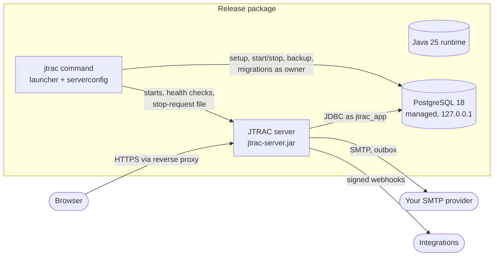

# Architecture

JTRAC is a self-hosted project and issue tracker: a **modular monolith** (Spring Boot 4.1 on
Java 25) serving a **React/TypeScript** single-page application from the same origin, backed
by **PostgreSQL 18**. Detailed module design: `architecture/overview.md`; decisions: `adr/`.

## Building blocks

| Gradle project | Role |
|---|---|
| `backend` | the server: REST API `/api/v1`, static SPA, health probes; modules `identity`, `organization`, `project`, `field`, `workflow`, `issue`, `collaboration`, `attachment`, `notification`, `search`, `reporting`, `planning`, `integration`, `realtime`, `audit`, `mail`, `system`, `shared` (boundaries verified by Spring Modulith) |
| `frontend` (pnpm) | the web UI, built into the server jar (`-PwithFrontend`) |
| `serverconfig` | shared configuration model, validation, secure config files, port checks, SMTP sessions and test email; used by the launcher and the server |
| `launcher` | the `jtrac` command: setup wizard, lifecycle, configure, test-email, backup/restore, update, service integration, uninstall |
| `distribution` | release packages per OS/architecture with allowlisted contents and release scans |

## Runtime configuration

The launcher passes `-Djtrac.config-dir=<data>/config`; the server imports
`jtrac.properties` and `secrets.properties` from there (`configuration-reference.md`).
Outgoing-email settings are also held in memory by the `mail` module and can be replaced at
runtime by server administrators (`system` module), written back to the same files.

## Data flow for email

Business actions write messages to the `email_outbox` table in their own transaction; a
scheduled dispatcher delivers them with retries using the shared SMTP session factory. In
email-pending mode the dispatcher sends nothing and messages wait.

## Process model

`jtrac start` starts the managed PostgreSQL (`pg_ctl`) and the server as a detached process
(`javaw` on Windows, `nohup` elsewhere), records its PID, and waits for
`/actuator/health/readiness`. `jtrac stop` writes a stop-request file that the server watches
(graceful shutdown on every OS), then stops PostgreSQL. `jtrac run` keeps both in the
foreground for service managers.
