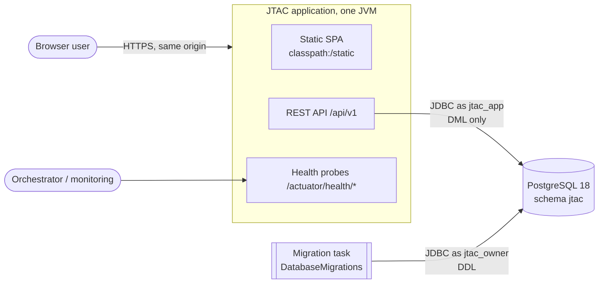

# JTAC architecture overview (M1 foundation)

JTAC is a project-management and issue-tracking platform built as a **modular monolith**
(Spring Boot 4.1 on JDK 25) with a **React/TypeScript SPA** served from the same origin,
backed by **PostgreSQL 18**. Domain concepts are informed by the reverse-engineered
JTrac 2.3.3 (see the project skill `.claude/skills/jtrac`), but no legacy code or schema
is reused.

## System context



In development the SPA runs on Vite (`:5173`) and proxies `/api` and `/actuator` to the
backend (`:8080`), so the browser still sees a single origin.

## Modules

| Module | Status | Responsibility | May depend on |
|---|---|---|---|
| `shared` (OPEN) | **M1** | UUIDv7 ids, RFC 9457 problems, request ids, migration settings, SPA delivery | none |
| `identity` | **M1** | user accounts, password hashing, login/logout/session, HTTP security, login throttling, admin CLI | shared |
| `organization` | M2 | organizations (tenants), memberships, teams, invitations | identity, shared |
| `project` | M3 | projects/spaces, project roles, permission schemes, keys & sequences | organization |
| `workflow` | M3 | versioned workflows, statuses (with categories), role-based transitions, field rules (hidden/read-only/optional/mandatory) | project, field |
| `field` | M3 | custom-field definitions and options | project |
| `issue` | M4 | issues, types, links, labels, ranking, optimistic locking | project, workflow, field |
| `collaboration` | M4/M6 | comments, mentions, watchers, activity history | issue |
| `attachment` | M4 | storage abstraction, upload validation, authorized download | issue |
| `search` | M4/M5 | structured queries, saved views, permission & field-mask filtering | issue, field |
| `notification` | M6 | in-app inbox, email, real-time (SSE) | events |
| `reporting` | M8 | dashboards and aggregates | search |
| `integration` | M9 | API tokens, webhooks, import/export | events, issue |
| `admin`, `audit` | M2+/M7 | settings, audit events | read-only on others |
| `mcp` | 3.x | AI agent connections: MCP endpoint, OAuth 2.1 server, agent tools (ADR 0010, docs/ai-agents.md) | public APIs of issue, collaboration, attachment, project, workflow, field, search, notification, planning, organization, identity, audit |

Dependency rule: no cycles; only public module APIs; verified by `ModularityTests`.

## Request flow (API)

```
RequestIdFilter (X-Request-Id, MDC)
  → Spring Security filter chain (session, CSRF, authorization, logout)
    → controller (module-internal) → module service (rules, authorization, transactions)
      → repository (JPA/Hibernate 7) → PostgreSQL as jtac_app
errors → GlobalProblemHandler → application/problem+json
```

## Security model (M1)

- Same-origin session cookie `JTAC_SESSION` (HttpOnly, SameSite=Lax, Secure in HTTPS
  deployments); CSRF via `XSRF-TOKEN` cookie + `X-XSRF-TOKEN` header: ADR 0005.
- `/api/**` requires authentication except `GET /api/v1/auth/csrf` and
  `POST /api/v1/auth/login`. Only health probes are exposed from actuator.
- Least-privilege database access with separate migration credentials: ADR 0004.
- CSP without inline script/style; fonts and scripts self-hosted.
- From M2: tenant isolation (organization id on every tenant-owned row, composite
  foreign keys, PostgreSQL row-level security as defence in depth) and a central
  authorization policy per module.

## Data (M1)

`jtac.user_account` (UUIDv7 id, email + generated `email_normalized` unique, display
name, password hash, status, timestamps, version) and `jtac.flyway_schema_history`
(read-only for the application). Migrations: `backend/src/main/resources/db/migration`.

## Observability

- Structured JSON logs (ECS) on stdout, including `requestId`; override with
  `JTAC_LOG_FORMAT` (`ecs`, `logstash`, `gelf`).
- `GET /actuator/health/liveness`, `GET /actuator/health/readiness` (includes the
  database). Details are never exposed.
- Planned: Micrometer metrics and OpenTelemetry tracing export (M10 hardening).

## Testing

| Layer | Where | Runs in |
|---|---|---|
| Unit + module boundaries | `backend/src/test` (no `db` tag) | `./gradlew test` |
| API/security/database integration (jtac_test) | `@DatabaseIntegrationTest` (tag `db`) | `./gradlew integrationTest` (after `migrateTestDb`) |
| Contract | `OpenApiContractTests` | `integrationTest` |
| Frontend unit/component | `frontend/src/**/*.test.ts(x)` | `pnpm test` |
| End-to-end + accessibility | `frontend/e2e` (Playwright, Edge) | `pnpm e2e` against a running jar |
